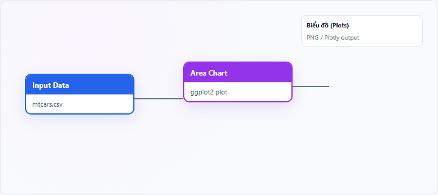
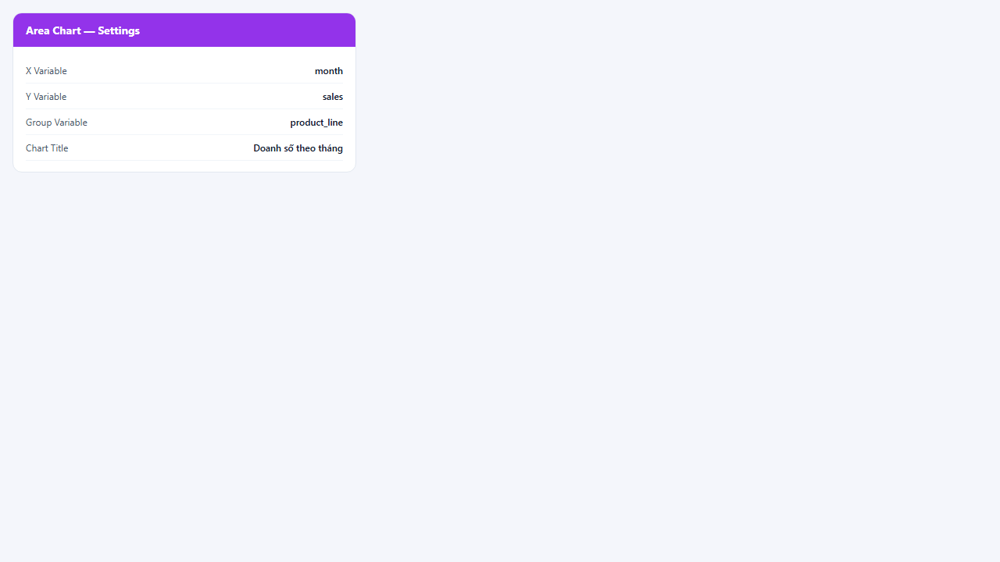
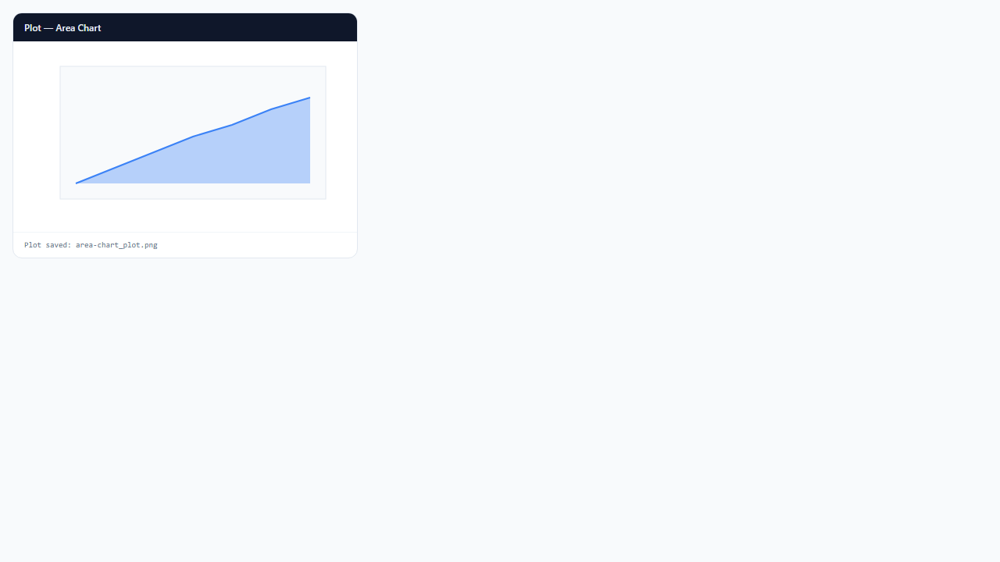

## 1. Biểu đồ vùng (Area Chart) là gì?

**Area chart** (biểu đồ vùng) vẽ đường như line chart nhưng **tô màu vùng** bên dưới (hoặc giữa) đường để nhấn mạnh **mức độ** hoặc **tích lũy trực quan** theo trục X có thứ tự. Nhiều nhóm có thể tạo các lớp vùng chồng hoặc xếp chồng (stacked) tùy aesthetic ggplot2.

Node **Area Chart** trên StatNode dùng **ggplot2** `geom_area`.

## 2. Biểu đồ vùng (Area Chart) dùng để làm gì?

Area chart trả lời:

- **Xu hướng** và **biên độ** thay đổi theo thời gian?
- **Tổng tích lũy** hoặc mức tồn tại theo chuỗi thời gian (khi stacked)?
- Sự **khác biệt trực quan** giữa các series (màu/vùng)?

**Khi nên dùng:** chuỗi thời gian, trục X có thứ tự; nhấn mạnh “khối lượng” dưới đường.

**Khi không nên dùng:** category không thứ tự; nhiều series chồng khó đọc (dùng line chart faceted).

**So sánh:** area ≈ line + fill; **line chart** sạch hơn khi có >3 series chồng.

## 3. Thực hành trên phần mềm StatNode

Workflow cơ bản: kéo node **Input Data** (hoặc nguồn dữ liệu khác) → nối cổng **Data** vào node **Area Chart** → chạy workflow → xem biểu đồ tại panel **Biểu đồ** (Plots).

**Dữ liệu minh họa:** Chuỗi thời gian: `month`, `sales`; tùy chọn `product_line` làm nhóm.

**Cấu hình node:**

- **X Variable**: `month`
- **Y Variable**: `sales`
- **Group Variable (optional)**: `product_line`
- **Chart Title**: `Doanh số theo tháng`

**Kết quả:**

## 4. Diễn giải kết quả

- **Vùng mở rộng:** giá trị Y tăng — đọc độ dốc cạnh trên vùng.
- **Vùng thu hẹp:** suy giảm — kiểm tra cấu trúc (break, mùa vụ).
- **Nhiều vùng màu:** so legend để gán nhóm; chú ý chồng lấn che khuất series nhỏ.
- **Stacked area (nếu dùng):** chiều cao tổng = tổng các thành phần — đọc cả tổng và cơ cấu.

**Sai lầm:** dùng area cho dữ liệu cắt ngang (cross-section); quá nhiều lớp màu không phân biệt được.

## 5. Tài liệu tham khảo

1. Wilke, C. O. (2019). *Fundamentals of Data Visualization*. https://clauswilke.com/dataviz/
2. Wickham, H. (2016). *ggplot2* (2nd ed.). Springer.
3. Cleveland, W. S. (1993). *Visualizing Data*. Hobart Press.
4. R Documentation — `geom_area()`: https://ggplot2.tidyverse.org/reference/geom_area.html

---

Ghi chú: Khi có nhiều nhóm, thử line chart hoặc facet_wrap nếu area chart trở nên khó đọc.