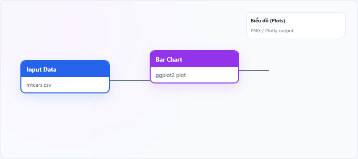
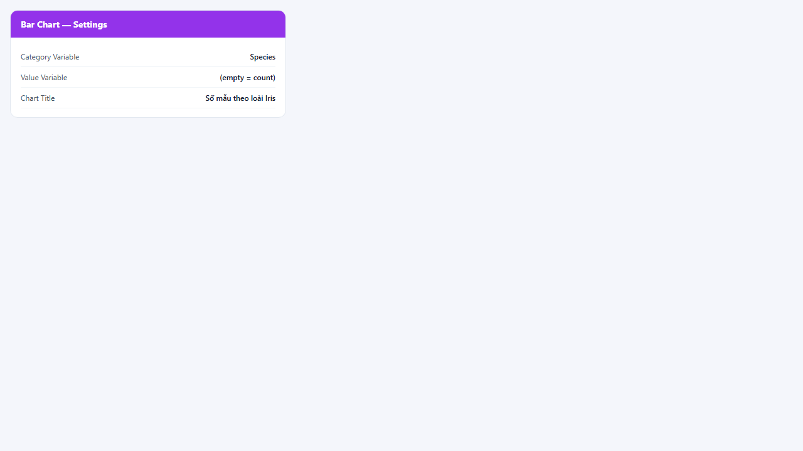
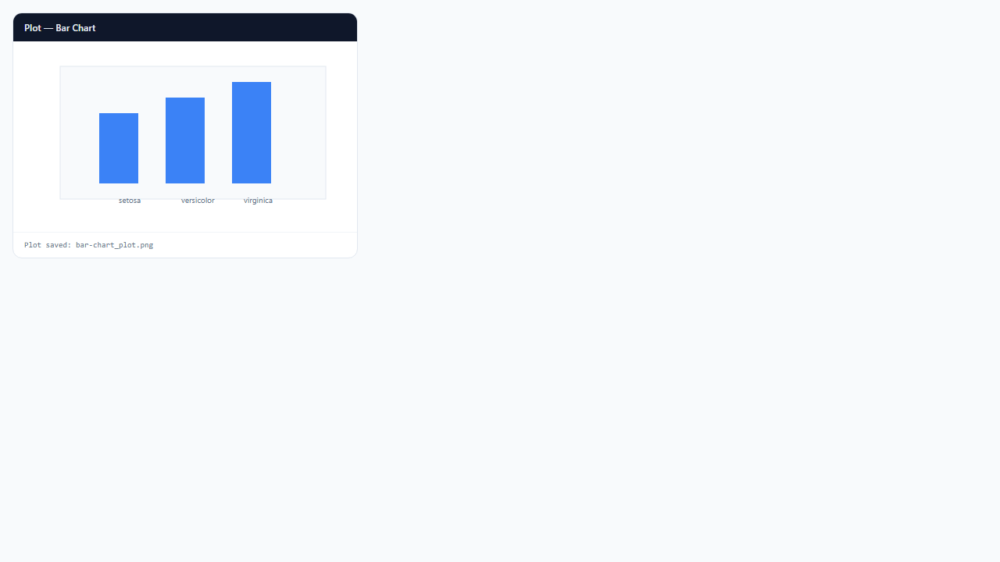

## 1. Biểu đồ cột (Bar Chart) là gì?

**Bar chart** (biểu đồ cột) dùng **cột thẳng đứng hoặc ngang** để so sánh **tần suất** hoặc **giá trị** giữa các **nhóm phân loại** trên trục X (hoặc Y nếu horizontal). Mỗi cột đại diện một category; chiều cao phản ánh count hoặc tổng/giá trị trung bình tùy cấu hình.

Node **Bar Chart** trên StatNode: nếu **Value Variable** để trống, ggplot2 đếm số dòng (`stat = "count"`); nếu có giá trị, vẽ theo biến số đó.

## 2. Biểu đồ cột (Bar Chart) dùng để làm gì?

Bar chart trả lời:

- Nhóm nào **chiếm ưu thế** về tần suất hoặc quy mô?
- Chênh lệch giữa các category có **lớn** không?
- Có nhóm **hiếm** cần gộp hoặc loại không?

**Khi nên dùng:** biến phân loại (nominal/ordinal); so sánh chính xác giữa các cột tương đương.

**Khi không nên dùng:** thể hiện tỷ trọng phần/trăm tổng với ít nhóm (có thể dùng pie/donut); chuỗi thời gian dài (dùng line chart).

**So sánh:** bar chart so **độ cao** tốt hơn pie chart khi có nhiều nhóm hoặc cần so sánh sát nhau.

## 3. Thực hành trên phần mềm StatNode

Workflow cơ bản: kéo node **Input Data** (hoặc nguồn dữ liệu khác) → nối cổng **Data** vào node **Bar Chart** → chạy workflow → xem biểu đồ tại panel **Biểu đồ** (Plots).

**Dữ liệu minh họa:** `iris`: biến phân loại `Species` (setosa, versicolor, virginica).

**Cấu hình node:**

- **Category Variable**: `Species`
- **Value Variable**: để trống (đếm số quan sát mỗi loài) hoặc chọn biến số để vẽ tổng/trung bình
- **Chart Title**: `Số mẫu theo loài Iris`

**Kết quả:**

## 4. Diễn giải kết quả

- **Cột cao nhất:** nhóm chiếm ưu thế — kiểm tra cân bằng mẫu nếu dùng cho mô hình phân loại.
- **Chênh lệch lớn:** imbalance có thể ảnh hưởng ước lượng — cân nhắc weighting hoặc stratified sampling.
- **Count mode (Value trống):** biểu đồ mô tả **tần suất**, không phải magnitude kinh tế.
- **Nhiều cột nhỏ bằng nhau:** có thể cần gộp category `Other`.

**Sai lầm:** dùng bar chart cho biến liên tục không bin; sắp xếp ngẫu nhiên category làm khó đọc — nên sắp theo giá trị giảm dần khi trình bày.

## 5. Tài liệu tham khảo

1. Wilke, C. O. (2019). *Fundamentals of Data Visualization*. https://clauswilke.com/dataviz/
2. Wickham, H. (2016). *ggplot2* (2nd ed.). Springer.
3. Tufte, E. R. (2001). *The Visual Display of Quantitative Information* (2nd ed.). Graphics Press.
4. R Documentation — `geom_bar()`: https://ggplot2.tidyverse.org/reference/geom_bar.html

---

Ghi chú: Với dữ liệu lớn, cân nhắc sắp xếp category theo giá trị để tăng khả năng đọc — StatNode vẽ theo thứ tự factor trong dữ liệu.