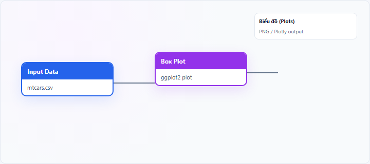
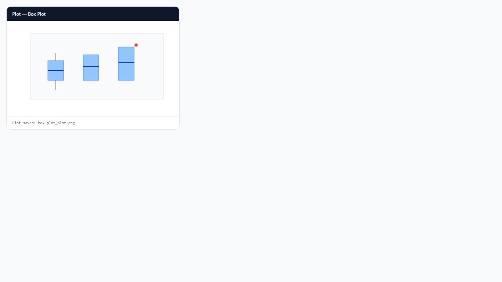

## 1. Biểu đồ hộp (Box Plot) là gì?

**Box plot** (biểu đồ hộp, box-and-whisker) tóm tắt phân phối một biến số bằng **hộp** (tứ phân vị Q1–Q3), **đường trung vị**, **râu** (whiskers) và **điểm outlier** ngoài râu. Có thể vẽ nhiều hộp song song theo biến nhóm (`x_var`).

Node **Box Plot** trên StatNode dùng **ggplot2** `geom_boxplot`; outlier thường được tô đỏ.

## 2. Biểu đồ hộp (Box Plot) dùng để làm gì?

Box plot trả lời:

- **Trung vị** và **IQR** của biến số?
- Có **outlier** không?
- **Khác biệt** giữa các nhóm (location, spread)?

**Khi nên dùng:** so sánh phân phối giữa 2+ nhóm; EDA trước mô hình; báo cáo robust (dùng median thay mean).

**Khi không nên dùng:** cần thấy hình dạng chi tiết/đa đỉnh trong nhóm (dùng violin hoặc histogram faceted).

**So sánh:** box plot = tóm tắt 5 số; **violin plot** thêm đường mật độ; **histogram** chi tiết hơn nhưng khó so nhiều nhóm.

## 3. Thực hành trên phần mềm StatNode

Workflow cơ bản: kéo node **Input Data** (hoặc nguồn dữ liệu khác) → nối cổng **Data** vào node **Box Plot** → chạy workflow → xem biểu đồ tại panel **Biểu đồ** (Plots).

**Dữ liệu minh họa:** `mtcars`: `mpg` theo nhóm `cyl` (4, 6, 8 xi-lanh).

**Cấu hình node:**

- **Numeric Variable**: `mpg`
- **Group Variable (optional)**: `cyl`
- **Chart Title**: `MPG theo số xi-lanh`

**Kết quả:**

## 4. Diễn giải kết quả

- **Vạch trong hộp:** trung vị — so sánh giữa nhóm bằng vị trí hộp.
- **Chiều cao hộp:** IQR — hộp cao = phân tán lớn hơn trong 50% giữa.
- **Râu dài:** đuôi phân phối; điểm đỏ ngoài râu = outlier tiềm năng.
- **Hộp lệch (median gần Q1/Q3):** skew trong nhóm.
- **Không thấy đa đỉnh:** cần violin/density bổ sung.

**Sai lầm:** coi outlier ggplot là lỗi chắc chắn; so sánh nhóm có cỡ mẫu rất chênh (box vẫn vẽ nhưng ý nghĩa hạn chế).

## 5. Tài liệu tham khảo

1. McGill, R., Tukey, J. W., & Larsen, W. A. (1978). Variations of box plots. *The American Statistician*, 32(1), 12–16.
2. Wickham, H., & Stryhn, H. (2020). Will the real box plot please stand up? https://vita.had.co.nz/papers/boxplots.pdf
3. Wickham, H. (2016). *ggplot2* (2nd ed.). Springer.
4. R Documentation — `geom_boxplot()`: https://ggplot2.tidyverse.org/reference/geom_boxplot.html

---

Ghi chú: ggplot2 box plot dùng quy tắc whisker 1.5×IQR; outlier định nghĩa theo ggplot, có thể khác phần mềm khác.