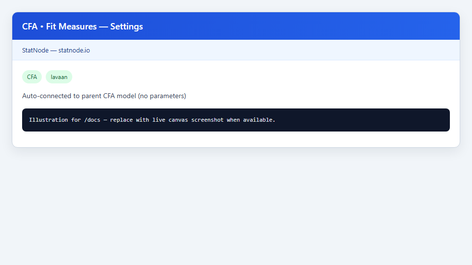
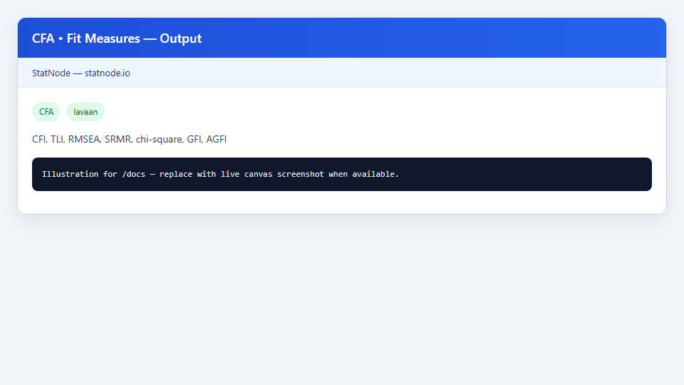

## 1. Sub-node này dùng để làm gì?

Sub-node **CFA • Fit Measures** trích xuất và trình bày **chỉ số phù hợp toàn cục** (global fit indices) từ mô hình CFA đã ước lượng bởi node cha, trả lời câu hỏi: *mô hình đo lường giả định có tái tạo hợp lý ma trận hiệp phương sai quan sát hay không?*

Khác với kiểm định ý nghĩa từng hệ số tải, fit measures đánh giá **mô hình tổng thể** — mức độ sai khác giữa ma trận mẫu $mathbf{S}$ và ma trận mô hình $oldsymbol{Sigma}(hat{oldsymbol{	heta}})$. Sub-node gọi `fitMeasures()` của `lavaan` và in các chỉ số phổ biến trong báo cáo SEM:

- **Chi-square** ($chi^2$), bậc tự do (df), p-value
- **CFI** (Comparative Fit Index), **TLI** (Tucker–Lewis Index)
- **RMSEA** (Root Mean Square Error of Approximation) kèm khoảng tin cậy 90%
- **SRMR** (Standardized Root Mean Square Residual)
- **GFI**, **AGFI**, **NFI**, **IFI**

Sub-node không có tham số cấu hình — tự động kết nối với fit object từ node CFA cha. Đây là bước đọc fit chuẩn sau mỗi lần ước lượng, trước khi đánh giá độ tin cậy hoặc xem xét sửa mô hình.


## 2. Nền tảng lý thuyết

### 2.1. Kiểm định Chi-square

Giả thuyết $H_0$: mô hình khớp hoàn hảo với tổng thể ($oldsymbol{Sigma} = oldsymbol{Sigma}(oldsymbol{	heta})$). Thống kê:

$$
T = (n - 1) cdot F_{ML}(hat{oldsymbol{	heta}}),
$$

với $F_{ML}$ là hàm discrepancy maximum likelihood. Dưới $H_0$ và giả định phân phối chuẩn đa biến, $T$ tiệm cận phân phối $chi^2$ với df = số phần tử riêng biệt trong $mathbf{S}$ trừ số tham số ước lượng tự do.

**Hạn chế:** với mẫu lớn, $chi^2$ gần như luôn significant dù sai lệch thực tế nhỏ (Bollen, 1989; được nhắc trong Kline, 2016). Do đó cần chỉ số bổ sung.

### 2.2. RMSEA

RMSEA ước lượng sai số xấp xỉ bình phương trung bình mỗi bậc tự do:

$$
	ext{RMSEA} = sqrt{maxleft(0, ; rac{T - df}{df cdot (n - 1)}
ight)}.
$$

Giá trị càng thấp càng tốt. Hu & Bentler (1999) đề xuất RMSEA ≤ 0,06 (tốt), ≤ 0,08 (chấp nhận được). Khoảng tin cậy 90% giúp đánh giá độ không chắc chắn — nếu CI trên vượt 0,08, fit có thể kém.

### 2.3. CFI và TLI

CFI so sánh mô hình đặt ra với mô hình độc lập (baseline null):

$$
	ext{CFI} = 1 - rac{max(T - df, 0)}{max(T_0 - df_0, 0)},
$$

với $T_0$, $df_0$ từ mô hình null. TLI (NNFI) điều chỉnh theo df:

$$
	ext{TLI} = rac{T_0/df_0 - T/df}{T_0/df_0 - 1}.
$$

Ngưỡng Hu & Bentler (1999): CFI/TLI ≥ 0,95 (tốt), ≥ 0,90 (chấp nhận được). Hair et al. (2021) dùng tương tự trong bối cảnh PLS-SEM và CFA.

### 2.4. SRMR

SRMR là trung bình trị tuyệt đối của phần tử trong ma trận residual chuẩn hóa:

$$
	ext{SRMR} = sqrt{rac{1}{p(p+1)/2} sum_{i leq j} left( s_{ij} - hat{sigma}_{ij} 
ight)^2 / sqrt{s_{ii} s_{jj}} }.
$$

Ngưỡng: SRMR ≤ 0,08 (Hu & Bentler, 1999). SRMR nhạy với sai lệch cục bộ — bổ sung cho RMSEA mang tính tổng hợp.

### 2.5. GFI, AGFI, NFI, IFI

Các chỉ số thế hệ đầu (Jöreskog & Sörbom, 1993): **GFI** (Goodness of Fit Index) đo tỷ lệ phương sai được giải thích; **AGFI** điều chỉnh theo df; **NFI** (Normed Fit Index) và **IFI** (Incremental Fit Index) so sánh với mô hình null. Byrne (2016) vẫn khuyến nghị báo cáo CFI/TLI/RMSEA/SRMR là chính; GFI/AGFI tham khảo thêm.

### 2.6. Quy tắc kết hợp “2-of-3”

Hu & Bentler (1999) đề xuất kết hợp: CFI ≥ 0,95 (hoặc 0,96), RMSEA ≤ 0,06 (hoặc 0,07), SRMR ≤ 0,08 (hoặc 0,09). Không có chỉ số đơn lẻ là đủ; đọc đa chiều là bắt buộc (Brown, 2015).


## 3. Điều kiện sử dụng

1. **Phải có node cha CFA đã chạy thành công** và cổng Model được kết nối đúng.
2. **Mô hình ước lượng hội tụ** — nếu lavaan báo lỗi convergence, fit measures không đáng tin.
3. **Giải thích theo ước lượng đã chọn:** CFI/TLI/RMSEA dưới ML có thể khác WLSMV; không so sánh trực tiếp giữa hai ước lượng trên cùng mô hình mà không chuẩn hóa phương pháp.
4. **Cỡ mẫu ảnh hưởng $chi^2$:** với Holzinger–Swineford ($n = 301$), p-value chi-square có thể significant dù CFI chấp nhận được — không kết luận chỉ từ p-value.
5. **Mô hình phức tạp:** nhiều nhân tố và chỉ báo làm df lớn, RMSEA có thể thấp giả tạo — xem thêm SRMR và residual diagnostics.
6. **Không thay thế kiểm tra cục bộ:** fit toàn cục tốt không loại trừ sai lệch tại cặp biến cụ thể (dùng sub-node Residuals).
7. **Báo cáo đầy đủ:** Jackson et al. (2009) khuyến nghị luôn nêu ít nhất một chỉ số tuyệt đối (RMSEA/SRMR) và một chỉ số tăng trưởng (CFI/TLI), kèm chi-square và df.


## 4. Quy trình thực hiện (Workflow)

1. Hoàn thành ước lượng CFA trên node cha (ví dụ mô hình Holzinger–Swineford ba nhân tố).
2. Kéo sub-node **CFA • Fit Measures** vào canvas; nối output Model của CFA vào input Model.
3. Không cần chỉnh Settings — sub-node tự đọc fit object.
4. Chạy sub-node; đọc bảng fit measures và gợi ý diễn giải Hu & Bentler in kèm output.
5. Đối chiếu CFI, TLI với ngưỡng 0,90/0,95; RMSEA với 0,06/0,08; SRMR với 0,08.
6. Nếu fit chưa đạt: chuyển sang sub-node Modification Indices hoặc Residuals — **không** lặp lại fit measures nhiều lần mà không sửa mô hình.
7. Ghi nhận fit measures cuối cùng sau khi mô hình đã ổn định (lý thuyết + fit) vào báo cáo.
8. So sánh fit trước/sau khi thêm tải chéo hoặc điều chỉnh có lý thuyết — MacCallum et al. (1992) cảnh báo overfitting khi sửa mô hình chỉ dựa trên chỉ số.


## 5. Thực hành trên phần mềm StatNode

Sub-node Fit Measures kết nối trực tiếp với node CFA đã fit trên Holzinger–Swineford.





**Các bước cụ thể:**

1. Sau khi node CFA chạy thành công với mô hình Visual–Textual–Speed, kéo **CFA • Fit Measures** từ palette post-estimation.
2. Nối dây từ cổng **Model** (CFA) → **Model** (Fit Measures).
3. Chạy sub-node. Panel Settings trống (auto-connected) — không cần tham số.
4. Đọc output bảng các chỉ số làm tròn 4 chữ số thập phân.

Lệnh R tương đương:

```r
library(lavaan)
indices <- c("chisq", "df", "pvalue", "cfi", "tli",
             "rmsea", "rmsea.ci.lower", "rmsea.ci.upper",
             "srmr", "gfi", "agfi", "nfi", "ifi")
fitMeasures(fit, indices)
```

Ví dụ output mẫu:

```r
--- CFA Global Fit Measures ---
         chisq             df         pvalue            cfi            tli
       85.3060        24.0000         0.0000         0.9310         0.8960
          rmsea rmsea.ci.lower rmsea.ci.upper           srmr            gfi
        0.0920         0.0710         0.1140         0.0650         0.9230
           agfi            nfi            ifi
        0.8850         0.9020         0.9320

Interpretation hints (Hu & Bentler 1999):
  CFI/TLI >= 0.95 (acceptable >= 0.90)
  RMSEA <= 0.06 (acceptable <= 0.08)
  SRMR <= 0.08
```

Với ví dụ trên: CFI = 0,931 và TLI = 0,896 nằm trong vùng “chấp nhận được” (≥ 0,90) nhưng chưa đạt “tốt” (≥ 0,95); RMSEA = 0,092 vượt ngưỡng 0,08 — gợi ý xem xét residual diagnostics hoặc điều chỉnh có lý thuyết; SRMR = 0,065 ≤ 0,08 — phù hợp.


## 6. Diễn giải kết quả

1. **Chi-square và p-value:** Báo cáo $T$, df, và p-value. Giải thích rằng p < 0,05 **không** tự động loại mô hình khi $n$ lớn — chuyển sang chỉ số tương đối.

2. **CFI và TLI đọc cùng nhau:** Nếu CFI đạt mà TLI thấp hơn nhiều, có thể do penalty df — mô hình phức tạp so với mẫu. Holzinger–Swineford thường cho CFI ~ 0,93–0,97 tùy đặc tả.

3. **RMSEA kèm CI:** RMSEA = 0,092 với CI [0,071; 0,114] — điểm ước lượng và cận trên đều trên 0,08 → fit xấp xỉ vừa phải. CI không chứa 0 cho thấy mô hình không khớp hoàn hảo (expected).

4. **SRMR thấp + RMSEA cao:** Pattern này gợi ý sai lệch tập trung ở vài quan hệ cụ thể hơn là lỗi rải rác — kiểm tra ma trận residual.

5. **GFI/AGFI:** GFI > 0,90 thường được coi là chấp nhận được trong literature cũ; AGFI penalize mô hình phức tạp — dùng bổ trợ, không thay CFI.

6. **So sánh mô hình lồng nhau:** Fit measures đơn lẻ không test nested models; cần chi-square difference test hoặc AIC/BIC từ lavaan khi so sánh mô hình lồng nhau (Brown, 2015).

7. **Báo cáo:** Trích dẫn ngưỡng đã dùng (ví dụ Hu & Bentler, 1999) và liệt kê đủ chi-square, df, CFI, TLI, RMSEA (90% CI), SRMR — theo khuyến nghị Jackson et al. (2009).


## 7. Tài liệu tham khảo

1. Hu, L., & Bentler, P. M. (1999). Cutoff Criteria for Fit Indexes in Covariance Structure Analysis. *Structural Equation Modeling*, 6(1), 1–55.
2. Brown, T. A. (2015). *Confirmatory Factor Analysis for Applied Research* (2nd ed.). Guilford Press.
3. Byrne, B. M. (2016). *Structural Equation Modeling With AMOS: Basic Concepts, Applications, and Programming* (3rd ed.). Routledge.
4. Kline, R. B. (2016). *Principles and Practice of Structural Equation Modeling* (4th ed.). Guilford Press.
5. Hair, J. F., Hult, G. T. M., Ringle, C. M., & Sarstedt, M. (2021). *A Primer on Partial Least Squares Structural Equation Modeling (PLS-SEM)* (3rd ed.). Sage.
6. Rosseel, Y. (2012). lavaan: An R Package for Structural Equation Modeling. *Journal of Statistical Software*, 48(2), 1–36.
7. Jöreskog, K. G., & Sörbom, D. (1993). *LISREL 8: Structural Equation Modeling with the SIMPLIS Command Language*. Scientific Software International.
8. MacCallum, R. C., Roznowski, M., & Necowitz, L. B. (1992). Model Modifications in Covariance Structure Analysis. *Psychological Bulletin*, 111(3), 490–504.
9. Jackson, D. L., Gillaspy, J. A., & Purc-Stephenson, R. (2009). Reporting Practices in Confirmatory Factor Analysis. *Organizational Research Methods*, 12(1), 3–43.
10. Fornell, C., & Larcker, D. F. (1981). Evaluating Structural Equation Models with Unobservable Variables and Measurement Error. *Journal of Marketing Research*, 18(1), 39–50.
11. Raykov, T. (2001). Bias of Coefficient Alpha and Fixed Consequences of Addressing Its Bias in Structural Equation Models. *Structural Equation Modeling*, 8(1), 144–161.

---

Ghi chú: Ngưỡng fit là hướng dẫn kinh nghiệm, không phải quy tắc cứng; luôn kết hợp lý thuyết, cỡ mẫu và chẩn đoán cục bộ.
