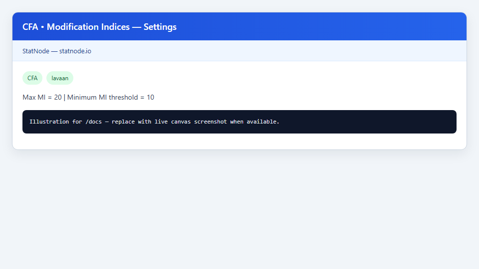
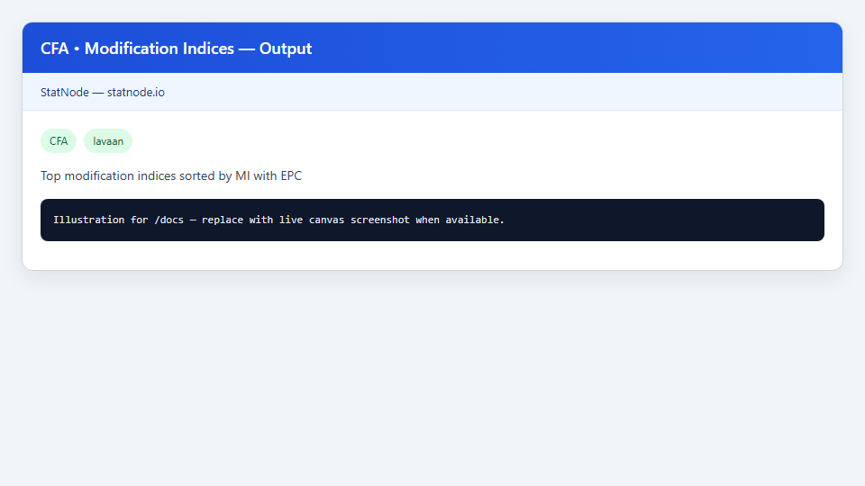

## 1. Sub-node này dùng để làm gì?

Sub-node **CFA • Modification Indices** (MI) liệt kê các **ràng buộc bị cố định** trong mô hình CFA mà, nếu được **nới lỏng** (free), có thể cải thiện fit đáng kể — kèm **Expected Parameter Change** (EPC). Sub-node trả lời: *mô hình đo lường hiện tại còn thiếu sót cấu trúc nào có thể sửa?*

Output sắp xếp theo MI giảm dần, lọc theo ngưỡng tối thiểu (mặc định MI ≥ 10) và giới hạn số dòng (mặc định 20). Mỗi dòng gợi ý loại tham số (ví dụ tải chéo $x_i leftarrow eta_j$, covariance giữa sai số $x_i sim x_j$) cùng MI và EPC.

**Cảnh báo quan trọng:** MI là công cụ **chẩn đoán**, không phải công cụ **khám phá**. MacCallum et al. (1992) và Brown (2015) nhấn mạnh: chỉ sửa mô hình khi có cơ sở lý thuyết mạnh — tránh data-driven respecification làm inflate fit và giảm tính khái quát hóa.


## 2. Nền tảng lý thuyết

### 2.1. Modification Index là gì?

Với ràng buộc $	heta_i = c$ (thường $c = 0$) chưa ước lượng, MI ước lượng mức giảm kỳ vọng của thống kê $chi^2$ nếu ràng buộc được bỏ:

$$
	ext{MI} approx rac{1}{2} cdot rac{(partial F / partial 	heta_i)^2}{partial^2 F / partial 	heta_i^2},
$$

với $F$ hàm discrepancy (Sörbom, 1989; triển khai trong `modindices()` của lavaan). Dưới giả định phân phối chuẩn, MI ≈ 3,84 tương ứng cải thiện $chi^2$ significant ở mức $alpha = 0,05$ với 1 df.

### 2.2. Expected Parameter Change (EPC)

EPC ước lượng **dấu và độ lớn** tham số nếu được ước lượng tự do. Kết hợp MI cao + EPC có ý nghĩa lý thuyết mới đáng xem xét — MI cao nhưng EPC gần 0 có thể do collinearity.

### 2.3. Các loại sửa mô hình phổ biến

| Loại MI | Ý nghĩa | Ví dụ Holzinger–Swineford |
|---------|---------|---------------------------|
| Cross-loading | Chỉ báo tải thêm nhân tố khác | `x9 =~ speed + visual` |
| Residual covariance | Sai số đo lường còn tương quan | `x1 ~~ x2` |
| Correlation nhân tố | Thiếu tương quan tiềm ẩn | Hiếm khi cần thêm nếu đã free hết |

Trên dataset cổ điển, MI thường gợi ý `x9` tải yếu trên Speed và có thể cross-load Visual, hoặc covariance giữa `x1`–`x2` — cần đối chiếu literature tâm lý học (Brown, 2015).

### 2.4. Vấn đề sửa mô hình lặp (post hoc)

MacCallum et al. (1992) mô phỏng cho thấy sửa mô hình dựa trên MI trên cùng mẫu có thể đạt fit xuất sắc **ngay cả khi mô hình sai về mặt tổng thể**. Khuyến nghị:

- Sửa **ít** tham số nhất có thể
- Mỗi sửa phải có **lý thuyết**
- Xác nhận trên **mẫu độc lập** (cross-validation)

### 2.5. Ngưỡng MI

StatNode mặc định **Minimum MI Threshold = 10** (mạnh hơn 3,84) và **Maximum Number of MIs = 20** để tránh danh sách quá dài. Byrne (2016) gợi ý MI > 10–11 cho mô hình vừa; Kline (2016) khuyên thận trọng hơn với mẫu lớn.

### 2.6. Quan hệ với Wald test

Wald test kiểm tra ràng buộc **đã ước lượng** (ví dụ hệ số tải = 0); MI liên quan ràng buộc **chưa ước lượng**. Hai công cụ bổ sung nhau trong chẩn đoán (Rosseel, 2012).


## 3. Điều kiện sử dụng

1. **CFA cha đã fit** — MI tính tại điểm ước lượng ML hiện tại.
2. **Mô hình hội tụ** — MI không đáng tin nếu có cảnh báo convergence.
3. **Không lạm dụng trên mẫu nhỏ** — MI không ổn định khi $n < 200$ (MacCallum et al., 1992).
4. **Đọc MI sau fit toàn cục kém** — nếu CFI/RMSEA đã đạt, MI cao có thể là nhiễu.
5. **Một lần sửa một tham số** — sửa nhiều MI cùng lúc làm MI mới không còn hợp lệ (phải re-fit).
6. **Cross-loading cần lý thuyết mạnh** — Jackson et al. (2009) khuyến nghị báo cáo minh bạch mọi cross-loading post hoc.
7. **Không thay thế EFA** — nếu nhiều MI gợi ý cấu trúc khác hoàn toàn, quay lại khái niệm hóa hoặc EFA.


## 4. Quy trình thực hiện (Workflow)

1. Fit CFA Holzinger–Swineford ban đầu (chỉ tải đơn); xem Fit Measures.
2. Nếu fit chưa đạt ngưỡng, kéo **CFA • Modification Indices**; nối Model.
3. Đặt **Maximum Number of MIs** = 20; **Minimum MI Threshold** = 10 (hoặc 3,84 nếu muốn liệt kê rộng hơn).
4. Chạy sub-node; đọc top MI kèm EPC.
5. Đối chiếu với **Residual Diagnostics** — cặp biến residual cao thường trùng MI covariance.
6. Chọn **tối đa một** sửa có lý thuyết; cập nhật mô hình trên node CFA (visual builder hoặc syntax).
7. Re-fit CFA; xem lại Fit Measures và MI mới.
8. Lặp tối đa 2–3 vòng; ghi nhận mọi thay đổi post hoc trong báo cáo (Brown, 2015).
9. Nếu có thể, validate trên split-sample hoặc bootstrap.


## 5. Thực hành trên phần mềm StatNode

Sub-node Modification Indices với tham số lọc MI trên mô hình Holzinger–Swineford.





**Các bước cụ thể:**

1. Kết nối Model từ node CFA đã fit.
2. Trong Settings:
   - **Maximum Number of MIs:** `20`
   - **Minimum MI Threshold:** `10`
3. Chạy sub-node.

Lệnh R tương đương:

```r
library(lavaan)
mi <- modindices(fit, sort. = TRUE, maximum.number = 20, minimum.value = 10)
print(mi)
```

Ví dụ output mẫu:

```r
--- Modification Indices (MI >= 10) ---
     lhs op rhs     mi    epc sepc.lv sepc.all sepc.nox
1     x9 =~ visual  34.21  0.312   0.312    0.312    0.312
2     x2 ~~     x1  28.45  0.156   0.156    0.156    0.156
3     x7 ~~     x8  18.92 -0.098  -0.098   -0.098   -0.098
4     x3 =~ textual  15.67  0.189   0.189    0.189    0.189
5     x6 =~   speed  12.34 -0.145  -0.145   -0.145   -0.145

Use MI/EPC cautiously — respecify only with strong theory (MacCallum et al. 1992).
```

Dòng 1 gợi ý `x9` có thể tải thêm Visual (MI = 34,21) — phù hợp với literature Holzinger–Swineford (một số đặc tả cho phép cross-load). Dòng 2 gợi ý covariance sai số `x1 ~~ x2` — cần lý thuyết về nhiễu đo lường chung cho hai bài visual. **Không** tự động thêm tất cả MI > 10.


## 6. Diễn giải kết quả

1. **Ưu tiên MI lớn nhất có lý thuyết** — MI = 34 không bắt buộc sửa nếu không có cơ sở lý thuyết về `x9` và Visual.

2. **Đọc cột op:** `=~` là cross-loading; `~~` là covariance (nhân tố hoặc sai số); `~1` hiếm trong output MI thông thường.

3. **EPC cùng dấu với kỳ vọng lý thuyết** — cross-load dương nghĩa chỉ báo tăng cùng nhân tố.

4. **Sau khi sửa, MI cũ biến mất** — re-fit và chạy lại sub-node; MI mới phản ánh mô hình cập nhật.

5. **Fit cải thiện không chứng minh mô hình đúng** — CFI tăng từ 0,93 lên 0,97 sau thêm `x9 =~ visual` vẫn cần giải thích lý thuyết và có thể cần mẫu xác nhận.

6. **Báo cáo minh bạch:** Liệt kê MI đã xem xét, tham số đã thêm/bỏ, và lý do (MacCallum et al., 1992; Jackson et al., 2009).

7. **So sánh với residuals:** Nếu MI gợi ý `x2 ~~ x1` và residual `x1`–`x2` cao, hai nguồn evidence củng cố — vẫn cần lý thuyết.


## 7. Tài liệu tham khảo

1. MacCallum, R. C., Roznowski, M., & Necowitz, L. B. (1992). Model Modifications in Covariance Structure Analysis. *Psychological Bulletin*, 111(3), 490–504.
2. Brown, T. A. (2015). *Confirmatory Factor Analysis for Applied Research* (2nd ed.). Guilford Press.
3. Byrne, B. M. (2016). *Structural Equation Modeling With AMOS: Basic Concepts, Applications, and Programming* (3rd ed.). Routledge.
4. Kline, R. B. (2016). *Principles and Practice of Structural Equation Modeling* (4th ed.). Guilford Press.
5. Rosseel, Y. (2012). lavaan: An R Package for Structural Equation Modeling. *Journal of Statistical Software*, 48(2), 1–36.
6. Jöreskog, K. G., & Sörbom, D. (1993). *LISREL 8: Structural Equation Modeling with the SIMPLIS Command Language*. Scientific Software International.
7. Jackson, D. L., Gillaspy, J. A., & Purc-Stephenson, R. (2009). Reporting Practices in Confirmatory Factor Analysis. *Organizational Research Methods*, 12(1), 3–43.
8. Hu, L., & Bentler, P. M. (1999). Cutoff Criteria for Fit Indexes in Covariance Structure Analysis. *Structural Equation Modeling*, 6(1), 1–55.
9. Fornell, C., & Larcker, D. F. (1981). Evaluating Structural Equation Models with Unobservable Variables and Measurement Error. *Journal of Marketing Research*, 18(1), 39–50.
10. Hair, J. F., Hult, G. T. M., Ringle, C. M., & Sarstedt, M. (2021). *A Primer on Partial Least Squares Structural Equation Modeling (PLS-SEM)* (3rd ed.). Sage.
11. Raykov, T. (2001). Bias of Coefficient Alpha and Fixed Consequences of Addressing Its Bias in Structural Equation Models. *Structural Equation Modeling*, 8(1), 144–161.

---

Ghi chú: MI là gợi ý thống kê; quyết định sửa mô hình thuộc về nhà nghiên cứu, không thuộc thuật toán.
