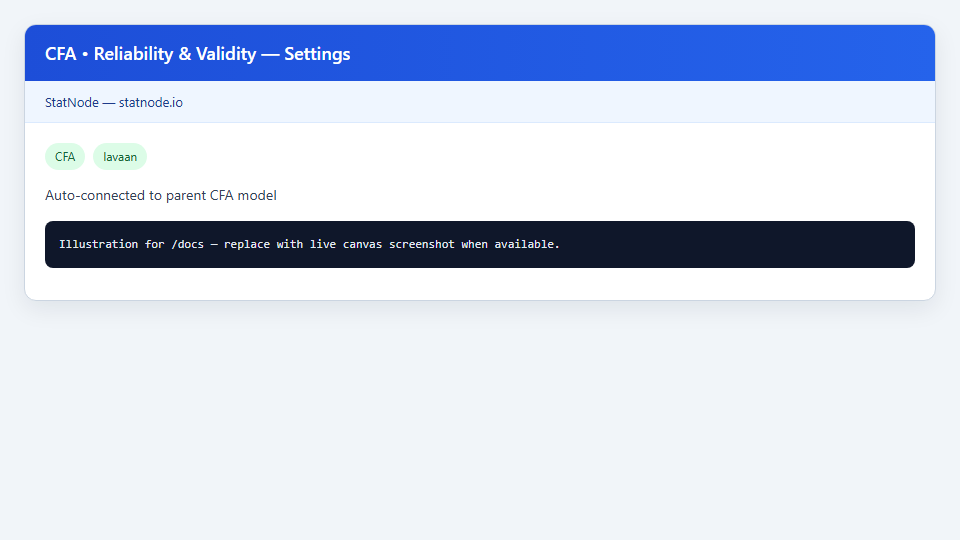
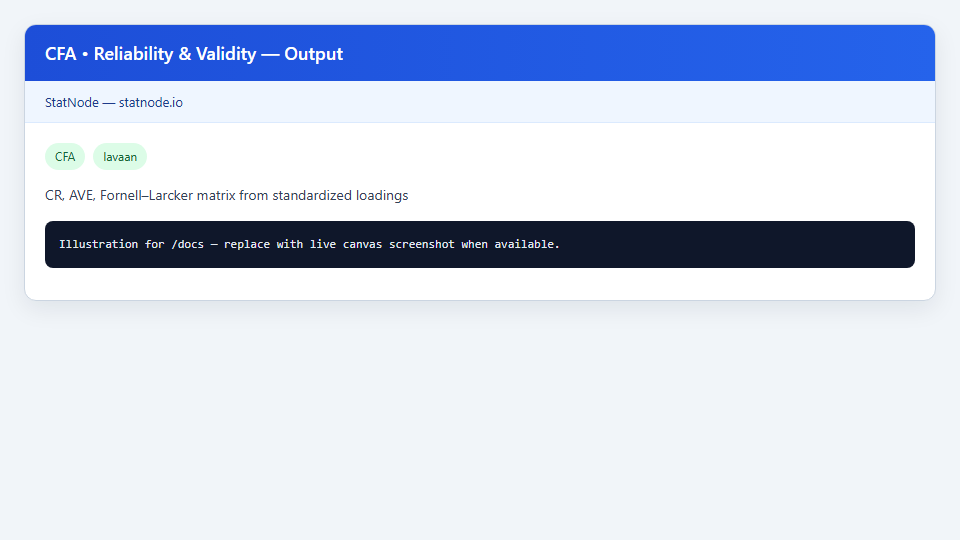

## 1. Sub-node này dùng để làm gì?

Sub-node **CFA • Reliability & Validity** tính toán các chỉ số **độ tin cậy** (reliability) và **giá trị hiệu lực** (validity) ở mức nhân tố tConstruct từ hệ số tải chuẩn hóa của mô hình CFA đã fit, trả lời:

- Mỗi nhân tố đo lường có **nhất quán nội bộ** đủ mạnh không?
- Các nhân tố có **phân biệt được** với nhau (discriminant validity) không?

Output gồm:

- **CR** (Composite Reliability — độ tin cậy tổng hợp)
- **AVE** (Average Variance Extracted — phương sai trích xuất trung bình)
- **Ma trận Fornell–Larcker** (đường chéo = $sqrt{	ext{AVE}}$, ngoài đường chéo = tương quan nhân tố)

Sub-node dựa trên `standardizedSolution()` và `lavInspect(..., "cor.lv")` của `lavaan`. Đây là bước bắt buộc trong báo cáo thang đo đa nhân tố trước khi chuyển sang mô hình cấu trúc (Hair et al., 2021; Fornell & Larcker, 1981).


## 2. Nền tảng lý thuyết

### 2.1. Độ tin cậy tổng hợp (CR)

Với hệ số tải chuẩn hóa $lambda_1, ldots, lambda_k$ trên nhân tố $j$:

$$
	ext{CR}_j = rac{left(sum_{i=1}^{k} lambda_i
ight)^2}{left(sum_{i=1}^{k} lambda_i
ight)^2 + sum_{i=1}^{k} 	heta_i},
$$

với $	heta_i = 1 - lambda_i^2$ là phần sai số chuẩn hóa của chỉ báo $i$ (Raykov, 2001; Hair et al., 2021). CR khái quát hóa Cronbach's $alpha$ khi các hệ số tải không đồng nhất — phù hợp CFA hơn $alpha$ thuần.

Ngưỡng: CR ≥ 0,70 (0,60 chấp nhận được trong nghiên cứu thăm dò).

### 2.2. Phương sai trích xuất trung bình (AVE)

$$
	ext{AVE}_j = rac{1}{k} sum_{i=1}^{k} lambda_i^2.
$$

AVE đo tỷ lệ phương sai quan sát do nhân tố $j$ giải thích. Ngưỡng Fornell & Larcker (1981): AVE ≥ 0,50 (tương đương hệ số tải trung bình ≥ 0,707).

### 2.3. Giá trị hiệu lực phân biệt (Fornell–Larcker)

Điều kiện cổ điển: với mọi cặp nhân tố $a 
eq b$,

$$
sqrt{	ext{AVE}_a} > |
ho_{ab}|,
$$

với $
ho_{ab}$ tương quan tiềm ẩn chuẩn hóa. Ma trận Fornell–Larcker in đường chéo là $sqrt{	ext{AVE}}$ và ngoài đường chéo là $
ho_{ab}$ — mỗi giá trị đường chéo phải lớn hơn trị tuyệt đối mọi phần tử cùng hàng/cột.

### 2.4. Giới hạn của tiêu chí Fornell–Larcker

Khi tương quan nhân tố rất cao ($> 0,85$), tiêu chí FL có thể quá khắt khe. Literature gần đây đề xuất **HTMT** (Heterotrait–Monotrait ratio) — ngoài phạm vi sub-node hiện tại; vẫn nên báo cáo FL kèm lý thuyết phân biệt khái niệm (Henseler et al., 2015; được nhắc trong Hair et al., 2021).

### 2.5. Convergent validity

Hệ số tải chuẩn hóa significant và AVE ≥ 0,50 (hoặc CR ≥ 0,70) chứng minh **giá trị hiệu lực hội tụ** — các chỉ báo thực sự đo cùng khái niệm tiềm ẩn (Brown, 2015).

### 2.6. Liên hệ với Cronbach's alpha

Raykov (2001) chỉ ra $alpha$ có thể thiên lệch khi hệ số tải không bằng nhau; CR từ CFA là thay thế ưu tiên trong báo cáo SEM hiện đại.


## 3. Điều kiện sử dụng

1. **Node cha CFA đã hội tụ** với hệ số tải hợp lý (không Heywood case).
2. **Dùng hệ số chuẩn hóa** — sub-node tự lấy từ `standardizedSolution()`; không nhập tay hệ số tải thô.
3. **Mỗi nhân tố ≥ 2 chỉ báo** để CR/AVE có nghĩa; với 2 chỉ báo, CR và AVE nhạy cảm cao với một hệ số tải yếu.
4. **Một nhân tố duy nhất:** ma trận Fornell–Larcker không áp dụng (không có tương quan nhân tố).
5. **Second-order factors:** CR/AVE tính trên nhân tố bậc một; nhân tố bậc hai cần xử lý riêng (ngoài phạm vi sub-node mặc định).
6. **Không thay thế fit toàn cục:** CR/AVE cao không cứu được mô hình fit kém — kiểm tra Fit Measures trước.
7. **Báo cáo minh bạch:** nêu công thức CR/AVE và nguồn hệ số tải (ước lượng ML, chuẩn hóa `std.lv`).


## 4. Quy trình thực hiện (Workflow)

1. Fit mô hình CFA Holzinger–Swineford (Visual, Textual, Speed) trên node cha.
2. Kéo **CFA • Reliability & Validity**; nối cổng Model.
3. Chạy sub-node — không có Settings.
4. Đọc bảng CR, AVE, $sqrt{	ext{AVE}}$ cho từng nhân tố.
5. Kiểm tra CR ≥ 0,70 và AVE ≥ 0,50 cho mỗi construct.
6. Đọc ma trận Fornell–Larcker: so sánh đường chéo với |ngoài đường chéo| từng hàng.
7. Nếu AVE thấp: xem xét loại chỉ báo hệ số tải < 0,50 hoặc sửa mô hình có lý thuyết.
8. Nếu discriminant validity fail: kiểm tra lại khái niệm hóa — hai nhân tố có thể quá gần về mặt lý thuyết (Brown, 2015).
9. Ghi CR/AVE/FL vào bảng kết quả measurement model trước structural model.


## 5. Thực hành trên phần mềm StatNode

Sub-node tự động kết nối với fit object từ CFA Holzinger–Swineford.





**Các bước cụ thể:**

1. Sau khi CFA chạy xong, kéo **CFA • Reliability & Validity** từ palette post-estimation.
2. Nối Model → Model; chạy sub-node.
3. Panel Settings hiển thị trạng thái auto-connected — không tham số người dùng.

Lệnh R tương đương (logic StatNode):

```r
library(lavaan)
std <- standardizedSolution(fit)
loadings <- std[std$op == "=~", ]
# Tính CR, AVE theo từng lhs (nhân tố)
# Ma trận FL từ cor.lv và sqrt(AVE)
```

Ví dụ output mẫu:

```r
--- Composite Reliability (CR) and AVE ---
    factor     CR    AVE sqrt_AVE
1   visual  0.834  0.625    0.791
2  textual  0.953  0.871    0.933
3    speed  0.804  0.580    0.762

Rule of thumb: CR >= 0.70, AVE >= 0.50 (Fornell & Larcker 1981; Hair et al. 2021)

--- Fornell-Larcker Matrix (diagonal = sqrt(AVE)) ---
          visual textual   speed
visual     0.791   0.408   0.262
textual    0.408   0.933   0.172
speed      0.262   0.172   0.762

Discriminant validity: diagonal should exceed off-diagonal |correlations|
in each row/column.
```

Diễn giải nhanh: cả ba nhân tố đạt CR > 0,70 và AVE > 0,50. Trong ma trận FL, $sqrt{	ext{AVE}_	ext{visual}} = 0,791 > 0,408 = |
ho_{	ext{visual,textual}}|$ và > 0,262 — Visual phân biệt được. Tương tự Textual (0,933 > 0,408 và > 0,172) và Speed (0,762 > 0,262 và > 0,172).


## 6. Diễn giải kết quả

1. **CR vs AVE:** AVE khắt khe hơn CR — một nhân tố có thể CR = 0,75 nhưng AVE = 0,45 nếu một chỉ báo tải yếu kéo trung bình xuống. Luôn báo cáo cả hai.

2. **Hệ số tải và AVE:** AVE = 0,625 cho Visual nghĩa là trung bình 62,5% phương sai mỗi chỉ báo do nhân tố Visual giải thích — phù hợp convergent validity.

3. **Fornell–Larcker pass:** Mọi đường chéo vượt tương quan cùng hàng → discriminant validity đạt theo tiêu chí cổ điển. Ghi rõ đây là điều kiện cần, không đủ để chứng minh khái niệm hóa hoàn hảo.

4. **Tương quan cao nhưng vẫn pass FL:** Visual–Textual $
ho = 0,408$ vừa phải; nếu $
ho > 0,85$ mà vẫn pass FL nhờ AVE cao, cần thảo luận lý thuyết về phân biệt khái niệm.

5. **Chỉ báo yếu:** Nếu x2 (Visual) có hệ số tải ~ 0,566, AVE Visual vẫn có thể đạt nhờ x1, x3 mạnh — xem xét có giữ x2 không (Jackson et al., 2009).

6. **Không dùng CR/AVE thay kiểm định fit:** Báo cáo measurement model cần cả fit indices (sub-node Fit Measures) và CR/AVE/FL.

7. **Trích dẫn:** Fornell & Larcker (1981) cho AVE/FL; Hair et al. (2021) cho ngưỡng hiện đại; Raykov (2001) khi so sánh với Cronbach's $alpha$.


## 7. Tài liệu tham khảo

1. Fornell, C., & Larcker, D. F. (1981). Evaluating Structural Equation Models with Unobservable Variables and Measurement Error. *Journal of Marketing Research*, 18(1), 39–50.
2. Hair, J. F., Hult, G. T. M., Ringle, C. M., & Sarstedt, M. (2021). *A Primer on Partial Least Squares Structural Equation Modeling (PLS-SEM)* (3rd ed.). Sage.
3. Raykov, T. (2001). Bias of Coefficient Alpha and Fixed Consequences of Addressing Its Bias in Structural Equation Models. *Structural Equation Modeling*, 8(1), 144–161.
4. Brown, T. A. (2015). *Confirmatory Factor Analysis for Applied Research* (2nd ed.). Guilford Press.
5. Byrne, B. M. (2016). *Structural Equation Modeling With AMOS: Basic Concepts, Applications, and Programming* (3rd ed.). Routledge.
6. Kline, R. B. (2016). *Principles and Practice of Structural Equation Modeling* (4th ed.). Guilford Press.
7. Rosseel, Y. (2012). lavaan: An R Package for Structural Equation Modeling. *Journal of Statistical Software*, 48(2), 1–36.
8. Hu, L., & Bentler, P. M. (1999). Cutoff Criteria for Fit Indexes in Covariance Structure Analysis. *Structural Equation Modeling*, 6(1), 1–55.
9. MacCallum, R. C., Roznowski, M., & Necowitz, L. B. (1992). Model Modifications in Covariance Structure Analysis. *Psychological Bulletin*, 111(3), 490–504.
10. Jackson, D. L., Gillaspy, J. A., & Purc-Stephenson, R. (2009). Reporting Practices in Confirmatory Factor Analysis. *Organizational Research Methods*, 12(1), 3–43.
11. Jöreskog, K. G., & Sörbom, D. (1993). *LISREL 8: Structural Equation Modeling with the SIMPLIS Command Language*. Scientific Software International.

---

Ghi chú: CR/AVE tính từ hệ số tải chuẩn hóa của một lần fit; nếu mô hình thay đổi, chạy lại sub-node trên fit mới.
