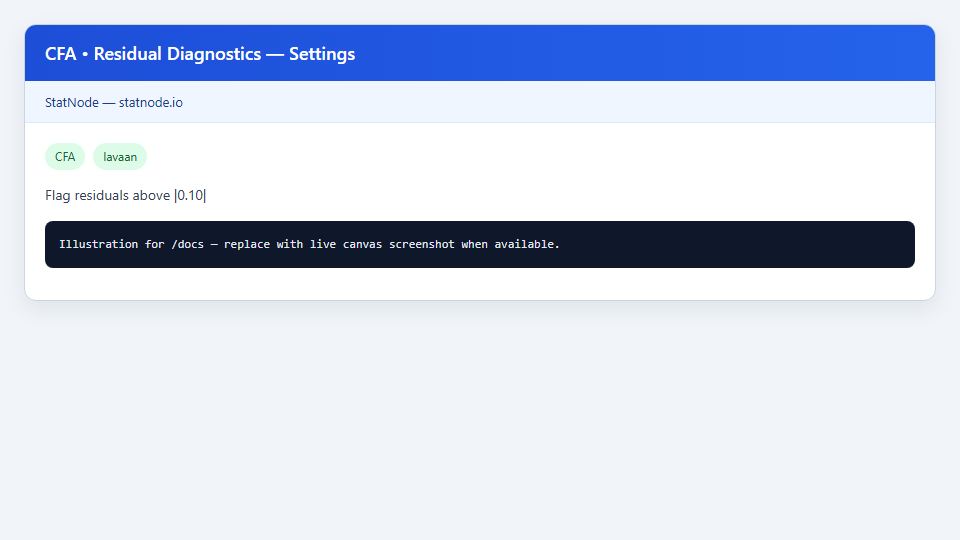
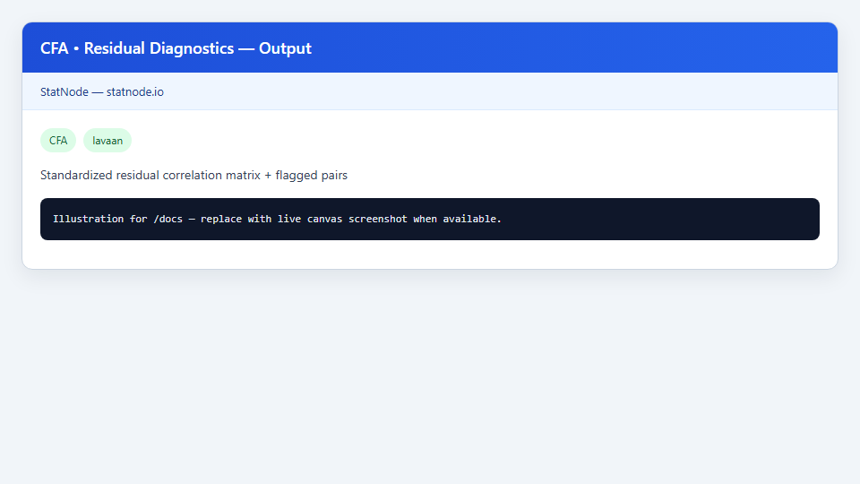

## 1. Sub-node này dùng để làm gì?

Sub-node **CFA • Residual Diagnostics** hiển thị **ma trận tương quan phần dư chuẩn hóa** (standardized residual correlation matrix) giữa các biến quan sát sau khi mô hình CFA đã fit, và **đánh dấu** các cặp có |residual| vượt ngưỡng (mặc định 0,10). Sub-node trả lời: *sai lệch mô hình tập trung ở đâu — cặp chỉ báo nào vẫn còn tương quan không được giải thích bởi cấu trúc nhân tố?*

Khác với fit indices toàn cục (CFI, RMSEA), residual diagnostics cung cấp **chẩn đoán cục bộ** (localized misfit). Một mô hình có CFI = 0,94 vẫn có thể có vài cặp residual > 0,10 — sub-node giúp định vị để đối chiếu với Modification Indices và lý thuyết (Brown, 2015; Byrne, 2016).

Output gồm ma trận tương quan residual đầy đủ và danh sách các cặp `var_i ~~ var_j` bị flag.


## 2. Nền tảng lý thuyết

### 2.1. Residual trong SEM

Ma trận hiệp phương sai quan sát mẫu $mathbf{S}$ và ma trận mô hình $oldsymbol{Sigma}(hat{oldsymbol{	heta}})$ tạo residual:

$$
mathbf{R} = mathbf{S} - oldsymbol{Sigma}(hat{oldsymbol{	heta}}).
$$

Trong lavaan, `residuals(fit, type = "cor")` chuẩn hóa $mathbf{R}$ thành ma trận tương quan residual — phần tử $r_{ij}$ đo mức tương quan giữa $x_i$ và $x_j$ **chưa** được mô hình giải thích.

### 2.2. Ý nghĩa phần tử residual

- $|r_{ij}|$ nhỏ (ví dụ < 0,10): mô hình mô tả tốt quan hệ $x_i$–$x_j$.
- $|r_{ij}|$ lớn: có thể thiếu tải chéo, thiếu covariance sai số $psi_{ij}$, hoặc sai cấu trúc nhân tố.

Trên Holzinger–Swineford, cặp `x1`–`x2` hoặc `x7`–`x8` thường nổi bật nếu mô hình tải đơn quá cứng.

### 2.3. Ngưỡng 0,10

Ngưỡng |residual| > 0,10 là quy ước thực hành phổ biến (Byrne, 2016; Brown, 2015) — không phải kiểm định giả thuyết chính thức. StatNode cho phép chỉnh **Flag Residuals Above** từ 0,05 đến 0,50.

### 2.4. Quan hệ với SRMR

SRMR là tổng hợp trung bình trị tuyệt đối các phần tử residual chuẩn hóa. SRMR thấp (≤ 0,08) nhưng vài residual lớn gợi ý sai lệch **cục bộ** — sub-node Residuals làm rõ vị trí.

### 2.5. Residual vs Modification Index

Residual cao tại $(i,j)$ thường đi kèm MI lớn cho `xi ~~ xj` (covariance sai số) hoặc cross-loading liên quan. Hai công cụ nên đọc **song song** (MacCallum et al., 1992).

### 2.6. Giới hạn

Residual matrix phụ thuộc ước lượng ML tại điểm hiện tại; không thay thế kiểm định formal như Lagrange multiplier trên từng ràng buộc — nhưng trực quan và dễ diễn giải trong báo cáo (Rosseel, 2012).


## 3. Điều kiện sử dụng

1. **CFA cha đã fit thành công** — ma trận residual không có nghĩa nếu mô hình không hội tụ.
2. **Số biến quan sát vừa phải** — ma trận $9 	imes 9$ (Holzinger–Swineford) dễ đọc; với 50+ biến, tập trung vào danh sách flagged pairs.
3. **Chọn ngưỡng phù hợp:** 0,10 mặc định; nghiên cứu khắt khe có thể 0,05; mẫu nhỏ có thể tăng lên 0,15 để tránh overinterpretation.
4. **Chỉ tam giác trên được flag** — sub-node bỏ qua đường chéo và tam giác dưới (đối xứng).
5. **Residual không điều chỉnh tự động mô hình** — chỉ chẩn đoán; sửa mô hình thủ công trên node CFA.
6. **Outliers ảnh hưởng residual** — kiểm tra Mahalanobis distance trước khi kết luận cấu trúc sai (Kline, 2016).
7. **Báo cáo:** nêu ngưỡng đã dùng và liệt kê cặp flagged kèm giá trị residual.


## 4. Quy trình thực hiện (Workflow)

1. Fit CFA Holzinger–Swineford trên node cha; ghi nhận fit toàn cục (Fit Measures).
2. Kéo **CFA • Residual Diagnostics**; nối cổng Model.
3. Đặt **Flag Residuals Above** = `0.10` (hoặc 0,05 nếu cần nhạy hơn).
4. Chạy sub-node; đọc ma trận residual và danh sách flagged.
5. Đối chiếu với **Modification Indices** — cặp flagged thường có MI cao cho `~~`.
6. Xem xét lý thuyết trước khi thêm covariance sai số hoặc cross-loading.
7. Cập nhật mô hình trên CFA; re-fit; chạy lại Residuals và Fit Measures.
8. Trong báo cáo, trình bày residual matrix (hoặc bảng cặp lớn) cho mô hình **cuối cùng** đã chấp nhận.
9. Nếu không còn cặp nào flagged và fit đạt — measurement model sẵn sàng cho structural path (Hair et al., 2021).


## 5. Thực hành trên phần mềm StatNode

Sub-node Residual Diagnostics trên fit Holzinger–Swineford.





**Các bước cụ thể:**

1. Kết nối Model từ node CFA.
2. Trong Settings: **Flag Residuals Above** = `0.10`.
3. Chạy sub-node.

Lệnh R tương đương:

```r
library(lavaan)
res <- residuals(fit, type = "cor")
print(round(res$cor, 4))
# Flag pairs with |r| > 0.10 above diagonal
```

Ví dụ output mẫu:

```r
--- Standardized Residual Correlation Matrix ---
      x1     x2     x3     x4     x5     x6     x7     x8     x9
x1  0.000  0.142 -0.038  0.012  0.008 -0.015  0.021 -0.009  0.045
x2  0.142  0.000  0.055  0.018 -0.022  0.011 -0.033  0.027  0.019
x3 -0.038  0.055  0.000 -0.010  0.016  0.024  0.012  0.008 -0.031
x4  0.012  0.018 -0.010  0.000  0.042  0.038  0.005 -0.012  0.028
x5  0.008 -0.022  0.016  0.042  0.000  0.051  0.009  0.014 -0.018
x6 -0.015  0.011  0.024  0.038  0.051  0.000 -0.007  0.019  0.022
x7  0.021 -0.033  0.012  0.005  0.009 -0.007  0.000  0.118  0.067
x8 -0.009  0.027  0.008 -0.012  0.014  0.019  0.118  0.000  0.089
x9  0.045  0.019 -0.031  0.028 -0.018  0.022  0.067  0.089  0.000

--- Residuals with |value| > 0.10 ---
x1 ~~ x2: 0.1420
x7 ~~ x8: 0.1180
```

Hai cặp flagged: **x1–x2** (residual = 0,142) và **x7–x8** (0,118) — gợi ý covariance sai số chưa được mô hình hóa giữa hai cặp bài visual và hai bài speed. Đối chiếu MI: thường thấy MI cao cho `x1 ~~ x2`. Quyết định có thêm `x1 ~~ x2` vào mô hình cần lý thuyết về nhiễu chung đo lường (Brown, 2015).


## 6. Diễn giải kết quả

1. **Đọc theo magnitude, không chỉ flag:** Residual 0,142 mạnh hơn 0,118 — ưu tiên xem xét x1–x2 trước.

2. **Dấu residual:** Dương nghĩa mô hình **underestimate** tương quan quan sát giữa hai biến — cần thêm liên kết (covariance hoặc nhân tố chung).

3. **Không flag không có nghĩa hoàn hảo:** Ngưỡng 0,10 là heuristic; residual 0,08 vẫn có thể đáng chú ý nếu có lý thuyết.

4. **Tam giác trên vs dưới:** Ma trận đối xứng; StatNode chỉ liệt kê tam giác trên để tránh trùng lặp.

5. **Sau sửa mô hình:** Thêm `x1 ~~ x2` nên làm giảm residual x1–x2 và có thể cải thiện RMSEA — kiểm tra lại Fit Measures.

6. **Tránh “residual fishing”:** Chỉ sửa cặp có cả evidence thống kê (residual + MI) **và** lý thuyết (MacCallum et al., 1992).

7. **Báo cáo:** Đính kèm ma trận hoặc bảng top |residual| cho mô hình cuối; nêu ngưỡng flag (Jackson et al., 2009).


## 7. Tài liệu tham khảo

1. Brown, T. A. (2015). *Confirmatory Factor Analysis for Applied Research* (2nd ed.). Guilford Press.
2. Byrne, B. M. (2016). *Structural Equation Modeling With AMOS: Basic Concepts, Applications, and Programming* (3rd ed.). Routledge.
3. Kline, R. B. (2016). *Principles and Practice of Structural Equation Modeling* (4th ed.). Guilford Press.
4. Rosseel, Y. (2012). lavaan: An R Package for Structural Equation Modeling. *Journal of Statistical Software*, 48(2), 1–36.
5. MacCallum, R. C., Roznowski, M., & Necowitz, L. B. (1992). Model Modifications in Covariance Structure Analysis. *Psychological Bulletin*, 111(3), 490–504.
6. Hu, L., & Bentler, P. M. (1999). Cutoff Criteria for Fit Indexes in Covariance Structure Analysis. *Structural Equation Modeling*, 6(1), 1–55.
7. Jackson, D. L., Gillaspy, J. A., & Purc-Stephenson, R. (2009). Reporting Practices in Confirmatory Factor Analysis. *Organizational Research Methods*, 12(1), 3–43.
8. Jöreskog, K. G., & Sörbom, D. (1993). *LISREL 8: Structural Equation Modeling with the SIMPLIS Command Language*. Scientific Software International.
9. Fornell, C., & Larcker, D. F. (1981). Evaluating Structural Equation Models with Unobservable Variables and Measurement Error. *Journal of Marketing Research*, 18(1), 39–50.
10. Hair, J. F., Hult, G. T. M., Ringle, C. M., & Sarstedt, M. (2021). *A Primer on Partial Least Squares Structural Equation Modeling (PLS-SEM)* (3rd ed.). Sage.
11. Raykov, T. (2001). Bias of Coefficient Alpha and Fixed Consequences of Addressing Its Bias in Structural Equation Models. *Structural Equation Modeling*, 8(1), 144–161.

---

Ghi chú: Residual diagnostics bổ sung fit indices toàn cục; đọc kết hợp với Modification Indices trước khi sửa mô hình.
