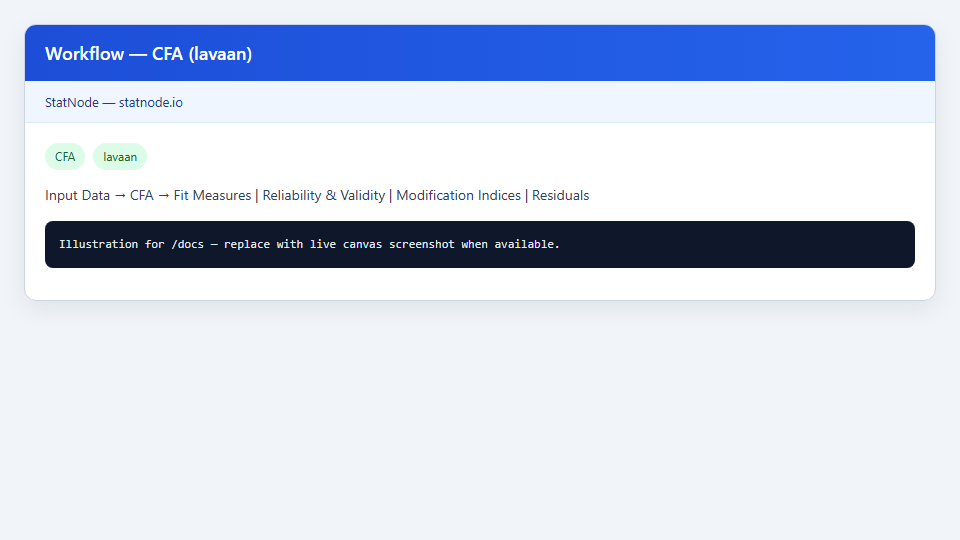
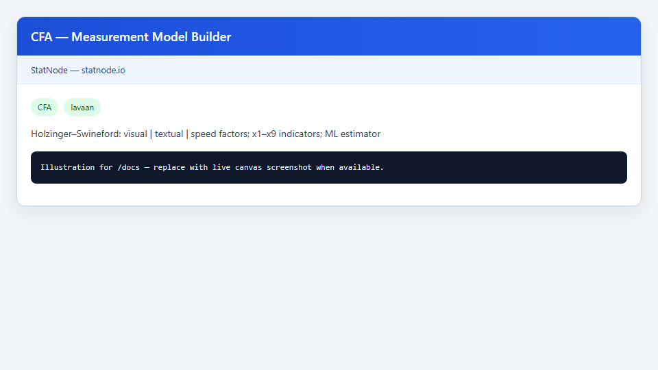
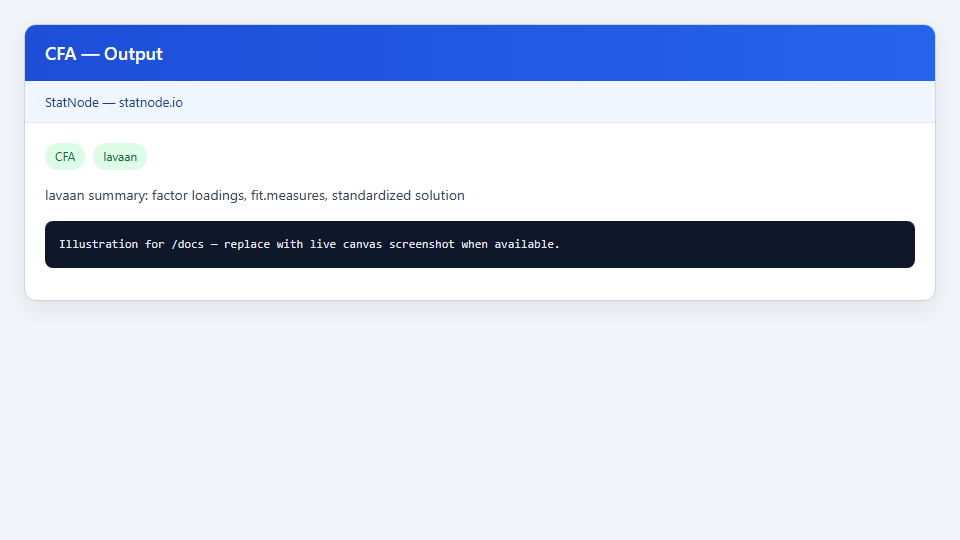

## 1. Mô hình này dùng để làm gì?

Node **CFA** (Confirmatory Factor Analysis — Phân tích nhân tố khẳng định) trên StatNode ước lượng mô hình đo lường (measurement model) trong phân tích cấu trúc tuyến tính (SEM), sử dụng gói R `lavaan` (Rosseel, 2012). Khác với EFA khám phá cấu trúc nhân tố từ dữ liệu, CFA **kiểm định trước** (a priori) xem các chỉ báo quan sát được có thực sự phản ánh các nhân tố tiềm ẩn đã lý thuyết hóa hay không.

Trong thực tiễn nghiên cứu định lượng, node CFA phục vụ các mục tiêu sau:

- **Xác nhận cấu trúc nhân tố** trước khi ghép mô hình cấu trúc (structural model) trong PLS-SEM hoặc CB-SEM.
- **Ước lượng hệ số tải nhân tố** (factor loadings) và tương quan giữa các nhân tố tiềm ẩn, làm cơ sở đánh giá độ tin cậy và giá trị hiệu lực.
- **Kiểm tra mức độ phù hợp toàn cục** (global fit) của mô hình đo lường với ma trận hiệp phương sai quan sát.
- **Chuẩn bị đối tượng mô hình** (`lavaan` fit object) cho các sub-node hậu ước lượng: Fit Measures, Reliability & Validity, Modification Indices và Residual Diagnostics.

StatNode cung cấp **trình dựng mô hình trực quan** (visual model builder): kéo-thả nhân tố, gán chỉ báo, thiết lập tương quan nhân tố — đồng thời sinh mã lavaan tương đương. Toàn bộ pipeline chạy trong trình duyệt qua WebR, phù hợp giảng dạy và phân tích nhanh mà không cần cài R cục bộ.

Ví dụ chạy xuyên suốt tài liệu này: bộ dữ liệu **Holzinger & Swineford (1939)** — 9 biến quan sát `x1`–`x9`, ba nhân tố **Visual**, **Textual** và **Speed** — là benchmark cổ điển trong SEM (Jöreskog & Sörbom, 1993; Brown, 2015).


## 2. Nền tảng lý thuyết

### 2.1. Mô hình đo lường

Với $p$ biến quan sát $mathbf{x} = (x_1, ldots, x_p)'$ và $m$ nhân tố tiềm ẩn chuẩn hóa $oldsymbol{eta} = (eta_1, ldots, eta_m)'$, mô hình đo lường tuyến tính viết:

$$
mathbf{x} = oldsymbol{Lambda} oldsymbol{eta} + oldsymbol{arepsilon},
$$

trong đó $oldsymbol{Lambda}$ là ma trận hệ số tải (factor loadings), $oldsymbol{arepsilon}$ là vector sai số đo lường với $E(oldsymbol{arepsilon}) = mathbf{0}$, $mathrm{Cov}(oldsymbol{arepsilon}) = oldsymbol{Theta}$ (thường đường chéo). Phương sai–hiệp phương sai quan sát:

$$
oldsymbol{Sigma} = oldsymbol{Lambda} oldsymbol{Psi} oldsymbol{Lambda}' + oldsymbol{Theta},
$$

với $oldsymbol{Psi} = mathrm{Cov}(oldsymbol{eta})$.

Đối với Holzinger–Swineford, mô hình ba nhân tố:

$$
egin{aligned}
	ext{visual} &coloneqq x_1, x_2, x_3, \
	ext{textual} &coloneqq x_4, x_5, x_6, \
	ext{speed} &coloneqq x_7, x_8, x_9,
end{aligned}
$$

cùng các tương quan tự do giữa ba nhân tố. Mỗi chỉ báo chỉ tải lên đúng một nhân tố (mô hình tải đơn — single loading).

### 2.2. Nhận dạng tham số (identification)

SEM yêu cầu ràng buộc để mô hình được nhận dạng. StatNode mặc định bật **Fix Latent Variances to 1** (`std.lv = TRUE` trong lavaan): phương sai mỗi nhân tố cố định bằng 1, hệ số tải được ước lượng tự do. Đây là cách nhận dạng phổ biến khi mỗi nhân tố có ít nhất ba chỉ báo (Brown, 2015; Kline, 2016).

Phương án thay thế: cố định một hệ số tải bằng 1 trên mỗi nhân tố (marker indicator) và ước lượng phương sai nhân tố — StatNode hiện ưu tiên `std.lv` cho tính nhất quán với báo cáo chuẩn hóa.

### 2.3. Ước lượng Maximum Likelihood (ML)

Với dữ liệu đa biến chuẩn và missing ngẫu nhiên hoàn toàn (MCAR) hoặc missing at random (MAR), lavaan ước lượng bằng **Maximum Likelihood**:

$$
hat{oldsymbol{	heta}} = argmax_{oldsymbol{	heta}} ; ell(oldsymbol{	heta}) = argmax_{oldsymbol{	heta}} ; log L(mathbf{S} mid oldsymbol{Sigma}(oldsymbol{	heta})),
$$

với $mathbf{S}$ ma trận hiệp phương sai mẫu, $oldsymbol{Sigma}(oldsymbol{	heta})$ ma trận mô hình hàm của tham số. Sai số chuẩn dựa trên ma trận thông tin (expected hoặc observed information).

### 2.4. Full Information Maximum Likelihood (FIML)

Khi có giá trị thiếu không hoàn toàn ngẫu nhiên nhưng thỏa MAR, StatNode cho phép **Missing Data Handling = FIML** (`missing = "ML"` trong lavaan). FIML tối đa hóa likelihood từng quan sát, tận dụng toàn bộ thông tin có sẵn thay vì listwise deletion — đặc biệt quan trọng khi mẫu khảo sát có tỷ lệ missing 5–15% (Enders, 2010; được tích hợp trong lavaan).

### 2.5. Các ước lượng thay thế

StatNode hỗ trợ thêm **WLSMV** (Weighted Least Squares Mean and Variance adjusted) cho biến thứ bậc hoặc phân phối lệch; **ULS** và **DWLS** cho mẫu nhỏ hoặc mô hình phức tạp. Với dữ liệu liên tục gần chuẩn như Holzinger–Swineford, ML là lựa chọn mặc định phù hợp (Byrne, 2016).

### 2.6. Quan hệ với SEM và PLS-SEM

CFA là tầng đo lường của CB-SEM (Jöreskog & Sörbom, 1993). Trong workflow StatNode, CFA thường đứng trước các node cấu trúc hoặc song song với PLS-SEM khi nghiên cứu viên cần so sánh phương pháp covariance-based và variance-based (Hair et al., 2021).


## 3. Điều kiện sử dụng

Áp dụng CFA có ý nghĩa thống kê và lý thuyết khi các điều kiện sau được xem xét:

1. **Cơ sở lý thuyết vững.** CFA không phù hợp để “dò” cấu trúc; cần mô hình đo lường được đề xuất từ literature hoặc thiết kế thang đo (Jackson et al., 2009).

2. **Cỡ mẫu đủ lớn.** Quy tắc kinh nghiệm: ít nhất 200 quan sát cho mô hình vừa; 300–500 trở lên khi mô hình phức tạp hoặc hệ số tải thấp (Kline, 2016). Holzinger–Swineford có $n = 301$ — đủ cho mô hình 9 chỉ báo, 3 nhân tố.

3. **Đa biến chuẩn (gần đúng).** ML giả định phân phối chuẩn đa biến; vi phạm nặng (quá lệch, outliers) nên xử lý trước hoặc chuyển sang WLSMV/robust SE.

4. **Mỗi nhân tố có ≥ 3 chỉ báo.** Hai chỉ báo/nhân tố dễ gây vấn đề nhận dạng và Heywood case (hệ số tải > 1 hoặc phương sai sai số âm).

5. **Không có đa cộng tuyến nghiêm trọng** giữa các chỉ báo cùng nhân tố; tương quan > 0,95 giữa hai biến có thể gây không ổn định ước lượng.

6. **Dữ liệu liên tục hoặc Likert đủ mức.** Thang 5–7 mức thường được xem xét như liên tục trong CFA; thang 3 mức nên cân nhắc WLSMV.

7. **Giới hạn trình duyệt.** StatNode chạy qua WebR; mẫu rất lớn ($n > 5000$) hoặc mô hình có hàng trăm tham số có thể chậm — cân nhắc subsample hoặc R cục bộ cho mô hình cực lớn.


## 4. Quy trình thực hiện (Workflow)

Quy trình phân tích CFA điển hình trên StatNode:

1. **Chuẩn bị dữ liệu:** nạp bảng chứa các biến quan sát (`x1`–`x9`); kiểm tra missing, phân phối, và ma trận tương quan.
2. **Xây dựng mô hình đo lường:** xác định nhân tố, chỉ báo, và ràng buộc (tải chéo = 0 trừ khi có lý do lý thuyết).
3. **Kéo node CFA** vào canvas; kết nối Input Data; mở visual builder để dựng hoặc nạp ví dụ Holzinger–Swineford.
4. **Cấu hình ước lượng:** Estimator = ML; Missing = listwise hoặc FIML; bật Fix Latent Variances to 1; chọn Standard Errors (standard/robust/bootstrap).
5. **Chạy ước lượng** và xem bảng hệ số tải, phương sai sai số, tương quan nhân tố, và fit measures tóm tắt.
6. **Gắn sub-node Fit Measures** để đọc chi tiết CFI, TLI, RMSEA, SRMR.
7. **Gắn sub-node Reliability & Validity** cho CR, AVE và ma trận Fornell–Larcker.
8. **Nếu fit chưa đạt:** xem **Modification Indices** và **Residual Diagnostics** — chỉ sửa mô hình khi có cơ sở lý thuyết (MacCallum et al., 1992).
9. **Báo cáo:** trình bày đặc tả mô hình, phương pháp ước lượng, bảng chuẩn hóa, chỉ số fit, độ tin cậy và giá trị hiệu lực.

Workflow trên canvas cho phép lưu pipeline hoàn chỉnh từ ước lượng đến chẩn đoán mô hình.


## 5. Thực hành trên phần mềm StatNode

Phần này hướng dẫn sử dụng node CFA với backend `lavaan::cfa()`, trên dataset Holzinger–Swineford.

Giao diện workflow và trình dựng mô hình:







**Các bước cụ thể:**

1. Nạp dataset Holzinger–Swineford (301 học sinh, biến `x1`–`x9`) từ thư viện dữ liệu minh họa StatNode hoặc file CSV tương đương.
2. Kéo node **CFA** (category: Multivariate → Statistic) vào canvas; kết nối cổng Data.
3. Trong Settings, mở **Model Specification** / visual builder:
   - Nhân tố **Visual** → chỉ báo `x1`, `x2`, `x3`
   - Nhân tố **Textual** → `x4`, `x5`, `x6`
   - Nhân tố **Speed** → `x7`, `x8`, `x9`
   - Bật tương quan giữa cả ba cặp nhân tố
   - Hoặc bấm **Load Example** để nạp cấu hình sẵn
4. Thiết lập ước lượng:
   - **Estimator:** `ML`
   - **Missing Data Handling:** `listwise` (hoặc `FIML` nếu có missing)
   - **Fix Latent Variances to 1:** bật (`std.lv = TRUE`)
   - **Standard Errors:** `standard`
5. Chạy node (Run). Output hiển thị lavaan summary, hệ số tải chuẩn hóa và fit measures.

Lệnh R tương đương StatNode thực thi:

```r
library(lavaan)
model <- '
  visual  =~ x1 + x2 + x3
  textual =~ x4 + x5 + x6
  speed   =~ x7 + x8 + x9
'
fit <- cfa(model, data = HS, estimator = "ML", std.lv = TRUE, missing = "listwise")
summary(fit, standardized = TRUE, fit.measures = TRUE)
```

Ví dụ output mẫu (minh họa định dạng):

```r
--- CFA Model (lavaan::cfa) ---
Estimator: ML | Observations: 301 | Missing: listwise | std.lv: TRUE

Latent Variables:
                   Estimate  Std.Err  z-value  P(>|z|)   Std.lv  Std.all
  visual =~
    x1                  0.899    0.083   10.833    0.000    0.899    0.899
    x2                  0.566    0.065    8.717    0.000    0.566    0.566
    x3                  0.845    0.071   11.891    0.000    0.845    0.845
  textual =~
    x4                  0.991    0.056   17.714    0.000    0.991    0.991
    x5                  1.052    0.063   16.632    0.000    1.052    1.052
    x6                  0.947    0.056   16.811    0.000    0.947    0.947
  speed =~
    x7                  0.920    0.083   11.088    0.000    0.920    0.920
    x8                  0.945    0.071   13.253    0.000    0.945    0.945
    x9                  0.622    0.074    8.416    0.000    0.622    0.622

Covariances:
                   Estimate  Std.Err  z-value  P(>|z|)   Std.lv  Std.all
  visual ~~ textual         0.408    0.074    5.552    0.000    0.408    0.408
  visual ~~ speed           0.262    0.056    4.660    0.000    0.262    0.262
  textual ~~ speed          0.172    0.063    2.718    0.007    0.172    0.172

Model Test User Model:
  Test statistic                          85.306
  Degrees of freedom                        24
  P-value (Chi-square)                     0.000

Fit Measures:
  CFI    0.931
  TLI    0.896
  RMSEA  0.092  [90% CI: 0.071, 0.114]
  SRMR   0.065
```

Sau khi ước lượng, kéo các sub-node từ menu post-estimation (màu xanh lá) và nối cổng Model của node CFA vào cổng Model của sub-node tương ứng.


## 6. Diễn giải kết quả

Khi đọc output CFA, tuân thủ các nguyên tắc sau:

1. **Hệ số tải chuẩn hóa (Std.all):** Với `std.lv = TRUE`, Std.lv và Std.all trùng nhau trên hệ số tải. Ngưỡng Hair et al. (2021): ≥ 0,708 (giải thích ≥ 50% phương sai); 0,60–0,708 chấp nhận được nếu CR/AVE đạt; < 0,50 nên loại chỉ báo.

2. **Ý nghĩa thống kê:** z-value và p-value cho thấy hệ số tải có khác 0 không. Tất cả hệ số tải significant là điều kiện cần nhưng chưa đủ — cần kiểm tra độ lớn và fit toàn cục.

3. **Tương quan nhân tố:** Hệ số tương quan chuẩn hóa giữa Visual–Textual, Visual–Speed, Textual–Speed phản ánh mối liên hệ cấu trúc giữa các khái niệm tiềm ẩn; diễn giải theo lý thuyết (ví dụ năng lực trí tuệ liên quan nhưng phân biệt được).

4. **Fit measures tóm tắt:** Trong summary, chi-square test thường nhạy với mẫu lớn; ưu tiên CFI, TLI, RMSEA, SRMR (Hu & Bentler, 1999). Mô hình Holzinger–Swineford đôi khi cho RMSEA hơi cao trên một số đặc tả — đây là cơ hội dạy cách đọc fit đa chiều.

5. **Phương sai sai số (residual variances):** Giá trị âm (Heywood case) báo hiệu vấn đề nhận dạng, quá nhiều tham số, hoặc mẫu quá nhỏ — cần sửa mô hình, không chỉ tin vào output.

6. **FIML vs listwise:** Nếu hai phương pháp cho kết quả khác biệt lớn, kiểm tra cơ chế missing (MCAR/MAR/MNAR) trước khi chọn báo cáo.

7. **Báo cáo học thuật:** Nêu rõ phần mềm (`lavaan` qua StatNode), phiên bản, ước lượng (ML/FIML), ràng buộc nhận dạng (`std.lv`), cỡ mẫu, và bảng hệ số chuẩn hóa kèm fit indices — theo chuẩn Byrne (2016) hoặc Brown (2015).


## 7. Tài liệu tham khảo

1. Rosseel, Y. (2012). lavaan: An R Package for Structural Equation Modeling. *Journal of Statistical Software*, 48(2), 1–36.
2. Brown, T. A. (2015). *Confirmatory Factor Analysis for Applied Research* (2nd ed.). Guilford Press.
3. Byrne, B. M. (2016). *Structural Equation Modeling With AMOS: Basic Concepts, Applications, and Programming* (3rd ed.). Routledge.
4. Kline, R. B. (2016). *Principles and Practice of Structural Equation Modeling* (4th ed.). Guilford Press.
5. Hair, J. F., Hult, G. T. M., Ringle, C. M., & Sarstedt, M. (2021). *A Primer on Partial Least Squares Structural Equation Modeling (PLS-SEM)* (3rd ed.). Sage.
6. Hu, L., & Bentler, P. M. (1999). Cutoff Criteria for Fit Indexes in Covariance Structure Analysis. *Structural Equation Modeling*, 6(1), 1–55.
7. Fornell, C., & Larcker, D. F. (1981). Evaluating Structural Equation Models with Unobservable Variables and Measurement Error. *Journal of Marketing Research*, 18(1), 39–50.
8. MacCallum, R. C., Roznowski, M., & Necowitz, L. B. (1992). Model Modifications in Covariance Structure Analysis. *Psychological Bulletin*, 111(3), 490–504.
9. Raykov, T. (2001). Bias of Coefficient Alpha and Fixed Consequences of Addressing Its Bias in Structural Equation Models. *Structural Equation Modeling*, 8(1), 144–161.
10. Jackson, D. L., Gillaspy, J. A., & Purc-Stephenson, R. (2009). Reporting Practices in Confirmatory Factor Analysis. *Organizational Research Methods*, 12(1), 3–43.
11. Jöreskog, K. G., & Sörbom, D. (1993). *LISREL 8: Structural Equation Modeling with the SIMPLIS Command Language*. Scientific Software International.

---

Ghi chú: Tài liệu nhằm hướng dẫn học thuật cho người dùng StatNode. Output mẫu minh họa định dạng; kết quả thực tế phụ thuộc dữ liệu và đặc tả mô hình.
