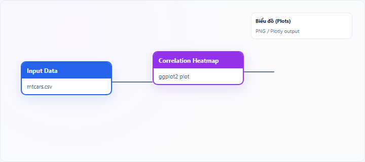
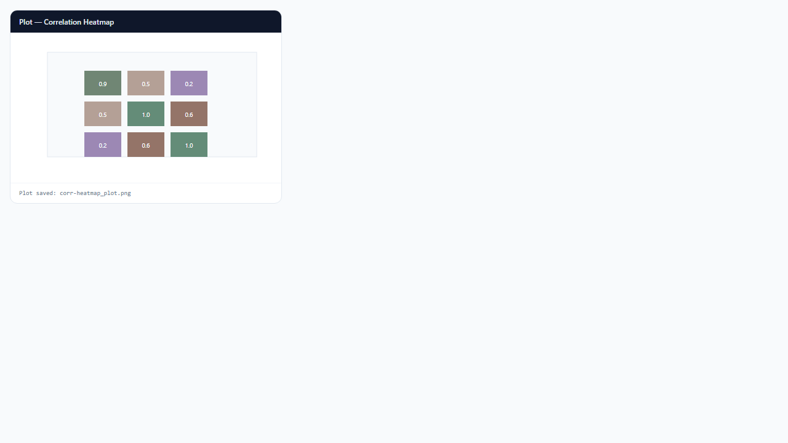

## 1. Bản đồ nhiệt tương quan (Correlation Heatmap) là gì?

**Correlation heatmap** (bản đồ nhiệt tương quan) là ma trận màu biểu diễn **hệ số tương quan** giữa từng cặp biến số. Màu đậm (thường đỏ/xanh) tương ứng $|r|$ lớn; ô gần trung tính là tương quan yếu. Node **Correlation Heatmap** dùng package R **ggcorrplot** trên ma trận tương quan tính bằng `cor()`.

## 2. Bản đồ nhiệt tương quan (Correlation Heatmap) dùng để làm gì?

Heatmap trả lời:

- Biến nào **di chuyển cùng nhau** (đa cộng tuyến)?
- Có **khối biến** tương quan mạnh gợi ý nhân tố chung?
- Cặp nào có $|r|$ rất cao — rủi ro **multicollinearity** trong hồi quy?

**Khi nên dùng:** khám phá trước hồi quy đa biến, CFA, hoặc chọn biến.

**Khi không nên dùng:** quan hệ phi tuyến mạnh (scatter từng cặp); biến phân loại (dùng phi hệ số khác).

**Phương pháp tương quan:**
- **Pearson** (mặc định): tuyến tính, biến liên tục gần chuẩn
- **Spearman**: hạng, robust với outlier
- **Kendall**: hạng, mẫu nhỏ

**Lưu ý:** node này **không** hỗ trợ chế độ Interactive (Plotly).

## 3. Thực hành trên phần mềm StatNode

Workflow cơ bản: kéo node **Input Data** (hoặc nguồn dữ liệu khác) → nối cổng **Data** vào node **Correlation Heatmap** → chạy workflow → xem biểu đồ tại panel **Biểu đồ** (Plots).

**Dữ liệu minh họa:** `mtcars`: các biến số `mpg`, `wt`, `hp`, `disp`, `qsec`.

**Cấu hình node:**

- **Variables**: để trống (mọi biến số) hoặc chọn tập con
- **Correlation Method**: `pearson` / `spearman` / `kendall`
Output là biểu đồ ma trận tam giác (lower triangle) với hệ số tương quan trên ô.

**Kết quả:**

## 4. Diễn giải kết quả

- **$r \approx 1$ hoặc $-1$:** tương quan tuyến tính rất mạnh — **không** đưa cả hai biến vào OLS cùng lúc nếu không có lý do lý thuyết.
- **$|r| > 0.7$–$0.8$:** đa cộng tuyến đáng lo — kiểm tra VIF hoặc PCA.
- **Khối màu đồng nhất:** nhóm biến đồng pha — gợi ý latent factor hoặc dimension reduction.
- **Spearman/Kendall khác Pearson nhiều:** quan hệ phi tuyến hoặc outlier — điều tra scatter từng cặp.

**Sai lầm:** nhầm tương quan với nhân quả; bỏ qua biến ẩn chung.

## 5. Tài liệu tham khảo

1. Friendly, M., & Meyer, D. (2021). *Discrete Data Analysis with R*. CRC Press.
2. Dormann, C. F., et al. (2013). Collinearity: A review of methods to deal with it. *Ecography*, 36(1), 27–46.
3. R package **ggcorrplot**: https://cran.r-project.org/package=ggcorrplot
4. Cohen, J. (1988). *Statistical Power Analysis for the Behavioral Sciences* (2nd ed.). Erlbaum.

---

Ghi chú: Ma trận tương quan chỉ đo liên hệ tuyến tính (Pearson) hoặc đơn điệu (Spearman/Kendall), không phát hiện quan hệ phức tạp hơn.