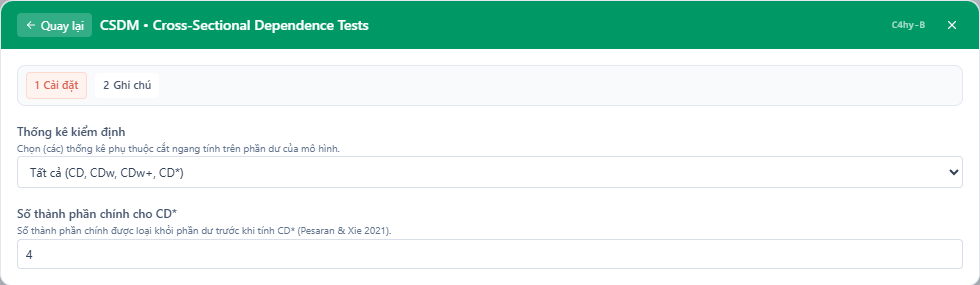
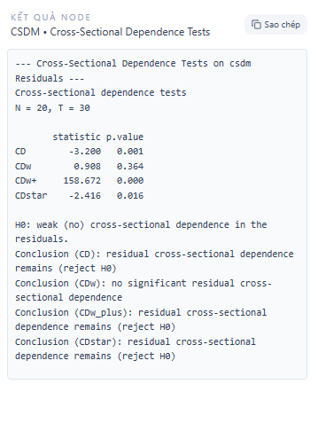

## 1. Kiểm định này dùng để làm gì?

Sub-node **CSDM • Cross-Sectional Dependence Tests** kiểm định xem phần dư của mô hình panel — ước lượng bởi node *Panel Model Estimation with Cross-Sectional Dependence* — còn chứa **phụ thuộc chéo** (cross-sectional dependence, CSD) hay không. Node gọi hàm `cd_test()` của package `csdm` và trả về bốn thống kê thuộc cùng một dòng họ nhưng khác nhau về tính chất mẫu hữu hạn: **CD** gốc của Pesaran, **CDw** (weighted CD), **CDw+** (power-enhanced CDw) và **CD\*** (bias-corrected CD).

Vai trò của kiểm định này trong quy trình phân tích panel có hai mặt. *Trước ước lượng*, nó trả lời câu hỏi liệu dữ liệu có phụ thuộc chéo đáng kể hay không — nếu có, các ước lượng giả định độc lập chéo (Pooled OLS, FE, RE với sai số chuẩn thông thường) sẽ cho suy luận sai lệch, và các phương pháp hấp thụ nhân tố chung như CCE/DCCE trở nên cần thiết. *Sau ước lượng*, nó đóng vai trò kiểm tra chất lượng: nếu trung bình chéo đã hấp thụ tốt các nhân tố chung, phần dư chỉ còn phụ thuộc chéo yếu và kiểm định không bác bỏ giả thuyết không. Ngược lại, việc bác bỏ gợi ý cấu trúc nhân tố chưa được mô hình hóa đầy đủ — cần thêm trễ trung bình chéo, thêm biến vào tập trung bình chéo, hoặc xem xét lại đặc tả.

Lý do node cung cấp đồng thời bốn biến thể thay vì chỉ CD gốc nằm ở một phát hiện quan trọng của văn liệu gần đây: khi áp dụng cho phần dư của các mô hình có ước lượng tham số theo đơn vị (FE, CCE), thống kê CD gốc chịu **vấn đề tham số ngẫu nhiên** (incidental parameters problem) khiến nó bác bỏ giả thuyết không quá mức, thậm chí suy biến về 0 trong một số cấu hình (Juodis & Reese, 2022). CDw, CDw+ và CD\* là ba câu trả lời khác nhau cho vấn đề này, và việc đọc chúng cùng nhau cho bức tranh đáng tin cậy hơn bất kỳ thống kê đơn lẻ nào.

## 2. Nền tảng lý thuyết

### 2.1. Phụ thuộc chéo yếu và mạnh

Đặt $u_{it}$ là sai số của đơn vị $i$ tại thời điểm $t$, và $\rho_{ij} = \mathrm{corr}(u_{it}, u_{jt})$ là tương quan cặp giữa hai đơn vị. Pesaran (2015) phân biệt **phụ thuộc chéo yếu** — tương quan giữa các cặp đủ thưa hoặc đủ nhỏ để trung bình chéo $\bar{u}_t$ hội tụ về 0 — với **phụ thuộc chéo mạnh**, điển hình là cấu trúc nhân tố $u_{it} = \gamma_i' f_t + \varepsilon_{it}$ với hệ số tải không suy biến. Giả thuyết không của cả bốn kiểm định trong node được hiểu theo nghĩa hiện đại:

$$
H_0: \text{phụ thuộc chéo yếu (weak CSD)} \quad \text{vs.} \quad H_1: \text{phụ thuộc chéo mạnh}.
$$

Phân biệt này quan trọng vì phụ thuộc yếu (ví dụ hiệu ứng lan tỏa không gian giữa các nước láng giềng) không phá hỏng tính nhất quán của các ước lượng thông thường, trong khi phụ thuộc mạnh thì có.

### 2.2. Thống kê CD của Pesaran

Với phần dư $\hat{u}_{it}$, tương quan cặp mẫu là

$$
\hat{\rho}_{ij} = \frac{\sum_{t=1}^{T} \hat{u}_{it}\hat{u}_{jt}}{\Big(\sum_{t=1}^{T} \hat{u}_{it}^2\Big)^{1/2}\Big(\sum_{t=1}^{T} \hat{u}_{jt}^2\Big)^{1/2}},
$$

và thống kê CD (Pesaran, 2004, 2021) là tổng chuẩn hóa của mọi tương quan cặp:

$$
CD = \sqrt{\frac{2T}{N(N-1)}} \sum_{i=1}^{N-1}\sum_{j=i+1}^{N} \hat{\rho}_{ij} \;\xrightarrow{d}\; N(0,1) \quad \text{dưới } H_0 .
$$

CD có hai ưu điểm khiến nó trở thành kiểm định mặc định trong văn liệu: hoạt động tốt với cả $N$ lớn hơn $T$ (khác kiểm định LM của Breusch–Pagan vốn đòi hỏi $T \to \infty$ với $N$ cố định), và trung bình mẫu hữu hạn đúng bằng 0 với nhiều cấu hình. Điểm yếu cố hữu: vì cộng các $\hat{\rho}_{ij}$ *có dấu*, CD mất năng lực khi tương quan dương và âm triệt tiêu nhau (ví dụ hệ số tải nhân tố có trung bình 0), và quan trọng hơn, khi áp dụng cho **phần dư của mô hình đã ước lượng** thì phân phối $N(0,1)$ không còn đúng.

### 2.3. Vấn đề tham số ngẫu nhiên và CDw

Juodis và Reese (2022) chứng minh rằng với phần dư từ các mô hình có hiệu ứng cố định hoặc CCE, thống kê CD hội tụ về một phân phối lệch — trong trường hợp CCE thậm chí suy biến — do mỗi đơn vị mang theo sai số ước lượng tham số riêng của nó (incidental parameters). Giải pháp của họ đơn giản và thanh lịch: nhân phần dư của từng đơn vị với **trọng số Rademacher** $w_i \in \{-1, +1\}$ rút ngẫu nhiên độc lập,

$$
\tilde{u}_{it} = w_i\, \hat{u}_{it}, \qquad
CD_w = \sqrt{\frac{2T}{N(N-1)}} \sum_{i<j} \tilde{\rho}_{ij},
$$

với $\tilde{\rho}_{ij}$ là tương quan cặp của phần dư đã gán trọng số. Phép ngẫu nhiên hóa phá vỡ thành phần chệch hệ thống nhưng bảo toàn tín hiệu phụ thuộc mạnh, khôi phục phân phối $N(0,1)$ dưới $H_0$. Cái giá phải trả là một lượng ngẫu nhiên ngoại sinh được đưa vào thống kê — hai lần chạy với chuỗi trọng số khác nhau cho giá trị khác nhau. Node cố định seed (42) để kết quả tái lập được giữa các lần chạy.

### 2.4. Tăng cường năng lực: CDw+

Vì phép gán trọng số làm giảm năng lực kiểm định (power) trong mẫu hữu hạn, Juodis và Reese (2022) áp dụng kỹ thuật **power enhancement** của Fan, Liao và Yao (2015): cộng vào $|CD_w|$ một thành phần sàng lọc chỉ kích hoạt khi tồn tại các cặp tương quan vượt ngưỡng,

$$
CD_{w+} = |CD_w| + \sum_{i<j} |\hat{\rho}_{ij}|\; \mathbf{1}\!\left\{ |\hat{\rho}_{ij}| > 2\sqrt{\tfrac{\log N}{T}} \right\}.
$$

Dưới $H_0$, xác suất mọi $|\hat{\rho}_{ij}|$ nằm dưới ngưỡng tiến về 1, nên thành phần sàng lọc triệt tiêu và $CD_{w+}$ kế thừa phân phối của $|CD_w|$; dưới $H_1$, thành phần này phân kỳ rất nhanh, cho năng lực gần như kiểm định không ngẫu nhiên hóa. Hệ quả thực hành: $CD_{w+}$ cực kỳ nhạy — một giá trị lớn bất thường (hàng chục, hàng trăm) cho biết nhiều cặp tương quan vượt ngưỡng sàng lọc, kể cả khi phần phụ thuộc còn lại là yếu về mặt kinh tế.

### 2.5. Hiệu chỉnh chệch: CD\*

Cách tiếp cận thứ ba, của Pesaran và Xie (2021), giữ nguyên tinh thần của CD nhưng **hiệu chỉnh giải tích** thành phần chệch sinh ra từ cấu trúc nhân tố tiềm ẩn. Các nhân tố được ước lượng từ phần dư bằng phân tích thành phần chính (PCA) với $p$ thành phần (tham số *Principal Components for CD\** của node, mặc định 4); thống kê hiệu chỉnh có dạng

$$
CD^{*} = \frac{CD + \sqrt{\tfrac{T}{2}}\,\hat{\theta}}{\sqrt{1 - \hat{\theta}^2\,}} \;\xrightarrow{d}\; N(0,1),
$$

trong đó $\hat{\theta}$ là đại lượng hiệu chỉnh ước lượng từ hệ số tải và phương sai nhân tố trích bằng PCA. CD\* không cần ngẫu nhiên hóa, có năng lực tốt và kích thước (size) chuẩn xác trong các mô phỏng của Pesaran và Xie; đổi lại nó đòi hỏi chọn số thành phần chính đủ lớn để phủ hết không gian nhân tố — chọn thiếu làm hiệu chỉnh không đủ, chọn thừa làm tăng nhiễu ước lượng nhẹ.

## 3. Điều kiện sử dụng

1. **Node cha bắt buộc.** Sub-node chỉ nhận đầu vào từ cổng model của node *Panel Model Estimation with Cross-Sectional Dependence*; phần dư được trích trực tiếp từ đối tượng `csdm_fit`.

2. **Kích thước panel.** Lý thuyết của cả bốn thống kê là tiệm cận $(N, T) \to \infty$. Thực hành mô phỏng cho thấy kết quả đáng tin từ $N \geq 10$ và $T \geq 20$; với $T$ rất ngắn, tương quan cặp ước lượng nhiễu và thành phần sàng lọc của CDw+ dễ kích hoạt sai.

3. **Tính dừng tương đối của phần dư.** Các thống kê xây dựng trên tương quan Pearson theo thời gian của phần dư; nếu mô hình gốc bỏ sót xu thế khiến phần dư không dừng, tương quan cặp bị thổi phồng giả tạo. Nên xử lý xu thế (tham số Trend của node cha) trước khi đọc kiểm định.

4. **Số thành phần chính cho CD\*.** Mặc định $p = 4$ phù hợp khi nghi ngờ tối đa khoảng bốn nhân tố chung. Quy tắc thực hành: chọn $p$ ít nhất bằng số nhân tố giả định trong mô hình kinh tế; tăng $p$ và kiểm tra độ ổn định của kết luận.

5. **Tính ngẫu nhiên của CDw/CDw+.** Hai thống kê này phụ thuộc chuỗi Rademacher; node cố định seed để tái lập, nhưng khi báo cáo khoa học nên nêu rõ tính chất ngẫu nhiên hóa của kiểm định.

## 4. Quy trình thực hiện (Workflow)

Trong một phân tích chuẩn, kiểm định CD được dùng ở hai thời điểm:

1. **Chẩn đoán ban đầu:** ước lượng một mô hình mốc (MG — không kiểm soát nhân tố) rồi chạy sub-node này. Bác bỏ mạnh ở mọi thống kê xác nhận dữ liệu có phụ thuộc chéo và biện minh cho việc dùng CCE/DCCE/CS-ARDL.
2. **Kiểm tra sau ước lượng:** chạy lại sub-node trên mô hình CCE/DCCE đã chọn. Trình tự đọc kết quả khuyến nghị:
   - Nhìn **CDw** và **CD\*** trước — hai thống kê có cơ sở lý thuyết vững nhất cho phần dư CCE.
   - Dùng **CDw+** như "đèn cảnh báo" độ nhạy cao: nếu cả CDw lẫn CD\* không bác bỏ mà CDw+ bác bỏ, phần phụ thuộc còn lại nhiều khả năng là yếu/cục bộ (một số ít cặp đơn vị).
   - Diễn giải **CD** gốc thận trọng, vì nó bác bỏ quá mức trên phần dư CCE.
3. **Phản ứng khi bác bỏ:** tăng số trễ trung bình chéo (DCCE), bổ sung biến vào *Cross-Sectional Average Variables*, thêm xu thế đơn vị, hoặc xem xét các kênh phụ thuộc không gian (spatial) nếu cấu trúc lan tỏa cục bộ là hợp lý về mặt kinh tế.

Trên canvas, sub-node nối thẳng vào cổng model của node cha và chạy cùng workflow bằng nút **Chạy tất cả**.

## 5. Thực hành trên phần mềm StatNode

Tiếp nối ví dụ ở bài hướng dẫn node chính (panel mô phỏng $N = 20$, $T = 30$, mô hình CCE với `y ~ x1 + x2`):

**Bước 1 — Thêm sub-node.** Chọn node *Panel Model Estimation with Cross-Sectional Dependence* trên canvas, nhấn nút **Thêm sub-node** trên thanh công cụ của node và chọn *CSDM • Cross-Sectional Dependence Tests*. StatNode tự động tạo node mới và nối cạnh model giữa hai node.

**Bước 2 — Cấu hình.** Mở cài đặt sub-node. Tham số **Thống kê kiểm định** chọn *Tất cả (CD, CDw, CDw+, CD\*)* để in đồng thời bốn thống kê; **Số thành phần chính cho CD\*** giữ mặc định 4:

**Bước 3 — Chạy và xem kết quả.** Nhấn **Chạy tất cả**; sau khi node cha ước lượng xong, sub-node tính bốn thống kê trên phần dư:

Output báo kích thước panel ($N = 20$, $T = 30$), bảng `statistic / p.value` cho bốn kiểm định, nhắc lại giả thuyết không, và các dòng kết luận tự động cho từng thống kê ở mức ý nghĩa 5%.

## 6. Diễn giải kết quả

Bảng kết quả của ví dụ minh họa:

| Thống kê | Giá trị | p-value | Kết luận ở mức 5% |
|---|---|---|---|
| CD | $-3.200$ | $0.001$ | Bác bỏ $H_0$ |
| CDw | $0.908$ | $0.364$ | Không bác bỏ $H_0$ |
| CDw+ | $158.672$ | $0.000$ | Bác bỏ $H_0$ |
| CD\* | $-2.416$ | $0.016$ | Bác bỏ $H_0$ |

Bốn thống kê không đồng thuận, và chính sự không đồng thuận này mang thông tin:

**CD bác bỏ nhưng không nên tin ngay.** Như trình bày ở mục lý thuyết, CD gốc trên phần dư CCE chịu chệch tham số ngẫu nhiên và nghiêng về bác bỏ quá mức. Một mình CD bác bỏ chưa đủ kết luận mô hình thất bại.

**CDw — thống kê được thiết kế riêng cho tình huống này — không bác bỏ** ($p = 0.364$). Sau khi loại bỏ thành phần chệch bằng ngẫu nhiên hóa, không còn bằng chứng về phụ thuộc chéo mạnh trong phần dư. Đây là tín hiệu thuận lợi nhất cho đặc tả CCE hiện tại.

**CDw+ rất lớn** vì thành phần sàng lọc phát hiện nhiều cặp $|\hat{\rho}_{ij}|$ vượt ngưỡng $2\sqrt{\log N / T} \approx 0.63$... thực tế với $N=20$, $T=30$ ngưỡng là $2\sqrt{\ln(20)/30} \approx 0.63$ — các cặp vượt ngưỡng cộng dồn trực tiếp vào thống kê. Trong panel mô phỏng có hệ số tải nhân tố cùng dấu, một phần tương quan cặp còn lại sau CCE vẫn đáng kể về giá trị tuyệt đối ở vài cặp, đủ kích hoạt sàng lọc. CDw+ vì vậy nên đọc là "còn tồn tại các cặp đơn vị tương quan mạnh cục bộ", không nhất thiết là cấu trúc nhân tố chung toàn cục còn sót.

**CD\* bác bỏ ở mức 5% nhưng không ở mức 1%** ($p = 0.016$). Sau hiệu chỉnh chệch bằng PCA bốn thành phần, vẫn còn tín hiệu phụ thuộc yếu. Kết hợp với CDw, diễn giải hợp lý là: trung bình chéo đã hấp thụ phần lớn — nhưng chưa tuyệt đối — cấu trúc nhân tố.

**Hàm ý hành động.** Tổng hợp bốn thống kê, người phân tích có hai lựa chọn phòng vệ: (i) tăng cường đặc tả — chuyển sang DCCE với 2–3 trễ trung bình chéo và so sánh lại bộ kiểm định; (ii) chấp nhận đặc tả hiện tại nhưng báo cáo đầy đủ bốn thống kê và thảo luận tính bền vững của hệ số. Điều không nên làm là chỉ trích dẫn thống kê thuận lợi nhất (cherry-picking) — bảng bốn thống kê tồn tại chính là để ngăn thực hành đó.

**Một lưu ý về quy mô hiệu ứng.** P-value chỉ đo bằng chứng thống kê; mức độ phụ thuộc *kinh tế* nên được đánh giá kèm tương quan cặp trung bình tuyệt đối (xấp xỉ $CD / \sqrt{2T N(N-1)/2}$ khi cùng dấu). Với $CD = -3.2$, tương quan trung bình chỉ khoảng $-0.03$ — nhỏ về độ lớn, củng cố kết luận rằng phần phụ thuộc còn lại không nghiêm trọng.

## 7. Tài liệu tham khảo

1. Pesaran, M. H. (2004). General diagnostic tests for cross section dependence in panels. *CESifo Working Paper No. 1229*; IZA Discussion Paper No. 1240.
2. Pesaran, M. H. (2015). Testing weak cross-sectional dependence in large panels. *Econometric Reviews*, 34(6–10), 1089–1117.
3. Pesaran, M. H. (2021). General diagnostic tests for cross-sectional dependence in panels. *Empirical Economics*, 60(1), 13–50.
4. Juodis, A., & Reese, S. (2022). The incidental parameters problem in testing for remaining cross-section correlation. *Journal of Business & Economic Statistics*, 40(3), 1191–1203.
5. Fan, J., Liao, Y., & Yao, J. (2015). Power enhancement in high-dimensional cross-sectional tests. *Econometrica*, 83(4), 1497–1541.
6. Pesaran, M. H., & Xie, Y. (2021). A bias-corrected CD test for error cross-sectional dependence in panel data models with latent factors. *Cambridge Working Papers in Economics* CWPE2158; *Journal of Applied Econometrics* (2024), 39(3).
7. Breusch, T. S., & Pagan, A. R. (1980). The Lagrange multiplier test and its applications to model specification in econometrics. *Review of Economic Studies*, 47(1), 239–253.
8. Chudik, A., & Pesaran, M. H. (2015). Common correlated effects estimation of heterogeneous dynamic panel data models with weakly exogenous regressors. *Journal of Econometrics*, 188(2), 393–420.
9. Ditzen, J. (2018). Estimating dynamic common-correlated effects in Stata. *The Stata Journal*, 18(3), 585–617.
10. csdm: Common Correlated Effects Estimation of Heterogeneous Panel Data Models. *CRAN Reference Manual*. https://cran.r-project.org/package=csdm
