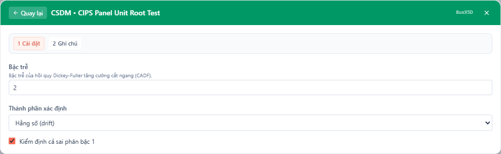
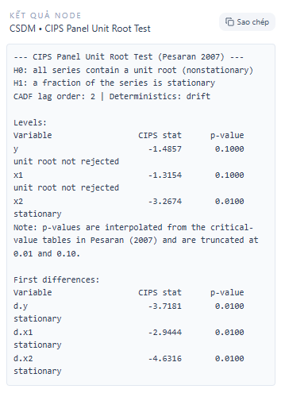

## 1. Kiểm định này dùng để làm gì?

Sub-node **CSDM • CIPS Panel Unit Root Test** thực hiện kiểm định **nghiệm đơn vị trên dữ liệu bảng** theo phương pháp CIPS (Cross-sectionally augmented Im–Pesaran–Shin) của Pesaran (2007), áp dụng cho toàn bộ các biến trong mô hình của node *Panel Model Estimation with Cross-Sectional Dependence* — cả ở **mức** (levels) lẫn **sai phân bậc một** (first differences). Mục tiêu là xác định **bậc tích hợp** của từng biến: chuỗi dừng I(0) hay chứa nghiệm đơn vị I(1).

Thông tin về bậc tích hợp quyết định cách đọc và cách đặc tả mô hình panel: hồi quy giữa các chuỗi I(1) không đồng tích hợp là hồi quy giả mạo (spurious regression); hệ số dài hạn của CS-ARDL chỉ có nghĩa khi tồn tại quan hệ cân bằng giữa các chuỗi; còn nếu mọi biến đều I(0), ước lượng CCE tĩnh trên mức là đủ. Quy trình chuẩn trong văn liệu CS-ARDL (Chudik et al., 2016; Ditzen, 2021) vì vậy luôn mở đầu bằng một bảng kiểm định nghiệm đơn vị panel.

Điểm khiến CIPS trở thành lựa chọn mặc định cho lớp mô hình này — thay vì các kiểm định "thế hệ thứ nhất" như Im–Pesaran–Shin (IPS; Im, Pesaran & Shin, 2003), Levin–Lin–Chu hay các kiểm định kiểu Fisher — là cách nó xử lý **phụ thuộc chéo**. Các kiểm định thế hệ thứ nhất giả định các đơn vị độc lập; khi dữ liệu chứa nhân tố chung (đúng bối cảnh mà node cha được thiết kế cho), chúng bóp méo kích thước nghiêm trọng, bác bỏ giả thuyết nghiệm đơn vị quá mức và dẫn nhà nghiên cứu tới kết luận sai về tính dừng. CIPS thuộc "thế hệ thứ hai": nó tăng cường hồi quy Dickey–Fuller của từng đơn vị bằng trung bình chéo — cùng triết lý CCE của node cha — để trung hòa nhân tố chung trước khi kiểm định.

## 2. Nền tảng lý thuyết

### 2.1. Mô hình và giả thuyết

Xét quá trình tự hồi quy bậc nhất dị biệt với cấu trúc một nhân tố:

$$
y_{it} = (1-\phi_i)\mu_i + \phi_i\, y_{i,t-1} + u_{it}, \qquad u_{it} = \gamma_i f_t + \varepsilon_{it},
$$

trong đó $f_t$ là nhân tố chung không quan sát được. Viết lại dạng Dickey–Fuller: $\Delta y_{it} = \alpha_i + b_i\, y_{i,t-1} + u_{it}$ với $b_i = \phi_i - 1$. Cặp giả thuyết của kiểm định:

$$
H_0: b_i = 0 \;\; \forall i \quad (\text{mọi chuỗi đều có nghiệm đơn vị}),
$$

$$
H_1: b_i < 0 \;\; \text{với một tỷ lệ khác không các đơn vị} \quad (\text{một bộ phận chuỗi dừng}).
$$

Giống IPS, đối thuyết là dị biệt: bác bỏ $H_0$ không có nghĩa *mọi* chuỗi đều dừng, chỉ rằng một tỷ lệ đáng kể trong số đó dừng.

### 2.2. Hồi quy CADF

Sự hiện diện của $f_t$ trong sai số khiến thống kê DF của từng đơn vị nhiễm phân phối của nhân tố. Giải pháp của Pesaran (2007) là **tăng cường hồi quy DF bằng trung bình chéo** $\bar{y}_t = N^{-1}\sum_i y_{it}$ — đại diện cho $f_t$ khi $N$ lớn — tạo thành hồi quy CADF (cross-sectionally augmented DF):

$$
\Delta y_{it} = \alpha_i + b_i\, y_{i,t-1} + c_i\, \bar{y}_{t-1} + d_i\, \Delta\bar{y}_t + e_{it}.
$$

Với chuỗi có tự tương quan bậc cao, hồi quy được mở rộng thêm $p$ trễ của cả sai phân riêng lẫn sai phân trung bình chéo (CADF($p$)):

$$
\Delta y_{it} = \alpha_i + b_i\, y_{i,t-1} + c_i\, \bar{y}_{t-1}
+ \sum_{\ell=0}^{p} d_{i\ell}\, \Delta\bar{y}_{t-\ell}
+ \sum_{\ell=1}^{p} \delta_{i\ell}\, \Delta y_{i,t-\ell}
+ e_{it}.
$$

Tham số **Lag Order** của node chính là $p$; lựa chọn phổ biến là $p = 1$–3 với dữ liệu năm, hoặc theo quy tắc $p \approx \lfloor 4(T/100)^{1/4} \rfloor$.

### 2.3. Thống kê CIPS

Gọi $t_i(N,T)$ là thống kê $t$ của hệ số $b_i$ trong hồi quy CADF của đơn vị $i$ (thống kê CADF$_i$). Thống kê CIPS là trung bình chéo của chúng:

$$
CIPS = \frac{1}{N} \sum_{i=1}^{N} t_i(N, T).
$$

Khác với khung IPS, các CADF$_i$ tương quan với nhau qua trung bình chéo, nên CIPS **không hội tụ về phân phối chuẩn**; phân phối tiệm cận của nó phi chuẩn và được Pesaran (2007) lập bảng giá trị tới hạn bằng mô phỏng cho từng tổ hợp $(N, T)$ và từng cấu hình thành phần tất định. P-value mà node báo cáo được **nội suy từ các bảng này và bị chặn trong khoảng [0.01; 0.10]** — vì bảng gốc chỉ phủ các mức ý nghĩa 1%, 5%, 10%. Do đó giá trị "p = 0.01" cần đọc là "p ≤ 0.01" và "p = 0.10" là "p ≥ 0.10".

### 2.4. Thành phần tất định

Phân phối của CIPS phụ thuộc vào thành phần tất định đưa vào hồi quy CADF, tương ứng tham số **Deterministic Component** của node:

- **Intercept (drift):** chuẩn cho các biến dao động quanh mức trung bình khác không — trường hợp mặc định.
- **Intercept and trend:** cho các biến có xu thế tuyến tính rõ (GDP thực, năng suất); dưới $H_1$ chuỗi dừng quanh xu thế.
- **None:** hiếm dùng, cho chuỗi đã khử trung bình.

Việc chọn sai thành phần tất định làm giảm năng lực kiểm định nghiêm trọng: kiểm định không xu thế áp lên chuỗi có xu thế sẽ hầu như không bao giờ bác bỏ nghiệm đơn vị.

### 2.5. Phân loại I(0)/I(1) bằng sai phân

Để kết luận một biến là I(1), cần đồng thời: *không bác bỏ* nghiệm đơn vị ở mức và *bác bỏ* ở sai phân bậc một. Nếu sai phân bậc một vẫn không dừng, biến có thể I(2) — vượt phạm vi cho phép của CS-ARDL. Tùy chọn **Also Test First Differences** của node tự động hóa bước này: chuỗi sai phân được dựng riêng cho từng đơn vị (tôn trọng biên giới đơn vị, không lấy sai phân "xuyên" giữa hai đơn vị liền kề trong bảng dữ liệu).

## 3. Điều kiện sử dụng

1. **Node cha bắt buộc.** Danh sách biến kiểm định (biến phụ thuộc và toàn bộ biến giải thích) cùng định danh đơn vị/thời gian được kế thừa từ node *Panel Model Estimation with Cross-Sectional Dependence*.

2. **Chiều thời gian đủ dài.** Hồi quy CADF($p$) tiêu tốn $2p + 4$ bậc tự do mỗi đơn vị; bảng giá trị tới hạn của Pesaran (2007) bắt đầu từ $T = 15$–20. Khuyến nghị $T \geq 20$ với $p \leq 2$; tăng $p$ đòi hỏi $T$ dài hơn tương ứng.

3. **Số đơn vị đủ lớn** để trung bình chéo đại diện tốt cho nhân tố chung; bảng tới hạn bắt đầu từ $N = 10$.

4. **Một nhân tố chung.** Lý thuyết gốc của CIPS xây dựng cho mô hình một nhân tố; với nhiều nhân tố, kiểm định CIPS vẫn được dùng rộng rãi trong thực hành nhưng tính chất chính xác chỉ được bảo đảm một phần (các mở rộng như Pesaran, Smith & Yamagata, 2013 dùng thêm trung bình chéo của các biến phụ).

5. **Panel nên tương đối cân bằng.** Triển khai qua `plm::cipstest` yêu cầu cấu trúc thời gian khớp giữa các đơn vị; node tự xử lý quan sát thiếu bằng cách dùng các quan sát đầy đủ và báo lỗi rõ ràng cho biến không tính được thay vì dừng toàn bộ kiểm định.

6. **Chọn đúng thành phần tất định** theo đồ thị chuỗi: biến có xu thế rõ → *Intercept and trend*; biến dao động quanh mức → *Intercept (drift)*.

## 4. Quy trình thực hiện (Workflow)

Trong quy trình CS-ARDL chuẩn, kiểm định nghiệm đơn vị đi trước việc diễn giải hệ số dài hạn:

1. **Ước lượng node cha** với đặc tả quan tâm (estimator nào cũng được — kiểm định chỉ dùng dữ liệu và danh sách biến).
2. **Chạy CIPS trên mức** với thành phần tất định phù hợp từng biến và $p$ trễ hợp lý.
3. **Chạy CIPS trên sai phân bậc một** (bật tùy chọn của node) để hoàn tất phân loại bậc tích hợp:
   - Mức dừng → biến I(0).
   - Mức không dừng, sai phân dừng → biến I(1).
   - Cả hai không dừng → nghi ngờ I(2); cần biến đổi dữ liệu (ví dụ lấy sai phân trước khi đưa vào mô hình) vì CS-ARDL không cho phép I(2).
4. **Quyết định đặc tả:**
   - Tất cả I(0) → CCE/DCCE trên mức, diễn giải hệ số như tác động đương thời/ngắn hạn.
   - Hỗn hợp I(0)/I(1) hoặc tất cả I(1) → CS-ARDL phù hợp; hệ số dài hạn có nghĩa nếu tồn tại quan hệ cân bằng, thể hiện qua hệ số hiệu chỉnh sai số âm và có ý nghĩa.
5. **Đối chiếu chéo:** kết hợp với kiểm định CD (phần dư) và Slope Homogeneity để hoàn thành bộ chẩn đoán tiền ước lượng tiêu chuẩn của một bài báo panel vĩ mô.

## 5. Thực hành trên phần mềm StatNode

Tiếp tục ví dụ panel mô phỏng ($N = 20$, $T = 30$, mô hình `y ~ x1 + x2`). Trong quá trình sinh dữ liệu, $x_1$ là bước ngẫu nhiên cộng nhân tố chung (kỳ vọng I(1)), $x_2$ là chuỗi dừng quanh nhân tố, còn $y$ kết hợp cả hai.

**Bước 1 — Thêm sub-node.** Chọn node cha trên canvas, nhấn **Thêm sub-node**, chọn *CSDM • CIPS Panel Unit Root Test*.

**Bước 2 — Cấu hình.** Trong bảng cài đặt: **Bậc trễ** (Lag Order) đặt 2; **Thành phần xác định** chọn *Hằng số (drift)* vì các chuỗi mô phỏng không có xu thế tất định; bật **Kiểm định cả sai phân bậc 1**:

**Bước 3 — Chạy.** Nhấn **Chạy tất cả**. Node dựng `pdata.frame`, gọi `plm::cipstest` cho từng biến ở mức rồi ở sai phân bậc một, và in bảng kết quả:

Output gồm: nhắc lại cặp giả thuyết, cấu hình (bậc trễ CADF, thành phần tất định), bảng thống kê CIPS và p-value cho từng biến ở mức, ghi chú về việc p-value bị chặn [0.01; 0.10], và bảng tương ứng cho sai phân bậc một (tiền tố `d.`).

## 6. Diễn giải kết quả

Kết quả trên dữ liệu minh họa:

| Biến | CIPS (mức) | p-value | CIPS (sai phân) | p-value | Phân loại |
|---|---|---|---|---|---|
| $y$ | $-1.4857$ | $\geq 0.10$ | $-3.7181$ | $\leq 0.01$ | I(1) |
| $x_1$ | $-1.3154$ | $\geq 0.10$ | $-2.9444$ | $\leq 0.01$ | I(1) |
| $x_2$ | $-3.2674$ | $\leq 0.01$ | $-4.6316$ | $\leq 0.01$ | I(0) |

**Đọc từng dòng.** Với $y$: thống kê CIPS $-1.49$ ở mức không đủ âm để bác bỏ nghiệm đơn vị (giá trị tới hạn 10% cho cấu hình drift, $N = 20$, $T = 30$ vào khoảng $-2.07$); sang sai phân, $-3.72$ vượt sâu qua ngưỡng 1% (khoảng $-2.40$), bác bỏ dứt khoát. Kết hợp hai mảnh: $y$ là I(1). Lập luận tương tự cho $x_1$. Riêng $x_2$ bác bỏ ngay ở mức — chuỗi dừng I(0) — đúng với thiết kế mô phỏng.

**Hàm ý cho đặc tả mô hình.** Hệ biến hỗn hợp I(1) ($y$, $x_1$) và I(0) ($x_2$) là địa hạt tự nhiên của **CS-ARDL**: phương pháp này không đòi hỏi mọi biến cùng bậc tích hợp và cho phép ước lượng đồng thời quan hệ dài hạn giữa $y$ và $x_1$ cùng động học ngắn hạn. Nếu người dùng tiếp tục với CCE tĩnh trên mức, hệ số vẫn ước lượng được quan hệ dài hạn trong bối cảnh đồng tích hợp (Kapetanios, Pesaran & Yamagata, 2011), nhưng việc tách dài hạn/ngắn hạn và kiểm tra tốc độ hiệu chỉnh đòi hỏi khung ARDL.

**Về các ghi chú "not computable".** Với panel quá ngắn hoặc có khoảng trống lớn, `cipstest` có thể không tính được cho một biến; node in rõ nguyên nhân cho từng biến thay vì dừng toàn bộ. Trong trường hợp đó, giảm bậc trễ $p$ thường khắc phục được.

**Ba cảnh báo diễn giải.** Thứ nhất, do p-value bị chặn, đừng so sánh "p = 0.01" giữa hai biến như thể chúng đo cùng cường độ bằng chứng — hãy so thống kê CIPS với giá trị tới hạn. Thứ hai, bác bỏ $H_0$ chỉ nói *một bộ phận* các đơn vị dừng; trong panel dị biệt, một số quốc gia có thể vẫn không dừng. Thứ ba, kết quả nhạy với thành phần tất định: nếu nghi ngờ chuỗi có xu thế, chạy lại với *Intercept and trend* và đối chiếu trước khi kết luận.

## 7. Tài liệu tham khảo

1. Pesaran, M. H. (2007). A simple panel unit root test in the presence of cross-section dependence. *Journal of Applied Econometrics*, 22(2), 265–312.
2. Im, K. S., Pesaran, M. H., & Shin, Y. (2003). Testing for unit roots in heterogeneous panels. *Journal of Econometrics*, 115(1), 53–74.
3. Pesaran, M. H., Smith, L. V., & Yamagata, T. (2013). Panel unit root tests in the presence of a multifactor error structure. *Journal of Econometrics*, 175(2), 94–115.
4. Chudik, A., Mohaddes, K., Pesaran, M. H., & Raissi, M. (2016). Long-run effects in large heterogeneous panel data models with cross-sectionally correlated errors. In *Essays in Honor of Aman Ullah* (Advances in Econometrics, Vol. 36, pp. 85–135). Emerald.
5. Kapetanios, G., Pesaran, M. H., & Yamagata, T. (2011). Panels with non-stationary multifactor error structures. *Journal of Econometrics*, 160(2), 326–348.
6. Ditzen, J. (2021). Estimating long-run effects and the exponent of cross-sectional dependence: An update to xtdcce2. *The Stata Journal*, 21(3), 687–707.
7. Croissant, Y., & Millo, G. (2008). Panel data econometrics in R: The plm package. *Journal of Statistical Software*, 27(2), 1–43.
8. Baltagi, B. H. (2021). *Econometric Analysis of Panel Data* (6th ed.). Springer. (Chương về panel unit root tests.)
9. Westerlund, J. (2007). Testing for error correction in panel data. *Oxford Bulletin of Economics and Statistics*, 69(6), 709–748.
