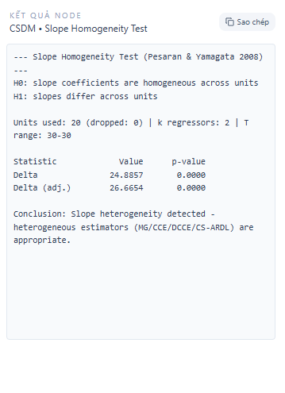

## 1. Kiểm định này dùng để làm gì?

Sub-node **CSDM • Slope Homogeneity Test** thực hiện kiểm định **đồng nhất hệ số góc** của Pesaran và Yamagata (2008) — thường gọi là kiểm định Delta ($\Delta$) — trên mô hình panel đã ước lượng bởi node *Panel Model Estimation with Cross-Sectional Dependence*. Câu hỏi mà kiểm định trả lời mang tính nền tảng cho toàn bộ chiến lược mô hình hóa: **các đơn vị chéo có chia sẻ cùng một vectơ hệ số góc hay không?**

Nếu hệ số đồng nhất ($\beta_i = \beta$ với mọi $i$), các ước lượng gộp (pooled) như FE/RE hiệu quả hơn nhờ tận dụng toàn bộ $NT$ quan sát cho một bộ tham số chung; lựa chọn heterogeneous estimators khi đó lãng phí thông tin. Ngược lại, nếu hệ số dị biệt thực sự mà vẫn áp đặt gộp chung, ước lượng pooled trong mô hình tĩnh chỉ còn ước lượng một trung bình có trọng số khó diễn giải, còn trong mô hình động thì **chệch và không vững** ngay cả với $N, T \to \infty$ (Pesaran & Smith, 1995). Kết quả kiểm định Delta vì vậy là một trong những căn cứ trực tiếp nhất để biện minh cho việc dùng MG/CCE/DCCE/CS-ARDL thay vì FEM/REM truyền thống trong một bài báo thực nghiệm.

Kiểm định này là thành phần chuẩn trong quy trình phân tích panel vĩ mô hiện đại: hệ sinh thái Stata triển khai nó qua lệnh `xthst` (Bersvendsen & Ditzen, 2021), và hầu hết các nghiên cứu ứng dụng CCE/CS-ARDL đều báo cáo $\Delta$ và $\Delta_{adj}$ trong bảng chẩn đoán tiền ước lượng. Trong R, kiểm định chưa có sẵn trong các package phổ biến cho lớp mô hình này, nên node của StatNode cài đặt trực tiếp công thức gốc của Pesaran và Yamagata (2008), với điều chỉnh cho panel không cân bằng.

## 2. Nền tảng lý thuyết

### 2.1. Bài toán và giả thuyết

Xét mô hình panel dị biệt tiềm năng:

$$
y_{it} = \alpha_i + \boldsymbol{\beta}_i' \mathbf{x}_{it} + \varepsilon_{it}, \qquad i = 1,\dots,N; \; t = 1,\dots,T_i,
$$

với $\mathbf{x}_{it}$ là vectơ $k \times 1$ biến giải thích. Cặp giả thuyết:

$$
H_0: \boldsymbol{\beta}_i = \boldsymbol{\beta} \;\; \forall i
\qquad \text{vs.} \qquad
H_1: \boldsymbol{\beta}_i \neq \boldsymbol{\beta}_j \;\; \text{với một tỷ lệ khác 0 các cặp } (i,j).
$$

Kiểm định cổ điển cho bài toán này — F-test gộp hoặc kiểm định Swamy (1970) — đòi hỏi $T$ lớn với $N$ cố định, không phù hợp với panel vĩ mô có cả hai chiều lớn. Đóng góp của Pesaran và Yamagata (2008) là chuẩn hóa lại thống kê phân tán kiểu Swamy để thu được phân phối chuẩn tiệm cận trong khung $(N, T) \to \infty$ đồng thời.

### 2.2. Thống kê phân tán Swamy

Bước đầu tiên là ước lượng OLS riêng cho từng đơn vị (sau biến đổi within để khử $\alpha_i$), thu được $\hat{\boldsymbol{\beta}}_i$ và phương sai phần dư $\hat{\sigma}_i^2$. Tiếp theo tính **ước lượng gộp có trọng số** (weighted fixed effects, WFE):

$$
\tilde{\boldsymbol{\beta}}_{WFE} = \left( \sum_{i=1}^{N} \frac{\mathbf{X}_i'\mathbf{M}_\tau\mathbf{X}_i}{\hat{\sigma}_i^2} \right)^{-1} \sum_{i=1}^{N} \frac{\mathbf{X}_i'\mathbf{M}_\tau\,\mathbf{y}_i}{\hat{\sigma}_i^2},
$$

trong đó $\mathbf{M}_\tau$ là ma trận khử trung bình theo thời gian của từng đơn vị. Thống kê phân tán đo khoảng cách có trọng số giữa các hệ số cá thể và hệ số gộp:

$$
\tilde{S} = \sum_{i=1}^{N} \big(\hat{\boldsymbol{\beta}}_i - \tilde{\boldsymbol{\beta}}_{WFE}\big)' \,\frac{\mathbf{X}_i'\mathbf{M}_\tau\mathbf{X}_i}{\hat{\sigma}_i^2}\, \big(\hat{\boldsymbol{\beta}}_i - \tilde{\boldsymbol{\beta}}_{WFE}\big).
$$

Trực giác: dưới $H_0$, mỗi số hạng trong tổng xấp xỉ một biến $\chi^2_k$, nên $\tilde{S}/N$ dao động quanh $k$; dưới $H_1$, khoảng cách giữa $\hat{\boldsymbol{\beta}}_i$ và hệ số gộp phản ánh dị biệt thật và $\tilde{S}$ phình to theo $T$.

### 2.3. Thống kê Delta và Delta hiệu chỉnh

Chuẩn hóa $\tilde{S}$ quanh kỳ vọng và phương sai tiệm cận của nó cho thống kê Delta:

$$
\Delta = \sqrt{N}\; \frac{N^{-1}\tilde{S} - k}{\sqrt{2k}} \;\xrightarrow{d}\; N(0,1) \quad \text{dưới } H_0,
$$

khi $(N, T) \to \infty$ với $\sqrt{N}/T \to 0$. Với $T$ hữu hạn, trung bình và phương sai của từng số hạng lệch khỏi $(k, 2k)$; phiên bản **hiệu chỉnh mẫu nhỏ** dùng moments chính xác dưới giả định sai số chuẩn:

$$
\Delta_{adj} = \sqrt{N}\; \frac{N^{-1}\tilde{S} - k}{\sqrt{v(T,k)}},
\qquad
v(T,k) = \frac{2k\,(T-k-1)}{T+1}.
$$

Với panel không cân bằng, node thay $v(T,k)$ bằng trung bình của $v(T_i, k)$ trên các đơn vị, theo đúng tinh thần công thức gốc cho $T_i$ khác nhau. Cả hai thống kê đều kiểm định hai phía trên phân phối chuẩn chuẩn tắc; node báo cáo p-value hai phía tương ứng.

### 2.4. Vị trí trong văn liệu và các mở rộng

Mô phỏng của Pesaran và Yamagata (2008) cho thấy $\Delta_{adj}$ giữ kích thước tốt từ $T \approx 20$ và có năng lực cao khi tỷ lệ đơn vị dị biệt vượt 20–30%. Hai hạn chế đã biết: thứ nhất, kiểm định giả định sai số không tự tương quan — Blomquist và Westerlund (2013) phát triển phiên bản HAC bền vững với tự tương quan và phương sai thay đổi; thứ hai, phụ thuộc chéo mạnh chưa được xử lý trong phiên bản gốc — thực hành phổ biến (như `xthst` với tùy chọn CSD) là chạy kiểm định trên dữ liệu đã khử nhân tố chung. Trong StatNode, người dùng có thể đối chiếu kết luận của kiểm định với chênh lệch thực tế giữa ước lượng MG và CCE như một phép kiểm tra chéo trực quan.

## 3. Điều kiện sử dụng

1. **Node cha bắt buộc.** Sub-node lấy dữ liệu gốc cùng danh sách biến từ thuộc tính đính kèm đối tượng model của node *Panel Model Estimation with Cross-Sectional Dependence*; kiểm định luôn được tính trên đặc tả $y \sim x_1 + \dots + x_k$ của node cha.

2. **Chiều thời gian tối thiểu.** Mỗi đơn vị cần $T_i > k + 1$ để hồi quy cá thể khả thi (node tự loại các đơn vị thiếu quan sát và báo số đơn vị bị loại). Để $\Delta_{adj}$ đáng tin cậy, khuyến nghị $T_i \geq 20$.

3. **Số đơn vị đủ lớn.** Phân phối chuẩn tiệm cận theo $\sqrt{N}$; với $N < 10$ kiểm định mất ý nghĩa thực tiễn.

4. **Sai số lý tưởng là không tự tương quan và phương sai thuần nhất theo thời gian** trong từng đơn vị. Với chuỗi có tự tương quan mạnh, p-value của phiên bản gốc có thể quá lạc quan; nên diễn giải thận trọng hoặc kiểm tra độ bền bằng cách thêm trễ vào đặc tả.

5. **Đa cộng tuyến trong từng đơn vị.** Ma trận $\mathbf{X}_i'\mathbf{M}_\tau\mathbf{X}_i$ phải khả nghịch cho từng đơn vị; node tự loại đơn vị có ma trận suy biến (ví dụ biến không đổi theo thời gian trong một đơn vị).

6. **Kết quả không phụ thuộc estimator đã chọn ở node cha** (MG hay CCE), vì kiểm định được tính lại từ dữ liệu gốc; nó đánh giá tính dị biệt của đặc tả cơ sở, không phải của mô hình tăng cường trung bình chéo.

## 4. Quy trình thực hiện (Workflow)

Kiểm định đồng nhất hệ số góc đứng ở vị trí "ngã ba đường" trong quy trình chọn mô hình panel:

1. **Ước lượng node cha** với đặc tả quan tâm (biến phụ thuộc, biến giải thích, định danh đơn vị/thời gian).
2. **Chạy sub-node Slope Homogeneity.** Đọc cả $\Delta$ và $\Delta_{adj}$; với $T$ vừa phải, ưu tiên $\Delta_{adj}$.
3. **Quyết định nhánh mô hình:**
   - *Bác bỏ $H_0$* → hệ số dị biệt: các ước lượng trung bình nhóm (MG/CCE/DCCE/CS-ARDL) là lựa chọn đúng; báo cáo kết quả kiểm định như căn cứ phương pháp luận.
   - *Không bác bỏ $H_0$* → cân nhắc pooled estimators (FEM/REM, hoặc pooled CCE) để tăng hiệu quả; tuy nhiên nếu lý thuyết kinh tế dự đoán dị biệt mạnh, việc không bác bỏ có thể chỉ phản ánh năng lực kiểm định thấp với $N$, $T$ hiện có.
4. **Kết hợp với các chẩn đoán khác:** kiểm định CD (phụ thuộc chéo) và CIPS (tính dừng) — ba sub-node cùng nhau tạo thành bộ "tam giác chẩn đoán" chuẩn trước khi diễn giải mô hình cuối cùng.

## 5. Thực hành trên phần mềm StatNode

Tiếp tục ví dụ panel mô phỏng ($N = 20$ quốc gia, $T = 30$ năm, `y ~ x1 + x2`) với hệ số thật được sinh dị biệt: $\beta_{1i} \sim N(0.8, 0.2^2)$ và $\beta_{2i} \sim N(-0.4, 0.1^2)$.

**Bước 1 — Thêm sub-node.** Chọn node *Panel Model Estimation with Cross-Sectional Dependence*, nhấn **Thêm sub-node** và chọn *CSDM • Slope Homogeneity Test*. Node được nối tự động vào cổng model.

**Bước 2 — Cấu hình.** Kiểm định không có siêu tham số: toàn bộ thông tin (dữ liệu, danh sách biến, định danh) kế thừa từ node cha, nên bảng cài đặt chỉ gồm phần ghi chú:

**Bước 3 — Chạy.** Nhấn **Chạy tất cả**. Node thực hiện 20 hồi quy within cá thể, tính $\tilde{\boldsymbol{\beta}}_{WFE}$, thống kê $\tilde{S}$ và in kết quả:

Output nêu rõ cặp giả thuyết, số đơn vị sử dụng/bị loại, số biến giải thích $k$, khoảng $T_i$, bảng hai thống kê kèm p-value, và một dòng kết luận tự động ở mức 5%.

## 6. Diễn giải kết quả

Kết quả trên dữ liệu minh họa:

| Thống kê | Giá trị | p-value |
|---|---|---|
| $\Delta$ | $24.8857$ | $< 0.0001$ |
| $\Delta_{adj}$ | $26.6654$ | $< 0.0001$ |

kèm thông tin: 20 đơn vị sử dụng, 0 bị loại, $k = 2$, $T_i = 30$ cho mọi đơn vị.

**Kết luận thống kê.** Cả hai thống kê đều vượt xa ngưỡng tới hạn của phân phối chuẩn (1.96 ở mức 5%; 2.58 ở mức 1%), bác bỏ dứt khoát giả thuyết hệ số đồng nhất. Độ lớn của thống kê — trên 24 độ lệch chuẩn — phản ánh dị biệt được thiết kế sẵn trong quá trình sinh dữ liệu: độ lệch chuẩn 0.2 của $\beta_{1i}$ quanh 0.8 là rất lớn so với nhiễu ước lượng cá thể khi $T = 30$.

**Đọc $N^{-1}\tilde{S}$ như quy mô hiệu ứng.** Từ công thức, $N^{-1}\tilde{S} = k + \Delta \sqrt{2k/N}$; với $\Delta = 24.89$, $k = 2$, $N = 20$ ta được $N^{-1}\tilde{S} \approx 13.1$ — trung bình mỗi đơn vị đóng góp lượng phân tán gấp hơn sáu lần mức kỳ vọng dưới đồng nhất ($k = 2$). Đây là dị biệt lớn cả về thống kê lẫn thực chất.

**Hàm ý mô hình hóa.** Dòng kết luận của node — *"Slope heterogeneity detected — heterogeneous estimators (MG/CCE/DCCE/CS-ARDL) are appropriate"* — chính là căn cứ phương pháp luận cho việc ở lại với node cha thay vì quay về FEM/REM. Trong bài báo thực nghiệm, kết quả này thường được trình bày trong bảng chẩn đoán tiền ước lượng, bên cạnh kiểm định CD và kiểm định nghiệm đơn vị.

**Khi nào kết luận ngược lại?** Nếu $\Delta_{adj}$ không bác bỏ (p-value lớn), pooled estimators trở thành lựa chọn hấp dẫn nhờ hiệu quả cao hơn. Tuy vậy cần ba lưu ý: (i) không bác bỏ không chứng minh đồng nhất — đặc biệt khi $N$ hoặc $T$ nhỏ; (ii) với tự tương quan mạnh trong sai số, phiên bản gốc có thể bác bỏ sai — nên đối chiếu với biến thể HAC (Blomquist & Westerlund, 2013) khi nghi ngờ; (iii) dị biệt có thể tập trung ở một nhóm nhỏ đơn vị — phân tích hệ số cá thể (in trong phần *Mean Group Variables* của node cha) giúp định vị nhóm này.

**Sai lầm cần tránh.** Không dùng kiểm định này để chọn giữa CCE và MG — cả hai đều là heterogeneous estimators; lựa chọn giữa chúng phụ thuộc vào phụ thuộc chéo (kiểm định CD), không phụ thuộc vào kết quả Delta. Tương tự, bác bỏ đồng nhất không nói gì về tính dừng hay đồng tích hợp của các chuỗi — đó là vai trò của kiểm định CIPS.

## 7. Tài liệu tham khảo

1. Pesaran, M. H., & Yamagata, T. (2008). Testing slope homogeneity in large panels. *Journal of Econometrics*, 142(1), 50–93.
2. Swamy, P. A. V. B. (1970). Efficient inference in a random coefficient regression model. *Econometrica*, 38(2), 311–323.
3. Pesaran, M. H., & Smith, R. (1995). Estimating long-run relationships from dynamic heterogeneous panels. *Journal of Econometrics*, 68(1), 79–113.
4. Blomquist, J., & Westerlund, J. (2013). Testing slope homogeneity in large panels with serial correlation. *Economics Letters*, 121(3), 374–378.
5. Bersvendsen, T., & Ditzen, J. (2021). Testing for slope heterogeneity in Stata. *The Stata Journal*, 21(1), 51–80.
6. Hsiao, C. (2014). *Analysis of Panel Data* (3rd ed.). Cambridge University Press. (Chương về random coefficients models.)
7. Pesaran, M. H. (2015). *Time Series and Panel Data Econometrics*. Oxford University Press. (Chương 28: Heterogeneous panels.)
8. Ditzen, J. (2018). Estimating dynamic common-correlated effects in Stata. *The Stata Journal*, 18(3), 585–617.
