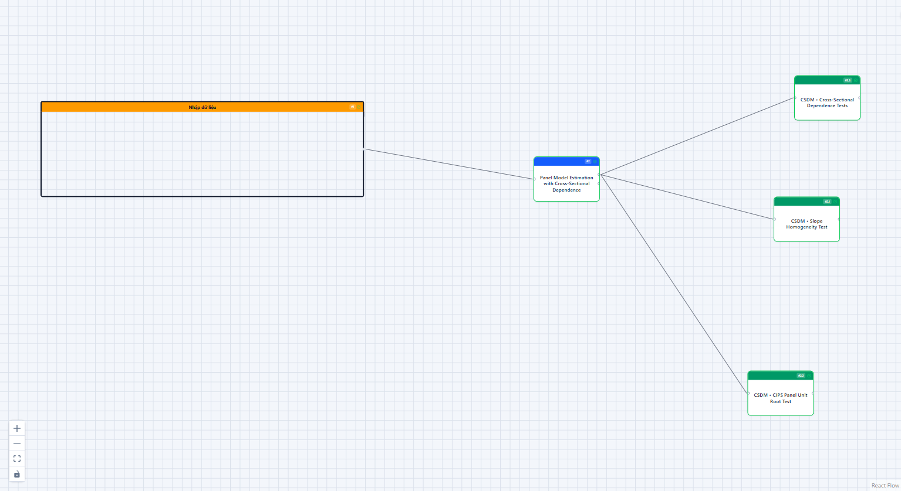
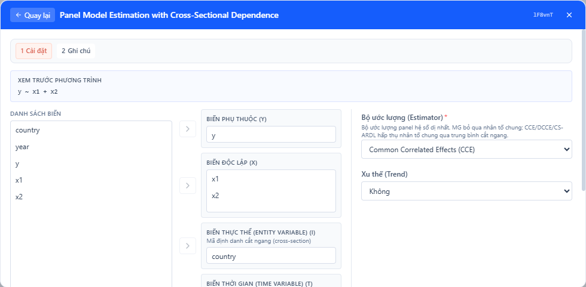
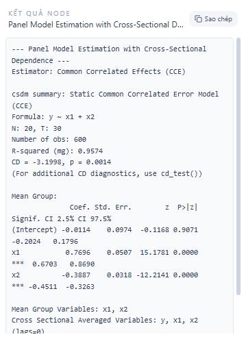

## 1. Mô hình này dùng để làm gì?

Node **Panel Model Estimation with Cross-Sectional Dependence** ước lượng các mô hình hồi quy trên dữ liệu bảng (panel data) trong bối cảnh mà giả định độc lập giữa các đơn vị chéo — quốc gia, doanh nghiệp, tỉnh thành, ngân hàng — không còn đứng vững. Node được xây dựng trên package `csdm` của R và cung cấp bốn bộ ước lượng thuộc cùng một dòng phương pháp luận: **Mean Group (MG)**, **Common Correlated Effects (CCE)**, **Dynamic CCE (DCCE)** và **Cross-Sectionally Augmented ARDL (CS-ARDL)**.

Trong dữ liệu bảng vĩ mô và tài chính hiện đại, các đơn vị chéo hiếm khi vận động độc lập với nhau. Một cú sốc giá dầu, một chu kỳ lãi suất toàn cầu, một làn sóng công nghệ hay một cuộc khủng hoảng tài chính đều tác động đồng thời lên nhiều quốc gia và doanh nghiệp, dù mức độ hấp thụ của từng đơn vị khác nhau. Hiện tượng này được gọi là **phụ thuộc chéo** (cross-sectional dependence, CSD) và thường được mô hình hóa bằng các **nhân tố chung không quan sát được** (unobserved common factors) với hệ số tải (factor loadings) dị biệt theo đơn vị. Khi phần dư của mô hình chứa nhân tố chung tương quan với biến giải thích, các ước lượng truyền thống như Pooled OLS, Fixed Effects hay Random Effects không chỉ mất hiệu quả mà còn **chệch và không vững** (Pesaran, 2006; Chudik & Pesaran, 2015).

Bên cạnh phụ thuộc chéo, dữ liệu bảng vĩ mô với chiều thời gian dài còn đặt ra vấn đề **dị biệt hệ số góc** (slope heterogeneity): không có lý do tiên nghiệm nào buộc độ co giãn của tiêu dùng năng lượng theo thu nhập ở Việt Nam phải bằng đúng ở Đức. Pesaran và Smith (1995) chứng minh rằng việc gộp chung (pooling) các hệ số thực chất dị biệt trong mô hình động sẽ tạo ra chệch không biến mất ngay cả khi cả $N$ và $T$ tiến ra vô hạn. Bốn bộ ước lượng trong node này đều thuộc lớp **heterogeneous panel estimators**: hồi quy được chạy riêng cho từng đơn vị, sau đó các hệ số được lấy trung bình để thu được tác động trung bình tổng thể.

Node này phù hợp cho các bài toán điển hình như: ước lượng hàm sản xuất xuyên quốc gia khi năng suất chịu cú sốc công nghệ chung (Eberhardt & Teal, 2011); phân tích mối quan hệ năng lượng – tăng trưởng – phát thải trong các panel quốc gia; nghiên cứu truyền dẫn chính sách tiền tệ qua hệ thống ngân hàng; hay bất kỳ ứng dụng nào có $N$ và $T$ cùng tương đối lớn (thường $N \geq 10$–20 và $T \geq 20$) và nghi ngờ tồn tại nhân tố chung. Với quan hệ dài hạn giữa các chuỗi không dừng, biến thể CS-ARDL cho phép ước lượng trực tiếp hệ số dài hạn cùng tốc độ hiệu chỉnh sai số.

## 2. Nền tảng lý thuyết

### 2.1. Mô hình nhân tố chung

Khung phân tích chuẩn của lớp ước lượng này là mô hình bảng dị biệt với cấu trúc sai số đa nhân tố (multifactor error structure):

$$
y_{it} = \alpha_i + \boldsymbol{\beta}_i' \mathbf{x}_{it} + u_{it}, \qquad u_{it} = \boldsymbol{\gamma}_i' \mathbf{f}_t + \varepsilon_{it},
$$

với $i = 1, \dots, N$ là chỉ số đơn vị chéo, $t = 1, \dots, T$ là chỉ số thời gian, $\mathbf{f}_t$ là vectơ $m \times 1$ các nhân tố chung không quan sát được, $\boldsymbol{\gamma}_i$ là hệ số tải dị biệt, và $\varepsilon_{it}$ là sai số đặc thù (idiosyncratic). Điểm then chốt là các biến giải thích cũng có thể chịu tác động của chính các nhân tố đó:

$$
\mathbf{x}_{it} = \mathbf{a}_i + \boldsymbol{\Gamma}_i' \mathbf{f}_t + \mathbf{v}_{it}.
$$

Khi $\boldsymbol{\Gamma}_i \neq \mathbf{0}$, nhân tố chung trong sai số tương quan với $\mathbf{x}_{it}$, tạo ra vấn đề nội sinh do biến bị bỏ sót (omitted variable bias) mà các phép biến đổi within hay sai phân không loại bỏ được, vì $\mathbf{f}_t$ thay đổi theo thời gian và tác động khác nhau lên từng đơn vị.

Hệ số quan tâm là trung bình của các hệ số cá thể, $\boldsymbol{\beta} = E(\boldsymbol{\beta}_i)$, theo cách tiếp cận random coefficients: $\boldsymbol{\beta}_i = \boldsymbol{\beta} + \boldsymbol{\eta}_i$ với $\boldsymbol{\eta}_i \sim IID(\mathbf{0}, \boldsymbol{\Omega}_\eta)$.

### 2.2. Ước lượng Mean Group (MG)

Pesaran và Smith (1995) đề xuất chạy OLS riêng cho từng đơn vị rồi lấy trung bình số học của các hệ số:

$$
\hat{\boldsymbol{\beta}}_{MG} = \frac{1}{N} \sum_{i=1}^{N} \hat{\boldsymbol{\beta}}_i ,
$$

với phương sai được ước lượng phi tham số từ độ phân tán giữa các đơn vị:

$$
\widehat{\mathrm{Var}}\big(\hat{\boldsymbol{\beta}}_{MG}\big) = \frac{1}{N(N-1)} \sum_{i=1}^{N} \big(\hat{\boldsymbol{\beta}}_i - \hat{\boldsymbol{\beta}}_{MG}\big)\big(\hat{\boldsymbol{\beta}}_i - \hat{\boldsymbol{\beta}}_{MG}\big)' .
$$

MG nhất quán cho $E(\boldsymbol{\beta}_i)$ khi $N, T \to \infty$ trong điều kiện không có phụ thuộc chéo mạnh. Tuy nhiên, khi tồn tại nhân tố chung tương quan với biến giải thích, MG vẫn chệch — nó đóng vai trò mốc so sánh (benchmark) hơn là ước lượng cuối cùng, và chênh lệch giữa MG với CCE thường là dấu hiệu trực quan đầu tiên về mức độ nghiêm trọng của phụ thuộc chéo.

### 2.3. Ước lượng Common Correlated Effects (CCE)

Đóng góp nền tảng của Pesaran (2006, *Econometrica*) là nhận xét rằng tổ hợp tuyến tính các **trung bình chéo** (cross-sectional averages) của biến phụ thuộc và biến giải thích có thể đại diện ngày càng chính xác cho không gian nhân tố khi $N \to \infty$. Đặt $\bar{\mathbf{z}}_t = (\bar{y}_t, \bar{\mathbf{x}}_t')'$ với $\bar{y}_t = N^{-1}\sum_i y_{it}$ và $\bar{\mathbf{x}}_t = N^{-1}\sum_i \mathbf{x}_{it}$. Lấy trung bình chéo phương trình nhân tố cho thấy, với điều kiện hạng (rank condition) thỏa mãn,

$$
\mathbf{f}_t \approx \big(\bar{\boldsymbol{C}}'\big)^{+} \big(\bar{\mathbf{z}}_t - \bar{\boldsymbol{\alpha}}\big) \quad \text{khi } N \to \infty,
$$

nghĩa là nhân tố không quan sát được có thể được "lọc" ra khỏi sai số bằng cách đưa $\bar{\mathbf{z}}_t$ vào hồi quy của từng đơn vị như các biến kiểm soát bổ sung:

$$
y_{it} = \alpha_i + \boldsymbol{\beta}_i' \mathbf{x}_{it} + \boldsymbol{\delta}_i' \bar{\mathbf{z}}_t + e_{it}.
$$

Ước lượng **CCE Mean Group (CCEMG)** là trung bình của các $\hat{\boldsymbol{\beta}}_i$ từ những hồi quy tăng cường này. Kết quả lý thuyết đáng chú ý: CCE nhất quán mà **không cần biết số nhân tố** $m$ (miễn là số trung bình chéo không nhỏ hơn $m$), vẫn hoạt động khi nhân tố không dừng (Kapetanios, Pesaran & Yamagata, 2011), và phân phối tiệm cận của ước lượng trung bình nhóm không phụ thuộc vào sai số ước lượng nhân tố.

### 2.4. Dynamic CCE (DCCE)

Khi mô hình chứa biến trễ của biến phụ thuộc,

$$
y_{it} = \alpha_i + \varphi_i y_{i,t-1} + \boldsymbol{\beta}_i' \mathbf{x}_{it} + \boldsymbol{\gamma}_i' \mathbf{f}_t + \varepsilon_{it},
$$

trung bình chéo đương thời không còn đủ để xấp xỉ nhân tố, vì $y_{i,t-1}$ phụ thuộc vào toàn bộ lịch sử của $\mathbf{f}_t$. Chudik và Pesaran (2015) chứng minh rằng tính nhất quán được khôi phục nếu bổ sung **các trễ của trung bình chéo**:

$$
y_{it} = \alpha_i + \varphi_i y_{i,t-1} + \boldsymbol{\beta}_i' \mathbf{x}_{it} + \sum_{\ell=0}^{p_T} \boldsymbol{\delta}_{i\ell}' \bar{\mathbf{z}}_{t-\ell} + e_{it},
$$

với số trễ khuyến nghị $p_T = \lfloor T^{1/3} \rfloor$. Ví dụ $T = 30$ cho $p_T \approx 3$, còn $T = 50$ cho $p_T \approx 3$–4. Việc thêm trễ tiêu tốn bậc tự do, do đó DCCE đòi hỏi chiều thời gian dài hơn đáng kể so với CCE tĩnh; các nghiên cứu mô phỏng cho thấy hiệu chỉnh chệch mẫu nhỏ (như half-panel jackknife) hữu ích khi $T$ khiêm tốn.

### 2.5. CS-ARDL và quan hệ dài hạn

Khi mục tiêu là **hệ số dài hạn** giữa các biến (có thể không dừng và đồng tích hợp), cách tiếp cận ARDL tăng cường trung bình chéo (CS-ARDL; Chudik, Mohaddes, Pesaran & Raissi, 2016) ước lượng cho từng đơn vị:

$$
y_{it} = c_i + \sum_{\ell=1}^{p_y} \varphi_{i\ell}\, y_{i,t-\ell} + \sum_{\ell=0}^{p_x} \boldsymbol{\beta}_{i\ell}' \mathbf{x}_{i,t-\ell} + \sum_{\ell=0}^{\bar{p}} \boldsymbol{\delta}_{i\ell}' \bar{\mathbf{z}}_{t-\ell} + e_{it},
$$

rồi suy ra hệ số dài hạn của từng đơn vị từ các hệ số ngắn hạn:

$$
\hat{\boldsymbol{\theta}}_i = \frac{\sum_{\ell=0}^{p_x} \hat{\boldsymbol{\beta}}_{i\ell}}{1 - \sum_{\ell=1}^{p_y} \hat{\varphi}_{i\ell}},
\qquad
\hat{\boldsymbol{\theta}}_{MG} = \frac{1}{N}\sum_{i=1}^N \hat{\boldsymbol{\theta}}_i .
$$

Tốc độ hiệu chỉnh về cân bằng dài hạn được đo bằng $\hat{\lambda}_i = -\big(1 - \sum_{\ell} \hat{\varphi}_{i\ell}\big)$; giá trị âm và có ý nghĩa thống kê là bằng chứng tồn tại quan hệ hiệu chỉnh sai số. Ưu điểm của CS-ARDL là cho phép biến hồi quy I(0) hoặc I(1), không đòi hỏi kiểm định đồng tích hợp tiền nghiệm, nhưng đổi lại nhạy cảm với việc chọn bậc trễ và đòi hỏi $T$ đủ lớn để ước lượng động học riêng cho từng đơn vị.

### 2.6. Thống kê CD đi kèm

Sau khi ước lượng, mức độ phụ thuộc chéo còn sót trong phần dư được đo bằng thống kê CD của Pesaran (2004, 2015, 2021):

$$
CD = \sqrt{\frac{2T}{N(N-1)}} \sum_{i=1}^{N-1} \sum_{j=i+1}^{N} \hat{\rho}_{ij} \;\xrightarrow{d}\; N(0,1),
$$

trong đó $\hat{\rho}_{ij}$ là tương quan cặp của phần dư giữa đơn vị $i$ và $j$. Node tự động in CD trong bảng tóm tắt; phân tích chuyên sâu hơn (CDw, CDw+, CD*) được thực hiện bằng sub-node **CSDM • Cross-Sectional Dependence Tests**.

## 3. Điều kiện sử dụng

Việc áp dụng có ý nghĩa các ước lượng MG/CCE/DCCE/CS-ARDL đòi hỏi đồng thời nhiều điều kiện về dữ liệu và cấu trúc mô hình:

1. **Cả hai chiều của panel phải đủ lớn.** Mỗi đơn vị được hồi quy riêng, nên $T$ phải lớn hơn nhiều so với số tham số trong hồi quy cá thể (gồm cả các trung bình chéo và trễ của chúng). Kinh nghiệm mô phỏng cho thấy CCE tĩnh hoạt động tốt từ $N, T \approx 20$; DCCE và CS-ARDL nên có $T \geq 30$–50. $N$ lớn cần thiết để trung bình chéo xấp xỉ tốt nhân tố và để suy luận mean-group có hiệu lực.

2. **Panel không có cặp (đơn vị, thời gian) trùng lặp** và nên tương đối cân bằng. Node tự kiểm tra trùng lặp và dừng với thông báo lỗi rõ ràng nếu phát hiện; khoảng trống (gaps) nhỏ được chấp nhận nhưng làm giảm số quan sát hữu dụng của từng đơn vị.

3. **Điều kiện hạng (rank condition).** Số nhân tố chung không được vượt quá số trung bình chéo đưa vào ($m \leq k+1$ với $k$ biến giải thích khi dùng mặc định). Trên thực tế điều kiện này không kiểm chứng trực tiếp được; thêm trung bình chéo của các biến ngoài mô hình (qua tham số *Cross-Sectional Average Variables*) là một biện pháp phòng ngừa.

4. **Tính ngoại sinh yếu của biến giải thích.** CCE tĩnh yêu cầu $\mathbf{x}_{it}$ ngoại sinh chặt sau khi kiểm soát nhân tố; DCCE/CS-ARDL nới lỏng xuống ngoại sinh yếu (weakly exogenous) nhưng loại trừ phản hồi tức thời từ $\varepsilon_{it}$ sang $\mathbf{x}_{it}$.

5. **Số trễ hợp lý cho mô hình động.** Quy tắc $p_T \approx T^{1/3}$ cho trễ trung bình chéo; bậc ARDL $(p_y, p_x)$ thường chọn 1–2 với dữ liệu năm. Trễ quá ít gây chệch do xấp xỉ nhân tố kém; trễ quá nhiều làm phương sai tăng mạnh.

6. **Dị biệt hệ số là dị biệt ngẫu nhiên.** Khung random coefficients giả định $\boldsymbol{\eta}_i$ độc lập với biến giải thích; nếu hệ số dị biệt một cách hệ thống theo một biến quan sát được, nên mô hình hóa tương tác trực tiếp.

7. **Với CS-ARDL:** các biến có thể I(0) hoặc I(1) nhưng không I(2); nên kiểm tra bậc tích hợp bằng sub-node **CIPS Panel Unit Root Test** trước khi diễn giải hệ số dài hạn.

Trước khi ước lượng, quy trình chuẩn trong văn liệu (Ditzen, 2018, 2021) khuyến nghị: kiểm định phụ thuộc chéo trên dữ liệu gốc, kiểm định tính dừng bằng kiểm định thế hệ hai (CIPS), và kiểm định dị biệt hệ số góc (Pesaran & Yamagata, 2008) — cả ba đều có sẵn dưới dạng sub-node của node này.

## 4. Quy trình thực hiện (Workflow)

Quy trình phân tích hoàn chỉnh với node này diễn ra theo tám bước, phản ánh thông lệ trong các nghiên cứu thực nghiệm sử dụng `xtdcce2` (Stata) và `csdm` (R):

1. **Chuẩn bị dữ liệu bảng dạng dài (long format):** mỗi dòng là một quan sát (đơn vị $i$, thời điểm $t$), có cột định danh đơn vị, cột thời gian, biến phụ thuộc và các biến giải thích. Xử lý giá trị thiếu và kiểm tra không có cặp $(i,t)$ trùng lặp.

2. **Thống kê mô tả và trực quan hóa:** vẽ chuỗi thời gian theo đơn vị để cảm nhận xu thế chung và mức độ dị biệt; tính tương quan giữa các đơn vị trên biến phụ thuộc.

3. **Kiểm định phụ thuộc chéo sơ bộ:** chạy ước lượng MG đơn giản rồi dùng sub-node CD Tests, hoặc quan sát thống kê CD in kèm bảng tóm tắt. Nếu không có bằng chứng CSD, các ước lượng FE/RE truyền thống có thể đủ và tiết kiệm hơn.

4. **Kiểm định tính dừng:** dùng sub-node CIPS trên các biến của mô hình (mức và sai phân bậc một) để xác định bậc tích hợp. Tất cả I(0): CCE/DCCE trực tiếp trên mức. Hỗn hợp I(0)/I(1): cân nhắc CS-ARDL để tách bạch dài hạn – ngắn hạn.

5. **Kiểm định dị biệt hệ số góc:** sub-node Slope Homogeneity (kiểm định $\tilde{\Delta}$) cho biết liệu giả định hệ số chung của các mô hình pooled có bị bác bỏ — nếu có, lựa chọn heterogeneous estimators của node này được củng cố.

6. **Chọn bộ ước lượng và cấu hình:** mô hình tĩnh → CCE (so sánh với MG); mô hình động hoặc nghi ngờ nhân tố tác động kéo dài → DCCE với `csa_lags` $\approx T^{1/3}$; quan tâm hệ số dài hạn → CS-ARDL với `ylags`, `xdlags` phù hợp.

7. **Ước lượng và chẩn đoán phần dư:** chạy node, sau đó chạy lại sub-node CD Tests trên phần dư của mô hình đã chọn. Kỳ vọng là sau khi hấp thụ nhân tố chung, phụ thuộc chéo mạnh không còn (CD không bác bỏ $H_0$, hoặc ít nhất CD* — phiên bản đã hiệu chỉnh chệch — không bác bỏ).

8. **Diễn giải và kiểm tra độ nhạy:** so sánh hệ số giữa MG/CCE/DCCE, thử thay đổi số trễ, thử thêm xu thế đơn vị (trend), và báo cáo đầy đủ các kiểm định đi kèm.

Trên canvas của StatNode, toàn bộ quy trình này thể hiện bằng một workflow trực quan: node **Nhập dữ liệu** nối vào node **Panel Model Estimation with Cross-Sectional Dependence**, và ba sub-node chẩn đoán nối vào cổng model của node chính.

## 5. Thực hành trên phần mềm StatNode

Phần này minh họa từng bước trên https://statnode.io với một bộ dữ liệu mô phỏng gồm $N = 20$ quốc gia, $T = 30$ năm (600 quan sát). Dữ liệu được sinh từ mô hình nhân tố: một nhân tố chung $f_t$ dạng bước ngẫu nhiên tác động lên cả $y$, $x_1$, $x_2$ với hệ số tải khác nhau giữa các quốc gia, và hệ số góc thật dị biệt quanh $\beta_1 = 0.8$, $\beta_2 = -0.4$. Tệp CSV gồm năm cột: `country`, `year`, `y`, `x1`, `x2`.

**Bước 1 — Dựng workflow.** Tạo project mới, thêm node **Nhập dữ liệu** (nhóm Dữ liệu) và tải tệp CSV lên. Tiếp đó tìm "Panel Model Estimation" trong nhóm Ước lượng → Panel, thêm vào canvas và kéo cạnh nối từ cổng dữ liệu của node nhập sang cổng Data của node ước lượng. Workflow hoàn chỉnh (kèm ba sub-node sẽ thêm ở các bài hướng dẫn tiếp theo) có dạng:

**Bước 2 — Cấu hình node.** Nhấp đúp node để mở bảng cài đặt. Gán `y` vào **Biến phụ thuộc (Y)**; `x1`, `x2` vào **Biến độc lập (X)**; `country` vào **Biến thực thể (Entity)**; `year` vào **Biến thời gian (Time)**. Ở mục **Bộ ước lượng (Estimator)** chọn *Common Correlated Effects (CCE)*. Phần xem trước phương trình hiển thị `y ~ x1 + x2`:

Một số lưu ý cấu hình:

- **Cross-Sectional Average Variables**: để trống, node mặc định dùng trung bình chéo của $y$, $x_1$, $x_2$ — lựa chọn chuẩn theo Pesaran (2006).
- Khi chuyển Estimator sang *Dynamic CCE* hoặc *CS-ARDL*, các tham số bổ sung xuất hiện: **Lags of Cross-Sectional Averages** (khuyến nghị $\lfloor T^{1/3} \rfloor \approx 3$ với $T=30$), **Lags of Dependent Variable (p)** và **Distributed Lags of Regressors (q)**.
- **Trend** cho phép thêm xu thế tuyến tính riêng từng đơn vị khi chuỗi có xu thế tất định.

**Bước 3 — Chạy và đọc output.** Nhấn **Chạy tất cả**. R (webR) tải package `csdm`, ước lượng 20 hồi quy cá thể tăng cường trung bình chéo và in bảng tóm tắt:

Output gồm các khối: thông tin mô hình (`Static Common Correlated Error Model (CCE)`, công thức, $N = 20$, $T = 30$, 600 quan sát), độ phù hợp ($R^2(mg) = 0.9574$), thống kê CD trên phần dư ($CD = -3.1998$, $p = 0.0014$), và bảng hệ số Mean Group với sai số chuẩn phi tham số, thống kê $z$, p-value cùng khoảng tin cậy 95%.

## 6. Diễn giải kết quả

Với dữ liệu minh họa, bảng hệ số CCE Mean Group cho kết quả:

| Hệ số | Ước lượng | SE | z | p-value | KTC 95% |
|---|---|---|---|---|---|
| Hằng số | $-0.0114$ | $0.0974$ | $-0.117$ | $0.907$ | $[-0.202;\ 0.180]$ |
| $x_1$ | $0.7696$ | $0.0507$ | $15.178$ | $<0.001$ | $[0.670;\ 0.869]$ |
| $x_2$ | $-0.3887$ | $0.0318$ | $-12.214$ | $<0.001$ | $[-0.451;\ -0.326]$ |

Cách đọc từng thành phần:

**Hệ số Mean Group.** $\hat{\beta}_1 = 0.7696$ là trung bình của 20 hệ số cá thể, ước lượng cho $E(\beta_{1i})$ — tác động trung bình của $x_1$ lên $y$ trong tổng thể các đơn vị. Giá trị này gần tham số thật ($0.8$) của quá trình sinh dữ liệu, và khoảng tin cậy 95% $[0.670; 0.869]$ chứa giá trị thật. Tương tự, $\hat{\beta}_2 = -0.3887$ tái tạo tốt $\beta_2 = -0.4$. Lưu ý diễn giải: đây là tác động *trung bình giữa các đơn vị*, không phải tác động chung áp đặt cho mọi đơn vị; từng quốc gia riêng lẻ có thể có hệ số khác đáng kể.

**Sai số chuẩn phi tham số.** SE được tính từ độ phân tán của các $\hat{\boldsymbol{\beta}}_i$ quanh trung bình, do đó đã phản ánh cả dị biệt hệ số thật lẫn sai số ước lượng cá thể — một lý do khiến suy luận mean-group bền vững với heteroskedasticity và tự tương quan trong từng đơn vị.

**$R^2(mg) = 0.9574$** là trung bình $R^2$ của các hồi quy cá thể (đã bao gồm các trung bình chéo), cho biết mô hình tăng cường giải thích phần lớn biến thiên trong từng đơn vị. Giá trị cao ở đây một phần do trung bình chéo hấp thụ nhân tố chung rất mạnh trong dữ liệu mô phỏng.

**Thống kê CD = $-3.1998$ ($p = 0.0014$).** Sau khi tăng cường trung bình chéo, kiểm định CD gốc vẫn bác bỏ $H_0$ về không phụ thuộc chéo ở phần dư. Kết quả này cần thận trọng: như Juodis và Reese (2022) chỉ ra, áp dụng CD lên phần dư CCE chịu vấn đề tham số ngẫu nhiên (incidental parameters) khiến kiểm định bác bỏ quá mức. Đây chính là lý do nên dùng sub-node **CD Tests** với các biến thể CDw, CDw+ và CD* đã hiệu chỉnh — trong ví dụ này CDw cho $p = 0.364$, tức không còn bằng chứng phụ thuộc chéo mạnh sau hiệu chỉnh (xem bài hướng dẫn sub-node tương ứng).

**So sánh giữa các estimator.** Chạy lại node với Estimator = MG cho hệ số lệch xa giá trị thật hơn (do nhân tố chung tương quan với biến giải thích chưa được kiểm soát), minh họa trực tiếp chệch của MG dưới CSD. Khi chuyển sang DCCE/CS-ARDL, output bổ sung các khối hệ số ngắn hạn, dài hạn và tốc độ hiệu chỉnh; hệ số dài hạn được đọc như độ co giãn cân bằng, còn $\hat{\lambda} \in (-2, 0)$ với p-value nhỏ xác nhận cơ chế hiệu chỉnh sai số ổn định.

**Những sai lầm diễn giải cần tránh:** (i) coi hệ số CCE như tác động nhân quả mà bỏ qua yêu cầu ngoại sinh yếu; (ii) so sánh trực tiếp độ lớn hệ số giữa CCE tĩnh và CS-ARDL — một bên là tác động đương thời có kiểm soát nhân tố, một bên là hệ số dài hạn; (iii) bỏ qua kiểm định phần dư rồi kết luận mô hình đã "xử lý xong" phụ thuộc chéo.

## 7. Tài liệu tham khảo

1. Pesaran, M. H., & Smith, R. (1995). Estimating long-run relationships from dynamic heterogeneous panels. *Journal of Econometrics*, 68(1), 79–113.
2. Pesaran, M. H. (2006). Estimation and inference in large heterogeneous panels with a multifactor error structure. *Econometrica*, 74(4), 967–1012.
3. Chudik, A., & Pesaran, M. H. (2015). Common correlated effects estimation of heterogeneous dynamic panel data models with weakly exogenous regressors. *Journal of Econometrics*, 188(2), 393–420.
4. Chudik, A., Mohaddes, K., Pesaran, M. H., & Raissi, M. (2016). Long-run effects in large heterogeneous panel data models with cross-sectionally correlated errors. In *Essays in Honor of Aman Ullah* (Advances in Econometrics, Vol. 36, pp. 85–135). Emerald.
5. Kapetanios, G., Pesaran, M. H., & Yamagata, T. (2011). Panels with non-stationary multifactor error structures. *Journal of Econometrics*, 160(2), 326–348.
6. Pesaran, M. H. (2015). Testing weak cross-sectional dependence in large panels. *Econometric Reviews*, 34(6–10), 1089–1117.
7. Pesaran, M. H. (2021). General diagnostic tests for cross-sectional dependence in panels. *Empirical Economics*, 60(1), 13–50.
8. Juodis, A., & Reese, S. (2022). The incidental parameters problem in testing for remaining cross-section correlation. *Journal of Business & Economic Statistics*, 40(3), 1191–1203.
9. Eberhardt, M., & Teal, F. (2011). Econometrics for grumblers: A new look at the literature on cross-country growth empirics. *Journal of Economic Surveys*, 25(1), 109–155.
10. Ditzen, J. (2018). Estimating dynamic common-correlated effects in Stata. *The Stata Journal*, 18(3), 585–617.
11. Ditzen, J. (2021). Estimating long-run effects and the exponent of cross-sectional dependence: An update to xtdcce2. *The Stata Journal*, 21(3), 687–707.
12. Pesaran, M. H., & Yamagata, T. (2008). Testing slope homogeneity in large panels. *Journal of Econometrics*, 142(1), 50–93.
13. Pesaran, M. H. (2007). A simple panel unit root test in the presence of cross-section dependence. *Journal of Applied Econometrics*, 22(2), 265–312.
14. csdm: Common Correlated Effects Estimation of Heterogeneous Panel Data Models. *CRAN Reference Manual*. https://cran.r-project.org/package=csdm
