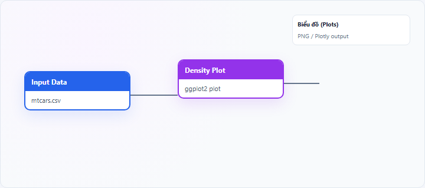
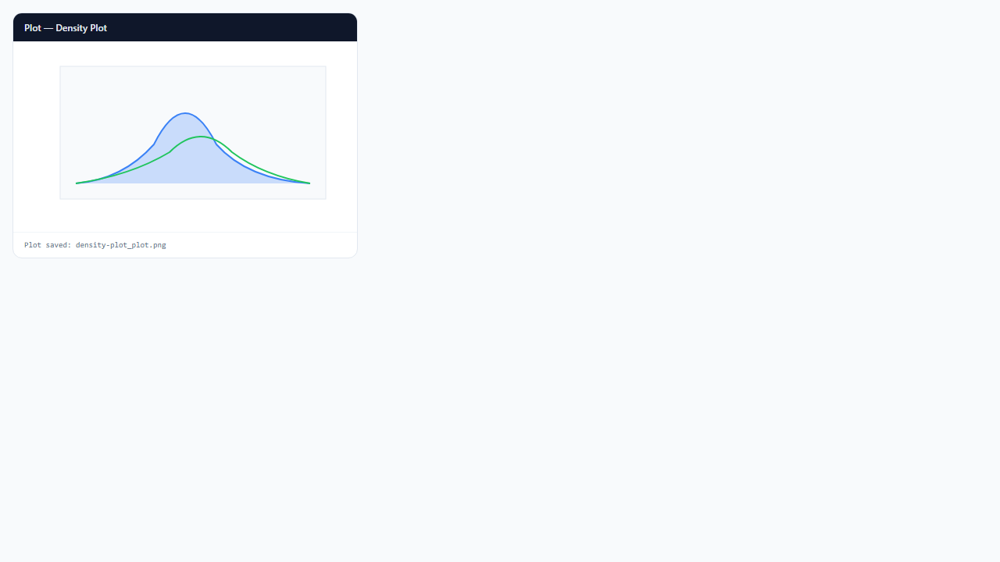

## 1. Biểu đồ mật độ (Density Plot) là gì?

**Density plot** (biểu đồ mật độ, KDE plot) vẽ **ước lượng mật độ xác suất** liên tục của biến số bằng **kernel density estimation** (KDE). Đường cong mượt thay cho cột histogram; diện tích dưới đường chuẩn hóa bằng 1 (một biến, một nhóm).

Node **Density Plot** trên StatNode dùng **ggplot2** `geom_density`; có thể tách theo `group_var`.

## 2. Biểu đồ mật độ (Density Plot) dùng để làm gì?

Density plot trả lời:

- **Vị trí đỉnh** và **độ phân tán** của phân phối?
- **Đuôi** (skew) và **đa đỉnh**?
- **So sánh hình dạng** giữa nhóm (đường chồng)?

**Khi nên dùng:** cần đường phân phối mượt; so sánh nhiều nhóm trên cùng trục; trình bày báo cáo.

**Khi không nên dùng:** mẫu rất nhỏ; cần đếm tần suất tuyệt đối (histogram); nhóm cực nhỏ.

**So sánh:** density = histogram làm mịn; **violin** = density + box theo nhóm; **box plot** bỏ qua modality.

## 3. Thực hành trên phần mềm StatNode

Workflow cơ bản: kéo node **Input Data** (hoặc nguồn dữ liệu khác) → nối cổng **Data** vào node **Density Plot** → chạy workflow → xem biểu đồ tại panel **Biểu đồ** (Plots).

**Dữ liệu minh họa:** `mtcars`: `mpg`; tùy chọn `cyl` làm nhóm.

**Cấu hình node:**

- **Variable**: `mpg`
- **Group Variable (optional)**: `cyl`
- **Chart Title**: `Mật độ MPG`

**Kết quả:**

## 4. Diễn giải kết quả

- **Đỉnh cao hẹp:** giá trị tập trung quanh một mode — phân phối hẹp.
- **Đỉnh thấp rộng:** phân tán lớn.
- **Đuôi dài một phía:** skew — cân nhắc transform.
- **Hai đỉnh:** bimodal — mixture hoặc hai tiểu nhóm.
- **Đường nhóm lệch trái/phải:** khác biệt location; đường cao hơn hẹp hơn: ít phân tán hơn (tương đối).

**Sai lầm:** KDE với $n < 20$ quá nhiễu; coi đỉnh KDE là đúng tuyệt đối (phụ thuộc bandwidth ggplot2 mặc định).

## 5. Tài liệu tham khảo

1. Silverman, B. W. (1986). *Density Estimation for Statistics and Data Analysis*. Chapman & Hall.
2. Wickham, H. (2016). *ggplot2* (2nd ed.). Springer.
3. Wand, M. P., & Jones, M. C. (1995). *Kernel Smoothing*. Chapman & Hall.
4. R Documentation — `geom_density()`: https://ggplot2.tidyverse.org/reference/geom_density.html

---

Ghi chú: ggplot2 chọn bandwidth theo mặc định; so sánh nhóm nên kiểm tra cỡ mẫu từng nhóm trước khi diễn giải chi tiết đỉnh phụ.