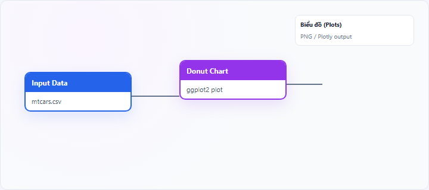
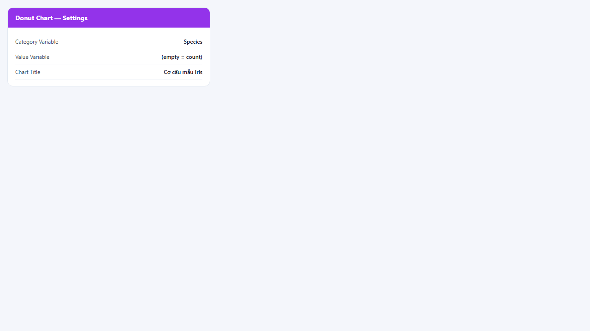
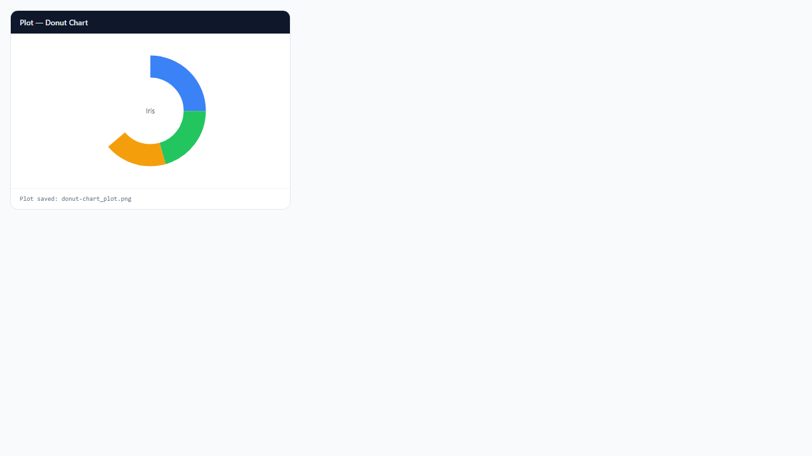

## 1. Biểu đồ vòng (Donut Chart) là gì?

**Donut chart** (biểu đồ vòng) là biến thể của pie chart: các lát được vẽ thành **vòng tròn rỗng** ở giữa. Tỷ lệ các đoạn vòng vẫn phản ánh **phần trăm/tỷ trọng** category — hình học tương đương pie, khác **phong cách trình bày** (nhãn tổng hoặc tiêu đề đặt ở lõi).

Node **Donut Chart** trên StatNode dùng **ggplot2** tương tự Pie Chart với `coord_polar` và `hole` (xlim điều chỉnh).

## 2. Biểu đồ vòng (Donut Chart) dùng để làm gì?

Donut chart dùng cho cùng mục đích pie chart:

- Thể hiện **cơ cấu** và **thị phần**
- Dashboard hoặc slide khi cần **lõi trống** đặt KPI tổng

**Khi nên dùng:** ít category, storytelling phần–tổng, giao diện hiện đại.

**Khi không nên dùng:** giống pie — nhiều nhóm, so sánh chi tiết (dùng bar).

**So sánh pie vs donut:** tỷ lệ giống nhau; donut tiện chèn text giữa; pie truyền thống hơn trong báo cáo học thuật.

## 3. Thực hành trên phần mềm StatNode

Workflow cơ bản: kéo node **Input Data** (hoặc nguồn dữ liệu khác) → nối cổng **Data** vào node **Donut Chart** → chạy workflow → xem biểu đồ tại panel **Biểu đồ** (Plots).

**Dữ liệu minh họa:** `iris`: `Species`.

**Cấu hình node:**

- **Category Variable**: `Species`
- **Value Variable**: để trống hoặc chọn biến tổng hợp
- **Chart Title**: `Cơ cấu mẫu Iris`

**Kết quả:**

## 4. Diễn giải kết quả

- Đọc **độ dài cung** từng đoạn vòng như lát pie — segment rộng = tỷ trọng lớn.
- **Lõi trống** không thay đổi số liệu — chỉ là không gian trình bày.
- Gộp category nhỏ nếu vòng quá chen chúc.
- Kết hợp với bảng số liệu % khi cần độ chính xác cao.

**Sai lầm:** cho rằng donut “chính xác hơn” pie — chỉ khác aesthetics.

## 5. Tài liệu tham khảo

1. Wilke, C. O. (2019). *Fundamentals of Data Visualization*. https://clauswilke.com/dataviz/
2. Wickham, H. (2016). *ggplot2* (2nd ed.). Springer.
3. Tufte, E. R. (2001). *The Visual Display of Quantitative Information*. Graphics Press.
4. R Documentation — `coord_polar()`: https://ggplot2.tidyverse.org/reference/coord_polar.html

---

Ghi chú: Donut và Pie trên StatNode dùng cùng logic tổng hợp dữ liệu; chọn theo sở thích trình bày, không theo thống kê.