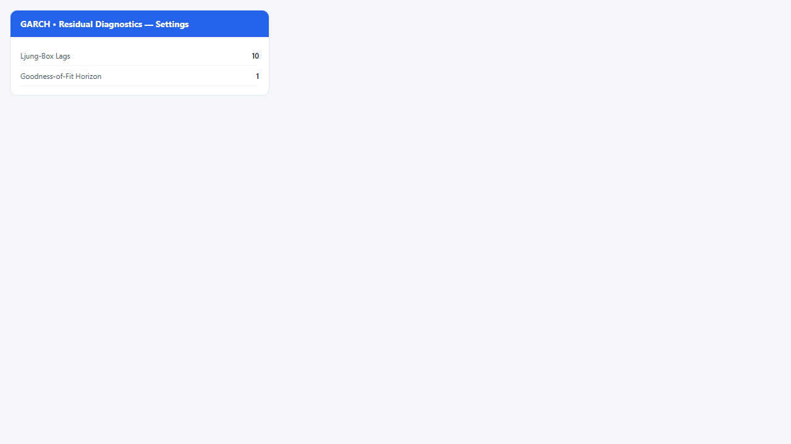
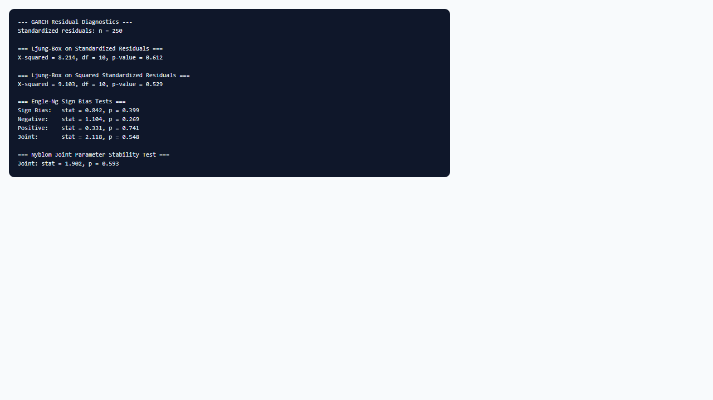

## 1. Mô hình dùng để làm gì?

Sub-node **GARCH • Residual Diagnostics** thực hiện bộ kiểm định hậu ước lượng trên mô hình GARCH đã fit bởi node cha, nhằm trả lời câu hỏi: *đặc tả phương sai và phân phối đổ mới đã chọn có mô tả đủ tốt cấu trúc động và phân phối của lợi suất chưa?* Node gọi các hàm của `rugarch` trên **phần dư chuẩn hóa** (standardized residuals) $hat{z}_t = hat{arepsilon}_t / hat{sigma}_t$.

Các kiểm định bao gồm:

- **Ljung-Box** trên $hat{z}_t$ và $hat{z}_t^2$ — phát hiện tương quan bậc thấp và ARCH effects còn sót.
- **Engle-Ng sign bias tests** — phát hiện sai đặc tả bất đối xứng (leverage) khi dùng sGARCH thay GJR/eGARCH.
- **Nyblom joint stability test** — kiểm tra tính ổn định tham số trên toàn mẫu.
- **Hong-Li goodness-of-fit** — đánh giá mức độ phù hợp của phân phối đổ mới đã chọn.

Sub-node này là bước bắt buộc trước khi diễn giải dự báo biến động hoặc VaR: mô hình không vượt qua diagnostics không nên dùng cho quản trị rủi ro mà không điều chỉnh đặc tả.


## 2. Nền tảng lý thuyết

### 2.1. Phần dư chuẩn hóa

Nếu mô hình GARCH đúng đặc tả, chuỗi $hat{z}_t$ nên gần i.i.d. theo phân phối đã chọn (normal, t, v.v.). Điều kiện cần:

$$
E[z_t mid mathcal{F}_{t-1}] = 0, qquad mathrm{Var}(z_t mid mathcal{F}_{t-1}) = 1.
$$

Sai lệch mô hình xuất hiện dưới dạng tương quan trong $hat{z}_t$ hoặc $hat{z}_t^2$.

### 2.2. Kiểm định Ljung-Box

Ljung-Box (LB) kiểm tra giả thuyết không có tự tương quan đến bậc $m$:

$$
Q_{LB}(m) = n(n+2) sum_{k=1}^{m} rac{hat{
ho}_k^2}{n-k},
$$

với $hat{
ho}_k$ là ACF mẫu của chuỗi kiểm tra. Dưới $H_0$, $Q_{LB} sim chi^2(m)$.

- LB trên $hat{z}_t$: phát hiện sai đặc tả **mean dynamics** hoặc phân phối đối xứng.
- LB trên $hat{z}_t^2$: phát hiện **ARCH effects** còn sót — heteroskedasticity chưa được mô hình hóa hết.

### 2.3. Engle-Ng sign bias tests

Engle & Ng (1993) đề xuất kiểm định bias dấu: phản ứng của $sigma_t^2$ đối với shock âm có thể khác shock dương ngay cả khi LB trên $hat{z}_t^2$ chưa bắt được. Hàm `signbias()` của `rugarch` chạy các hồi quy phụ trên biến nhị phân dấu shock và in bảng hệ số với p-value. Kết quả significant gợi ý chuyển sang **GJR-GARCH** hoặc **eGARCH**.

### 2.4. Nyblom stability test

Nyblom (1989) kiểm định tính ổn định tham số theo thời gian (parameter constancy). Thống kê joint test so sánh ước lượng tích lũy (CUSUM-type) với giới hạn cho thấy có break cấu trúc trong mẫu hay không. Vi phạm ổn định có thể do khủng hoảng (crisis periods) chưa được mô hình hóa.

### 2.5. Hong-Li goodness-of-fit

Hong & Li (2005) đề xuất kiểm định specification của mô hình density dự báo đa bước. Hàm `gof()` trong `rugarch` với tham số `n.ahead` đánh giá mức độ phù hợp của phân phối điều kiện; p-value thấp cho thấy nên xem xét phân phối đuôi dày hơn (Student-t, skew-t) hoặc điều chỉnh bậc GARCH.

### 2.6. Quan hệ với ARCH-LM và McLeod-Li

Trước khi ước lượng GARCH, kiểm định ARCH-LM (Engle, 1982) trên phần dư bình phương là tiền đề; sau khi fit, LB trên $hat{z}_t^2$ đóng vai trò tương tự **post-estimation**. Nếu cả ARCH-LM ban đầu và LB sau fit đều significant, có thể cần mô hình có bậc cao hơn hoặc SV (stochastic volatility) — ngoài phạm vi `rugarch` univariate hiện tại.


## 3. Điều kiện sử dụng

1. **Phải có node cha GARCH đã chạy thành công** và cổng Model được kết nối đúng.
2. **Đủ phần dư hữu dụng:** số quan sát phải lớn hơn `lb_lags + 5` (mặc định 10 lag → cần ít nhất 15 phần dư finite; thực tế nên có mẫu gốc $geq 100$).
3. **Ljung-Box là kiểm định phụ thuộc mẫu:** với mẫu lớn, LB dễ reject $H_0$ ngay cả khi sai lệch kinh tế nhỏ — kết hợp xem xét magnitude và đồ thị ACF.
4. **Sign bias và Nyblom** nhạy với outliers; kiểm tra lợi suất cực đoan trước khi kết luận sai đặc tả.
5. **Hong-Li** phụ thuộc horizon (`gof_horizon`); horizon 1 là mặc định cho kiểm định một bước; tăng horizon khi quan tâm dự báo đa bước ngắn.
6. Diagnostics **in-sample** — không thay thế backtest VaR out-of-sample (dùng sub-node `garch-var-backtest`).
7. **Mức ý nghĩa thống kê:** với $n > 1000$, ngưỡng 5% có thể reject các sai lệch nhỏ; báo cáo nên kèm effect size (ACF residual plots) chứ không chỉ p-value.
8. **Tương quan giữa các test:** LB trên $hat{z}_t^2$ significant thường đi kèm Hong-Li reject; sign bias significant thường xuất hiện khi dùng normal thay vì skew-t trên cổ phiếu.


## 4. Quy trình workflow

1. Hoàn thành ước lượng GARCH trên node cha; lưu ý đặc tả variance model và distribution.
2. Kéo sub-node **GARCH • Residual Diagnostics** vào canvas; nối output Model của GARCH vào input GARCH Model.
3. Đặt **Ljung-Box Lags** (mặc định 10; tăng lên 15–20 nếu dữ liệu tuần/tháng và mẫu dài).
4. Đặt **Goodness-of-Fit Horizon** (mặc định 1).
5. Chạy sub-node; đọc tuần tự bốn khối output.
6. Nếu LB trên $hat{z}_t^2$ significant: thử tăng $(p,q)$, đổi sang GJR/eGARCH, hoặc thêm mean AR.
7. Nếu sign bias significant: ưu tiên GJR-GARCH.
8. Nếu Hong-Li reject: thử Student-t hoặc skew-t.
9. Nếu Nyblom reject: chia mẫu theo subsample, thêm dummy khủng hoảng, hoặc mô hình regime-switching (ngoài phạm vi node hiện tại).
10. Lặp lại ước lượng trên node cha với đặc tả mới cho đến khi diagnostics chấp nhận được.


## 5. Thực hành StatNode

Sub-node kết nối sau node GARCH trên cùng canvas workflow:





**Cấu hình mẫu:**

- **Ljung-Box Lags:** `10`
- **Goodness-of-Fit Horizon:** `1`

**Các bước:** chạy node GARCH trước → kéo sub-node diagnostics → nối Model → Run.

Code R tương đương:

```r
library(rugarch)
std_res <- residuals(fit, standardize = TRUE)
Box.test(std_res, lag = 10, type = "Ljung-Box")
Box.test(std_res^2, lag = 10, type = "Ljung-Box")
signbias(fit)
nyblom(fit)
gof(fit, n.ahead = 1)
```

Output mẫu:

```r
--- GARCH Residual Diagnostics ---
Standardized residuals: n = 1258

=== Ljung-Box on Standardized Residuals ===
        Box-Ljung test
data:  std_res
X-squared = 8.2341, df = 10, p-value = 0.6021

=== Ljung-Box on Squared Standardized Residuals ===
        Box-Ljung test
data:  std_res^2
X-squared = 6.8912, df = 10, p-value = 0.7334

=== Engle-Ng Sign Bias Tests ===
                        t-value     prob
Sign Bias              0.8421    0.3998
Negative Size Bias     1.0234    0.3062
Positive Size Bias     0.5671    0.5707
Joint Test             1.4567    0.4823

=== Nyblom Joint Parameter Stability Test ===
                joint
statistic       0.8234
p-value         0.9123

=== Hong-Li Goodness-of-Fit Test ===
    n.ahead   statistic   p-value
 1      1      2.3456     0.6712

Interpretation: p-values above 0.05 for Ljung-Box suggest no remaining serial correlation;
sign bias and Nyblom tests assess asymmetric misspecification and parameter stability.
```

Trong ví dụ trên, tất cả p-value $> 0.05$ — mô hình GARCH(1,1)-t đạt diagnostics cơ bản. Nếu LB trên $hat{z}_t^2$ cho p-value $= 0.02$, cần điều chỉnh đặc tả trước khi dự báo.

**Bảng đọc nhanh output:**

| Khối output | $H_0$ | p-value cao → | p-value thấp → |
|-------------|-------|---------------|----------------|
| LB trên $hat{z}_t$ | Không tự tương quan | Mean/distribution ổn | Thêm ARMA mean hoặc đổi phân phối |
| LB trên $hat{z}_t^2$ | Không ARCH còn sót | Variance spec đủ | Tăng $(p,q)$ hoặc GJR/eGARCH |
| Sign bias | Không leverage misspec | sGARCH có thể đủ | Chuyển GJR/eGARCH |
| Nyblom | Tham số ổn định | Mẫu đồng nhất | Chia subsample / rolling |
| Hong-Li | Density đúng | Phân phối phù hợp | Student-t, skew-t, GED |

Khi chạy trên StatNode, output xuất hiện trong panel kết quả dạng text; có thể copy vào báo cáo kèm screenshot từ `garch-diagnostics-output.png`.


## 6. Diễn giải kết quả

**Ljung-Box trên phần dư chuẩn hóa:** p-value $> 0.05$ → không bác bỏ $H_0$ không tự tương quan; phần trung bình và phân phối đối xứng được mô tả tương đối đủ. p-value $leq 0.05$ → xem ACF plot, thử mean ARMA hoặc phân phối lệch.

**Ljung-Box trên bình phương:** đây là kiểm định quan trọng nhất cho GARCH. p-value thấp nghĩa là còn clustering volatility chưa được bắt — tăng bậc, đổi variance spec, hoặc kiểm tra structural breaks.

**Sign bias:** Joint test hoặc Sign Bias significant → bằng chứng leverage effect; GJR hoặc eGARCH thường cải thiện. Negative Size Bias significant là dấu hiệu điển hình của cổ phiếu.

**Nyblom:** p-value thấp → tham số không ổn định; cẩn trọng khi dùng toàn mẫu cho VaR. Có thể ước lượng rolling window hoặc loại trừ giai đoạn khủng hoảng.

**Hong-Li:** reject → phân phối đổ mới chưa phù hợp; thử `std`, `sstd`, hoặc `ged`.

**Nguyên tắc tổng hợp:** không dựa vào một test duy nhất; kết hợp bảng kiểm định với đồ thị phần dư, QQ-plot (nếu có) và so sánh information criteria giữa các đặc tả.

**Ví dụ diễn giải đoạn văn báo cáo:** "Sau khi ước lượng GARCH(1,1) với phân phối Student-t, kiểm định Ljung-Box bậc 10 trên phần dư chuẩn hóa cho $chi^2 = 8.23$ (p = 0.60) và trên bình phương phần dư cho $chi^2 = 6.89$ (p = 0.73), không bác bỏ giả thuyết không còn cấu trúc tự tương quan. Kiểm định sign bias của Engle-Ng (joint) cho p = 0.48; Nyblom stability p = 0.91; Hong-Li goodness-of-fit p = 0.67. Kết luận: đặc tả GARCH(1,1)-t phù hợp cho giai đoạn mẫu."

**Lỗi thường gặp:** (a) chạy diagnostics trước khi node cha fit xong; (b) đặt `lb_lags` quá lớn so với cỡ mẫu; (c) kết luận "mô hình hoàn hảo" chỉ vì một test pass — luôn xem xét kinh tế lượng và out-of-sample.


## 7. Tài liệu tham khảo

- Engle, R. F. (1982). Autoregressive Conditional Heteroscedasticity with Estimates of the Variance of United Kingdom Inflation. *Econometrica*, 50(4), 987–1007.
- Bollerslev, T. (1986). Generalized Autoregressive Conditional Heteroskedasticity. *Journal of Econometrics*, 31(3), 307–327.
- Engle, R. F., & Ng, V. K. (1993). Measuring and Testing the Impact of News on Volatility. *Journal of Finance*, 48(5), 1749–1778.
- Ljung, G. M., & Box, G. E. P. (1978). On a Measure of Lack of Fit in Time Series Models. *Biometrika*, 65(2), 297–303.
- Nyblom, J. (1989). Testing for the Constancy of Parameters over Time. *Journal of the American Statistical Association*, 84(405), 223–230.
- Hong, Y., & Li, H. (2005). Nonparametric Specification Testing for Continuous-Time Models with Applications to Spot Interest Rates. *Review of Financial Studies*, 18(4), 1125–1171.
- Brooks, C. (2014). *Introductory Econometrics for Finance* (3rd ed.). Cambridge University Press.
- Tsay, R. S. (2010). *Analysis of Financial Time Series* (3rd ed.). Wiley.
- Ghalanos, A. (2024). rugarch: Univariate GARCH Models. R package vignette. CRAN.

---

Ghi chú: Các giá trị output mẫu minh họa định dạng; p-value thực tế phụ thuộc mô hình cha và dữ liệu.
