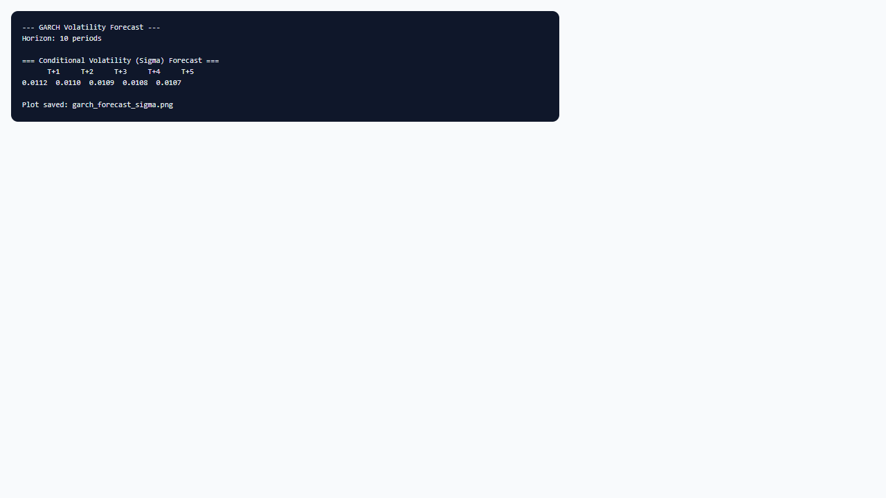

## 1. Mô hình dùng để làm gì?

Sub-node **GARCH • Volatility Forecast** sinh dự báo đa bước (multi-step ahead) cho **phần trung bình có điều kiện** $hat{mu}_{t+h}$ và **độ lệch chuẩn có điều kiện** $hat{sigma}_{t+h}$ từ mô hình GARCH đã ước lượng, thông qua `rugarch::ugarchforecast()`. Đây là công cụ trung tâm trong quản trị rủi ro, định giá tùy chọn (implied vs realized vol), và lập kế hoạch vốn khi cần biết mức biến động kỳ vọng trong $h$ kỳ tới.

Ứng dụng điển hình:

- **Dự báo biến động ngắn hạn** cho danh mục đầu tư (VaR horizon, margin requirements).
- **So sánh realized volatility** với dự báo GARCH để đánh giá chất lượng mô hình out-of-sample (kết hợp rolling re-estimation nếu cần).
- **Trực quan hóa đường dự báo $sigma_{t+h}$** qua biểu đồ PNG (tùy chọn Plot Conditional Volatility).
- **Cung cấp đầu vào** cho báo cáo nội bộ về triển vọng biến động thị trường.

Node chỉ dự báo từ thông tin đến thời điểm $t$ (end-of-sample forecast); không thay thế hệ thống dự báo out-of-sample đầy đủ với tái ước lượng rolling, nhưng đủ cho minh họa và phân tích horizon ngắn.


## 2. Nền tảng lý thuyết

### 2.1. Dự báo có điều kiện trong GARCH

Cho mô hình GARCH đã ước lượng tại thời điểm $T$, dự báo $h$ bước trước dựa trên bộ thông tin $mathcal{F}_T$:

$$
hat{mu}_{T+h mid T} = E[r_{T+h} mid mathcal{F}_T],
$$

$$
hat{sigma}_{T+h mid T}^2 = E[arepsilon_{T+h}^2 mid mathcal{F}_T] quad 	ext{(hoặc dạng tương đương theo đặc tả variance)}.
$$

Với GARCH(1,1) và mean constant, $hat{mu}_{T+h} = hat{mu}$ cho mọi $h$. Phương sai dự báo hội tụ:

$$
hat{sigma}_{T+h mid T}^2 
ightarrow rac{hat{omega}}{1 - hat{alpha}_1 - hat{eta}_1} quad 	ext{khi } h 
ightarrow infty,
$$

nếu $hat{alpha}_1 + hat{eta}_1 < 1$ (stationary case). Đây là **unconditional variance** của quá trình — mức biến động dài hạn mà chuỗi tiệm cận.

### 2.2. Động lực dự báo đa bước

Với $h=1$, $hat{sigma}_{T+1 mid T}^2$ phụ thuộc trực tiếp vào $hat{arepsilon}_T^2$ và $hat{sigma}_T^2$. Với $h>1$, kỳ vọng của các đổi mới tương lai được thay bằng kỳ vọng có điều kiện (thường bằng 1 cho phần chuẩn hóa), dẫn đến $hat{sigma}_{T+h}^2$ tiệm cận dần về phương sai không điều kiện. Đồ thị dự báo $sigma$ thường giảm hoặc tăng từ mức hiện tại về mức dài hạn tùy vị trí hiện tại so với long-run vol.

### 2.3. eGARCH và GJR

Với eGARCH và GJR, công thức đệ quy cho $hat{sigma}_{T+h}^2$ phức tạp hơn nhưng nguyên tắc tương tự: `ugarchforecast()` xử lý analytic/iterative forecast theo đặc tả. Dự báo bất đối xứng phản ánh khác biệt khi shock gần nhất âm hoặc dương.

### 2.4. Phân phối và khoảng dự báo

Dự báo $hat{sigma}_{T+h}$ mô tả scale; để có **prediction interval** cho $r_{T+h}$, cần kết hợp $hat{mu}_{T+h}$, $hat{sigma}_{T+h}$ và phân phối $z$ (ví dụ $t_
u$). StatNode in bảng mean và sigma; người dùng có thể tính quantile:

$$
hat{q}_{T+h}(alpha) = hat{mu}_{T+h} + hat{sigma}_{T+h} cdot F_z^{-1}(alpha).
$$

### 2.5. QLIKE và đánh giá chất lượng dự báo

Trong literature, loss function **QLIKE** (quasi-likelihood) thường dùng để so sánh dự báo biến động:

$$
L_t = log hat{sigma}_t^2 + rac{r_t^2}{hat{sigma}_t^2}.
$$

Giá trị trung bình QLIKE thấp hơn cho thấy mô hình dự báo realized volatility tốt hơn. Node forecast cung cấp $hat{sigma}_{T+h}$ analytic; người dùng có thể tính QLIKE ngoài canvas khi có realized $r_{T+h}$.

### 2.6. Hạn chế lý thuyết

Dự báo GARCH in-sample giả định tham số cố định và không có structural break tương lai. Trong thực tế, **combined forecasts** hoặc **rolling window** thường cho out-of-sample tốt hơn (Brooks, 2014; Tsay, 2010).


## 3. Điều kiện sử dụng

1. **Node cha GARCH đã fit và pass diagnostics cơ bản** — dự báo từ mô hình sai đặc tả dễ misleading.
2. **Forecast horizon hợp lý:** mặc định StatNode cho phép 1–60 kỳ; khuyến nghị $leq 30$ trong trình duyệt. Horizon dài → $hat{sigma}_{T+h}$ tiệm cận unconditional vol, ít thông tin từ shock gần nhất.
3. **Tần suất dữ liệu:** horizon 10 ngày khác 10 tháng về ý nghĩa kinh tế; báo cáo rõ đơn vị thời gian.
4. **Stationarity:** với iGARCH hoặc unit root trong variance, dự báo dài hạn có thể không hội tụ — kiểm tra $alpha + eta$ trên node cha.
5. **Plot sigma:** bật tùy chọn Plot khi cần hình ảnh cho báo cáo; tắt khi chạy batch nhanh.
6. **Không nhầm với realized vol:** $hat{sigma}_{T+h}$ là dự báo có điều kiện, không phải thực hiện biến động trong tương lai.
7. **Mean model ảnh hưởng $hat{mu}_{T+h}$:** nếu node cha dùng AR(1), dự báo mean có thể decay về unconditional mean; kiểm tra đặc tả mean trên node GARCH trước khi diễn giải bảng Mean Forecast.
8. **Performance:** horizon 60 trên chuỗi dài vẫn nhẹ; plot PNG thêm vài giây — tắt plot khi chạy nhiều scenario song song.


## 4. Quy trình workflow

1. Ước lượng GARCH trên node cha; xác nhận diagnostics (sub-node garch-diagnostics).
2. Kéo **GARCH • Volatility Forecast**; nối Model output.
3. Chọn **Forecast Horizon** (`n_ahead`): ví dụ 5 ngày giao dịch hoặc 10 ngày.
4. Bật **Plot Conditional Volatility** nếu cần đồ thị.
5. Run sub-node; đọc bảng Mean Forecast và Sigma Forecast.
6. (Tùy chọn) Tính prediction interval hoặc VaR điểm từ $hat{mu}$ và $hat{sigma}$ với quantile phân phối đã chọn.
7. (Nâng cao) So sánh với realized vol trong $h$ kỳ tiếp theo bằng cách cập nhật dữ liệu và rolling re-fit.
8. Kết hợp **garch-var-backtest** để đánh giá chất lượng VaR in-sample trước khi triển khai chính sách rủi ro.


## 5. Thực hành StatNode




**Cấu hình ví dụ:**

- **Forecast Horizon:** `10`
- **Plot Conditional Volatility:** bật (checked)

**Thao tác:** sau khi node GARCH chạy xong → gắn sub-node forecast → Run.

Code R tương đương:

```r
library(rugarch)
fc <- ugarchforecast(fit, n.ahead = 10)
as.data.frame(fitted(fc))      # mean forecast
as.data.frame(sigma(fc))       # volatility forecast
plot(fc, which = 2)            # sigma path
```

Output mẫu:

```r
--- GARCH Volatility Forecast ---
Horizon: 10 periods

=== Mean Forecast ===
   T+1      T+2      T+3      T+4      T+5      T+6      T+7      T+8      T+9     T+10
0.00041  0.00041  0.00041  0.00041  0.00041  0.00041  0.00041  0.00041  0.00041  0.00041

=== Conditional Volatility (Sigma) Forecast ===
   T+1      T+2      T+3      T+4      T+5      T+6      T+7      T+8      T+9     T+10
0.01234  0.01241  0.01248  0.01252  0.01255  0.01257  0.01258  0.01259  0.01260  0.01260

Plot saved: /tmp/node_abc_sigma_forecast.png
```

Giải thích nhanh output mẫu: $hat{sigma}$ bắt đầu từ 0.01234 (1.23% mỗi ngày nếu lợi suất thập phân) và tăng nhẹ tiệm cận 0.01260 — phản ánh mức biến động hiện tại thấp hơn long-run vol một chút, hoặc ngược lại tùy bối cảnh mô hình.

Để tính VaR 5% một ngày từ dòng T+1 (với phân phối t):

```r
mu_1  <- fitted(fc)[1]
sig_1 <- sigma(fc)[1]
nu    <- coef(fit)["shape"]
var_5 <- mu_1 + sig_1 * qt(0.05, df = nu)
```

**So sánh với unconditional volatility:** long-run $sigma_{LR} = sqrt{hat{omega}/(1-hat{alpha}_1-hat{eta}_1)}$. Nếu $hat{sigma}_{T+1} gg sigma_{LR}$, thị trường đang ở giai đoạn biến động cao và dự báo kỳ vọng **mean reversion** về mức thấp hơn. Ngược lại, $hat{sigma}_{T+1} < sigma_{LR}$ gợi ý biến động có thể tăng dần trong các kỳ tới.

**Rolling forecast (ngoài node):** trong nghiên cứu, vòng lặp tái ước lượng GARCH trên $[1,t]$ và dự báo $sigma_{t+1}$ tạo chuỗi out-of-sample; so sánh với realized $|r_{t+1}|$ hoặc $r_{t+1}^2$ bằng MSE hoặc QLIKE (Tsay, 2010).


## 6. Diễn giải kết quả

1. **Mean forecast:** Với constant mean, các cột giống nhau — đó là $hat{mu}$ ước lượng. Nếu dùng AR mean, $hat{mu}_{T+h}$ có thể hội tụ về unconditional mean của quá trình AR.

2. **Sigma forecast:** Quan sát xu hướng tăng/giảm về long-run level. Sau shock biến động lớn, $hat{sigma}_{T+1}$ cao và thường **giảm dần** theo $h$ (mean reversion in variance) nếu $alpha + eta < 1$.

3. **Đơn vị:** $hat{sigma}$ cùng đơn vị với lợi suất đầu vào. Nếu lợi suất là %, $hat{sigma} = 1.2$ nghĩa là 1.2% độ lệch chuẩn ngày.

4. **Horizon dài:** Các cột cuối gần bằng nhau — dự báo đã tiệm cận unconditional volatility; không nên diễn giải khác biệt nhỏ giữa T+9 và T+10 là tín hiệu kinh tế mạnh.

5. **Đồ thị:** Plot `which = 2` hiển thị đường $sigma$ forecast; hữu ích cho slide và báo cáo. Kiểm tra visual có khớp bảng số.

6. **Hạn chế:** Dự báo điểm không kèm confidence band trong output mặc định; uncertainty về tham số không được phản ánh. Báo cáo học thuật nên nêu rõ đây là analytic forecast từ `ugarchforecast`.

7. **Liên kết VaR:** Sigma forecast một bước có thể so sánh với chuỗi VaR in-sample từ sub-node backtest để đánh giá tính nhất quán.

8. **Ví dụ đoạn báo cáo:** "Dự báo độ lệch chuẩn có điều kiện 10 ngày giao dịch từ GARCH(1,1)-t cho thấy $hat{sigma}_{T+1} = 1.23%$ ngày, tiệm cận mức dài hạn 1.26% khi $h 	o 10$. Điều này phù hợp với hồi phục biến động sau giai đoạn stress gần đây."

**Checklist trước khi publish forecast:** (i) diagnostics pass; (ii) ghi rõ ngày cuối mẫu $T$; (iii) nêu đơn vị lợi suất; (iv) đính kèm plot sigma nếu trình bày cho người không chuyên.

**Annualized volatility (tham khảo):** nếu lợi suất ngày và 252 ngày giao dịch/năm, annualized vol $approx hat{sigma}_{day} 	imes sqrt{252}$. Ví dụ $hat{sigma} = 0.0126$ ngày $Rightarrow$ ~20% năm. Chỉ áp dụng khi giả định i.i.d. scaling hợp lệ.


## 7. Tài liệu tham khảo

- Engle, R. F. (1982). Autoregressive Conditional Heteroscedasticity with Estimates of the Variance of United Kingdom Inflation. *Econometrica*, 50(4), 987–1007.
- Bollerslev, T. (1986). Generalized Autoregressive Conditional Heteroskedasticity. *Journal of Econometrics*, 31(3), 307–327.
- Nelson, D. B. (1991). Conditional Heteroskedasticity in Asset Returns: A New Approach. *Econometrica*, 59(2), 347–370.
- Glosten, L. R., Jagannathan, R., & Runkle, D. E. (1993). On the Relation between the Expected Value and the Volatility of the Nominal Excess Return on Stocks. *Journal of Finance*, 48(5), 1779–1801.
- Brooks, C. (2014). *Introductory Econometrics for Finance* (3rd ed.). Cambridge University Press.
- Tsay, R. S. (2010). *Analysis of Financial Time Series* (3rd ed.). Wiley.
- Ghalanos, A. (2024). rugarch: Univariate GARCH Models. R package vignette. CRAN.
- Ghalanos, A. (2024). tsgarch: Univariate GARCH Models. CRAN vignette.

---

Ghi chú: Số liệu output mẫu mang tính minh họa; đường dự báo thực tế phụ thuộc trạng thái $hat{sigma}_T$ và tham số ước lượng.
