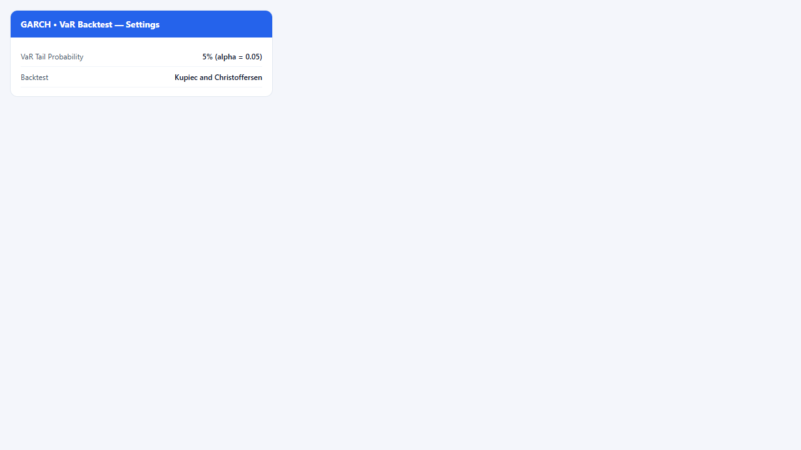
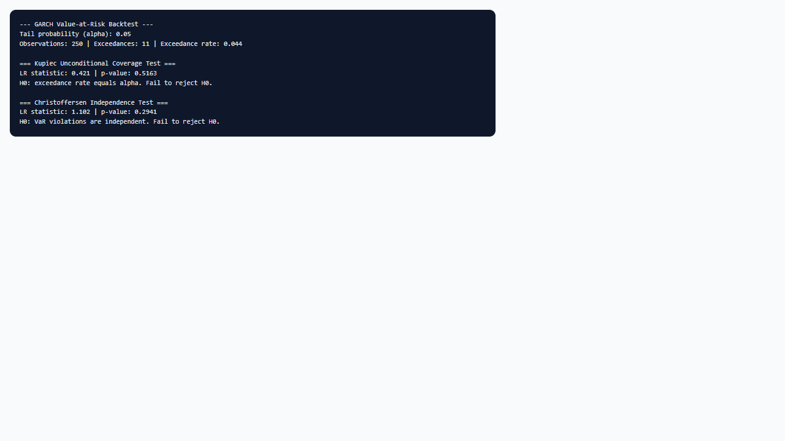

## 1. Mô hình dùng để làm gì?

Sub-node **GARCH • VaR Backtest** đánh giá chất lượng **Value-at-Risk (VaR) có điều kiện** được suy ra từ mô hình GARCH đã ước lượng, bằng cách so sánh **tần suất vi phạm** (exceedances) trong mẫu với mức xác suất đuôi $alpha$ và kiểm định **độc lập** của các vi phạm. VaR tại mức $alpha$ (ví dụ 5%) là mức lỗ ngưỡng sao cho xác suất lợi suất thấp hơn VaR trong một kỳ bằng $alpha$ (under correct specification).

Node thực hiện:

- Tính chuỗi **VaR in-sample** từ `quantile()` của đối tượng `ugarchfit` với xác suất đuôi do người dùng chọn.
- Đếm **exceedances** $I_t = mathbf{1}{r_t < widehat{VaR}_t}$.
- Chạy **Kupiec (1995) unconditional coverage test** và/hoặc **Christoffersen (1998) independence test**.

Đây là bước validation bắt buộc trong quy trình quản trị rủi ro nội bộ (Basel, stress testing) và nghiên cứu học thuật về mô hình hóa rủi ro thị trường trước khi triển khai VaR dựa trên GARCH cho báo cáo regulatory hoặc giới hạn danh mục.


## 2. Nền tảng lý thuyết

### 2.1. Value-at-Risk có điều kiện

Với lợi suất $r_t$ và bộ thông tin $mathcal{F}_{t-1}$, VaR đuôi trái mức $alpha$:

$$
Pr(r_t < VaR_t(alpha) mid mathcal{F}_{t-1}) = alpha.
$$

Trong khung GARCH, $r_t = mu_t + sigma_t z_t$ với $z_t$ theo phân phối đã chọn. VaR có điều kiện:

$$
widehat{VaR}_t(alpha) = hat{mu}_t + hat{sigma}_t cdot F_z^{-1}(alpha),
$$

trong đó $F_z^{-1}$ là quantile của phần chuẩn hóa (normal, Student-t, v.v.). Hàm `quantile(ugarchfit, probs = alpha)` của `rugarch` trả về chuỗi $widehat{VaR}_t$ in-sample.

### 2.2. Exceedance và tần suất vi phạm

Định nghĩa biến hit:

$$
H_t = mathbf{1}{r_t < widehat{VaR}_t}.
$$

Dưới mô hình đúng, $E[H_t] = alpha$ và (lý tưởng) $H_t$ không tự tương quan. Tần suất mẫu:

$$
hat{pi} = rac{1}{n}sum_{t=1}^n H_t.
$$

### 2.3. Kiểm định Kupiec (LRuc)

Kupiec (1995) kiểm định **unconditional coverage** $H_0: E[H_t] = alpha$ bằng likelihood ratio:

$$
LR_{uc} = -2lnleft[rac{alpha^x (1-alpha)^{n-x}}{ hat{pi}^x (1-hat{pi})^{n-x} }
ight] sim chi^2(1),
$$

với $x = sum H_t$ số vi phạm và $n$ số quan sát. Reject $H_0$ → tần suất vi phạm khác $alpha$ (VaR quá lỏng hoặc quá chặt).

### 2.4. Kiểm định Christoffersen (LRind)

Christoffersen (1998) kiểm định **independence** của chuỗi vi phạm — vi phạm có xu hướng **cluster** (nhiều ngày liên tiếp vượt VaR) khi mô hình không bắt được dynamics. Xây dựng ma trận chuyển tiếp 00, 01, 10, 11 giữa $H_{t-1}$ và $H_t$; under $H_0$ các vi phạm độc lập với xác suất $pi$.

$$
LR_{ind} sim chi^2(1).
$$

Clustered violations là dấu hiệu điển hình của GARCH under-specified hoặc phân phối đuôi mỏng.

### 2.5. Conditional coverage

Kết hợp $LR_{cc} = LR_{uc} + LR_{ind}$ (Christoffersen) kiểm đồng thời coverage và independence. StatNode cho phép chạy Kupiec, Christoffersen, hoặc cả hai.


## 3. Điều kiện sử dụng

1. **Mô hình GARCH cha đã ước lượng** với chuỗi lợi suất gắn attribute `statnode_series` (StatNode tự lưu khi fit).
2. **In-sample backtest:** kết quả đánh giá fit trong mẫu, không thay thế out-of-sample hoặc rolling backtest — tránh overfitting optimism khi báo cáo regulatory.
3. **Chọn $alpha$ phù hợp:** 5% và 1% phổ biến; với $alpha = 1%$ cần mẫu lớn để có đủ exceedances cho test có power (ví dụ 1000 ngày → kỳ vọng ~10 vi phạm).
4. **Phân phối đuôi:** VaR chính xác phụ thuộc phân phối innovation; nếu Hong-Li reject trên diagnostics, backtest VaR cũng có thể fail.
5. **Độ dài chuỗi khớp:** node kiểm tra length(VaR) = length(returns); nếu lỗi, re-run node GARCH.
6. **Diễn giải p-value:** mức 5% chuẩn; với nhiều test (nhiều $alpha$, nhiều mô hình), cân nhắc điều chỉnh multiple testing.
7. **Left-tail VaR:** node mặc định đánh giá rủi ro long position (lỗ khi $r_t$ thấp); short position cần right-tail VaR (ngoài phạm vi node hiện tại).
8. **Expected Shortfall (ES):** Basel III khuyến khích ES thay VaR; backtest node tập trung VaR — ES cần công cụ bổ sung.


## 4. Quy trình workflow

1. Fit GARCH với phân phối phù hợp (thường Student-t); pass residual diagnostics.
2. Gắn sub-node **GARCH • VaR Backtest**; nối Model.
3. Chọn **VaR Tail Probability** $alpha$ (ví dụ 5%).
4. Chọn **Backtest:** Kupiec and Christoffersen (khuyến nghị đủ cả coverage và independence).
5. Run; ghi nhận số exceedances, tần suất mẫu, LR statistics và p-values.
6. Nếu Kupiec reject: VaR biased — điều chỉnh $alpha$ implicit bằng đổi phân phối, GARCH spec, hoặc scaling.
7. Nếu Christoffersen reject nhưng Kupiec pass: tần suất đúng nhưng vi phạm cluster — cải thiện dynamics (bậc GARCH, GJR) hoặc dùng ES thay VaR.
8. (Nâng cao) Rolling window backtest ngoài StatNode cho đánh giá thực tế hơn.
9. Báo cáo: bảng exceedances, cả hai test, đặc tả GARCH đầy đủ.


## 5. Thực hành StatNode





**Cấu hình ví dụ:**

- **VaR Tail Probability:** `5% (alpha = 0.05)`
- **Backtest:** `Kupiec and Christoffersen`

**Thao tác:** node GARCH → sub-node VaR Backtest → Run.

Code R tương đương (logic StatNode):

```r
library(rugarch)
alpha <- 0.05
var_series <- as.numeric(quantile(fit, probs = alpha))
returns  <- attr(fit, "statnode_series")
hits <- as.integer(returns < var_series)
x <- sum(hits); n <- length(hits); rate <- x / n
# Kupiec LRuc và Christoffersen LRind — xem output node
```

Output mẫu:

```r
--- GARCH Value-at-Risk Backtest ---
Tail probability (alpha): 0.05
Observations: 1258 | Exceedances: 58 | Exceedance rate: 0.0461

=== Kupiec Unconditional Coverage Test ===
LR statistic: 0.6234 | p-value: 0.4301
H0: exceedance rate equals alpha. Fail to reject H0.

=== Christoffersen Independence Test ===
LR statistic: 2.1045 | p-value: 0.1467
H0: VaR violations are independent. Fail to reject H0.
```

Trong ví dụ, tần suất vi phạm 4.61% gần 5%, cả hai test không reject $H_0$ ở mức 5% — mô hình GARCH-t đạt VaR backtest in-sample cơ bản.

Ví dụ thất bại (minh họa):

```r
Observations: 1258 | Exceedances: 89 | Exceedance rate: 0.0707

=== Kupiec Unconditional Coverage Test ===
LR statistic: 18.4521 | p-value: 0.0000
H0: exceedance rate equals alpha. Reject H0 (VaR coverage failure).

=== Christoffersen Independence Test ===
LR statistic: 9.2341 | p-value: 0.0023
H0: VaR violations are independent. Reject H0 (clustered violations).
```

Kịch bản này gợi ý VaR quá lỏng (quá nhiều vi phạm) và vi phạm có cluster — cần skew-t, GJR, hoặc Expected Shortfall.

**Ma trận chuyển tiếp (Christoffersen):** node tính nội bộ các ô $n_{00}, n_{01}, n_{10}, n_{11}$ từ chuỗi $H_t$. Tỷ lệ $n_{11}/(n_{10}+n_{11})$ cao cho thấy vi phạm có xu hướng **liên tiếp** — điển hình trong khủng hoảng khi GARCH phản ứng chậm.

**Traffic light (gợi ý Basel):** có thể map p-value Kupiec: xanh (p > 0.25), vàng (0.05–0.25), đỏ (p < 0.05) — đây là heuristic báo cáo, không thay thế quy định pháp lý cụ thể.


## 6. Diễn giải kết quả

1. **Exceedance rate vs $alpha$:** So sánh trực quan trước khi xem test. Rate $= 0.07$ với $alpha = 0.05$ nghĩa là VaR underestimate risk khoảng 40% số vi phạm tương đối.

2. **Kupiec:** p-value $> 0.05$ → không có bằng chứng tần suất khác $alpha$. p-value thấp → điều chỉnh mô hình hoặc dùng scaled VaR.

3. **Christoffersen:** quan trọng khi quản lý vốn — clustered violations gây thiệt hại liên tiếp. Reject independence dù Kupiec pass → mô hình capture level đúng nhưng sai dynamics; ưu tiên GJR/eGARCH.

4. **Số exceedances nhỏ:** với $alpha = 1%$ và $n = 200$, chỉ ~2 vi phạm — test có power thấp; cần mẫu dài hơn.

5. **In-sample caveat:** pass in-sample không đảm bảo pass out-of-sample; báo cáo nên nêu rõ phạm vi.

6. **Liên kết diagnostics:** fail VaR thường đi cùng fail Hong-Li hoặc LB trên $hat{z}_t^2$ — sửa gốc mô hình thay vì chỉ tune $alpha$.

7. **Báo cáo Basel:** nêu $alpha$, horizon (1 ngày), số quan sát, LR statistics, đặc tả GARCH đầy đủ, và kết luận accept/reject từng $H_0$.

8. **Ví dụ đoạn báo cáo:** "VaR 5% một ngày từ GARCH(1,1)-t trên 1.258 quan sát ghi nhận 58 vi phạm (4.61% vs 5% mục tiêu). Kupiec LR = 0.62 (p = 0.43); Christoffersen LR = 2.10 (p = 0.15). Không bác bỏ coverage và independence tại 5%."

**Khi cả hai test fail:** ưu tiên (1) phân phối đuôi (skew-t); (2) GJR cho leverage; (3) tăng bậc GARCH; (4) loại trừ outliers hoặc chia mẫu; (5) rolling backtest xác nhận out-of-sample.

**Conditional coverage kết hợp:** trong literature, $LR_{cc} = LR_{uc} + LR_{ind}$ kiểm đồng thời tần suất và độc lập vi phạm. StatNode in riêng hai test; nếu cả hai pass, có thể coi như pass conditional coverage ở mức cơ bản. Nếu chỉ một trong hai fail, xác định rõ nguyên nhân (level vs clustering) trước khi sửa mô hình.


## 7. Tài liệu tham khảo

- Engle, R. F. (1982). Autoregressive Conditional Heteroscedasticity with Estimates of the Variance of United Kingdom Inflation. *Econometrica*, 50(4), 987–1007.
- Nelson, D. B. (1991). Conditional Heteroskedasticity in Asset Returns: A New Approach. *Econometrica*, 59(2), 347–370.
- Bollerslev, T. (1986). Generalized Autoregressive Conditional Heteroskedasticity. *Journal of Econometrics*, 31(3), 307–327.
- Kupiec, P. H. (1995). Techniques for Verifying the Accuracy of Risk Measurement Models. *Journal of Derivatives*, 3(2), 73–84.
- Christoffersen, P. F. (1998). Evaluating Interval Forecasts. *International Economic Review*, 39(4), 841–862.
- Engle, R. F., & Ng, V. K. (1993). Measuring and Testing the Impact of News on Volatility. *Journal of Finance*, 48(5), 1749–1778.
- Brooks, C. (2014). *Introductory Econometrics for Finance* (3rd ed.). Cambridge University Press.
- Tsay, R. S. (2010). *Analysis of Financial Time Series* (3rd ed.). Wiley.
- Ghalanos, A. (2024). rugarch: Univariate GARCH Models. R package vignette. CRAN.
- Ghalanos, A. (2024). tsgarch: Univariate GARCH Models. CRAN vignette.

---

Ghi chú: Backtest in-sample trên StatNode phục vụ giảng dạy và kiểm tra nhanh; ứng dụng production nên bổ sung rolling và stress scenarios.
