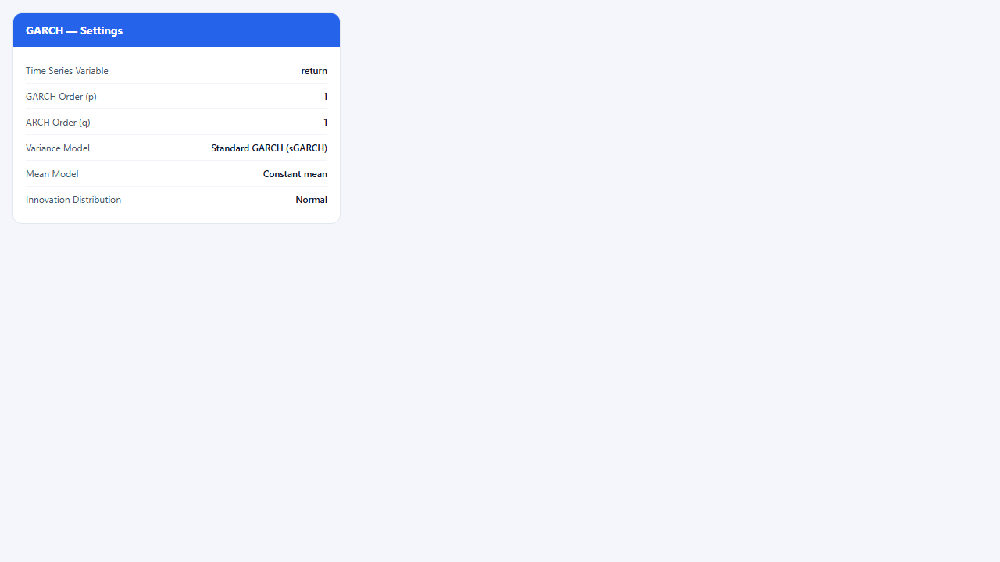
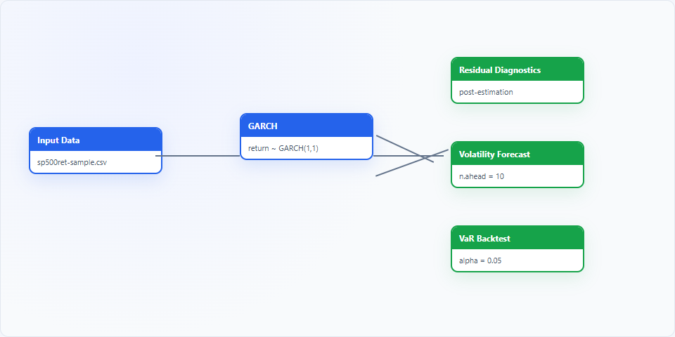
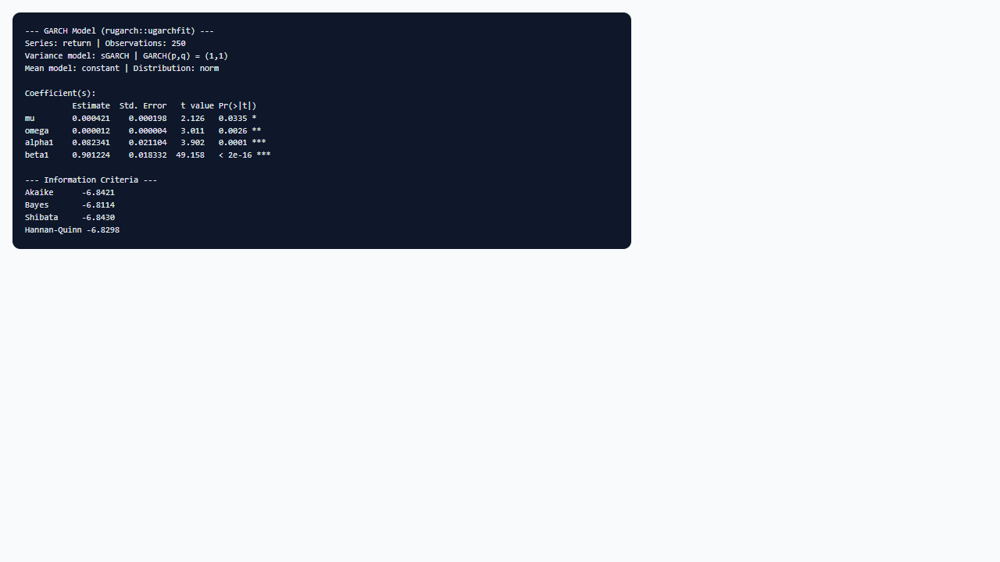

## 1. Mô hình dùng để làm gì?

Node **GARCH** trên StatNode ước lượng mô hình biến động có điều kiện (conditional volatility) cho chuỗi lợi suất tài chính hoặc các chuỗi thời gian kinh tế lượng khác, sử dụng gói R `rugarch` (Ghalanos, 2024). Khác với mô hình ARMA cổ điển giả định phương sai không đổi, họ GARCH/ARCH mô tả phương sai của phần dư phụ thuộc vào quá khứ — hiện tượng **clustering of volatility** (volatility clustering) mà Mandelbrot (1963) và Fama (1965) đã quan sát sớm trên thị trường chứng khoán.

Trong thực tiễn, node này phục vụ các mục tiêu sau:

- **Đo lường và theo dõi biến động có điều kiện** của lợi suất cổ phiếu, tỷ giá, trái phiếu, hàng hóa hoặc chỉ số vĩ mô (lạm phát, chênh lệch lãi suất).
- **Kiểm tra và mô hình hóa heteroskedasticity** có điều kiện (ARCH effects) sau khi đã mô tả phần trung bình bằng AR/ARMA hoặc hằng số.
- **Chuẩn bị đầu vào** cho các sub-node hậu ước lượng: kiểm định phần dư chuẩn hóa, dự báo sigma, và backtest Value-at-Risk (VaR).
- **So sánh các đặc tả phương sai** (sGARCH, eGARCH, GJR-GARCH, iGARCH) và phân phối đổ mới (normal, Student-t, skew-t, GED) để chọn mô hình phù hợp với đuôi phân phối và bất đối xứng.

Node GARCH là điểm khởi đầu của workflow phân tích rủi ro trên StatNode: sau khi ước lượng thành công, đối tượng mô hình `ugarchfit` được truyền sang các sub-node `garch-diagnostics`, `garch-forecast` và `garch-var-backtest`. Toàn bộ pipeline chạy trong trình duyệt qua WebR, phù hợp giảng dạy và phân tích nhanh mà không cần cài đặt R cục bộ.


## 2. Nền tảng lý thuyết

### 2.1. Mô hình ARCH

Engle (1982) đề xuất mô hình Autoregressive Conditional Heteroskedasticity (ARCH) để mô tả phương sai thay đổi theo thời gian. Với chuỗi lợi suất $r_t$ và phần trung bình $mu_t$ (có thể bằng hằng số hoặc ARMA), đặt đổi mới $arepsilon_t = r_t - mu_t$. Mô hình ARCH($q$) đặt:

$$
arepsilon_t = sigma_t z_t, qquad z_t sim i.i.d.;(0,1),
$$

$$
sigma_t^2 = omega + sum_{i=1}^{q} alpha_i arepsilon_{t-i}^2,
$$

với $omega > 0$, $alpha_i geq 0$. Điều kiện dương tính của $sigma_t^2$ đòi hỏi các ràng buộc trên tham số; phương sai không điều kiện tồn tại khi $sum_i alpha_i < 1$.

### 2.2. Mô hình GARCH

Bollerslev (1986) tổng quát hóa ARCH bằng cách thêm các lag của chính $sigma_t^2$, tạo ra GARCH($p,q$):

$$
sigma_t^2 = omega + sum_{i=1}^{p} eta_i sigma_{t-i}^2 + sum_{j=1}^{q} alpha_j arepsilon_{t-j}^2.
$$

Điều kiện dương tính và tính dừng yêu cầu $sum_i eta_i + sum_j alpha_j < 1$ trong trường hợp sGARCH chuẩn. Ưu điểm của GARCH so với ARCH thuần là mô hình parsimonious hơn: GARCH(1,1) với ba tham số thường mô tả tốt clustering volatility trên dữ liệu tài chính hàng ngày.

Phần trung bình có thể được mô tả song song:

$$
r_t = mu_t + arepsilon_t, qquad mu_t = c + sum_{k=1}^{P} phi_k r_{t-k} + sum_{l=1}^{Q} 	heta_l arepsilon_{t-l},
$$

tương ứng các lựa chọn mean model (zero, constant, AR, ARMA) trong StatNode.

### 2.3. Các biến thể phương sai

**GJR-GARCH** (Glosten, Jagannathan & Runkle, 1993) thêm hạng bất đối xứng: phản ứng của $sigma_t^2$ đối với shock âm khác shock dương (leverage effect). Trong `rugarch`, GJR được đặc tả qua submodel `GJR` của sGARCH.

**eGARCH** (Nelson, 1991) mô hình hóa $log sigma_t^2$, cho phép hiệu ứng bất đối xứng mà không đặt ràng buộc dương tuyến tính trên tham số; phù hợp khi ước lượng GARCH thuần gặp vấn đề biên.

**iGARCH** (Integrated GARCH) là trường hợp đặc biệt khi $sum_i eta_i + sum_j alpha_j = 1$, tương đương quá trình IGARCH — shock có ảnh hưởng vĩnh viễn lên mức biến động.

### 2.4. Phân phối đổ mới

Giả định $z_t sim N(0,1)$ thường không đủ cho đuôi dày (fat tails). StatNode hỗ trợ Student-t (`std`), skew Student-t (`sstd`), GED và skew normal. Tham số độ tự do (hoặc độ nhọn) được ước lượng cùng các hệ số GARCH bằng maximum likelihood với solver `hybrid` của `rugarch`.

### 2.5. Ước lượng

Hàm log-likelihood của GARCH không lồi toàn cục; `ugarchfit()` dùng tối ưu lai (hybrid) kết hợp quasi-Newton và thuật toán mạnh hơn. Sai số chuẩn tiệm cận dựa trên ma trận thông tin (BHHH hoặc Hessian) được in trong bảng tóm tắt; kiểm định ý nghĩa dựa trên z-statistic và p-value.


## 3. Điều kiện sử dụng

Áp dụng GARCH có ý nghĩa khi các điều kiện sau được xem xét:

1. **Chuỗi lợi suất, không phải giá gốc.** GARCH được thiết kế cho chuỗi dừng (stationary) — thường là lợi suất log $r_t = 100 	imes (ln P_t - ln P_{t-1})$ hoặc lợi suất đơn giản. Ước lượng trực tiếp trên giá hoặc mức log-giá dễ vi phạm giả định dừng.

2. **Cỡ mẫu đủ lớn.** StatNode yêu cầu tối thiểu 50 quan sát không missing; thực tế nên có ít nhất 250–500 quan sát để ước lượng GARCH(1,1) ổn định, và nhiều hơn nếu dùng ARMA mean hoặc phân phối skew-t.

3. **Bằng chứng ARCH/GARCH.** Nên kiểm tra hiệu ứng ARCH (Engle LM test) hoặc quan sát clustering trên đồ thị lợi suất bình phương trước khi ước lượng; nếu phương sai gần như không đổi, mô hình GARCH có thể thừa.

4. **Phần trung bình đã được mô tả hợp lý.** Tương quan trong phần dư có thể bị nhầm với heteroskedasticity; chọn mean model (AR/ARMA) khi ACF của lợi suất cho thấy cấu trúc tự hồi quy.

5. **Giới hạn hiệu năng trình duyệt.** StatNode cắt chuỗi ở 2500 quan sát gần nhất để đảm bảo thời gian chạy; với dữ liệu intraday dài, nên lấy mẫu hoặc chia subsample trước khi nạp.

6. **Không có giá trị thiếu xen kẽ.** Node tự loại NA; khoảng trống lớn trong chuỗi có thể làm méo ước lượng — nên nội suy hoặc ghép chuỗi liên tục trước.

7. **Diễn giải tham số theo đặc tả phương sai.** Hệ số trong eGARCH và GJR không tương đương trực tiếp với sGARCH; so sánh AIC/BIC chỉ hợp lý trong cùng họ phân phối và cùng mean spec.


## 4. Quy trình workflow

Quy trình phân tích GARCH điển hình trên StatNode:

1. **Chuẩn bị dữ liệu:** nạp bảng thời gian, tính lợi suất từ giá (nếu cần dùng node tiền xử lý), kiểm tra biểu đồ lợi suất và histogram.
2. **Khám phá sơ bộ:** vẽ ACF/PACF của $r_t$ và $r_t^2$; kiểm tra ngoại lai cực đoan; xác định tần suất dữ liệu (ngày, tuần).
3. **Chọn đặc tả ban đầu:** GARCH(1,1) + constant mean + normal là điểm khởi đầu chuẩn (Brooks, 2014); thêm Student-t nếu đuôi dày.
4. **Kéo node GARCH** vào canvas, kết nối Input Data, cấu hình biến lợi suất, bậc $(p,q)$, variance model và distribution.
5. **Chạy ước lượng** và xem bảng hệ số, log-likelihood, AIC/BIC. So sánh vài đặc tả lân cận nếu cần.
6. **Gắn sub-node garch-diagnostics** để kiểm tra phần dư chuẩn hóa (Ljung-Box, sign bias Engle-Ng, Nyblom, Hong-Li).
7. **Nếu mô hình đạt:** dùng **garch-forecast** cho dự báo $sigma_{t+h}$ và **garch-var-backtest** để đánh giá VaR trong mẫu.
8. **Báo cáo:** trình bày đặc tả cuối cùng, bảng hệ số, đồ thị conditional volatility, kết quả kiểm định và (nếu có) backtest VaR.

Workflow trên canvas StatNode cho phép lưu và chia sẻ pipeline hoàn chỉnh từ ước lượng đến kiểm định và dự báo.


## 5. Thực hành StatNode

Phần này hướng dẫn sử dụng node GARCH trong môi trường trình duyệt StatNode, với backend `rugarch::ugarchfit()`.

Giao diện gồm bảng cấu hình, canvas workflow và panel output:







**Các bước cụ thể:**

1. Nạp dataset chứa cột lợi suất — ví dụ `returns` từ chỉ số VN-Index hoặc `sp500ret` từ dữ liệu minh họa.
2. Kéo node **GARCH** (category: Time Series → Statistic) vào canvas; kết nối cổng Data.
3. Trong Settings:
   - **Time Series Variable:** `returns`
   - **GARCH Order (p):** `1`
   - **ARCH Order (q):** `1`
   - **Variance Model:** `sGARCH` (hoặc `gjrGARCH` nếu nghi ngờ leverage effect)
   - **Mean Model:** `constant` hoặc `AR` với order 1 nếu ACF có cấu trúc
   - **Innovation Distribution:** `std` (Student-t) cho dữ liệu tài chính
4. Chạy node (Run). Output hiển thị ma trận hệ số, std. error, z-value, p-value và information criteria.

Lệnh R tương đương StatNode thực thi:

```r
library(rugarch)
spec <- ugarchspec(
  variance.model = list(model = "sGARCH", garchOrder = c(1, 1)),
  mean.model = list(armaOrder = c(0, 0), include.mean = TRUE),
  distribution.model = "std"
)
fit <- ugarchfit(spec, data = returns, solver = "hybrid")
print(fit)
infocriteria(fit)
```

Ví dụ output mẫu (minh họa định dạng):

```r
--- GARCH Model (rugarch::ugarchfit) ---
Series: returns | Observations: 1258
Variance model: sGARCH | GARCH(p,q) = (1,1)
Mean Model: constant | Distribution: std

GARCH Model     : sGARCH(1,1)
Mean Model      : ARFIMA(0,0,0)
Distribution    : std

Optimal Parameters
        Estimate  Std. Error   t value Pr(>|t|)
mu      0.000412    0.000198   2.081   0.0375 *
omega   0.000008    0.000003   2.667   0.0077 **
alpha1  0.085214    0.018432   4.623   0.0000 ***
beta1   0.901234    0.021567   41.79   0.0000 ***
shape   5.842100    0.892341   6.547   0.0000 ***

Robust Standard Errors:
        Estimate  Std. Error   t value Pr(>|t|)
...

LogLikelihood : 3421.567
Information Criteria:
    Akaike      Bayes      Shibata      Hannan-Quinn
  -5.4321    -5.4189     -5.4321       -5.4278

--- Information Criteria ---
        Akaike      Bayes      Shibata      Hannan-Quinn
[1,]  -5.4321   -5.4189    -5.4321        -5.4278
```

Sau khi ước lượng, kéo các sub-node từ menu post-estimation (màu xanh lá) và nối cổng Model của node GARCH vào cổng GARCH Model của sub-node tương ứng.


## 6. Diễn giải kết quả

Khi đọc bảng ước lượng GARCH, tuân thủ các nguyên tắc sau:

1. **Ý nghĩa hệ số GARCH(1,1):** $alpha_1$ đo mức phản ứng của $sigma_t^2$ với shock gần nhất ($arepsilon_{t-1}^2$); $eta_1$ đo độ bền (persistence) của biến động. Tổng $alpha_1 + eta_1$ gần 1 cho thấy shock có ảnh hưởng lâu — điển hình trên dữ liệu tài chính ngày. Nếu $alpha_1 + eta_1 geq 1$ trong sGARCH, xem xét iGARCH hoặc kiểm tra đặc tả.

2. **Phần trung bình $mu$:** Hệ số $mu$ khác không và có ý nghĩa cho thấy lợi suất trung bình khác zero; với dữ liệu ngày, $mu$ thường nhỏ nhưng vẫn cần báo cáo nếu significant.

3. **Tham số shape (Student-t):** Giá trị shape càng nhỏ, đuôi càng dày; shape $
ightarrow infty$ tiệm cận normal. Ước lượng shape significant khuyến nghị giữ phân phối t thay vì normal.

4. **Information criteria:** So sánh AIC/BIC giữa các đặc tả cùng chuỗi; chênh lệch vài đơn vị có thể quyết định chọn GJR thay sGARCH nếu cải thiện fit và sign bias test hỗ trợ.

5. **Không kết luận chỉ từ hệ số:** Luôn chạy **garch-diagnostics** — Ljung-Box trên phần dư chuẩn hóa và bình phương phần dư chuẩn hóa phải không significant để mô hình đạt.

6. **Điều kiện ban đầu:** `rugarch` dùng giá trị khởi tạo cho $sigma_0^2$; với mẫu ngắn, độ nhạy có thể cao — thử nhiều solver hoặc đặc tả đơn giản hơn nếu không hội tụ.

7. **Báo cáo học thuật:** Nêu rõ chuỗi (nguồn, tần suất, đơn vị lợi suất), đặc tả đầy đủ GARCH$(p,q)$, mean model, phân phối, phương pháp ML (`rugarch`, solver hybrid), và kết quả kiểm định phần dư.


## 7. Tài liệu tham khảo

- Engle, R. F. (1982). Autoregressive Conditional Heteroscedasticity with Estimates of the Variance of United Kingdom Inflation. *Econometrica*, 50(4), 987–1007.
- Bollerslev, T. (1986). Generalized Autoregressive Conditional Heteroskedasticity. *Journal of Econometrics*, 31(3), 307–327.
- Nelson, D. B. (1991). Conditional Heteroskedasticity in Asset Returns: A New Approach. *Econometrica*, 59(2), 347–370.
- Glosten, L. R., Jagannathan, R., & Runkle, D. E. (1993). On the Relation between the Expected Value and the Volatility of the Nominal Excess Return on Stocks. *Journal of Finance*, 48(5), 1779–1801.
- Engle, R. F., & Ng, V. K. (1993). Measuring and Testing the Impact of News on Volatility. *Journal of Finance*, 48(5), 1749–1778.
- Brooks, C. (2014). *Introductory Econometrics for Finance* (3rd ed.). Cambridge University Press.
- Tsay, R. S. (2010). *Analysis of Financial Time Series* (3rd ed.). Wiley.
- Ghalanos, A. (2024). rugarch: Univariate GARCH Models. R package vignette. CRAN.
- Ghalanos, A. (2024). tsgarch: Univariate GARCH Models (successor ecosystem). CRAN vignette.

---

Ghi chú: Tài liệu nhằm hướng dẫn học thuật cho người dùng StatNode. Output mẫu minh họa định dạng; kết quả thực tế phụ thuộc dữ liệu và đặc tả mô hình.
