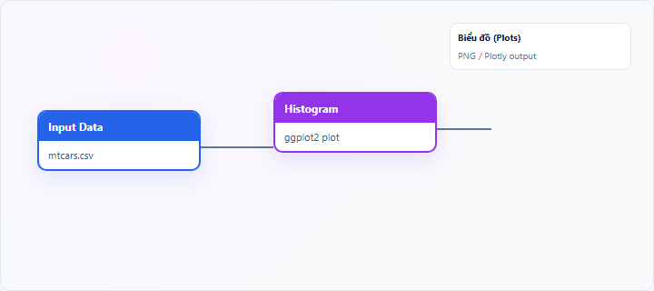
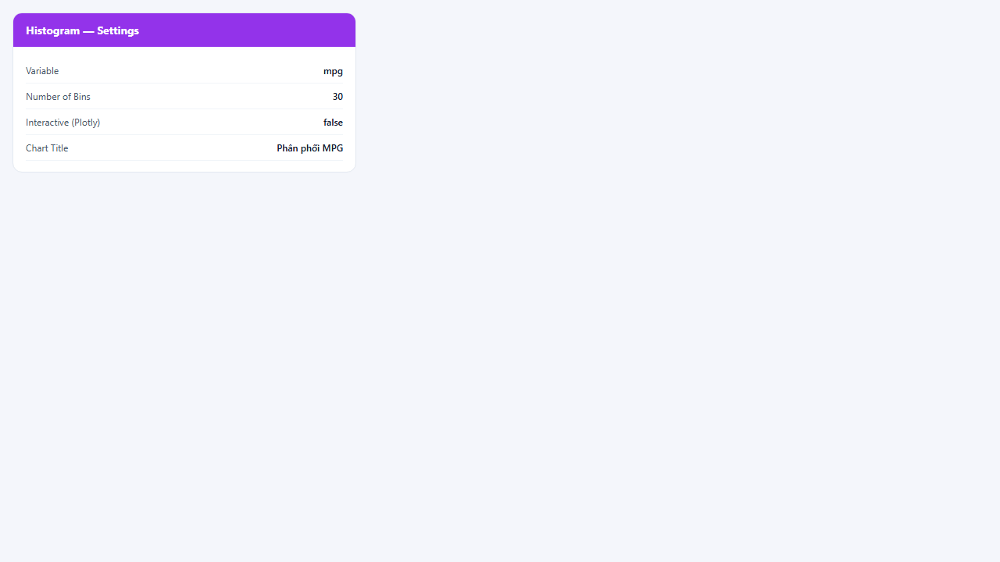
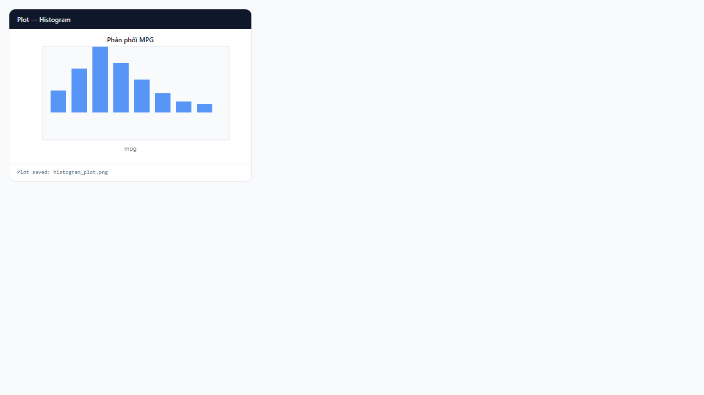

## 1. Biểu đồ tần suất (Histogram) là gì?

**Histogram** (biểu đồ tần suất) là biểu đồ cột liền kề mô tả **phân phối empiric** của một biến số liên tục hoặc rời rạc có nhiều giá trị khác nhau. Trục ngang chia miền giá trị thành các **khoảng (bin)**; trục dọc thể hiện **số quan sát** (tần suất hoặc count) rơi vào mỗi khoảng.

Trên StatNode, node **Histogram** dùng package R **ggplot2** (`geom_histogram`) để vẽ biểu đồ tĩnh (PNG) hoặc tương tác (Plotly) khi bật **Interactive (Plotly)**. Đây là công cụ khám phá dữ liệu (EDA) cơ bản nhất cho một biến đơn.

## 2. Biểu đồ tần suất (Histogram) dùng để làm gì?

Histogram trả lời các câu hỏi:

- Biến **phân bố như thế nào** (đối xứng, lệch trái/phải, đa đỉnh)?
- Có **outlier**, khoảng trống (gap), hay **đuôi dày** (heavy tail) không?
- Phân phối có **gần chuẩn** đủ để dùng phương pháp dựa trên giả định normality không?

**Khi nên dùng:** một biến số, cỡ mẫu từ vài chục trở lên; cần hình dạng phân phối trước khi mô hình hóa.

**Khi không nên dùng:** biến phân loại ít nhóm (dùng bar chart); cần đường cong mượt (dùng density plot); so sánh nhiều nhóm chi tiết (dùng box/violin plot).

**So sánh nhanh:** histogram hiển thị tần suất theo bin cố định; **density plot** ước lượng mật độ liên tục; **box plot** tóm tắt tứ phân vị mà không cho thấy đa đỉnh rõ như histogram.

## 3. Thực hành trên phần mềm StatNode

Workflow cơ bản: kéo node **Input Data** (hoặc nguồn dữ liệu khác) → nối cổng **Data** vào node **Histogram** → chạy workflow → xem biểu đồ tại panel **Biểu đồ** (Plots).

**Dữ liệu minh họa:** bộ dữ liệu `mtcars` (32 quan sát), biến `mpg` (miles per gallon).

**Cấu hình node:**

- **Variable**: `mpg`
- **Number of Bins**: `30` (mặc định; tăng để chi tiết hơn, giảm để làm mượt)
- **Interactive (Plotly)**: tùy chọn — bật để phóng to/kéo trên panel Biểu đồ
- **Chart Title**: ví dụ `Phân phối MPG`
Sau khi chạy, output ghi `Plot saved: ...png` và biểu đồ hiển thị tại tab Plots.

**Kết quả:**

## 4. Diễn giải kết quả

- **Hình dạng đối xứng, một đỉnh:** gợi ý phân phối gần chuẩn hoặc unimodal; có thể cân nhắc OLS, kiểm định t truyền thống.
- **Lệch phải (đuôi dài bên phải):** phổ biến với thu nhập, giá, diện tích — cân nhắc log-transform hoặc mô hình robust.
- **Lệch trái:** thường gặp với biến bị giới hạn trên (điểm số, tỷ lệ) — kiểm tra censored/Tobit nếu có kiểm duyệt.
- **Hai đỉnh trở lên:** có thể là hai tiểu nhóm chưa tách — thêm biến nhóm hoặc mixture model.
- **Cột cực đoan xa trung tâm:** outlier — kiểm tra lỗi nhập liệu trước khi loại bỏ.

**Sai lầm thường gặp:** chọn quá ít bin (mất chi tiết) hoặc quá nhiều bin (nhiễu); diễn giải histogram của mẫu nhỏ như quy luật tổng thể.

## 5. Tài liệu tham khảo

1. Wickham, H. (2016). *ggplot2: Elegant Graphics for Data Analysis* (2nd ed.). Springer.
2. Cleveland, W. S. (1993). *Visualizing Data*. Hobart Press.
3. Wilke, C. O. (2019). *Fundamentals of Data Visualization*. O'Reilly Media. https://clauswilke.com/dataviz/
4. R Documentation — `geom_histogram()`: https://ggplot2.tidyverse.org/reference/geom_histogram.html

---

Ghi chú: Số bin ảnh hưởng hình dạng nhưng không thay đổi tổng quan phân phối; thử 15–50 bin khi khám phá.