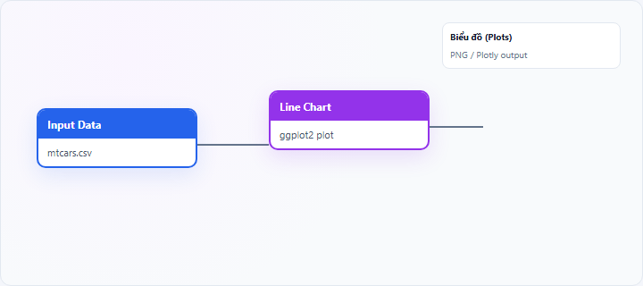
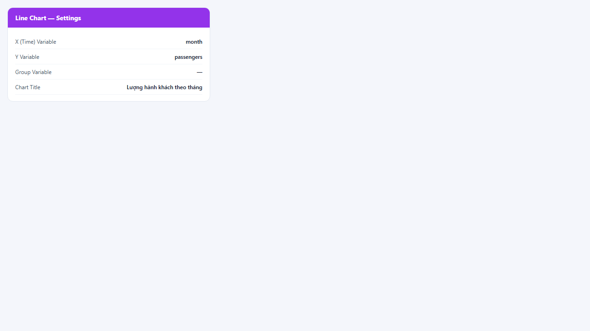
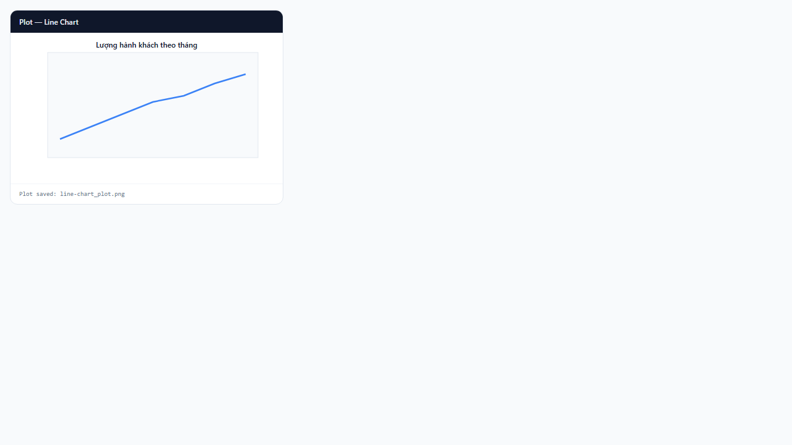

## 1. Biểu đồ đường (Line Chart) là gì?

**Line chart** (biểu đồ đường) nối các điểm $(x_i, y_i)$ bằng đoạn thẳng theo thứ tự trên trục X. Trục X thường là **thời gian**, thứ hạng, hoặc chiều có **thứ tự tự nhiên**; trục Y là biến số cần theo dõi. Có thể vẽ **nhiều đường** theo biến nhóm (`group_var`).

Node **Line Chart** trên StatNode dùng **ggplot2** (`geom_line`) với tùy chọn Plotly.

## 2. Biểu đồ đường (Line Chart) dùng để làm gì?

Line chart trả lời:

- Biến **tăng, giảm hay ổn định** theo thời gian?
- Có **điểm gãy**, **mùa vụ**, **chu kỳ**, hay **spike** bất thường?
- Các **nhóm** có xu hướng song song hay phân kỳ?

**Khi nên dùng:** chuỗi thời gian, dữ liệu theo thứ tự (ngày, quý, năm, giai đoạn).

**Khi không nên dùng:** biến phân loại không có thứ tự (dùng bar chart); hai biến số quan hệ chéo (dùng scatter).

**So sánh:** line chart nhấn mạnh **xu hướng và thứ tự**; **area chart** tô vùng dưới đường để nhấn mức/tích lũy; **bar chart** so sánh từng thời điểm rời rạc.

## 3. Thực hành trên phần mềm StatNode

Workflow cơ bản: kéo node **Input Data** (hoặc nguồn dữ liệu khác) → nối cổng **Data** vào node **Line Chart** → chạy workflow → xem biểu đồ tại panel **Biểu đồ** (Plots).

**Dữ liệu minh họa:** CSV mẫu chuỗi thời gian hoặc `AirPassengers` (sau khi tạo cột `month`, `passengers`).

**Cấu hình node:**

- **X (Time) Variable**: `month` (hoặc `year`, `date`)
- **Y Variable**: `passengers` (hoặc biến kinh tế vĩ mô)
- **Group Variable (optional)**: `region` khi so sánh nhiều chuỗi
- **Chart Title**: `Lượng hành khách theo tháng`

**Kết quả:**

## 4. Diễn giải kết quả

- **Đường dốc lên:** xu hướng tăng — đánh giá tính bền vững (cấu trúc, cơ sở) trước khi dự báo.
- **Đường phẳng:** ổn định hoặc trung tính — có thể không cần sai phân.
- **Gãy đột ngột:** sự kiện cấu trúc, chính sách, khủng hoảng — đánh dấu cho mô hình có break.
- **Dao động định kỳ:** mùa vụ — cần biến mùa vụ hoặc SARIMA.
- **Nhiều đường:** so sánh tốc độ tăng trưởng và hội tụ/phân kỳ giữa nhóm.

**Sai lầm:** nối line qua các điểm X không có thứ tự; quá nhiều đường chồng lấn không đọc được.

## 5. Tài liệu tham khảo

1. Hyndman, R. J., & Athanasopoulos, G. (2021). *Forecasting: Principles and Practice* (3rd ed.). https://otexts.com/fpp3/
2. Wickham, H. (2016). *ggplot2* (2nd ed.). Springer.
3. Cleveland, W. S. (1993). *Visualizing Data*. Hobart Press.
4. R Documentation — `geom_line()`: https://ggplot2.tidyverse.org/reference/geom_line.html

---

Ghi chú: Đảm bảo trục X được sắp xếp đúng thứ tự thời gian trước khi vẽ; ggplot2 không tự sắp xếp theo ngày nếu cột là ký tự.