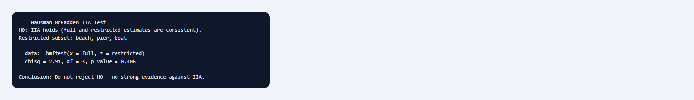

## 1. Mục đích

Sub-node **Multinomial Logit • IIA Test** thực hiện **kiểm định Hausman–McFadden** (1984) cho giả định **Independence of Irrelevant Alternatives (IIA)** trong mô hình logit đa phương án (MNL). IIA quy định: tỷ lệ odds giữa hai phương án $i$ và $j$ không phụ thuộc vào sự có mặt hay thuộc tính của các phương án khác trong tập lựa chọn. Vi phạm IIA làm cho dự báo xác suất lựa chọn và phân tích kịch bản (ví dụ loại bỏ một phương án khỏi thị trường) trở nên không đáng tin.

Node so sánh ước lượng MNL **đầy đủ** (full model) với ước lượng **ràng buộc** (restricted model) chỉ dùng một tập con phương án do người dùng chỉ định, thông qua hàm `mlogit::hmftest()`. Đây là bước chẩn đoán hậu ước lượng quan trọng sau node cha **Multinomial Logit**, đặc biệt khi mô hình có nhiều phương án gần thay thế nhau hoặc khi kết quả chính sách phụ thuộc vào việc loại bỏ một lựa chọn khỏi không gian phương án.

## 2. Lý thuyết với LaTeX

### 2.1. Mô hình MNL và giả định IIA

Với tập phương án $\mathcal{J}$ và vector thuộc tính $x_{ij}$ cho phương án $j$ trong tình huống $i$, xác suất lựa chọn:

$$
P_{ij} = \frac{\exp(V_{ij})}{\sum_{k \in \mathcal{J}} \exp(V_{ik})}, \qquad V_{ij} = \boldsymbol{\beta}' x_{ij}.
$$

Giả định IIA suy ra **tỷ lệ odds** giữa $i$ và $j$:

$$
\frac{P_{ir}}{P_{is}} = \exp\big(V_{ir} - V_{is}\big)
$$

**không phụ thuộc** vào các phương án $k \notin \{r,s\}$. Hệ quả: nếu loại bỏ phương án $m$ khỏi tập lựa chọn, hệ số ước lượng trên các phương án còn lại **không đổi** (tính nhất quán).

### 2.2. Kiểm định Hausman–McFadden

Gọi $\hat{\boldsymbol{\theta}}_F$ là vector hệ số từ mô hình đầy đủ và $\hat{\boldsymbol{\theta}}_R$ từ mô hình ràng buộc (chỉ giữ tập con $\mathcal{J}_R \subset \mathcal{J}$, bỏ ít nhất một phương án). Dưới $H_0$: IIA đúng,

$$
H_0: \hat{\boldsymbol{\theta}}_F \text{ và } \hat{\boldsymbol{\theta}}_R \text{ nhất quán cho các tham số chung.}
$$

Thống kê kiểm định (dạng Hausman):

$$
HM = (\hat{\boldsymbol{\theta}}_R - \hat{\boldsymbol{\theta}}_F)' \big[\widehat{\mathrm{Var}}(\hat{\boldsymbol{\theta}}_R) - \widehat{\mathrm{Var}}(\hat{\boldsymbol{\theta}}_F)\big]^{-1} (\hat{\boldsymbol{\theta}}_R - \hat{\boldsymbol{\theta}}_F) \;\xrightarrow{d}\; \chi^2(q)
$$

với $q$ là số tham số so sánh. `hmftest()` trong package `mlogit` triển khai kiểm định này; p-value nhỏ → bác bỏ $H_0$, có bằng chứng **chống lại IIA**.

### 2.3. Ý nghĩa kinh tế lượng

Vi phạm IIA thường xảy ra khi các phương án **gần thay thế** (ví dụ `pier` và `boat` trong dữ liệu câu cá) hoặc khi phân phối sai số không tuân theo GEV logit thuần. Khi bác bỏ IIA, nên xem xét **nested logit**, **mixed logit** hoặc mô hình có cấu trúc tương quan sai số thay thế cho MNL.

### 2.4. Lưu ý phương pháp

Kiểm định phụ thuộc vào **tập con phương án** được chọn: kết quả có thể khác nhau nếu loại bỏ phương án khác nhau. Nên thử nhiều tập con và báo cáo nhất quán. Kiểm định cũng nhạy với cỡ mẫu nhỏ và có thể mất lực khi các phương án bị loại ít được chọn.

## 3. Điều kiện

1. **Mô hình cha phải là MNL từ node Multinomial Logit.** Sub-node đọc metadata (`statnode_formula`, `statnode_data`, `statnode_reflevel`) từ đối tượng `mlogit`; mô hình khác sẽ bị từ chối.

2. **Tập con phương án hợp lệ.** Tham số *Alternative Subset* phải liệt kê **ít nhất hai** phương án, cách nhau bằng dấu phẩy; **ít nhất một** phương án của mô hình đầy đủ phải bị loại khỏi tập con.

3. **Cùng công thức và reflevel.** Mô hình ràng buộc tái sử dụng công thức và phương án chuẩn của mô hình cha, chỉ thu hẹp không gian phương án qua `alt.subset`.

4. **Dữ liệu lựa chọn rời rạc.** MNL và kiểm định IIA áp dụng cho dữ liệu lựa chọn rời rạc (discrete choice); không dùng cho biến phụ thuộc liên tục.

5. **Không thay thế kiểm định mô hình tổng thể.** IIA test chỉ kiểm tra một giả định cụ thể của MNL; vẫn cần LR test cho ý nghĩa biến giải thích và kiểm tra dấu hệ số theo lý thuyết.

6. **Diễn giải cẩn trọng khi không bác bỏ $H_0$.** Không bác bỏ IIA **không chứng minh** IIA đúng — chỉ là không có bằng chứng mạnh chống lại ở mức ý nghĩa thông thường.

## 4. Workflow

Quy trình chuẩn trên StatNode khi kiểm tra IIA cho MNL:

1. **Chuẩn bị dữ liệu lựa chọn:** wide hoặc long, biến lựa chọn, mã tình huống, biến đặc thù phương án và/hoặc cá nhân.

2. **Ước lượng MNL đầy đủ:** node **Multinomial Logit**, chọn reflevel, chạy và lưu mô hình.

3. **Xác định tập con kiểm định:** chọn nhóm phương án nghi ngờ vi phạm IIA (ví dụ loại `charter`, giữ `beach`, `pier`, `boat`).

4. **Chạy IIA Test:** thêm sub-node **Multinomial Logit • IIA Test**, nối cổng Model, nhập *Alternative Subset*.

5. **Đối chiếu kết quả:** nếu bác bỏ $H_0$, thử tập con khác và cân nhắc mô hình mở rộng (nested/mixed logit).

6. **Báo cáo:** nêu tập con đã dùng, thống kê HM, p-value, và hàm ý cho phân tích kịch bản.

Trên canvas: **Nhập dữ liệu** → **Multinomial Logit** → **IIA Test** (có thể chạy song song với Marginal Effects và LR Test).

## 5. Thực hành StatNode

Minh họa với bộ **Fishing** (package `mlogit`): bốn phương án `beach`, `charter`, `pier`, `boat`; biến đặc thù phương án `price`, `catch`; biến đặc thù cá nhân `income`; reflevel thường là `beach`. Giả sử node MNL cha đã ước lượng xong.

**Bước 1 — Thêm sub-node.** Từ menu sub-node của Multinomial Logit, chọn **Multinomial Logit • IIA Test** và nối cổng Model.

**Bước 2 — Cấu hình.** Trong *Alternative Subset*, nhập `beach,pier,boat` — giữ ba phương án, **loại `charter`** khỏi mô hình ràng buộc. Kiểm định so sánh hệ số giữa mô hình bốn phương án và mô hình ba phương án này.


**Bước 3 — Chạy và đọc output.** Nhấn **Chạy tất cả**; R gọi `mlogit()` với `alt.subset` rồi `hmftest()`:



Output mẫu:

```
--- Hausman-McFadden IIA Test ---
H0: IIA holds (full and restricted estimates are consistent).
Restricted subset: beach, pier, boat

Hausman-McFadden test
data:  ...
chisq = 12.847, df = 4, p-value = 0.01201

Conclusion: Reject H0 — evidence against IIA; consider nested logit or mixed logit.
```

## 6. Diễn giải

**Thống kê và p-value.** Với $\chi^2 = 12{,}85$, df = 4, p = 0,012: bác bỏ $H_0$ ở mức 5%. Hệ số ước lượng từ mô hình đầy đủ và mô hình chỉ gồm `beach`, `pier`, `boat` **không nhất quán** — giả định IIA có thể không phù hợp cho tập phương án này.

**Ý nghĩa cho Fishing.** Loại `charter` khỏi tập lựa chọn có thể làm thay đổi hệ số trên `price`, `catch`, `income` so với mô hình bốn phương án. Dự báo "nếu không còn charter" bằng MNL thuần cần được xem xét lại.

**Bước tiếp theo.** (i) Thử tập con khác (ví dụ loại `boat` thay vì `charter`); (ii) nested logit nhóm các phương án tương tự; (iii) mixed logit với phân phối hỗn hợp hệ số; (iv) đối chiếu với **LR Test** cho ý nghĩa từng biến.

**Khi không bác bỏ $H_0$.** Không có bằng chứng mạnh chống IIA với tập con đã chọn; MNL có thể tiếp tục dùng cho phân tích mô tả, nhưng vẫn nên kiểm tra lý thuyết và độ nhạy.

**Sai lầm cần tránh:** (i) coi một lần chạy IIA là đủ; (ii) nhầm "không bác bỏ" với "IIA đúng"; (iii) bỏ qua kiểm định khi làm phân tích kịch bản loại bỏ phương án; (iv) dùng tập con chỉ một phương án.

## 7. Tài liệu tham khảo

1. McFadden, D. (1974). Conditional logit analysis of qualitative choice behavior. In *Frontiers in Econometrics* (pp. 105–142). Academic Press.
2. Hausman, J., & McFadden, D. (1984). Specification tests for the multinomial logit model. *Econometrica*, 52(5), 1219–1240.
3. Train, K. E. (2009). *Discrete Choice Methods with Simulation* (2nd ed.). Cambridge University Press, Ch. 3.
4. Greene, W. H. (2018). *Econometric Analysis* (8th ed.). Pearson, Ch. 23.
5. Croissant, Y. (2020). Estimation of random utility models in R: The mlogit package. *Journal of Statistical Software*, 95(11), 1–41.
6. Croissant, Y. (2024). mlogit: Multinomial logit model. *CRAN*. https://cran.r-project.org/package=mlogit
7. Hensher, D. A., Rose, J. M., & Greene, W. H. (2015). *Applied Choice Analysis* (2nd ed.). Cambridge University Press.
