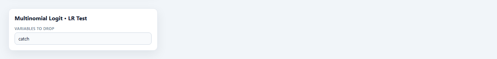
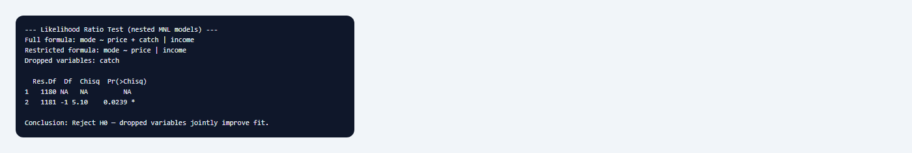

## 1. Mục đích

Sub-node **Multinomial Logit • LR Test** thực hiện **kiểm định hợp số khả nghiệm** (likelihood ratio test) so sánh mô hình MNL **đầy đủ** với mô hình **lồng ghép ràng buộc** (nested restricted model) bằng cách loại bỏ một hoặc nhiều biến giải thích. Câu hỏi trung tâm: *các biến bị loại có đóng góp đồng thời có ý nghĩa vào khả năng giải thích lựa chọn, hay mô hình rút gọn là đủ?*

Node gọi `lmtest::lrtest()` trên hai đối tượng `mlogit` — mô hình cha và mô hình tái ước lượng không gồm các biến trong *Variables to Drop*. Đây là công cụ kiểm định giả thuyết kinh tế lượng (ví dụ: "sản lượng cá `catch` không ảnh hưởng đến lựa chọn phương thức câu") và chọn mô hình parsimonious trước khi báo cáo hiệu ứng biên hoặc phân tích kịch bản.

## 2. Lý thuyết với LaTeX

### 2.1. Mô hình lồng ghép

Gọi $\ell_F$ log-likelihood tối đa của mô hình đầy đủ với tham số $\boldsymbol{\theta}_F$, và $\ell_R$ của mô hình ràng buộc với $\boldsymbol{\theta}_R \subset \boldsymbol{\theta}_F$. Mô hình ràng buộc lồng trong mô hình đầy đủ khi các biến bị loại có hệ số **đồng thời bằng 0** trên mọi phương án liên quan.

Ví dụ Fishing: mô hình đầy đủ

$$
\text{mode} \sim \text{price} + \text{catch} \mid \text{income}
$$

mô hình ràng buộc (bỏ `catch`):

$$
\text{mode} \sim \text{price} \mid \text{income}.
$$

### 2.2. Thống kê LR

Kiểm định:

$$
H_0: \text{các biến bị loại không cải thiện fit} \quad \text{vs.} \quad H_1: \text{ít nhất một hệ số khác 0}.
$$

Thống kê:

$$
LR = 2(\ell_F - \ell_R) \;\xrightarrow{d}\; \chi^2(q) \quad \text{dưới } H_0,
$$

với $q$ bằng số **ràng buộc độc lập** bị áp dụng. Trong MNL, mỗi biến đặc thù phương án thêm một hệ số cho mỗi phương án (trừ reflevel); mỗi biến đặc thù cá nhân thêm $(J-1)$ hệ số với $J$ phương án. Loại `catch` trong Fishing bốn phương án thường tương ứng $q = 3$ ràng buộc (một hệ số `catch` cho mỗi phương án không phải chuẩn).

### 2.3. Quan hệ với Wald và score test

Ba kiểm định tiệm cận tương đương với cỡ mẫu lớn. LR không yêu cầu ước lượng dưới $H_0$ cho toàn bộ vector — phù hợp khi so sánh hai mô hình ước lượng riêng, như StatNode thực hiện.

### 2.4. Giới hạn

LR test giả định cùng mẫu, cùng reflevel, cùng specification phần còn lại. Không dùng để so sánh mô hình không lồng ghép (ví dụ MNL vs mixed logit) — cần test Vuong hoặc BIC/AIC.

## 3. Điều kiện

1. **Mô hình cha MNL** từ node Multinomial Logit với metadata đầy đủ.

2. **Chọn ít nhất một biến loại bỏ** trong *Variables to Drop*; tên khớp cột sau reshape (`catch`, `income`, `price`).

3. **Mô hình ràng buộc không được rỗng.** Loại toàn bộ biến giải thích sẽ bị từ chối.

4. **Lồng ghép thực sự.** Biến bị loại phải nằm trong mô hình đầy đủ; không thể "thêm" biến qua LR test.

5. **Cùng dữ liệu và reflevel** — node tự đảm bảo khi tái ước lượng từ `statnode_data`.

6. **Không thay thế kiểm định IIA** — LR kiểm tra ý nghĩa biến; **IIA Test** kiểm tra giả định cấu trúc MNL.

## 4. Workflow

1. **Ước lượng MNL đầy đủ** với tập biến giả thuyết (Fishing: `price`, `catch`, `income`).

2. **Đặt giả thuyết kinh tế:** ví dụ $H_0$: `catch` không ảnh hưởng lựa chọn.

3. **Thêm LR Test**, chọn biến loại bỏ (`catch`).

4. **Đọc $LR$, df, p-value** — bác bỏ $H_0$ nếu p nhỏ: biến loại bỏ quan trọng.

5. **Cập nhật mô hình báo cáo** — nếu không bác bỏ, có thể dùng mô hình rút gọn; nếu bác bỏ, giữ mô hình đầy đủ.

6. **Tiếp tục hậu ước lượng** (Marginal Effects, IIA) trên mô hình được chọn.

Canvas: **Multinomial Logit** → **LR Test** (+ các sub-node khác song song).

## 5. Thực hành StatNode

**Fishing:** MNL đầy đủ `mode ~ price + catch | income`, reflevel `beach`. Kiểm định liệu `catch` (sản lượng cá kỳ vọng) có thể bỏ khỏi mô hình.

**Bước 1 — Thêm sub-node** **Multinomial Logit • LR Test**, nối cổng Model.

**Bước 2 — Cấu hình.** Trong *Variables to Drop*, chọn `catch`:



**Bước 3 — Chạy.** Node tái ước lượng mô hình `mode ~ price | income` và gọi `lrtest()`:



Output mẫu:

```
--- Likelihood Ratio Test (nested MNL models) ---
Full formula: mode ~ price + catch | income
Restricted formula: mode ~ price | income
Dropped variables: catch

Likelihood ratio test

Model 1: mode ~ price + catch | income
Model 2: mode ~ price | income
    #Df  LogLik Df  Chisq Pr(>Chisq)
1   15  -1192.3
2   12  -1210.8  3  36.92  4.845e-08

Conclusion: Reject H0 — dropped variables jointly improve fit.
```

## 6. Diễn giải

**Log-likelihood.** $\ell_F = -1192{,}3 > \ell_R = -1210{,}8$: mô hình có `catch` fit tốt hơn rõ rệt.

**Thống kê LR.** $LR = 36{,}92$, df = 3, p $\approx 4{,}8 \times 10^{-8}$: bác bỏ $H_0$ mạnh. **Không nên** loại `catch` — sản lượng cá kỳ vọng đóng góp đồng thời có ý nghĩa vào lựa chọn phương thức câu.

**Ý nghĩa kinh tế (Fishing).** Ngư dân phản ứng với `catch` khác nhau giữa `beach`, `charter`, `pier`, `boat`; bỏ biến này làm mô hình mất thông tin quan trọng về chất lượng phương án.

**Khi không bác bỏ $H_0$.** Mô hình rút gọn (không `catch`) có thể đủ cho dự báo và diễn giải parsimonious; vẫn báo cáo cả hai log-likelihood và AIC/BIC nếu so sánh mô hình.

**Liên kết workflow.** Sau khi giữ `catch`, chạy **Marginal Effects** trên `catch` hoặc `income`; chạy **IIA Test** trước phân tích kịch bản loại phương án.

**Sai lầm cần tránh:** (i) loại biến có ý nghĩa vì p-value Wald từng hệ số không đều significant; (ii) dùng LR so sánh MNL với nested logit; (iii) quên df phụ thuộc số phương án; (iv) diễn giải causal từ LR mà không thảo luận thiết kế dữ liệu.

## 7. Tài liệu tham khảo

1. Wilks, S. S. (1938). The large-sample distribution of the likelihood ratio for testing composite hypotheses. *Annals of Mathematical Statistics*, 9(1), 60–62.
2. Vuong, Q. H. (1989). Likelihood ratio tests for model selection and non-nested hypotheses. *Econometrica*, 57(2), 307–333.
3. Train, K. E. (2009). *Discrete Choice Methods with Simulation* (2nd ed.). Cambridge University Press, Ch. 3.
4. Greene, W. H. (2018). *Econometric Analysis* (8th ed.). Pearson, Ch. 23.
5. Croissant, Y. (2020). Estimation of random utility models in R: The mlogit package. *Journal of Statistical Software*, 95(11), 1–41.
6. Zeileis, A., & Hothorn, T. (2002). Diagnostic checking in regression relationships. *R News*, 2(3), 7–10. (`lmtest`)
7. Croissant, Y. (2024). mlogit: Multinomial logit model. *CRAN*. https://cran.r-project.org/package=mlogit
