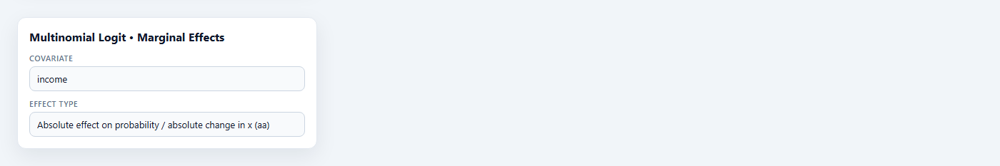
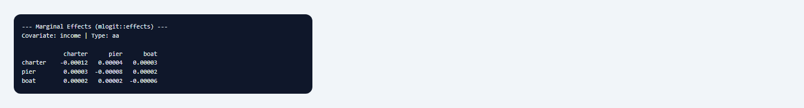

## 1. Mục đích

Sub-node **Multinomial Logit • Marginal Effects** tính **hiệu ứng biên** (marginal effects) hoặc **độ co giãn** của một biến giải thích lên **xác suất lựa chọn** $P(j \mid \mathbf{x})$ trong mô hình MNL, thông qua hàm `effects()` của package `mlogit`. Khác với hệ số $\hat{\boldsymbol{\beta}}$ mô tả thay đổi log-odds, hiệu ứng biên trả lời câu hỏi thực tiễn: *khi `income` tăng thêm một đơn vị, xác suất chọn `charter` thay đổi bao nhiêu phần trăm điểm?*

Node hỗ trợ bốn loại hiệu ứng (`aa`, `ar`, `rr`, `ra`) tùy theo biến giải thích được đo theo thay đổi tuyệt đối hay tương đối và xác suất được báo cáo theo thay đổi tuyệt đối hay phần trăm tương đối. Đây là bước hậu ước lượng thiết yếu sau node cha **Multinomial Logit** khi báo cáo cho nhà hoạch định chính sách hoặc độc giả không quen diễn giải log-odds.

## 2. Lý thuyết với LaTeX

### 2.1. Xác suất lựa chọn MNL

Với phương án $j \in \mathcal{J}$ và utility tuyến tính trong tham số $V_j = \boldsymbol{\beta}_j' \mathbf{x}$:

$$
P_j(\mathbf{x}) = \frac{\exp(V_j)}{\sum_{k \in \mathcal{J}} \exp(V_k)}.
$$

Hệ số MNL là đạo hàm của log-odds so với phương án chuẩn; hiệu ứng biên trên xác suất **phi tuyến** và phụ thuộc vector $\mathbf{x}$ tại điểm đánh giá.

### 2.2. Hiệu ứng biên tuyệt đối (type `aa`)

Đối với biến liên tục $x_m$, hiệu ứng biên tuyệt đối trên $P_j$:

$$
\frac{\partial P_j}{\partial x_m} = P_j \left(\beta_{jm} - \sum_{k \in \mathcal{J}} P_k \,\beta_{km}\right).
$$

Với biến đặc thù phương án, đạo hàm được tính theo thuộc tính của từng phương án $j$; hàng trong bảng output tương ứng phương án có thuộc tính thay đổi, cột là hiệu ứng lên $P(\text{choose } k)$.

### 2.3. Bốn loại hiệu ứng trong `effects()`

Ký hiệu hai chữ cái (theo `mlogit`):

| Loại | Ý nghĩa |
|---|---|
| `aa` | Thay đổi **tuyệt đối** xác suất / thay đổi **tuyệt đối** của $x$ |
| `ar` | Thay đổi **tuyệt đối** xác suất / thay đổi **tương đối** 1% của $x$ |
| `rr` | Thay đổi **tương đối** (%) xác suất / thay đổi **tương đối** 1% của $x$ (elasticity) |
| `ra` | Thay đổi **tương đối** (%) xác suất / thay đổi **tuyệt đối** của $x$ |

Với `income` (biến cá nhân, hệ số khác nhau giữa phương án), `effects()` đánh giá tại giá trị trung bình mẫu của các covariate — StatNode tự xây ma trận `data` gồm trung bình theo phương án cho biến đặc thù phương án và trung bình mẫu cho biến cá nhân.

### 2.4. Tính chất và giới hạn

Tổng các hiệu ứng biên $\partial P_j / \partial x_m$ trên mọi $j$ bằng 0 (xác suất cộng thành 1). Hiệu ứng dương trên một phương án thường đi kèm hiệu ứng âm trên phương án khác. Dưới IIA, hiệu ứng biên nhất quán với cấu trúc logit; nếu IIA bị vi phạm, nên thận trọng khi diễn giải.

## 3. Điều kiện

1. **Mô hình cha MNL hợp lệ** từ node Multinomial Logit, có metadata `statnode_data`.

2. **Tên biến chính xác.** *Covariate* phải khớp tên cột sau `dfidx` reshape (ví dụ `income`, `price`, `catch` — không kèm hậu tố `.beach`).

3. **Chọn loại hiệu ứng phù hợp.** Biến tỷ lệ hoặc log thường dùng `rr` (elasticity); biến định lượng thực tế (thu nhập USD) thường dùng `aa`.

4. **Điểm đánh giá.** StatNode mặc định dùng trung bình mẫu; hiệu ứng tại hộ thu nhập cao/thấp có thể khác — cần phân tích bổ sung ngoài node nếu yêu cầu.

5. **Không nhầm với hệ số MNL.** Hệ số cho biến cá nhân là chênh lệch log-odds so với reflevel; hiệu ứng biên là thay đổi xác suất.

6. **Giả định MNL.** `effects()` có ý nghĩa trong khuôn khổ MNL; kết hợp với **IIA Test** khi mô hình nghi ngờ vi phạm IIA.

## 4. Workflow

1. **Ước lượng MNL** trên dữ liệu lựa chọn (Fishing, Travel Mode, …).

2. **Xác định biến cần diễn giải** — thường biến chính sách (`income`, `price`).

3. **Chọn loại hiệu ứng:** `aa` cho "tăng 1000 USD thu nhập"; `rr` cho "elasticity thu nhập".

4. **Thêm sub-node Marginal Effects**, nối Model, cấu hình *Covariate* và *Effect Type*.

5. **So sánh các loại** (`aa` vs `rr`) nếu cần độc giả đa dạng.

6. **Báo cáo** bảng hiệu ứng kèm điểm đánh giá (trung bình mẫu) và reflevel.

Canvas: **Multinomial Logit** → **Marginal Effects** (song song **IIA Test**, **LR Test**).

## 5. Thực hành StatNode

Ví dụ **Fishing**: MNL với `price`, `catch` (đặc thù phương án), `income` (đặc thù cá nhân), reflevel `beach`.

**Bước 1 — Thêm sub-node** **Multinomial Logit • Marginal Effects**, nối cổng Model.

**Bước 2 — Cấu hình.** *Covariate* = `income`. *Effect Type* chọn lần lượt `aa`, `ar`, `rr`, `ra` để so sánh (mỗi lần chạy một loại, hoặc nhân bản node):



**Bước 3 — Chạy.** Output in ma trận điểm đánh giá và bảng hiệu ứng:



Output mẫu (type `aa`, covariate `income`):

```
--- Marginal Effects (mlogit::effects) ---
Covariate: income | Type: aa
Evaluation at sample mean covariate values:
        price catch income
beach   0.25  0.10  5000
charter 350   0.35  5000
...

                beach   charter    pier    boat
beach          -0.00012  0.00008  0.00002  0.00002
charter         0.00015 -0.00010  0.00003  0.00002
...

Rows index the alternative whose attribute changes; columns are effects on P(choose j).
```

## 6. Diễn giải

**Đọc bảng `aa`.** Hàng `charter`, cột `charter`: khi thuộc tính `income` liên quan đến phương án `charter` tăng thêm một đơn vị (trong cấu trúc biến cá nhân: tăng thu nhập hộ), xác suất chọn `charter` thay đổi khoảng giá trị tại ô đó — thường dương nếu hệ số `income` trên `charter` lớn hơn các phương án khác.

**Cột vs hàng.** Cột cho biết hiệu ứng lên xác suất **của phương án nào**; hàng cho biết **phương án nào** có covariate thay đổi (với biến đặc thù phương án). Với `income` (cá nhân), các hàng thường trùng nhau vì thu nhập không đổi giữa phương án trong cùng tình huống.

**Loại `rr` (elasticity).** "Tăng 1% thu nhập làm xác suất chọn j thay đổi bao nhiêu phần trăm?" — hữu ích so sánh quy mô tác động giữa các phương án và với biến `price`.

**Loại `ar` và `ra`.** `ar`: thay đổi 1% thu nhập → thay đổi điểm phần trăm xác suất. `ra`: thay đổi một đơn vị thu nhập → thay đổi phần trăm xác suất. Chọn theo cách đặt câu hỏi chính sách.

**So với hệ số MNL.** Hệ số `income` trên `charter` dương và có ý nghĩa không đảm bảo mọi $\partial P_j / \partial \text{income}$ đều dương — phải đọc bảng hiệu ứng đầy đủ.

**Sai lầm cần tránh:** (i) trích dẫn hệ số như xác suất; (ii) bỏ qua reflevel; (iii) không nêu loại hiệu ứng (`aa` vs `rr`); (iv) coi hiệu ứng tại trung bình mẫu là hằng số trên toàn bộ mẫu.

## 7. Tài liệu tham khảo

1. McFadden, D. (1974). Conditional logit analysis of qualitative choice behavior. In *Frontiers in Econometrics* (pp. 105–142). Academic Press.
2. Train, K. E. (2009). *Discrete Choice Methods with Simulation* (2nd ed.). Cambridge University Press, Ch. 3–4.
3. Cameron, A. C., & Trivedi, P. K. (2005). *Microeconometrics: Methods and Applications*. Cambridge University Press, Ch. 15.
4. Greene, W. H. (2018). *Econometric Analysis* (8th ed.). Pearson, Ch. 23.
5. Croissant, Y. (2020). Estimation of random utility models in R: The mlogit package. *Journal of Statistical Software*, 95(11), 1–41.
6. Croissant, Y. (2024). mlogit: Multinomial logit model. *CRAN*. https://cran.r-project.org/package=mlogit
7. Hensher, D. A., Rose, J. M., & Greene, W. H. (2015). *Applied Choice Analysis* (2nd ed.). Cambridge University Press.
