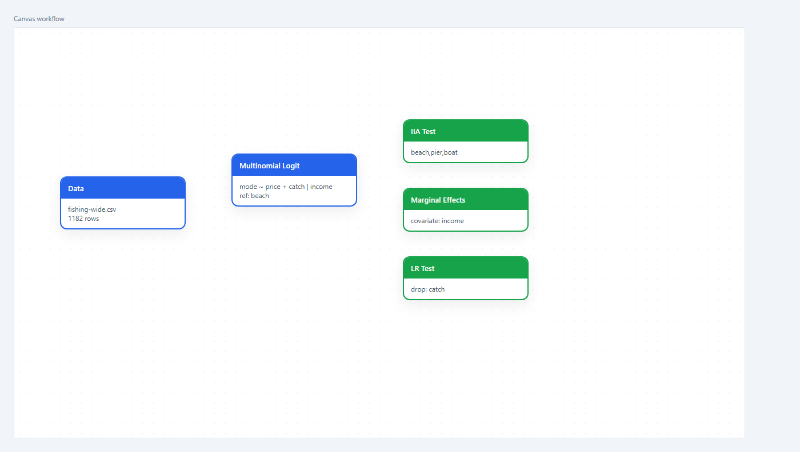
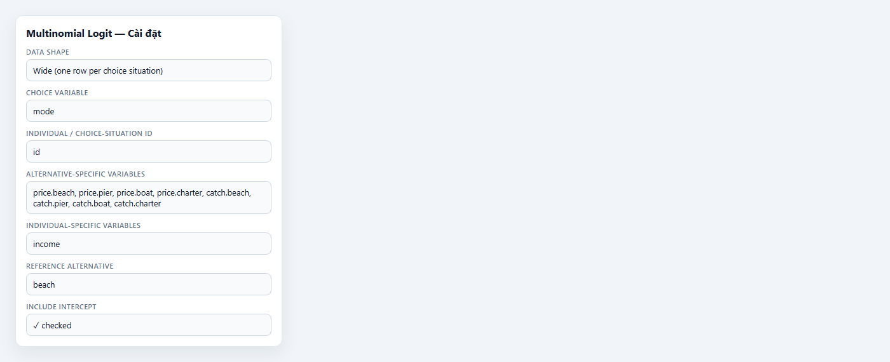
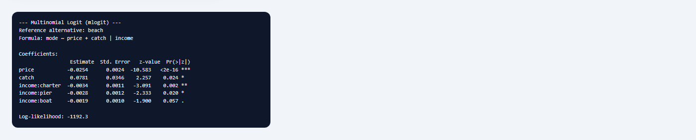

## 1. Mô hình này dùng để làm gì?

Node **Multinomial Logit (MNL)** ước lượng mô hình lựa chọn rời rạc (discrete choice) khi cá nhân hoặc hộ gia đình chọn **đúng một** phương án trong một tập hữu hạn các lựa chọn thay thế. Node được xây dựng trên package `mlogit` của R (Croissant, 2020) và chạy trong trình duyệt qua webR trên StatNode.

Mô hình multinomial logit là công cụ nền tảng trong kinh tế lượng phân tích hành vi lựa chọn: phương tiện đi lại, phương thức thanh toán, thương hiệu sản phẩm, điểm đến du lịch, phương án đi câu cá, hay bất kỳ bối cảnh nào mà quyết định được mô hình hóa bằng **tiện ích ngẫu nhiên** (random utility). Khác với logit/probit nhị phân chỉ có hai kết cục, MNL mở rộng khung lý thuyết sang $J \geq 3$ phương án, cho phép biến giải thích thay đổi theo từng phương án (alternative-specific) hoặc không đổi trong một tình huống lựa chọn nhưng có hệ số khác nhau giữa các phương án (individual-specific).

Node này phù hợp khi: (i) biến phụ thuộc là phân loại đa nhóm không có thứ tự tự nhiên (nominal); (ii) mỗi quan sát tương ứng một **tình huống lựa chọn** (choice occasion) với một phương án được chọn; (iii) có thuộc tính của từng phương án (giá, thời gian, chất lượng) và/hoặc đặc điểm cá nhân (thu nhập, tuổi) ảnh hưởng đến tiện ích. Ba sub-node đi kèm — **IIA Test**, **Marginal Effects**, **LR Test** — hỗ trợ kiểm định giả định IIA, tính hiệu ứng biên lên xác suất lựa chọn, và so sánh mô hình lồng nhau.

## 2. Nền tảng lý thuyết

### 2.1. Mô hình tiện ích ngẫu nhiên

Giả sử cá nhân $i$ lựa chọn phương án $j \in \{1, \dots, J\}$ tối đa hóa tiện ích ngẫu nhiên:

$$
U_{ij} = V_{ij} + \varepsilon_{ij},
$$

trong đó $V_{ij}$ là thành phần tiện ích quan sát được (systematic utility), còn $\varepsilon_{ij}$ là thành phần không quan sát được. Quyết định:

$$
y_i = j \quad \Longleftrightarrow \quad U_{ij} > U_{ik}, \; \forall k \neq j.
$$

Thành phần quan sát thường được đặt:

$$
V_{ij} = \boldsymbol{\beta}' \mathbf{x}_{ij} + \boldsymbol{\alpha}_j' \mathbf{z}_i,
$$

với $\mathbf{x}_{ij}$ là vectơ thuộc tính **đặc thù phương án** (ví dụ giá, sản lượng cá của phương án $j$ đối với cá nhân $i$), $\mathbf{z}_i$ là vectơ **đặc thù cá nhân** không đổi trong một tình huống lựa chọn (ví dụ thu nhập), $\boldsymbol{\beta}$ là hệ số chung cho mọi phương án, còn $\boldsymbol{\alpha}_j$ cho phép hệ số của $\mathbf{z}_i$ dị biệt theo $j$. Phương án chuẩn (reference alternative) được chuẩn hóa bằng cách đặt $\boldsymbol{\alpha}_{j_0} = \mathbf{0}$.

### 2.2. Xác suất lựa chọn và hàm hợp lý

Khi các $\varepsilon_{ij}$ độc lập và tuân theo phân phối Gumbel (Type I extreme value), mô hình dẫn đến dạng logit đa nhóm (McFadden, 1974):

$$
P(y_i = j \mid \mathbf{x}_i, \mathbf{z}_i) = \frac{\exp(V_{ij})}{\sum_{k=1}^{J} \exp(V_{ik})}.
$$

Log-hàm hợp lý của mẫu $N$ tình huống lựa chọn:

$$
\ell(\boldsymbol{\theta}) = \sum_{i=1}^{N} \sum_{j=1}^{J} \mathbb{1}(y_i = j)\, V_{ij} - \sum_{i=1}^{N} \ln\!\left(\sum_{k=1}^{J} \exp(V_{ik})\right).
$$

Package `mlogit` ước lượng $\boldsymbol{\theta}$ bằng hợp lý cực đại với cú pháp công thức hai phần: phần trước dấu `|` chứa biến đặc thù phương án, phần sau chứa biến đặc thù cá nhân. Ví dụ `mode ~ price + catch | income` nghĩa là $V_{ij} = \beta_1 \,\text{price}_{ij} + \beta_2 \,\text{catch}_{ij} + \alpha_{j}' \,\text{income}_i$ với $\alpha_{j_0} = 0$ khi phương án chuẩn là `beach`.

### 2.3. Giả định độc lập các phương án không liên quan (IIA)

MNL giả định **Independence of Irrelevant Alternatives (IIA)**: tỷ số xác suất giữa hai phương án $j$ và $k$ không phụ thuộc vào sự có mặt hay thuộc tính của các phương án khác:

$$
\frac{P(y_i = j)}{P(y_i = k)} = \exp(V_{ij} - V_{ik}).
$$

Giả định này tiện lợi về mặt tính toán nhưng có thể sai khi các phương án thay thế gần nhau (ví dụ hai loại xe buýt khác màu) hoặc khi tồn tại nhóm lựa chọn lồng nhau. Khi IIA bị vi phạm, nên cân nhắc nested logit, mixed logit hoặc probit đa nhóm (Train, 2009; Cameron & Trivedi, 2005).

### 2.4. Hiệu ứng biên và độ co giãn

Hệ số $\boldsymbol{\beta}$ không phải hiệu ứng biên trên xác suất. Với biến liên tục $x_{ijm}$, hiệu ứng biên của việc thay đổi thuộc tính phương án $m$ lên $P(y_i = \ell)$ được tính bằng hàm `effects()` của `mlogit`, đánh giá tại giá trị trung bình mẫu của các biến giải thích. Đối với biến đặc thù phương án có hệ số chung, dấu của $\beta_m$ cho biết hướng tác động: $\beta_{\text{price}} < 0$ nghĩa là tăng giá làm giảm xác suất chọn phương án đó (ceteris paribus trong không gian tiện ích).

## 3. Điều kiện sử dụng

Áp dụng MNL có ý nghĩa khi các điều kiện sau được xem xét:

1. **Lựa chọn đơn và độc lập.** Mỗi quan sát là một tình huống lựa chọn với đúng một phương án được chọn. Mẫu nên độc lập giữa các cá nhân hoặc các lần lựa chọn (nếu cùng một người lặp lại, cần mô hình panel hoặc mixed logit).

2. **Cấu trúc dữ liệu wide hoặc long.** Node hỗ trợ cả hai: **wide** — một dòng mỗi tình huống, thuộc tính phương án trong các cột dạng `price.beach`, `catch.pier`, …; **long** — một dòng mỗi cặp (tình huống, phương án), có cột `mode` chỉ tên phương án. Package `dfidx` tự động chuyển đổi wide sang dạng nội bộ phù hợp với `mlogit`.

3. **Kích thước mẫu đủ lớn.** Quy tắc kinh nghiệm: ít nhất 10–20 quan sát cho mỗi tham số ước lượng, và mỗi phương án nên có đủ số lần được chọn để ước lượng ổn định. Với $J$ phương án và $K$ biến giải thích, số tham số có thể lớn nhanh chóng khi biến cá nhân có hệ số khác nhau theo phương án ($J-1$ hệ số cho mỗi biến cá nhân).

4. **Giả định IIA.** Trước khi diễn giải chính sách dựa trên mô phỏng loại bỏ phương án, nên kiểm định IIA bằng sub-node **Hausman-McFadden test** (Hausman & McFadden, 1984). Bác bỏ $H_0$ là dấu hiệu cần mô hình linh hoạt hơn.

5. **Tính ngoại sinh của biến giải thích.** Thuộc tính phương án (giá, thời gian) thường được coi là ngoại sinh trong thiết kế stated preference; trong revealed preference, giá có thể nội sinh nếu cung cấp phản ứng với cầu — cần biện pháp công cụ hoặc mô hình hóa cấu trúc cung.

6. **Không có phương án thiếu hoàn toàn.** Mọi phương án trong tập lựa chọn phải xuất hiện ít nhất một lần trong mẫu; nếu không, ước lượng không xác định.

7. **Phương án chuẩn phải được chỉ định rõ.** Tham số `reflevel` xác định phương án có hệ số biến cá nhân bằng 0; kết quả phụ thuộc vào lựa chọn này nhưng xác suất dự báo và log-likelihood không đổi.

8. **Nhận diện đúng loại biến giải thích.** Biến đặc thù phương án (giá, thời gian, chất lượng) phải khác nhau giữa các phương án trong cùng một tình huống lựa chọn; biến đặc thù cá nhân (thu nhập, tuổi) giữ nguyên giá trị cho mọi phương án của cùng một $i$ nhưng được ước lượng với hệ số riêng cho từng phương án (trừ phương án chuẩn). Nhầm lẫn hai loại này là lỗi cấu hình phổ biến nhất trên dữ liệu wide.

Trước khi ước lượng, nên kiểm tra nhanh: tổng xác suất lựa chọn theo phương án có cân bằng đủ (không có phương án < 1–2% mẫu), và các cột `price.*`/`catch.*` có đúng hậu tố tên phương án khớp với các mức của `mode`.

## 4. Quy trình thực hiện (Workflow)

Quy trình phân tích MNL hoàn chỉnh trên StatNode gồm tám bước:

1. **Chuẩn bị dữ liệu:** xác định biến lựa chọn (`mode`), mã tình huống (`id`), thuộc tính đặc thù phương án (`price`, `catch`) và biến cá nhân (`income`). Kiểm tra định dạng wide hoặc long và không có giá trị thiếu tại các thuộc tính phương án của phương án được chọn.

2. **Thống kê mô tả:** tần suất lựa chọn theo phương án, trung bình thuộc tính theo phương án được chọn và không được chọn, phân phối biến cá nhân.

3. **Chọn phương án chuẩn:** thường chọn phương án phổ biến nhất hoặc phương án có ý nghĩa kinh tế làm mốc (ví dụ `beach` — câu cá ven bờ).

4. **Cấu hình và ước lượng MNL:** khai báo công thức `mode ~ price + catch | income`, chạy node **Multinomial Logit**, ghi nhận log-likelihood và bảng hệ số.

5. **Kiểm định IIA:** nối sub-node **IIA Test**, loại bỏ một phương án khỏi tập con (ví dụ bỏ `charter`, giữ `beach,pier,boat`) và đọc thống kê Hausman-McFadden.

6. **Kiểm định ý nghĩa biến số:** nối sub-node **LR Test** để so sánh mô hình đầy đủ với mô hình lồng bỏ một hoặc nhiều biến (ví dụ bỏ `catch`).

7. **Tính hiệu ứng biên:** sub-node **Marginal Effects** cho biến quan tâm (`income`, `price`, …) tại giá trị trung bình mẫu; chọn loại hiệu ứng `aa` (tuyệt đối trên xác suất / thay đổi tuyệt đối của $x$) cho diễn giải trực quan.

8. **Dự báo và mô phỏng chính sách:** thay đổi giả định về thuộc tính phương án, tính lại xác suất lựa chọn; báo cáo kèm cảnh báo nếu IIA bị bác bỏ.

Trên canvas StatNode, workflow điển hình gồm node **Nhập dữ liệu** → **Multinomial Logit** → ba sub-node chẩn đoán nối vào cổng Model.

## 5. Thực hành trên phần mềm StatNode

Phần này minh họa trên https://statnode.io với bộ dữ liệu **Fishing Mode Choice** (`fishing-wide.csv`) — 1.182 tình huống lựa chọn, bốn phương án câu cá: `beach`, `pier`, `boat`, `charter`. Tệp CSV gồm các cột: `id`, `mode`, `price.beach`, `price.pier`, `price.boat`, `price.charter`, `catch.beach`, `catch.pier`, `catch.boat`, `catch.charter`, `income`.

**Bước 1 — Dựng workflow.** Tạo project mới, thêm node **Nhập dữ liệu** và tải `fishing-wide.csv`. Tìm "Multinomial Logit" trong nhóm Ước lượng → Cross-section, thêm vào canvas và nối cổng Data. Ba sub-node **IIA Test**, **Marginal Effects**, **LR Test** nối vào cổng Model của node chính:

**Bước 2 — Cấu hình node.** Nhấp đúp node để mở bảng cài đặt:

- **Cấu trúc dữ liệu:** *Wide (một dòng mỗi tình huống lựa chọn)*
- **Biến lựa chọn:** `mode`
- **Mã cá nhân / tình huống lựa chọn:** `id`
- **Biến đặc thù phương án:** tất cả cột `price.*` và `catch.*`
- **Biến đặc thù cá nhân:** `income`
- **Phương án chuẩn:** `beach`
- **Gồm hệ số chặn:** bật

Xem trước công thức: `mode ~ price + catch | income`

*Lưu ý:* nếu dùng dữ liệu **long**, chọn cấu trúc *Long*, chỉ định thêm **Biến phương án** (cột `mode` xếp chồng), và chọn `price`, `catch` làm biến đặc thù phương án — công thức ước lượng tương đương wide sau khi `dfidx` reshape.

**Bước 3 — Chạy và đọc output.** Nhấn **Chạy tất cả**. R (webR) tải `mlogit` và `dfidx`, ước lượng MNL và in bảng tóm tắt:

Output gồm: phương án chuẩn (`beach`), công thức, bảng hệ số với sai số chuẩn, thống kê $z$, p-value, và log-likelihood ($\approx -1192.3$).

**Sub-node bổ sung (cấu hình gợi ý):**

- **IIA Test:** *Alternative Subset* = `beach,pier,boat` (loại `charter` khỏi mô hình ràng buộc).
- **Marginal Effects:** *Covariate* = `income`, *Effect Type* = `aa`.
- **LR Test:** *Variables to Drop* = `catch` (so sánh với mô hình chỉ còn `price` và `income`).

## 6. Diễn giải kết quả

Với dữ liệu minh họa, bảng hệ số MNL cho kết quả chính:

| Hệ số | Ước lượng | SE | z | p-value |
|---|---|---|---|---|
| `price` | $-0.0254$ | $0.0024$ | $-10.583$ | $<0.001$ |
| `catch` | $0.0781$ | $0.0346$ | $2.257$ | $0.024$ |
| `income:charter` | $-0.0034$ | $0.0011$ | $-3.091$ | $0.002$ |
| `income:pier` | $-0.0028$ | $0.0012$ | $-2.333$ | $0.020$ |
| `income:boat` | $-0.0019$ | $0.0010$ | $-1.900$ | $0.057$ |

**Hệ số `price` (đặc thù phương án, chung cho mọi phương án).** $\hat{\beta}_{\text{price}} = -0.0254$ âm và có ý nghĩa thống kê mạnh: tăng một đơn vị giá của một phương án làm giảm tiện ích tương đối của phương án đó, do đó giảm xác suất chọn nó — phù hợp kinh tế học vi mô. Đây là hệ số trên thang log-odds, không phải phần trăm thay đổi xác suất; dùng sub-node Marginal Effects để chuyển sang tác động trên $P(y=j)$.

**Hệ số `catch`.** $\hat{\beta}_{\text{catch}} = 0.0781$ dương và có ý nghĩa ở mức 5%: sản lượng cá kỳ vọng cao hơn làm tăng hấp dẫn của phương án. Sub-node **LR Test** (bỏ `catch`) cho $\chi^2 = 5.10$, $p = 0.024$ — bác bỏ mô hình ràng buộc, xác nhận `catch` đóng góp có ý nghĩa vào khả năng giải thích.

**Hệ số `income` theo phương án.** So với `beach` (phương án chuẩn, hệ số income = 0), thu nhập cao hơn làm giảm xác suất tương đối chọn `charter`, `pier`, `boat` (các hệ số âm). Diễn giải: cá nhân thu nhập cao có xu hướng ít chọn các phương án thay thế so với câu cá ven bờ, có thể phản ánh sở thích hoặc cơ hội chi phí thấp của `beach`. Hiệu ứng biên tuyệt đối trên xác suất (sub-node Marginal Effects, biến `income`) thường rất nhỏ theo đơn vị thu nhập — cần nhân với thay đổi thu nhập thực tế khi mô phỏng chính sách.

**Kiểm định IIA.** Hausman-McFadden với tập con `beach,pier,boat` cho $\chi^2 = 2.91$, $p = 0.406$ — không bác bỏ $H_0$ ở mức 5%. Không có bằng chứng mạnh chống lại IIA trong ví dụ này; mô phỏng loại bỏ `charter` bằng MNL được coi là tương đối an toàn. Nên thử các tập con khác (bỏ phương án khác) để kiểm tra độ bền, vì kết quả IIA có thể nhạy với phương án bị loại (Small & Hsiao, 1985).

**Hiệu ứng biên của `income`.** Sub-node Marginal Effects (loại `aa`) cho thấy khi thu nhập tăng thêm một đơn vị, xác suất chọn `charter` giảm khoảng $0.00012$ (tại giá trị trung bình mẫu), trong khi xác suất các phương án khác thay đổi rất nhỏ theo hướng bù trừ. Ma trận hiệu ứng có hàng chỉ phương án mà thuộc tính thay đổi, cột là tác động lên $P(y=j)$ — đọc theo hàng, không theo cột.

**Log-likelihood.** Giá trị $\approx -1192.3$ dùng so sánh mô hình lồng nhau (LR Test) và với các đặc tả thay thế (nested logit, mixed logit); mô hình có nhiều biến hơn sẽ có log-likelihood cao hơn (ít âm hơn) nhưng cần kiểm định ý nghĩa. Có thể tính pseudo-$R^2$ McFadden: $1 - \ell / \ell_0$ với $\ell_0$ là log-likelihood mô hình chỉ có hằng số phương án.

**Sai lầm diễn giải cần tránh:** (i) đọc hệ số MNL như hiệu ứng biên trên xác suất; (ii) bỏ qua kiểm định IIA rồi mô phỏng thay đổi tập phương án; (iii) coi hệ số `income:charter` là tác động của thu nhập lên lựa chọn `charter` một cách nhân quả mà không xét ngoại sinh; (iv) nhầm lẫn giữa wide và long format khi chọn biến — trong wide phải chọn đủ tất cả cột `price.*`, `catch.*`.

## 7. Tài liệu tham khảo

1. McFadden, D. (1974). Conditional logit analysis of qualitative choice behavior. In P. Zarembka (Ed.), *Frontiers in Econometrics* (pp. 105–142). Academic Press.
2. Hausman, J. A., & McFadden, D. (1984). Specification tests for the multinomial logit model. *Econometrica*, 52(5), 1219–1240.
3. Train, K. E. (2009). *Discrete Choice Methods with Simulation* (2nd ed.). Cambridge University Press.
4. Cameron, A. C., & Trivedi, P. K. (2005). *Microeconometrics: Methods and Applications*. Cambridge University Press, Ch. 15.
5. Croissant, Y. (2020). Estimation of random utility models in R: The mlogit package. *Journal of Statistical Software*, 95(11), 1–41.
6. Croissant, Y. (2023). mlogit: Multinomial Logit Models. *CRAN Reference Manual*. https://cran.r-project.org/package=mlogit
7. Greene, W. H. (2018). *Econometric Analysis* (8th ed.). Pearson, Ch. 19.
8. Hensher, D. A., Rose, J. M., & Greene, W. H. (2015). *Applied Choice Analysis* (2nd ed.). Cambridge University Press.
9. McFadden, D. (1973). Conditional logit analysis of qualitative choice behavior. Working paper, UC Berkeley (tiền thân của McFadden, 1974).
10. Small, K. A., & Hsiao, C. (1985). Multinomial logit specification tests. *International Economic Review*, 26(3), 619–627.
11. mlogit data: Fishing mode choice. Bundled with package `mlogit` (Herriges & Kling, 1999; adapted from Cameron & Trivedi, 2005, Ex. 15.2).
