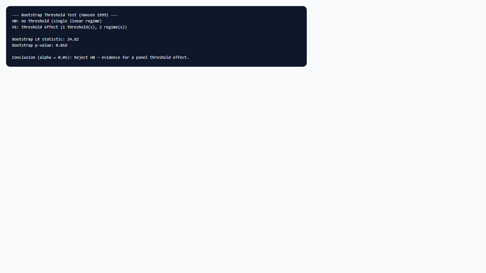

## 1. Mô hình dùng để làm gì?

Sub-node **Panel Threshold • Bootstrap Test** thực hiện **kiểm định bootstrap** cho hiệu ứng ngưỡng trên dữ liệu bảng, theo phương pháp Hansen (1999). Kiểm định so sánh hai mô hình lồng nhau (nested models): mô hình ràng buộc $H_0$ — panel tuyến tính với một chế độ duy nhất, hệ số góc không đổi theo biến ngưỡng — và mô hình thay thế $H_1$ — panel ngưỡng với hệ số phụ thuộc chế độ (regime-dependent coefficients) trên các biến `ind1`.

Vai trò của sub-node trong workflow StatNode là **cổng quyết định thống kê** trước khi diễn giải kinh tế các hệ số theo chế độ. Nếu kiểm định không bác bỏ $H_0$, việc báo cáo $\hat{\boldsymbol{\beta}}_1 \neq \hat{\boldsymbol{\beta}}_2$ từ output `ptm()` là không có cơ sở suy luận chuẩn — các khác biệt hệ số có thể chỉ phản ánh nhiễu lấy mẫu hoặc overfitting trên lưới ngưỡng. Ngược lại, khi p-value bootstrap nhỏ hơn mức ý nghĩa, nghiên cứu có cơ sở chuyển sang sub-node **Regime Summary** và báo cáo cấu trúc piecewise linear.

Sub-node **không ước lượng lại** mô hình: nó đọc kết quả đã lưu từ node cha **Panel Threshold** (đối tượng `statnode_ptm` sau lệnh `ptm()`) và trích xuất thống kê kiểm định bootstrap tương ứng với **Threshold Order** đã chọn (1, 2, hoặc 3 ngưỡng). Do đó, số lần bootstrap (`bootn`), tỷ lệ trim, và lưới quantile phải được cấu hình trên node cha; sub-node chỉ chọn khối output `Output[[k]]` để phân tích.

Trong thực hành kinh tế lượng panel, kiểm định này tương đương bước “test for threshold effects” trong Hansen (1999) và được nhắc lại trong các khảo sát gần đây về mô hình ngưỡng (Wang & Chan, 2024). Nó bổ sung — không thay thế — phán đoán định tính từ đồ thị scatter hoặc chênh lệch hệ số OLS tách mẫu thủ công.

## 2. Nền tảng lý thuyết

### 2.1. Giả thuyết kiểm định

Với một ngưỡng và hai chế độ, mô hình đầy đủ ($H_1$) là:

$$
y_{it} = \mu_i + \mathbf{x}_{1,it}' \boldsymbol{\beta}_{1} I(q_{it} \leq \gamma) + \mathbf{x}_{1,it}' \boldsymbol{\beta}_{2} I(q_{it} > \gamma) + \mathbf{x}_{2,it}' \boldsymbol{\beta}_3 + u_{it},
$$

trong đó $\mathbf{x}_{1,it}$ là vectơ `ind1`, $\mathbf{x}_{2,it}$ là vectơ `ind2`, và $\gamma$ chưa biết. Giả thuyết không ($H_0$) ràng buộc:

$$
H_0: \boldsymbol{\beta}_1 = \boldsymbol{\beta}_2,
$$

tức mô hình thu gọn thành hồi quy panel tuyến tính với hiệu ứng cố định:

$$
y_{it} = \mu_i + \mathbf{x}_{1,it}' \boldsymbol{\beta} + \mathbf{x}_{2,it}' \boldsymbol{\beta}_3 + u_{it}.
$$

Với $m$ ngưỡng và $m+1$ chế độ, $H_0$ vẫn là **đồng nhất hệ số** trên mọi chế độ đối với các biến trong `ind1`; số tham số tăng dưới $H_1$ là $(m \times k_1)$ hệ số bổ sung (với $k_1$ chiều của `ind1`) cộng thêm $m$ ngưỡng.

### 2.2. Vấn đề tham số không xác định dưới $H_0$

Điểm then chốt khiến kiểm định chuẩn (LR, Wald, F) không áp dụng trực tiếp: dưới $H_0$, tham số ngưỡng $\gamma$ **không được nhận dạng** (unidentified). Mọi giá trị $\gamma$ đều cho cùng một mô hình tuyến tính và cùng SSE. Phân phối tiệm cận của ước lượng ngưỡng không phải phân phối chuẩn mà thuộc họ phân phối **Chernoff** hoặc hỗn hợp, với tốc độ hội tụ $O_p(T^{-1})$ khác với $O_p(T^{-1/2})$ của hệ số OLS. Hansen (1999, 2000) chứng minh rằng sử dụng phân phối $\chi^2$ cho thống kê LR sẽ **lạm dương** nghiêm trọng — tức từ chối $H_0$ quá thường xuyên dù không có hiệu ứng ngưỡng thật.

### 2.3. Thống kê kiểm định và bootstrap panel

Thống kê kiểm định thường dựa trên chênh lệch giữa tổng bình phương sai số (SSE) của mô hình ràng buộc và không ràng buộc. Ký hiệu $SSE_0$ và $SSE_1$ lần lượt là SSE dưới $H_0$ và $H_1$ với ngưỡng ước lượng $\hat{\gamma}$. Thống kê dạng LR hoặc F có dạng:

$$
LR = T \cdot \big(\log SSE_0 - \log SSE_1\big),
$$

hoặc biến thể dựa trên $F$-statistic tương đương trong output `ptm()`. Giá trị lớn của $LR$ ủng hộ $H_1$.

Hansen (1999) đề xuất **bootstrap panel** để xấp xỉ phân phối của $LR$ dưới $H_0$:

1. Ước lượng mô hình tuyến tính dưới $H_0$ và thu phần dư $\hat{u}_{it}$.
2. Với mỗi lần bootstrap $b = 1, \ldots, B$: tái tạo dữ liệu theo quy tắc bootstrap phù hợp panel (thường resample phần dư hoặc cặp $(y_{it}, \mathbf{x}_{it})$ giữ cấu trúc $N \times T$), ước lượng lại cả mô hình ràng buộc và mô hình ngưỡng, tính $LR^{(b)}$.
3. p-value bootstrap:

$$
\hat{p} = \frac{1}{B} \sum_{b=1}^{B} I\big(LR^{(b)} \geq LR^{\mathrm{obs}}\big).
$$

Trong `ptm()`, tham số `bootn` (mặc định 100 trên StatNode) kiểm soát $B$ cho từng order ngưỡng. p-value in trong output được sub-node trích và đưa ra kết luận ở mức $\alpha = 0.05$.

### 2.4. Kiểm định và số ngưỡng

`ptm()` luôn ước lượng ba cấu hình (1, 2, 3 ngưỡng). Kiểm định bootstrap **gắn với từng order**: sub-node phải chọn **Threshold Order** trùng với giả thuyết kinh tế. Thông lệ: kiểm định order = 1 trước; chỉ khi bác bừ $H_0$ và có cơ sở lý thuyết, mới xem order = 2 hoặc 3. Kiểm định order cao hơn với cùng mức ý nghĩa không tự động “chọn mô hình tốt nhất” — cần cân nhắc parcimonie và cân bằng quan sát giữa các chế độ (Baltagi, 2021).

### 2.5. Quan hệ với kiểm định chuỗi thời gian

Hansen (2000) phát triển lý thuyết sample splitting và bootstrap cho mô hình ngưỡng **một chuỗi thời gian**. Hansen (1999) điều chỉnh cho **panel tĩnh** với hiệu ứng cố định và lặp theo $T$. Logic bootstrap giữ nguyên: tham số ngưỡng không liên tục làm suy luận chuẩn thất bại. Caner & Hansen (2004) mở rộng sang IV khi biến ngưỡng nội sinh — ngoài phạm vi sub-node hiện tại.

### 2.6. Công suất kiểm định và lựa chọn $B$

Công suất kiểm định bootstrap phụ thuộc vào độ lớn thật của chênh lệch hệ số giữa các chế độ, vị trí ngưỡng thật trong phân phối $q_{it}$, và chiều thời gian $T$. Với panel micro ($N = 30$, $T = 15$) như `invest-sample.csv`, hiệu ứng ngưỡng vừa phải có thể chỉ được phát hiện khi $B \geq 100$. Tăng $B$ lên 200–300 làm p-value ổn định hơn (bước quantize tối thiểu $1/B$) nhưng tăng thời gian chạy trên WebR tuyến tính theo $B$. Không nên so sánh p-value từ $B = 50$ với $B = 300$ trên hai lần chạy khác nhau mà không chạy lại toàn bộ node cha — mọi thành phần bootstrap phải đồng bộ.

### 2.7. Báo cáo trong văn phong học thuật

Wang & Chan (2024) khuyến nghị trình bày kiểm định ngưỡng ngay sau mô tả mẫu và trước bảng hệ số theo chế độ. Cụm thông tin tối thiểu gồm: phát biểu $H_0/H_1$, số lần bootstrap, thống kê kiểm định (LR hoặc F), p-value bootstrap, và mức ý nghĩa. Tránh dùng từ “chứng minh có ngưỡng” — nên dùng “bác bỏ giả thuyết mô hình tuyến tính đơn chế độ” hoặc “có bằng chứng thống kê cho hiệu ứng ngưỡng”.

## 3. Điều kiện sử dụng

1. **Bắt buộc có mô hình cha.** Sub-node chỉ hoạt động khi node **Panel Threshold** đã chạy thành công và xuất đối tượng `statnode_ptm`. Nếu node cha lỗi (panel không cân bằng, $T < 5$), sub-node không có input hợp lệ.

2. **Cùng Threshold Order với giả thuyết.** Order = 1 kiểm định một ngưỡng (hai chế độ); order = 2 kiểm định hai ngưỡng (ba chế độ); order = 3 tương ứng bốn chế độ. Không nên kiểm định order = 3 rồi diễn giải hệ số order = 1 mà không nêu rõ.

3. **Số lần bootstrap đủ lớn trên node cha.** Với $B = 50$, p-value bootstrap có độ phân giải tối thiểu 0.02; khuyến nghị $B \geq 100$ cho báo cáo, $B = 200$–300 cho bài báo. Giảm $B$ trên node cha khi thử nhanh, tăng lại trước kết luận cuối.

4. **Panel cân bằng và $T$ đủ lớn.** Điều kiện giống node cha: mỗi entity có cùng $T$, tối thiểu $T \geq 5$ (khuyến nghị $T \geq 10$–15). Kiểm định có công suất thấp khi $T$ nhỏ hoặc biến ngưỡng tập trung ở một vùng hẹp.

5. **Thứ tự suy luận.** Kiểm định bootstrap trả lời câu hỏi “có hiệu ứng ngưỡng hay không?”, không trả lời “ngưỡng bằng bao nhiêu?” hay “hệ số chế độ 2 là bao nhiêu?”. Các câu sau dùng output node cha và Regime Summary **sau khi** bác bừ $H_0$.

6. **Không thay thế kiểm định unit root.** Bootstrap threshold test không kiểm tra tính dừng; kết hợp sub-node **Panel Unit Root (pIGF)** khi làm việc trên mức.

## 4. Quy trình workflow

Quy trình sử dụng sub-node Bootstrap Test trong phân tích panel threshold:

1. **Hoàn tất ước lượng node cha** với cấu hình `ind1`, `ind2`, biến ngưỡng, entity/time, và `bootn` phù hợp (ví dụ 100).

2. **Nối sub-node** vào cổng **Model** của node Panel Threshold (không cần nối lại dữ liệu gốc).

3. **Chọn Threshold Order** trên sub-node: thường bắt đầu với “1 threshold (2 regimes)”.

4. **Chạy sub-node** (hoặc Chạy tất cả). Đọc thống kê kiểm định (LR/F), phân phối bootstrap nếu in, và **p-value bootstrap**.

5. **Quyết định thống kê:** nếu $\hat{p} < \alpha$ (thường 0.05), bác bừ $H_0$ — tiếp tục Regime Summary và diễn giải hệ số. Nếu $\hat{p} \geq \alpha$, dừng diễn giải ngưỡng; báo cáo mô hình panel FE tuyến tính.

6. **(Tùy chọn) Kiểm định order cao hơn** nếu lý thuyết cho phép nhiều ngưỡng và order = 1 đã bị bác bừ — so sánh p-value và cân bằng chế độ trước khi chọn mô hình phức tạp hơn.

7. **Ghi chép trong báo cáo:** nêu rõ $H_0$, $H_1$, số lần bootstrap, order ngưỡng, thống kê và p-value, và mức ý nghĩa.

Workflow trên canvas: **Input Data** → **Panel Threshold** → **Bootstrap Threshold Test** (song song có thể thêm Regime Summary và Unit Root sau khi có kết quả kiểm định).

## 5. Thực hành trên phần mềm StatNode

Minh họa với dữ liệu `invest-sample.csv` ($N = 30$, $T = 15$): biến phụ thuộc `investment`, `ind1` = (`tobins_q`, `cashflow`), biến ngưỡng `tobins_q`, entity `entity`, time `time`. Giả sử node **Panel Threshold** đã chạy với **Bootstrap Repetitions** = 100.

**Bước 1 — Nối sub-node.** Kéo node **Panel Threshold • Bootstrap Test** từ nhóm Hậu ước lượng, nối cổng Model của node cha sang cổng Model của sub-node.

**Bước 2 — Cấu hình.**

- **Threshold Order:** `1 threshold (2 regimes)` — kiểm định một ngưỡng, hai chế độ, phù hợp giả thuyết đầu tư cơ hội đơn ngưỡng trên Tobin's Q.

Không có tham số bootstrap trên sub-node; mọi thiết lập bootstrap nằm trên node cha.

**Bước 3 — Chạy và đọc output.**

Output in:

- Phát biểu $H_0$: không có ngưỡng (một chế độ tuyến tính).
- Phát biểu $H_1$: có hiệu ứng ngưỡng với $m$ ngưỡng và $m+1$ chế độ.
- Thống kê kiểm định từ khối `Output[[1]]` của `ptm()` (tên trường có thể là F-statistic, LR, hoặc khối Bootstrap tùy phiên bản `pdR`).
- **p-value bootstrap** và dòng kết luận tự động: “Reject H0 — evidence for a panel threshold effect” hoặc “Do not reject H0 — no significant threshold effect detected” ở $\alpha = 0.05$.

Nếu output không tách riêng p-value, sub-node in toàn bộ khối kiểm định để người dùng đọc thủ công; quy tắc vẫn là so sánh p-value với mức ý nghĩa.

**Ví dụ đọc nhanh:** p-value bootstrap = 0.032 → bác bừ $H_0$ ở 5%; tiếp tục Regime Summary. p-value = 0.214 → không bác bừ; báo cáo mô hình tuyến tính FE, không nhấn mạnh $\hat{\gamma}$.

## 6. Diễn giải kết quả

**p-value bootstrap là đối tượng chính.** Khác với p-value từ phân phối $\chi^2$, p-value bootstrap đã điều chỉnh cho tham số ngưỡng không xác định dưới $H_0$. Giá trị nhỏ (ví dụ 0.01–0.05) cho thấy chênh lệch SSE giữa mô hình tuyến tính và mô hình ngưỡng **lớn hơn** so với phần lớn các lần mô phỏng dưới giả thuyết không có ngưỡng — tức có bằng chứng cho cấu trúc piecewise linear trên `ind1`.

**Không bác bừ $H_0$ không chứng minh “không có ngưỡng”.** Kiểm định có thể thiếu công suất khi $T$ nhỏ, ngưỡng thật nằm ở đuôi phân phối $q_{it}$, hoặc chênh lệch hệ số giữa chế độ nhỏ. Kết luận đúng là: *với dữ liệu và mức ý nghĩa này, không đủ bằng chứng để bác bừ mô hình tuyến tính*. Có thể báo cáo ước lượng ngưỡng như exploratory nhưng không trình bày như kết quả xác nhận.

**Bác bừ $H_0$ là điều kiện cần, chưa đủ cho mọi tuyên bố.** Vẫn cần: (i) kiểm tra cân bằng chế độ (Regime Summary); (ii) khoảng tin cậy bootstrap của $\hat{\gamma}$ không quá rộng; (iii) hệ số theo chế độ có ý nghĩa kinh tế; (iv) bậc tích hợp phù hợp nếu dùng mức (pIGF).

**So sánh giữa các order.** Nếu order = 1 bị bác bừ ($p = 0.04$) nhưng order = 2 có $p = 0.31$, mô hình một ngưỡng thường được ưu tiên trừ khi lý thuyết yêu cầu ba chế độ. Bác bừ cả order = 1 và 2 không tự động nghĩa là “chọn order = 2” — cần tiêu chí parcimonie và đủ quan sát mỗi chế độ.

**Mức ý nghĩa và báo cáo.** Nên nêu rõ $\alpha = 0.05$ (hoặc 0.10 trong exploratory), $B = 100$ (hoặc giá trị thực tế), và order kiểm định. Ví dụ câu báo cáo: “Kiểm định bootstrap Hansen (1999) với $B = 100$ bác bừ giả thuyết không có ngưỡng cho mô hình một ngưỡng ($p = 0.032$), cho phép diễn giải hệ số theo chế độ.”

**Robustness với mức ý nghĩa.** Ở mức $\alpha = 0.10$, p-value = 0.08 có thể được báo cáo như bằng chứng yếu (marginal) nếu lý thuyết mạnh và cân bằng chế độ chấp nhận được — nhưng phải nêu rõ mức ý nghĩa, không “cherry-pick” sau khi thấy p-value 0.04 ở $\alpha = 0.05$ thất bại khi chạy lại với $B$ lớn hơn.

**Liên hệ với kiểm định nhiều ngưỡng.** Khi báo cáo cả order = 1 và order = 2, độc giả có thể hiểu nhầm rằng cả hai đều được xác nhận độc lập. Nên trình bày theo thứ tự parcimonie: kiểm định order = 1 trước; chỉ trình bày order = 2 nếu có cơ sở lý thuyết và kiểm định order = 1 đã bị bác bừ. Baltagi (2021) nhắc rằng overfitting ngưỡng là rủi ro đặc thù của mô hình piecewise so với hồi quy tuyến tính.

**Sai lầm cần tránh:** (i) dùng p-value OLS tách mẫu thay cho bootstrap; (ii) diễn giải hệ số chế độ khi $p \geq 0.05$; (iii) kiểm định order = 1 nhưng trình bày hệ số từ order = 2 vì “đẹp hơn”; (iv) quên rằng kiểm định gắn với biến ngưỡng và tập `ind1` đã chọn — đổi biến ngưỡng phải chạy lại toàn bộ node cha.

## 7. Tài liệu tham khảo

1. Hansen, B. E. (1999). Threshold effects in non-dynamic panels: Estimation, testing and inference. *Journal of Econometrics*, 93(2), 345–368.
2. Hansen, B. E. (2000). Sample splitting and threshold estimation. *Econometrica*, 68(3), 575–603.
3. Caner, M., & Hansen, B. E. (2004). Instrumental variable estimation of a threshold model. *Journal of Business & Economic Statistics*, 22(3), 278–289.
4. Chang, Y. (2002). Nonlinear IV unit root tests in panels with cross-sectional dependency. *Journal of Econometrics*, 110(2), 261–292.
5. Kremer, S., Nykolidaki, E., & Zaklan, F. (2013). On the determinants of renewable energy consumption growth: A global sample analysis. *Energy Economics*, 36, 641–647.
6. Seo, M. H., & Shin, Y. (2016). Dynamic panels with threshold effect and endogeneity. *Journal of Econometrics*, 195(1), 170–180.
7. Wang, Q., & Chan, F. (2024). A survey of threshold models in economics and finance. *Journal of Economic Surveys*, 38(1), 3–42.
8. Baltagi, B. H. (2021). *Econometric Analysis of Panel Data* (6th ed.). Springer.
9. Ho Tsung-wu. pdR: Threshold Model and Unit Root Tests in Cross-Section and Time Series Data. *CRAN Reference Manual*. https://cran.r-project.org/package=pdR
