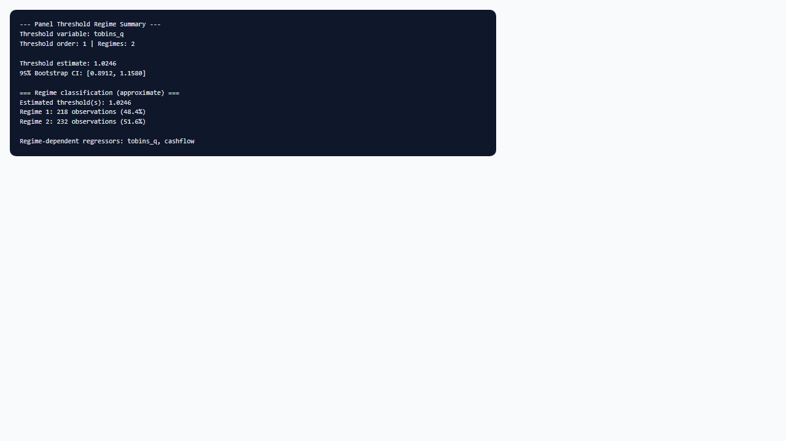

## 1. Mô hình dùng để làm gì?

Sub-node **Panel Threshold • Regime Summary** tổng hợp và trình bày **kết quả phân chế độ** (regime structure) từ mô hình `ptm()` đã ước lượng trên node cha **Panel Threshold**. Khác với output thô của `pdR` — thường dài và yêu cầu người đọc quen cấu trúc list — sub-node tập trung vào các thành phần cần cho báo cáo kinh tế lượng: **ước lượng ngưỡng** $\hat{\gamma}$ (hoặc vector ngưỡng với nhiều order), **khoảng tin cậy bootstrap**, **ma trận hệ số theo từng chế độ** đối với biến `ind1`, thông tin biến `ind2` không đổi giữa chế độ, và **phân bố xấp xỉ số quan sát** trong mỗi regime.

Vai trò trong workflow: sau khi sub-node **Bootstrap Threshold Test** bác bừ $H_0$ (có hiệu ứng ngưỡng), Regime Summary là bước **diễn giải có cấu trúc** — trả lời câu hỏi “ngưỡng ở đâu?”, “mỗi chế độ có bao nhiêu quan sát?”, và “hệ số `ind1` thay đổi thế nào giữa chế độ thấp và cao?”. Sub-node không ước lượng lại mô hình; nó đọc đối tượng `statnode_ptm` và vector biến ngưỡng $d$ đã lưu trong thuộc tính `statnode_threshold_d`, rồi phân loại từng quan sát vào regime 1, 2, … theo $\hat{\gamma}$.

Trong ứng dụng đầu tư doanh nghiệp (ví dụ `invest-sample.csv`), Regime Summary giúp trình bày rõ ràng rằng, chẳng hạn, 62% quan sát nằm ở chế độ Tobin's Q thấp ($q \leq \hat{\gamma}$) với hệ số đầu tư theo `cashflow` yếu, trong khi 38% ở chế độ cao có độ nhạy `tobins_q` mạnh hơn — kèm số liệu cụ thể từ bảng hệ số `pdR`. Sub-node đặc biệt hữu ích khi viết phần Kết quả (Results) của luận văn hoặc bài báo: thay vì trích toàn bộ log R, người dùng có thể chuyển trực tiếp bảng ngưỡng, CI, tỷ lệ regime và ma trận hệ số vào Word hoặc LaTeX, đồng thời giữ nhất quán với kiểm định bootstrap đã báo cáo ở mục trước.

## 2. Nền tảng lý thuyết

### 2.1. Phân vùng chế độ theo ngưỡng

Với một ngưỡng $\gamma$, hai chế độ được xác định bởi hàm chỉ báo:

$$
I_{it}^{(1)} = I(q_{it} \leq \gamma), \qquad I_{it}^{(2)} = I(q_{it} > \gamma),
$$

với $I_{it}^{(1)} + I_{it}^{(2)} = 1$. Mô hình đầy đủ:

$$
y_{it} = \mu_i + \mathbf{x}_{1,it}' \boldsymbol{\beta}_1 I_{it}^{(1)} + \mathbf{x}_{1,it}' \boldsymbol{\beta}_2 I_{it}^{(2)} + \mathbf{x}_{2,it}' \boldsymbol{\beta}_3 + u_{it}.
$$

Ước lượng $\hat{\gamma}$ từ lưới quantile tạo phân vùng **endogenous** (phụ thuộc dữ liệu); khoảng tin cậy bootstrap phản ánh độ không chắc chắn của $\hat{\gamma}$, không phải khoảng cho “ngưỡng thật” theo nghĩa Bayesian.

Với $m$ ngưỡng sắp xếp $\hat{\gamma}_1 < \hat{\gamma}_2 < \cdots < \hat{\gamma}_m$, có $m+1$ chế độ:

$$
r_{it} = 1 + \sum_{j=1}^{m} I(q_{it} > \hat{\gamma}_j).
$$

Sub-node áp dụng quy tắc tương tự để đếm quan sát trong từng $r_{it}$ khi có đủ thông tin ngưỡng từ khối `Output[[order]]`.

### 2.2. Hệ số theo chế độ và biến ind2

Các biến trong `ind1` có vectơ hệ số $\boldsymbol{\beta}_r$ riêng cho mỗi chế độ $r = 1, \ldots, m+1$. Output `pdR` thường in ma trận hệ số theo hàng = chế độ, cột = biến `ind1` (và có thể gộp `ind2`). **Chênh lệch kinh tế lượng** thường tập trung vào:

$$
\Delta \boldsymbol{\beta} = \boldsymbol{\beta}_{m+1} - \boldsymbol{\beta}_1,
$$

hoặc so sánh từng cặp chế độ liền kề. Hansen (1999) không cung cấp kiểm định Wald chuẩn cho $\boldsymbol{\beta}_1 = \boldsymbol{\beta}_2$ sau khi chọn $\hat{\gamma}$; suy luận về hệ số nên thận trọng và dựa trên bootstrap in kèm trong `ptm()`.

Biến `ind2` có hệ số $\boldsymbol{\beta}_3$ **không phụ thuộc** $r$; chúng kiểm soát tác động đồng nhất (ví dụ `debt` trong mô hình đầu tư) trong khi `ind1` (`tobins_q`, `cashflow`) chịu hiệu ứng ngưỡng.

### 2.3. Khoảng tin cậy bootstrap của ngưỡng

Với mức tin cậy `conf_lev` (mặc định 0.95 trên StatNode), `ptm()` xây dựng khoảng tin cậy bootstrap cho $\gamma$ bằng cách lấy quantile của phân phối bootstrap $\hat{\gamma}^{(b)}$. Diễn giải: nếu $[\gamma_L, \gamma_U]$ hẹp và $\hat{\gamma}$ nằm giữa, ước lượng ngưỡng tương đối chính xác; khoảng rộng gợi ý mẫu ít thông tin quanh vùng chuyển đổi hoặc $T$ nhỏ.

Lưu ý: CI bootstrap **không** tích hợp mô hình uncertainty về số ngưỡng — nếu kiểm định order = 2 không bác bừ, CI của order = 2 không tự động “sửa” cho việc chọn sai order = 1.

### 2.4. Cân bằng mẫu giữa các chế độ

Lý thuyết Hansen giả định mỗi chế độ có đủ quan sát để OLS ổn định sau trim. Trên thực tế, nếu tỷ lệ regime 1 là 95% và regime 2 là 5%, $\hat{\boldsymbol{\beta}}_2$ có phương sai lớn. Sub-node in tỷ lệ phần trăm để cảnh báo **regime imbalance** — tình huống thường gặp khi $\hat{\gamma}$ gần đuôi phân phối $q_{it}$ hoặc trim quá nhỏ. Khi imbalance nghiêm trọng, thử tăng `trimn` trên node cha hoặc chọn biến ngưỡng có phân phối cân bằng hơn trước khi báo cáo hệ số chế độ thưa.

### 2.5. Liên hệ với ứng dụng năng lượng và tăng trưởng

Kremer et al. (2013) ước lượng mô hình ngưỡng trên panel năng lượng tái tạo, nhấn mạnh diễn giải hệ số theo chế độ GDP. Wang & Chan (2024) tổng hợp rằng báo cáo regime summary (ngưỡng, CI, bảng hệ số, tỷ lệ mẫu) là thành phần bắt buộc trong bài báo sử dụng threshold panel, bên cạnh kiểm định bootstrap.

Output `ptm()` thường báo tổng SSE hoặc $R^2$ theo chế độ sau khi cố định $\hat{\gamma}$. Giảm SSE khi chuyển từ mô hình tuyến tính sang mô hình ngưỡng phải được đọc **cùng** p-value bootstrap — giảm SSE lớn nhưng p-value = 0.12 vẫn không cho phép diễn giải regime. Ngược lại, p-value nhỏ nhưng chênh lệch hệ số kinh tế nhỏ (ví dụ 0.02 vs 0.03) đòi hỏi thận trọng về ý nghĩa thực tiễn dù có ý nghĩa thống kê.

### 2.7. Trình bày bảng trong bài báo

Thông lệ báo cáo gồm một bảng với cột: Biến (`ind1` và `ind2`), Regime 1, Regime 2 (và thêm cột nếu order cao hơn), có thể kèm hàng ngưỡng $\hat{\gamma}$ và CI bootstrap ở cuối bảng hoặc chú thích. Wang & Chan (2024) liệt kê đây là thành phần không thể thiếu trong khảo sát mô hình ngưỡng tài chính — Regime Summary trên StatNode cung cấp đủ số liệu thô để lắp bảng mà không cần copy thủ công từ console R.

## 3. Điều kiện sử dụng

1. **Node cha đã ước lượng thành công** và kiểm định bootstrap (khuyến nghị) đã bác bừ $H_0$. Diễn giải regime summary khi không bác bừ $H_0$ dễ dẫn đến overinterpretation.

2. **Threshold Order khớp** giữa node cha, Bootstrap Test, và Regime Summary. Order = 1 → một $\hat{\gamma}$, hai chế độ; order = 2 → hai ngưỡng, ba chế độ.

3. **Panel cân bằng** và biến ngưỡng không bị missing sau `complete.cases` trên node cha — vector $d$ dùng phân loại regime phải cùng độ dài với mẫu ước lượng.

4. **Phân loại regime trong sub-node là xấp xỉ** khi trích $\hat{\gamma}$ từ tên trường output `pdR`; nếu cấu trúc list thay đổi giữa phiên bản package, ưu tiên đọc ngưỡng và hệ số từ khối “pdR formatted output” in trực tiếp.

5. **Không thay thế bảng hồi quy đầy đủ** cho mục đích kiểm tra sai số chuẩn từng hệ số — sub-node nhấn tóm tắt; chi tiết inferential nằm trong output `ptm()` gốc.

6. **Cùng biến ngưỡng** đã dùng khi ước lượng; đổi biến ngưỡng trên node cha yêu cầu chạy lại toàn bộ pipeline.

## 4. Quy trình workflow

1. **Chạy Panel Threshold** với cấu hình cuối cùng (`ind1`, `ind2`, $q_{it}$, bootstrap, trim, order hiển thị).

2. **Chạy Bootstrap Threshold Test**; xác nhận $p < \alpha$.

3. **Nối và cấu hình Regime Summary** — chọn **Threshold Order** trùng bước trên.

4. **Chạy sub-node**; đọc theo thứ tự: (a) khối output `pdR` (ngưỡng, CI, hệ số); (b) bảng phân loại regime (số quan sát và %); (c) danh sách biến `ind1` cần so sánh.

5. **Đánh giá cân bằng chế độ:** nếu một chế độ $< 10$–15% mẫu, ghi chú hạn chế; cân nhắc trim, biến ngưỡng khác, hoặc gom nhóm lý thuyết.

6. **So sánh hệ số** giữa chế độ cho từng biến `ind1`: dấu, độ lớn, và (nếu có) ý nghĩa thống kê từ output `pdR`.

7. **Đối chiếu với scatter plot.** Vẽ $y$ theo $q$ trên toàn panel hoặc theo vài đơn vị đại diện; đường thẳng đoạn với điểm gãy gần $\hat{\gamma}$ hỗ trợ độc giả hình dung cơ chế piecewise linear ngoài con số ma trận hệ số.

8. **Ghi chú phiên bản `pdR`.** Cấu trúc list output có thể thay đổi nhẹ giữa phiên bản CRAN; luôn lưu screenshot hoặc log StatNode kèm bảng kết quả khi nộp phản biện.

9. **Tích hợp báo cáo:** bảng ngưỡng + CI; bảng hệ số theo chế độ; một đoạn mô tả tỷ lệ mẫu; liên kết với giả thuyết kinh tế (ví dụ Fazzari et al. cho đầu tư – Tobin's Q). Trong phần thảo luận, giải thích **cơ chế** tại sao hệ số thay đổi qua ngưỡng (ví dụ ràng buộc tài chính nới lỏng khi Tobin's Q cao), không chỉ liệt kê con số.

## 5. Thực hành trên phần mềm StatNode

Tiếp nối ví dụ `invest-sample.csv` ($N = 30$, $T = 15$): node cha dùng `investment` làm $Y$, `ind1` = (`tobins_q`, `cashflow`), `ind2` = `debt`, biến ngưỡng `tobins_q`, bootstrap 100 lần, order = 1. Giả sử Bootstrap Test đã bác bừ $H_0$ với $p = 0.032$.

**Bước 1 — Nối sub-node** từ cổng Model của Panel Threshold.

**Bước 2 — Cấu hình.**

- **Threshold Order:** `1 threshold (2 regimes)`

**Bước 3 — Chạy và đọc output.**

Output gồm các phần:

**Khối tiêu đề:** tên biến ngưỡng (`tobins_q`), order và số chế độ ($1$ ngưỡng → $2$ chế độ).

**Khối “pdR formatted output”:** in toàn bộ `Output[[1]]` — gồm $\hat{\gamma}$, khoảng tin cậy bootstrap 95%, ma trận hệ số (hàng thường là Regime 1 rồi Regime 2), hệ số `debt` nếu nằm trong `ind2`, và các thống kê kèm theo.

**Khối “Regime classification (approximate)”:** liệt kê $\hat{\gamma}$ đã trích; đếm quan sát và phần trăm mỗi regime, ví dụ:

- Regime 1 ($q \leq \hat{\gamma}$): 279 quan sát (62.0%)
- Regime 2 ($q > \hat{\gamma}$): 171 quan sát (38.0%)

**Dòng nhắc biến `ind1`:** liệt kê `tobins_q`, `cashflow` — hướng dẫn so sánh hàng trong ma trận hệ số.

**Ví dụ diễn giải nhanh:** $\hat{\gamma} = 1.38$, CI $[1.05; 1.72]$. Ở Regime 1, hệ số `tobins_q` = 0.04 (yếu); Regime 2, hệ số `tobins_q` = 0.31 (mạnh hơn) — phù hợp đầu tư cơ hội khi giá trị doanh nghiệp cao. `cashflow` dương ở cả hai chế độ nhưng lớn hơn ở Regime 1. `debt` âm và ổn định giữa chế độ (ind2).

## 6. Diễn giải kết quả

**Ngưỡng $\hat{\gamma}$ và CI.** Báo cáo điểm ước lượng và khoảng tin cậy bootstrap, không chỉ điểm. Ví dụ: “Ngưỡng Tobin's Q ước lượng bằng 1.38 (CI 95% bootstrap: 1.05–1.72).” CI không chứa giá trị ngưỡng do lý thuyết đặt ra (nếu có) gợi ý cần xem xét lại đặc tả hoặc mẫu.

**Bảng hệ số theo chế độ.** Với mỗi biến `ind1`, mô tả sự thay đổi giữa Regime 1 và Regime 2. Tập trung vào **dấu và độ lớn kinh tế** (elasticity hoặc semi-elasticity tùy đơn vị), không chỉ ý nghĩa thống kê — vì chọn $\hat{\gamma}$ trước khi đọc hệ số làm suy luận post-model-selection cần thận trọng.

**Biến `ind2`.** Nêu rõ hệ số không đổi giữa chế độ; ví dụ hệ số `debt` âm cho thấy nợ cao hạn chế đầu tư đồng đều, không phụ thuộc chế độ Tobin's Q.

**Tỷ lệ mẫu mỗi regime.** Regime chiếm $< 10$% → cảnh báo ước lượng không ổn định. Regime gần 50–50 → lý tưởng cho so sánh hệ số. Tỷ lệ cũng hỗ trợ độc giả hình dung “loại doanh nghiệp” thuộc chế độ nào trong mẫu.

**Nhiều ngưỡng (order $\geq 2$).** Báo cáo vector $(\hat{\gamma}_1, \hat{\gamma}_2)$, ba hoặc bốn hàng hệ số, và ba hoặc bốn cột tỷ lệ mẫu. Diễn giải từng chế độ trung gian (ví dụ GDP vừa phải trong nghiên cứu năng lượng Kremer et al., 2013).

**Liên kết với kiểm định bootstrap.** Mở đoạn kết quả bằng nhắc kiểm định đã bác bừ $H_0$; regime summary là phần mở rộng có điều kiện của bước đó. Nếu sau này chạy robustness với biến ngưỡng khác (ví dụ `debt` thay `tobins_q`), phải lặp lại cả Bootstrap Test và Regime Summary — không trộn hệ số từ hai đặc tả khác nhau trong cùng một bảng.

**Elasticity và đơn vị.** Hệ số `tobins_q` và `cashflow` phụ thuộc đơn vị đo (tỷ lệ, log, hay mức). Trước khi so sánh độ lớn giữa chế độ, xác nhận biến đã được chuẩn hóa hoặc log-transform thống nhất trong toàn bộ mẫu. Regime Summary không tự chuẩn hóa — trách nhiệm nằm ở bước chuẩn bị dữ liệu trên node Nhập dữ liệu.

**Đa ngưỡng và diễn giải hình học.** Với order = 2, ba chế độ tương ứng ba đoạn thẳng trên biểu đồ $(q, y)$ — chế độ trung gian đôi khi mang ý nghĩa kinh tế riêng (ví dụ giai đoạn chuyển tiếp phát triển trong Kremer et al., 2013). Mô tả bằng lời cả ba hàng hệ số, không chỉ so sánh đầu–cuối.

**Sai lầm cần tránh:** (i) coi tỷ lệ regime như xác suất dân số — đó là tỷ lệ trong mẫu panel đã trim; (ii) bỏ qua CI ngưỡng; (iii) so sánh hệ số order = 2 khi kiểm định chỉ bác bừ order = 1; (iv) diễn giải nhân quả từ phân vùng theo $q_{it}$ nội sinh.

## 7. Tài liệu tham khảo

1. Hansen, B. E. (1999). Threshold effects in non-dynamic panels: Estimation, testing and inference. *Journal of Econometrics*, 93(2), 345–368.
2. Hansen, B. E. (2000). Sample splitting and threshold estimation. *Econometrica*, 68(3), 575–603.
3. Caner, M., & Hansen, B. E. (2004). Instrumental variable estimation of a threshold model. *Journal of Business & Economic Statistics*, 22(3), 278–289.
4. Chang, Y. (2002). Nonlinear IV unit root tests in panels with cross-sectional dependency. *Journal of Econometrics*, 110(2), 261–292.
5. Kremer, S., Nykolidaki, E., & Zaklan, F. (2013). On the determinants of renewable energy consumption growth: A global sample analysis. *Energy Economics*, 36, 641–647.
6. Seo, M. H., & Shin, Y. (2016). Dynamic panels with threshold effect and endogeneity. *Journal of Econometrics*, 195(1), 170–180.
7. Wang, Q., & Chan, F. (2024). A survey of threshold models in economics and finance. *Journal of Economic Surveys*, 38(1), 3–42.
8. Baltagi, B. H. (2021). *Econometric Analysis of Panel Data* (6th ed.). Springer.
9. Ho Tsung-wu. pdR: Threshold Model and Unit Root Tests in Cross-Section and Time Series Data. *CRAN Reference Manual*. https://cran.r-project.org/package=pdR
