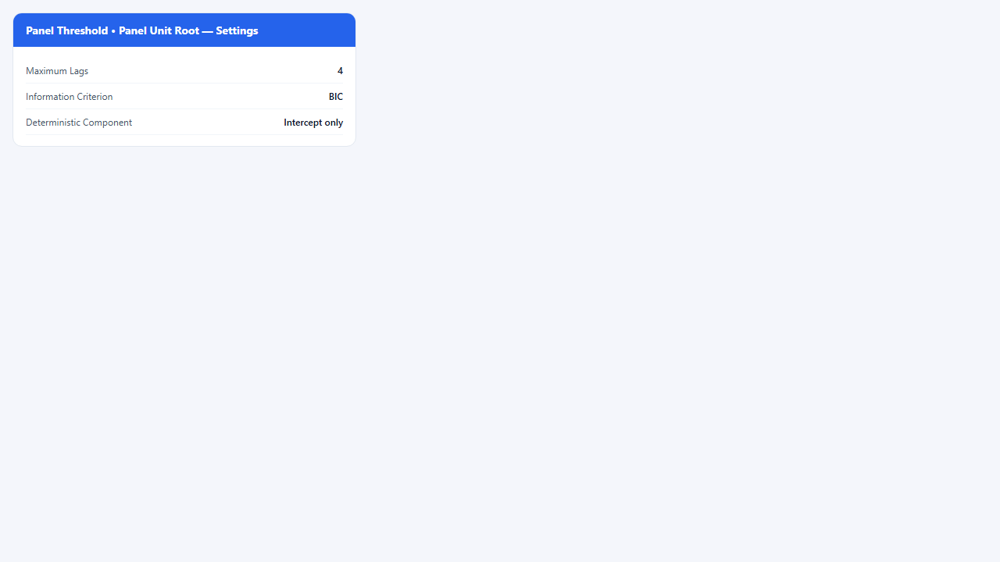
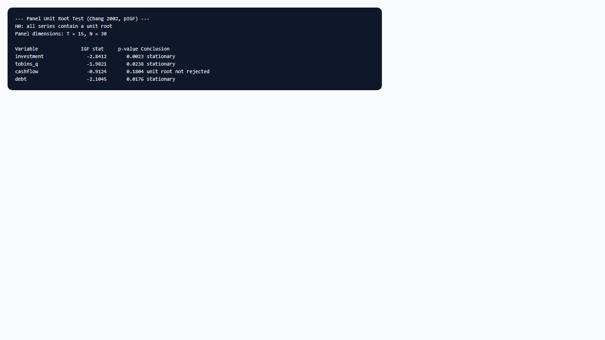

## 1. Mô hình dùng để làm gì?

Sub-node **Panel Threshold • Panel Unit Root (pIGF)** thực hiện **kiểm định unit root trên panel** theo phương pháp **nonlinear IV** của Chang (2002), thông qua hàm `pIGF()` trong package `pdR`. Mục đích là xác định **bậc tích hợp** (integration order) của biến phụ thuộc, biến ngưỡng, và các biến giải thích trong mô hình panel threshold **trước hoặc song song** với ước lượng `ptm()` trên mức (levels).

Mô hình ngưỡng bảng tĩnh Hansen (1999) được phát triển cho biến dừng hoặc sai phân dừng. Khi một hoặc nhiều biến I(1) được đưa vào mô hình ở mức mà không có cơ chế hiệu chỉnh sai số hoặc quan hệ đồng tích hợp, hồi quy spurious và suy luận bootstrap về ngưỡng có thể không đáng tin. Sub-node pIGF cung cấp **bằng chứng sơ bộ** về tính dừng từng chuỗi trong panel: bác bừ $H_0$ unit root → gợi ý I(0) trên mức đã kiểm tra; không bác bừ → có thể I(1), cần sai phân, kiểm định khác, hoặc mô hình động (Seo & Shin, 2016).

Sub-node **không thay thế** toàn bộ chiến lược pre-test (như CIPS của Pesaran cho phụ thuộc chéo, hay kiểm định theo từng quốc gia), nhưng **tích hợp sẵn** trong workflow Panel Threshold của StatNode: tự động lấy danh sách biến từ thuộc tính mô hình cha (`statnode_dep_var`, `statnode_regime_dep_vars`, `statnode_regime_indep_vars`, `statnode_threshold_var`), reshape dữ liệu thành ma trận $T \times N$, và chạy `pIGF()` cho từng biến với tham số người dùng chọn (số trễ tối đa, tiêu chí thông tin, thành phần deterministic).

## 2. Nền tảng lý thuyết

### 2.1. Giả thuyết unit root trên panel

Với chuỗi panel $z_{it}$, giả thuyết không chuẩn:

$$
H_0: z_{it} \text{ chứa unit root (I(1))},
$$

đối lập:

$$
H_1: z_{it} \text{ dừng (I(0))}.
$$

Kiểm định ADF/PP trên từng $i$ riêng lẻ mất công suất khi $T$ nhỏ. Kiểm định panel gộp thông tin từ $N$ đơn vị với $T$ kỳ, cải thiện công suất trong bối cảnh micro panel ($N$ lớn, $T$ vừa) — cấu hình điển hình của `invest-sample.csv` ($N = 30$, $T = 15$).

### 2.2. Kiểm định IGF của Chang (2002)

Chang (2002) đề xuất kiểm định unit root **phi tuyến** dựa trên công cụ (instrumental variables) trong panel có thể có phụ thuộc chéo yếu. Hàm `pIGF()` trong `pdR` triển khai phiên bản **panel IGF** (Instrumental Variable Goodness-of-Fit) cho ma trận dữ liệu $T \times N$: mỗi cột là một đơn vị chéo, mỗi hàng là một thời điểm — khớp cách `ptm()` xếp chồng quan sát theo entity rồi time.

Hồi quy unit root dạng:

$$
\Delta z_{it} = \alpha_i + \delta_i t + \rho z_{i,t-1} + \sum_{j=1}^{p} \phi_{ij} \Delta z_{i,t-j} + v_{it},
$$

với $p$ chọn bằng BIC hoặc AIC trong phạm vi `maxp`. Thành phần deterministic (`spec`): không có (0), hằng số (1), hoặc hằng số + xu thế (2). Thống kê panel $IGF$ và p-value được in cho từng biến.

Dưới $H_0$, $\rho = 0$ (unit root); bác bừ $H_0$ khi p-value $< \alpha$ → kết luận **stationary** (I(0) trên mức kiểm tra). Không bác bừ → **unit root not rejected** — không khẳng định I(1) chắc chắn nhưng gợi ý cần thận trọng khi dùng mức trong `ptm()`.

### 2.3. Ma trận $T \times N$ và thứ tự quan sát

StatNode reshape vector dài (sau sắp xếp entity, time) thành ma trận `matrix(vec, nrow = T, ncol = N)`. Thứ tự sai → kiểm định sai. Node cha Panel Threshold đã sắp xếp và kiểm tra cân bằng; sub-node tái sử dụng `statnode_t` và `statnode_n` đã lưu.

### 2.4. Panel threshold và bậc tích hợp

Hansen (1999) giả định mô hình tĩnh trên biến dừng. Nếu $y_{it}$ và $q_{it}$ đồng I(1) và có quan hệ đồng tích hợp, mô hình ngưỡng trên mức có thể mô tả quan hệ cân bằng dài hạn phi tuyến — nhưng cần biện minh lý thuyết. Nếu chỉ một số biến I(1), **hỗn hợp bậc tích hợp** (mixed integration) làm suy luận phức tạp; Seo & Shin (2016) mở rộng panel threshold **động** với endogeneity và biến trễ, phù hợp hơn khi không muốn sai phân.

Wang & Chan (2024) khuyến nghị báo cáo kiểm định unit root (hoặc tương đương) trong bảng mô tả trước ước lượng ngưỡng. Baltagi (2021) nhắc rằng spurious regression trong panel không kém nguy hiểm so với chuỗi thời gian đơn.

### 2.6. Tiệm cận và giới hạn với $T$ nhỏ

Với $T = 15$ như `invest-sample.csv`, kiểm định unit root panel có công suất hạn chế — đặc biệt khi $\rho$ gần 1 (root gần unit). Kết luận “stationary” nên được hiểu là **bác bừ unit root với spec và max lags đã chọn**, không phải chứng minh mạnh I(0). Tăng $T$ hoặc $N$ cải thiện công suất; với micro panel ngắn, kết hợp pIGF với đồ thị và kiểm định theo từng quốc gia (nếu có) là thông lệ trong Baltagi (2021).

### 2.7. Sai phân và mô hình ngưỡng

Nếu pIGF không bác bừ unit root trên $y_{it}$ và $q_{it}$, sai phân bậc một:

$$
\Delta y_{it} = \mu_i + \mathbf{x}_{1,it}' \boldsymbol{\beta}_{1,r} + \cdots
$$

đặt ra câu hỏi đặc tả mới — `ptm()` trên StatNode hiện áp dụng cho mức, không cho sai phân trực tiếp. Seo & Shin (2016) phát triển panel threshold động với biến trễ và endogeneity; Caner & Hansen (2004) xét ngưỡng trên biến công cụ. Sub-node pIGF giúp **phát hiện** nhu cầu chuyển sang các khung này, không thay thế chúng.

### 2.8. pIGF so với kiểm định khác

`pIGF()` là một lựa chọn trong hệ sinh thái `pdR`, nhất quán với `ptm()`. Nó khác Levin-Lin-Chu (đồng nhất $\rho$) hay IPS (xác suất trung bình). Chang (2002) nhấn mạnh IV nonlinear trong bối cảnh phụ thuộc chéo — phù hợp hơn so với ADF đơn lẻ khi $T$ nhỏ và $N$ trung bình. Sub-node không chạy kiểm định ngưỡng hay đồng tích hợp; chỉ unit root từng biến.

## 3. Điều kiện sử dụng

1. **Mô hình cha Panel Threshold đã chạy** — sub-node cần thuộc tính `statnode_data`, `statnode_t`, `statnode_n`, và tên biến.

2. **Panel cân bằng** — cùng điều kiện `ptm()`. Ma trận $T \times N$ yêu cầu mỗi cột đủ $T$ giá trị.

3. **Chọn deterministic spec phù hợp** từng biến: chuỗi có xu thế → intercept + trend (2); chuỗi dao động quanh mức cố định → intercept (1); chỉ dùng none (0) khi lý thuyết hỗ trợ. Sai spec làm lệch công suất kiểm định.

4. **Max lags và IC:** mặc định `max_lags = 4`, `IC = BIC` — hợp lý với $T = 15$; tăng max lags quá cao làm mất bậc tự do. Với $T$ nhỏ, 2–4 trễ thường đủ.

5. **Giá trị thiếu:** sub-node dùng `complete.cases` trên các biến kiểm tra; mất quan sát có thể làm $T \times N$ khác mẫu ước lượng `ptm()` nếu missing không đồng đều — nên xử lý missing trước khi ước lượng.

6. **Chạy pIGF trên cùng mẫu đã dùng cho `ptm()`.** Sub-node lấy dữ liệu từ thuộc tính mô hình cha; nếu người dùng lọc mẫu sau khi ước lượng, cần chạy lại node cha để đồng bộ.

7. **Diễn giải đồng bộ với mô hình:** nếu pIGF bác bừ unit root trên `investment` và `tobins_q` ở mức, ước lượng ngưỡng trên levels có cơ sở hơn; nếu không bác bừ trên nhiều biến, cân nhắc sai phân $\Delta y_{it}$, $\Delta q_{it}$ hoặc mô hình động — lưu ý mô hình ngưỡng trên sai phân đòi hỏi đặc tả khác (Caner & Hansen, 2004; Seo & Shin, 2016).

8. **Không thay thế kiểm định bootstrap ngưỡng** — pIGF trả lời câu hỏi tích hợp, không phải “có ngưỡng hay không”.

## 4. Quy trình workflow

1. **Chuẩn bị dữ liệu** cân bằng, xử lý missing, xác định biến vào mô hình ngưỡng.

2. **(Khuyến nghị) Chạy Panel Threshold** để có mô hình cha — hoặc chạy pIGF ngay sau node cha trong cùng lần Chạy tất cả.

3. **Nối sub-node Panel Unit Root (pIGF)** vào cổng Model.

4. **Cấu hình:** Maximum Lags (4), Information Criterion (BIC), Deterministic Component (intercept only cho hầu hết biến tài chính mức).

5. **Chạy sub-node** — đọc bảng: Variable, IGF stat, p-value, Conclusion cho từng biến (`investment`, `tobins_q`, `cashflow`, `debt`, …).

6. **Ghi bảng pre-estimation** trong báo cáo: biến nào stationary, biến nào unit root not rejected.

7. **Quyết định đặc tả:** tiếp tục `ptm()` trên levels; sai phân một phần; hoặc mở rộng lý thuyết (dynamic threshold). Kết hợp Bootstrap Test và Regime Summary sau khi chốt đặc tả.

8. **Kiểm tra độ nhạy:** thử `spec = 2` nếu chuỗi có xu thế rõ; so sánh kết luận I(0)/I(1) — nếu không ổn định, tránh kết luận mạnh từ một lần chạy.

9. **Lưu log pIGF cùng output `ptm()`.** Phản biện thường yêu cầu bảng unit root và kiểm định ngưỡng trong cùng phụ lục — StatNode cho phép xuất log console; nên lưu cả hai sub-node cùng một lần Chạy tất cả để tham số $T$, $N$ khớp nhau.

## 5. Thực hành trên phần mềm StatNode

Ví dụ `invest-sample.csv`: node Panel Threshold với `investment`, `ind1` = (`tobins_q`, `cashflow`), `ind2` = `debt`, ngưỡng `tobins_q`, $N = 30$, $T = 15$. Sub-node kiểm tra tất cả biến trong mô hình cộng biến ngưỡng (trùng `tobins_q` không lặp hai lần).

**Bước 1 — Nối sub-node** từ cổng Model của node cha.

**Bước 2 — Cấu hình.**

- **Maximum Lags:** 4
- **Information Criterion:** BIC
- **Deterministic Component:** Intercept only (`1`)

**Bước 3 — Chạy và đọc output.**

Output in:

- Tiêu đề: Chang (2002), pIGF; $H_0$: all series contain a unit root
- Kích thước panel: $T = 15$, $N = 30$
- Tham số max lags, IC, deterministic spec
- Bảng từng biến:

| Biến | IGF stat | p-value | Kết luận (mặc định $\alpha=0.05$) |
|------|----------|---------|-----------------------------------|
| investment | (số) | (số) | stationary hoặc unit root not rejected |
| tobins_q | … | … | … |
| cashflow | … | … | … |
| debt | … | … | … |

Dòng kết: gợi ý nếu I(1) phổ biến ở mức, cần $T$ đủ lớn hoặc sai phân; mixed integration cần mở rộng động (Seo & Shin, 2016).

**Ví dụ đọc giả định:** nếu `investment` và `tobins_q` có p-value $< 0.05$ → stationary; `debt` p-value = 0.18 → unit root not rejected → ghi chú hạn chế khi giải thích hệ số `debt` ở mức; cân nhắc robustness với sai phân hoặc thêm xu thế (`spec = 2`).

**Thứ tự sub-node trên canvas.** Unit Root có thể chạy song song với Bootstrap Test — không phụ thuộc kết quả kiểm định ngưỡng. Tuy nhiên, trong báo cáo văn bản, bảng pIGF thường đặt trước mục ước lượng ngưỡng để độc giả hiểu bậc tích hợp trước khi đọc $\hat{\gamma}$ và hệ số chế độ.

## 6. Diễn giải kết quả

**p-value $< 0.05$ → “stationary”.** Bác bừ $H_0$ unit root: biến được coi I(0) trên mức với deterministic spec đã chọn. Hỗ trợ ước lượng panel threshold trên levels cho biến đó.

**p-value $\geq 0.05$ → “unit root not rejected”.** Không đủ bằng chứng chống unit root — **không** đồng nghĩa đã chứng minh I(1), nhưng cảnh báo spurious regression nếu dùng mức trong quan hệ tĩnh. Báo cáo trung thực và cân nhắc sai phân hoặc mô hình động.

**Deterministic spec.** Intercept only phù hợp biến dao động quanh mức trung bình; trend cần khi có xu thế tất định (một số biến vĩ mô). Thay đổi spec có thể đảo kết luận — báo cáo spec đã dùng và thử robustness nếu kết quả nhạy cảm.

**Max lags và BIC.** BIC chọn bậc trễ parsimonious, phù hợp $T$ nhỏ. Max lags quá lớn so với $T$ gây overfitting và làm kiểm định yếu đi.

**Hỗn hợp I(0) và I(1).** Rất phổ biến: ví dụ `cashflow` I(0), `investment` không rõ. Không có quy tắc tự động trong StatNode — người dùng phải quyết định kinh tế lượng: CS-ARDL-style reasoning không áp dụng trực tiếp cho `ptm()`; thường chọn sai phân toàn bộ hoặc chỉ biến I(1), hoặc trích dẫn Seo & Shin (2016) cho dynamic threshold.

**Liên kết workflow.** Bảng pIGF đặt **trước** hoặc **cạnh** bảng bootstrap test và regime summary trong bài báo. Câu mẫu: “Kiểm định panel unit root Chang (2002) cho thấy investment và Tobin's Q dừng ở mức (p $< 0.05$); debt không bác bừ unit root (p = 0.18), kết quả hệ số nợ được đọc thận trọng.”

**So sánh với ADF từng quốc gia.** pIGF gộp thông tin panel; nếu vài đơn vị I(1) và phần lớn I(0), kết luận panel có thể che giấu dị biệt. Với nghiên cứu nhấn mạnh dị biệt quốc gia, cân nhắc kiểm định bổ sung ngoài StatNode — sub-node vẫn đủ cho workflow chuẩn khi $N$ và $T$ đồng nhất.

**Biến ngưỡng $q_{it}$.** Unit root trên biến ngưỡng quan trọng vì phân vùng chế độ dựa trên mức $q_{it}$. Nếu $q_{it}$ I(1), ngưỡng $\hat{\gamma}$ trên mức có thể không ổn định theo thời gian — cân nhắc ngưỡng trên biến dừng (ví dụ sai phân hoặc tỷ lệ) hoặc mô hình động.

**Sai lầm cần tránh:** (i) bỏ qua unit root vì “panel threshold thường dùng mức”; (ii) coi stationary nghĩa là đã kiểm tra endogeneity; (iii) dùng pIGF thay kiểm định đồng tích hợp khi nghi ngờ cointegration; (iv) reshape sai thứ tự entity/time (StatNode xử lý tự động nếu node cha đúng).

## 7. Tài liệu tham khảo

1. Hansen, B. E. (1999). Threshold effects in non-dynamic panels: Estimation, testing and inference. *Journal of Econometrics*, 93(2), 345–368.
2. Hansen, B. E. (2000). Sample splitting and threshold estimation. *Econometrica*, 68(3), 575–603.
3. Caner, M., & Hansen, B. E. (2004). Instrumental variable estimation of a threshold model. *Journal of Business & Economic Statistics*, 22(3), 278–289.
4. Chang, Y. (2002). Nonlinear IV unit root tests in panels with cross-sectional dependency. *Journal of Econometrics*, 110(2), 261–292.
5. Kremer, S., Nykolidaki, E., & Zaklan, F. (2013). On the determinants of renewable energy consumption growth: A global sample analysis. *Energy Economics*, 36, 641–647.
6. Seo, M. H., & Shin, Y. (2016). Dynamic panels with threshold effect and endogeneity. *Journal of Econometrics*, 195(1), 170–180.
7. Wang, Q., & Chan, F. (2024). A survey of threshold models in economics and finance. *Journal of Economic Surveys*, 38(1), 3–42.
8. Baltagi, B. H. (2021). *Econometric Analysis of Panel Data* (6th ed.). Springer.
9. Ho Tsung-wu. pdR: Threshold Model and Unit Root Tests in Cross-Section and Time Series Data. *CRAN Reference Manual*. https://cran.r-project.org/package=pdR
