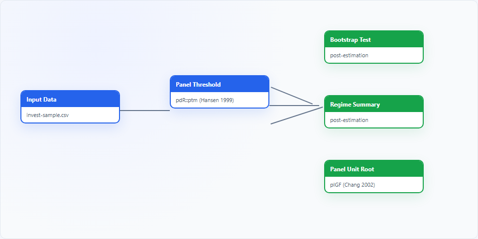
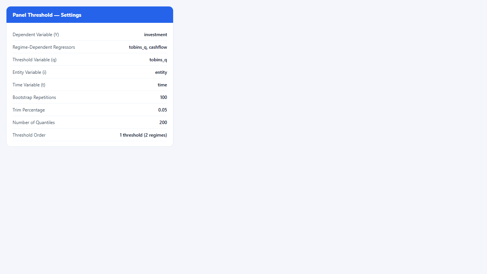
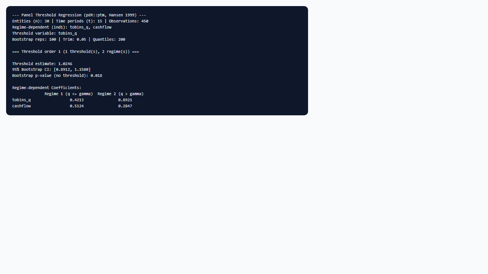

## 1. Mô hình dùng để làm gì?

Node **Panel Threshold** trên StatNode ước lượng **mô hình hồi quy ngưỡng bảng tĩnh** (static panel threshold regression) theo Hansen (1999), thông qua hàm `ptm()` của package R `pdR` (Ho Tsung-wu, 2025). Khác với hồi quy panel tuyến tính cổ điển — nơi hệ số góc giữ nguyên trên toàn bộ miền giá trị của biến giải thích — mô hình ngưỡng cho phép **hệ số thay đổi đột biến** khi biến ngưỡng $q_{it}$ vượt qua một giá trị chưa biết $\gamma$. Cấu trúc này mô tả quan hệ **tuyến tính từng đoạn** (piecewise linear): trong mỗi chế độ (regime), mô hình vẫn tuyến tính, nhưng hệ số góc có thể khác nhau giữa các chế độ.

Trong kinh tế lượng ứng dụng, hiện tượng ngưỡng xuất hiện ở nhiều bối cảnh. Độ co giãn đầu tư theo Tobin's Q có thể mạnh hơn khi doanh nghiệp vượt qua một ngưỡng tài chính nhất định, phản ánh giả thuyết đầu tư cơ hội (Fazzari, Hubbard & Petersen, 1988). Tác động của thu nhập lên tiêu dùng thường thay đổi sau một mức thu nhập cụ thể. Quan hệ năng lượng – tăng trưởng có thể chuyển cơ cấu khi GDP đạt ngưỡng phát triển (Kremer, Nykolidaki & Zaklan, 2013). Trong tài chính, tác động của biến động thị trường lên lợi suất hoặc rủi ro tín dụng thường không đồng nhất trên toàn miền giá trị của biến điều kiện (Wang & Chan, 2024). Node Panel Threshold cho phép kiểm tra và ước lượng các cấu trúc phi tuyến dạng piecewise linear này trực tiếp trên dữ liệu bảng cân bằng (balanced panel), kèm suy luận bootstrap theo phương pháp Hansen.

Node được thiết kế như **điểm khởi đầu** của một workflow gồm ba sub-node hậu ước lượng: **Bootstrap Threshold Test** (kiểm định sự tồn tại của hiệu ứng ngưỡng), **Regime Summary** (tóm tắt ngưỡng, khoảng tin cậy và hệ số theo chế độ), và **Panel Unit Root (pIGF)** (kiểm tra tính dừng theo Chang, 2002). Toàn bộ pipeline chạy trong trình duyệt qua WebR, không cần cài đặt R cục bộ. Người dùng chỉ cần chuẩn bị dữ liệu dạng dài (long format), gán biến phụ thuộc, biến phụ thuộc chế độ (`ind1`), biến không phụ thuộc chế độ (`ind2`), biến ngưỡng, và các cột định danh đơn vị/thời gian.

Package `pdR` mở rộng code gốc Fortran của Hansen theo hai chiều quan trọng: (i) cho phép **nhiều biến phụ thuộc chế độ** trong `ind1`, không giới hạn một biến duy nhất như triển khai ban đầu; (ii) tách biệt biến **không phụ thuộc chế độ** (`ind2`) có cùng hệ số ở mọi chế độ. Hàm `ptm()` đồng thời ước lượng ba cấu hình: một ngưỡng (hai chế độ), hai ngưỡng (ba chế độ), và ba ngưỡng (bốn chế độ), giúp so sánh mức độ phức tạp của cấu trúc phi tuyến mà không cần chạy lại toàn bộ quy trình bootstrap ba lần riêng biệt.

## 2. Nền tảng lý thuyết

### 2.1. Mô hình ngưỡng bảng tĩnh

Hansen (1999) xét mô hình bảng dạng:

$$
y_{it} = \mu_i + \boldsymbol{\beta}_1' \mathbf{x}_{it} \cdot I(q_{it} \leq \gamma) + \boldsymbol{\beta}_2' \mathbf{x}_{it} \cdot I(q_{it} > \gamma) + u_{it},
$$

với $i = 1, \ldots, N$ là chỉ số đơn vị chéo, $t = 1, \ldots, T$ là chỉ số thời gian, $\mu_i$ là hiệu ứng cố định cá thể (individual fixed effects), $\mathbf{x}_{it}$ là vectơ biến giải thích, $q_{it}$ là **biến ngưỡng** (threshold variable), $\gamma$ là **ngưỡng chưa biết** (unknown threshold), và $I(\cdot)$ là hàm chỉ báo. Khi $q_{it} \leq \gamma$, hệ số góc là $\boldsymbol{\beta}_1$ (chế độ thấp); khi $q_{it} > \gamma$, hệ số chuyển sang $\boldsymbol{\beta}_2$ (chế độ cao). Phần dư $u_{it}$ được giả định có kỳ vọng bằng không sau khi kiểm soát hiệu ứng cố định; trong triển khai `ptm()`, hiệu ứng cố định được loại bỏ trong quá trình ước lượng tách mẫu.

Phương trình tổng quát trong `pdR` phân tách biến giải thích thành hai nhóm:

$$
y_{it} = \mu_i + \mathbf{x}_{1,it}' \boldsymbol{\beta}_{1,r} + \mathbf{x}_{2,it}' \boldsymbol{\beta}_2 + u_{it}, \qquad r = 1, 2, \ldots, R,
$$

trong đó $\mathbf{x}_{1,it}$ thuộc `ind1` (hệ số phụ thuộc chế độ) và $\mathbf{x}_{2,it}$ thuộc `ind2` (hệ số không đổi giữa các chế độ). Chỉ số chế độ $r$ được xác định bởi vị trí của $q_{it}$ so với một hoặc nhiều ngưỡng $\gamma_1, \gamma_2, \ldots$.

### 2.2. Ước lượng ngưỡng bằng lưới quantile

Với $\gamma$ cố định, mô hình trở thành hồi quy tách mẫu (split-sample regression) và có thể ước lượng bằng OLS trong từng chế độ sau khi loại hiệu ứng cố định. Vì $\gamma$ chưa biết, Hansen (1999) đề xuất **quét lưới** trên các quantile của $q_{it}$ (sau trim) và chọn $\hat{\gamma}$ minimising the concentrated sum of squared errors:

$$
\hat{\gamma} = \arg\min_{\gamma \in \Gamma} \mathrm{SSE}(\gamma),
$$

với $\Gamma$ là tập các ứng viên ngưỡng sau khi loại $\alpha\%$ quantile thấp nhất và cao nhất (trim) để tránh vùng có quá ít quan sát. Trong `ptm()`, tham số `qn` kiểm soát độ mịn của lưới (số điểm quantile được xem xét) và `trimn` kiểm soát tỷ lệ trim. Phương pháp này kế thừa logic **sample splitting** của Hansen (2000) trong bối cảng chuỗi thời gian, nhưng được điều chỉnh cho cấu trúc panel với hiệu ứng cố định.

Sau khi có $\hat{\gamma}$, các hệ số $\hat{\boldsymbol{\beta}}_{1,r}$ và $\hat{\boldsymbol{\beta}}_2$ được ước lượng lại trên mẫu đã phân chế độ. Sai số chuẩn và khoảng tin cậy của ngưỡng được suy ra từ **bootstrap panel**, không từ phân phối tiệm cận chuẩn — vì ngưỡng là tham số không liên tục (discrete parameter) với tốc độ hội tụ khác biệt so với hệ số tuyến tính.

### 2.3. Kiểm định bootstrap cho hiệu ứng ngưỡng

Giả thuyết không có ngưỡng ($H_0$) tương đương mô hình tuyến tính (một chế độ duy nhất): $\boldsymbol{\beta}_1 = \boldsymbol{\beta}_2$. Dưới $H_0$, tham số ngưỡng $\gamma$ **không được xác định** (unidentified): mọi giá trị $\gamma$ đều cho cùng một mô hình tuyến tính. Hệ quả là phân phối tiệm cận của thống kê LR hoặc F chuẩn không áp dụng, và các p-value từ phân phối $\chi^2$ thông thường thường **lạm dương** (oversized). Hansen (1999) đề xuất **bootstrap panel** để xấp xỉ phân phối null: lặp lại quá trình ước lượng trên mẫu bootstrap (với số lần `bootn`) và so sánh thống kê kiểm định quan sát với phân phối bootstrap. Sub-node **Bootstrap Threshold Test** trích xuất kết quả kiểm định này từ output `ptm()`.

Thống kê kiểm định thường dựa trên chênh lệch SSE giữa mô hình ràng buộc (linear) và mô hình ngưỡng (unrestricted). p-value bootstrap được tính là tỷ lệ các lần bootstrap mà thống kê null vượt quá thống kê quan sát. Quy tắc diễn giải: p-value nhỏ hơn mức ý nghĩa (thường 0.05) → bác bỏ $H_0$, có bằng chứng cho hiệu ứng ngưỡng; ngược lại, không nên diễn giải hệ số theo chế độ như kết quả có ý nghĩa kinh tế lượng.

### 2.4. Mô hình nhiều ngưỡng

`ptm()` ước lượng đồng thời ba cấu hình: một ngưỡng (hai chế độ), hai ngưỡng (ba chế độ), và ba ngưỡng (bốn chế độ). Output là list gồm ba phần tử `Output[[1]]`, `Output[[2]]`, `Output[[3]]`. Với hai ngưỡng $\gamma_1 < \gamma_2$, ba chế độ được xác định bởi $q_{it} \leq \gamma_1$, $\gamma_1 < q_{it} \leq \gamma_2$, và $q_{it} > \gamma_2$. Tham số **Threshold Order to Display** trên node chọn phần tử nào được in ra; các sub-node có cùng lựa chọn để phân tích nhất quán.

Việc chọn số ngưỡng nên kết hợp giả thuyết kinh tế và kiểm định bootstrap: nếu kiểm định bác bỏ $H_0$ cho order = 1 nhưng không bác bỏ cho order cao hơn, mô hình một ngưỡng thường đủ. Thêm ngưỡng khi không cần thiết làm tăng phương sai ước lượng và làm mỏng số quan sát trong từng chế độ.

### 2.5. Nội sinh biến ngưỡng và mở rộng động

Giả định ngoại sinh của $q_{it}$ là điều kiện quan trọng. Khi $q_{it}$ nội sinh (ví dụ biến ngưỡng tương quan với phần dư $u_{it}$), ước lượng OLS/tách mẫu chệch. Caner & Hansen (2004) đề xuất ước lượng ngưỡng bằng biến công cụ (IV threshold estimation) cho dữ liệu chéo; Seo & Shin (2016) mở rộng sang **panel động có ngưỡng** với endogeneity và hiệu ứng trễ. Node Panel Threshold hiện tại triển khai mô hình tĩnh Hansen (1999); nếu nghi ngờ nội sinh hoặc cần biến trễ, nên tham khảo các mở rộng này và cân nhắc sai phân hoặc biến công cụ ngoài StatNode.

### 2.6. Khung tiệm cận

Lý thuyết Hansen (1999) xét tiệm cận khi $T \to \infty$ với $N$ cố định hoặc $N \to \infty$. Trong thực nghiệm micro panel (ví dụ doanh nghiệp), $N$ lớn và $T$ vừa phải ($T \approx 10$–20) là cấu hình phổ biến; bootstrap được khuyến nghị mạnh vì phân phối tiệm cận của $\hat{\gamma}$ phụ thuộc vào mật độ quan sát quanh ngưỡng thật. Baltagi (2021, Ch. 12) tổng hợp các ứng dụng panel threshold trong kinh tế lượng panel hiện đại.

## 3. Điều kiện sử dụng

Việc áp dụng có ý nghĩa mô hình ngưỡng bảng đòi hỏi đồng thời nhiều điều kiện về dữ liệu, cấu trúc mô hình và giả định kinh tế lượng:

1. **Balanced panel bắt buộc.** `ptm()` yêu cầu mỗi đơn vị $i$ có đúng $T$ quan sát liên tiếp; dữ liệu phải được sắp xếp theo (entity, time). Panel không cân bằng cần cân bằng hóa trước (interpolate, drop đơn vị thiếu kỳ, hoặc chọn subsample). Node tự kiểm tra và dừng với thông báo lỗi nếu phát hiện số quan sát không đồng nhất giữa các đơn vị.

2. **$T$ đủ lớn.** Hansen (1999) yêu cầu $T$ lớn (asymptotics khi $T \to \infty$). Thực nghiệm khuyến nghị $T \geq 10$–15 mỗi đơn vị; node báo lỗi nếu $T < 5$. Với $T$ nhỏ, khoảng tin cậy bootstrap của ngưỡng thường rộng và kiểm định có công suất thấp.

3. **Biến ngưỡng và phân bố quan sát.** Biến $q_{it}$ nên có phân phối đủ rộng để tạo hai (hoặc nhiều) chế độ có số quan sát tương đối cân bằng; trim quá lớn (`trimn > 0.15$) làm mất ứng viên ngưỡng ở đuôi phân phối. Nếu hơn 90% quan sát nằm trong một chế độ, ước lượng hệ số chế độ thưa trở nên không ổn định.

4. **Ngoại sinh yếu của biến ngưỡng.** Endogeneity của $q_{it}$ vi phạm giả định — cần biến công cụ (Caner & Hansen, 2004) nếu nghi ngờ nội sinh. Tránh chọn biến ngưỡng trùng hoàn toàn với biến giải thích mà không có cơ sở lý thuyết, vì cấu trúc mô hình trở nên khó diễn giải.

5. **Chi phí tính toán bootstrap.** Mặc định 100 lần bootstrap × 3 cấu hình ngưỡng có thể chạy vài phút trên WebR. Giảm **Bootstrap Repetitions** (50) khi thử nghiệm; tăng lên 200–300 cho báo cáo cuối cùng. Số quantile `qn = 200` cân bằng độ chính xác lưới và thời gian chạy.

6. **Tính dừng.** Panel threshold trên mức (levels) yêu cầu biến dừng hoặc sai phân dừng. Dùng sub-node **Panel Unit Root (pIGF)** để kiểm tra trước hoặc song song. Nếu biến I(1) được dùng ở mức mà không có cơ chế hiệu chỉnh sai số, suy luận có thể không hợp lệ; cân nhắc sai phân bậc một hoặc mô hình động (Seo & Shin, 2016).

7. **Lựa chọn `ind1` và `ind2`.** Chỉ đưa vào `ind1` các biến mà lý thuyết cho rằng hệ số có thể thay đổi theo chế độ. Biến kiểm soát có hệ số ổn định nên đặt trong `ind2` để tiết kiệm tham số và giảm phương sai.

## 4. Quy trình workflow

Quy trình phân tích hoàn chỉnh với node Panel Threshold diễn ra theo tám bước, phản ánh thông lệ trong các nghiên cứu sử dụng `ptm()` và tài liệu `pdR`:

1. **Chuẩn bị dữ liệu bảng dạng dài (long format):** mỗi dòng là một quan sát (đơn vị $i$, thời điểm $t$), có cột định danh đơn vị, cột thời gian, biến phụ thuộc, biến ngưỡng, và các biến giải thích. Xử lý giá trị thiếu; đảm bảo mỗi đơn vị có đủ $T$ kỳ.

2. **Thống kê mô tả và trực quan hóa:** vẽ phân phối biến ngưỡng, scatter plot biến phụ thuộc theo biến ngưỡng, và chuỗi thời gian theo đơn vị. Bước này giúp đánh giá sơ bộ liệu có đủ biến thiên để hỗ trợ hai chế độ hay không.

3. **Kiểm tra tính dừng (tùy chọn nhưng khuyến nghị):** chạy sub-node **Panel Unit Root (pIGF)** sau khi ước lượng, hoặc kiểm tra unit root riêng trước khi chạy mô hình trên mức. Ghi nhận bậc tích hợp của từng biến trong bảng mô tả.

4. **Cấu hình và ước lượng node chính:** gán biến phụ thuộc, `ind1`, `ind2`, biến ngưỡng, entity/time; đặt bootstrap, trim, quantiles; chọn **Threshold Order to Display** (thường bắt đầu với order = 1). Chạy node và ghi nhận $\hat{\gamma}$, khoảng tin cậy bootstrap, ma trận hệ số theo chế độ.

5. **Kiểm định hiệu ứng ngưỡng:** nối sub-node **Bootstrap Threshold Test** vào cổng model. Bác bỏ $H_0$ mới tiếp tục diễn giải hệ số theo chế độ; nếu không bác bỏ, báo cáo mô hình panel FE tuyến tính thay thế.

6. **Tóm tắt chế độ:** sub-node **Regime Summary** cung cấp phân loại quan sát theo chế độ, tỷ lệ mẫu trong từng regime, và bảng hệ số chi tiết. Kiểm tra cân bằng chế độ trước khi diễn giải kinh tế.

7. **So sánh số ngưỡng (nếu cần):** thay đổi **Threshold Order** trên node và sub-node để xem liệu mô hình hai hoặc ba ngưỡng có cải thiện phù hợp (SSE, kiểm định bootstrap) và có ý nghĩa kinh tế hay không.

8. **Báo cáo và kiểm tra độ nhạy:** báo cáo ngưỡng kèm CI bootstrap, bảng hệ số theo chế độ, p-value kiểm định, và bậc tích hợp. Thử thay đổi `trimn`, `bootn`, hoặc biến ngưỡng thay thế để đánh giá độ bền kết quả.

Trên canvas StatNode, workflow thể hiện bằng node **Nhập dữ liệu** → **Panel Threshold**, với ba sub-node nối vào cổng model.

## 5. Thực hành trên phần mềm StatNode

Phần này minh họa từng bước trên https://statnode.io với bộ dữ liệu mô phỏng `invest-sample.csv`: $N = 30$ doanh nghiệp, $T = 15$ kỳ (450 quan sát). Tệp CSV gồm các cột `entity`, `time`, `investment` (biến phụ thuộc), `tobins_q`, `cashflow`, và `debt`. Dữ liệu mô phỏng bối cảnh hồi quy đầu tư doanh nghiệp, nơi độ nhạy đầu tư theo Tobin's Q có thể thay đổi khi doanh nghiệp vượt qua ngưỡng tài chính.

**Bước 1 — Dựng workflow.** Tạo project mới, thêm node **Nhập dữ liệu** và tải `invest-sample.csv`. Thêm node **Panel Threshold** (nhóm Ước lượng → Panel), nối cổng dữ liệu. Thêm ba sub-node **Bootstrap Threshold Test**, **Regime Summary**, và **Panel Unit Root (pIGF)**, nối cổng model của node chính sang từng sub-node:



**Bước 2 — Cấu hình node chính.** Nhấp đúp node Panel Threshold để mở bảng cài đặt:



Gán biến như sau:

- **Dependent Variable (Y):** `investment`
- **Regime-Dependent Regressors (ind1):** `tobins_q`, `cashflow`
- **Regime-Independent Regressors (ind2):** `debt` (hoặc để trống nếu muốn mọi hệ số phụ thuộc chế độ)
- **Threshold Variable (q):** `tobins_q` (nếu giả thuyết ngưỡng trên cơ hội đầu tư) hoặc `debt` (nếu giả thuyết ngưỡng trên cơ cấu vốn)
- **Entity Variable:** `entity`
- **Time Variable:** `time`
- **Bootstrap Repetitions:** 100 (giảm 50 khi thử nhanh trên trình duyệt)
- **Trim Percentage:** 0.05
- **Number of Quantiles (qn):** 200
- **Confidence Level:** 0.95
- **Threshold Order to Display:** 1 threshold (2 regimes)

**Bước 3 — Chạy và đọc output.** Nhấn **Chạy tất cả**. WebR tải package `pdR`, kiểm tra panel cân bằng ($n = 30$, $t = 15$), chạy `ptm()` với bootstrap cho cả ba order, và in khối output tương ứng order đã chọn:



Output gồm: thông tin mô hình (số đơn vị, số kỳ, biến `ind1`/`ind2`, biến ngưỡng), **ước lượng ngưỡng** $\hat{\gamma}$ kèm khoảng tin cậy bootstrap, ma trận **hệ số theo chế độ** (thường in từ trên xuống theo thứ tự chế độ trong output `pdR`), thống kê kiểm định bootstrap, và các chỉ số phù hợp (SSE, $R^2$ theo chế độ nếu có).

Mã R tương đương sau khi dữ liệu được xếp chồng theo thứ tự entity rồi time:

```r
library(pdR)
Output <- ptm(
  dep = investment, ind1 = cbind(tobins_q, cashflow), ind2 = debt,
  d = tobins_q, bootn = rep(100, 3), trimn = rep(0.05, 3),
  qn = 200, conf_lev = 0.95, t = 15, n = 30
)
print(Output[[1]])  # một ngưỡng, hai chế độ
```

**Bước 4 — Sub-node.** Sau khi node chính chạy thành công, chạy lần lượt **Bootstrap Threshold Test** (xác nhận hiệu ứng ngưỡng), **Regime Summary** (tỷ lệ quan sát và hệ số chi tiết), **Panel Unit Root (pIGF)** (bậc tích hợp). Đặt **Threshold Order** trên mỗi sub-node trùng với order đã chọn trên node chính.

## 6. Diễn giải kết quả

**Ngưỡng $\hat{\gamma}$.** Giá trị ước lượng cho biết mức $q_{it}$ mà tại đó hệ số góc (các biến trong `ind1`) thay đổi. Ví dụ với `tobins_q` làm biến ngưỡng, $\hat{\gamma} = 1.42$ có nghĩa doanh nghiệp có Tobin's Q dưới 1.42 thuộc chế độ 1, trên 1.42 thuộc chế độ 2. Khoảng tin cậy bootstrap (in trong output `pdR`) đánh giá độ không chắc chắn lấy mẫu; CI rộng gợi ý cần tăng $T$, giảm số biến `ind1`, hoặc xem xét biến ngưỡng thay thế.

**Hệ số theo chế độ.** So sánh $\hat{\boldsymbol{\beta}}_1$ và $\hat{\boldsymbol{\beta}}_2$ cho từng biến trong `ind1`: chênh lệch lớn về dấu hoặc độ lớn củng cố giả thuyết phi tuyến. Trong ví dụ đầu tư, hệ số `tobins_q` dương và lớn hơn ở chế độ cao ($q > \hat{\gamma}$) phù hợp giả thuyết đầu tư cơ hội mạnh hơn khi giá trị doanh nghiệp cao. Hệ số `ind2` (`debt`) giữ nguyên giữa các chế độ theo thiết kế mô hình.

**Bootstrap p-value.** p-value nhỏ (ví dụ $< 0.05$) → bác bỏ mô hình tuyến tính đơn giản, có bằng chứng cho cấu trúc ngưỡng. p-value lớn → không đủ bằng chứng; nên báo cáo mô hình panel FE/ pooled OLS và không nhấn mạnh phân tách chế độ. Kiểm định phải được đọc **trước** khi diễn giải hệ số theo regime — đây là thứ tự bắt buộc trong văn phong kinh tế lượng (Wang & Chan, 2024).

**Cân bằng chế độ.** Sub-node Regime Summary in tỷ lệ quan sát mỗi chế độ. Nếu một chế độ chiếm dưới 10% mẫu, hệ số ước lượng dễ không ổn định; cân nhắc trim nhỏ hơn hoặc biến ngưỡng khác.

**Bậc tích hợp.** Nếu pIGF không bác bừ unit root trên `investment` hoặc `tobins_q` ở mức, mô hình trên levels cần được biện minh (ví dụ quan hệ cân bằng dài hạn) hoặc chuyển sang sai phân. Hỗn hợp I(0)/I(1) là tình huống thường gặp và đòi hỏi thận trọng (Seo & Shin, 2016).

**Sai lầm cần tránh:** (i) dùng panel không cân bằng; (ii) chọn biến ngưỡng trùng biến giải thích mà không có lý do lý thuyết; (iii) diễn giải nhân quả khi $q_{it}$ nội sinh; (iv) bỏ qua kiểm định bootstrap rồi báo cáo hệ số theo chế độ; (v) thêm nhiều ngưỡng chỉ vì SSE giảm nhẹ mà không có cơ sở kinh tế.

## 7. Tài liệu tham khảo

1. Hansen, B. E. (1999). Threshold effects in non-dynamic panels: Estimation, testing and inference. *Journal of Econometrics*, 93(2), 345–368.
2. Hansen, B. E. (2000). Sample splitting and threshold estimation. *Econometrica*, 68(3), 575–603.
3. Caner, M., & Hansen, B. E. (2004). Instrumental variable estimation of a threshold model. *Journal of Business & Economic Statistics*, 22(3), 278–289.
4. Chang, Y. (2002). Nonlinear IV unit root tests in panels with cross-sectional dependency. *Journal of Econometrics*, 110(2), 261–292.
5. Kremer, S., Nykolidaki, E., & Zaklan, F. (2013). On the determinants of renewable energy consumption growth: A global sample analysis. *Energy Economics*, 36, 641–647.
6. Seo, M. H., & Shin, Y. (2016). Dynamic panels with threshold effect and endogeneity. *Journal of Econometrics*, 195(1), 170–180.
7. Wang, Q., & Chan, F. (2024). A survey of threshold models in economics and finance. *Journal of Economic Surveys*, 38(1), 3–42.
8. Baltagi, B. H. (2021). *Econometric Analysis of Panel Data* (6th ed.). Springer.
9. Ho Tsung-wu. pdR: Threshold Model and Unit Root Tests in Cross-Section and Time Series Data. *CRAN Reference Manual*. https://cran.r-project.org/package=pdR
