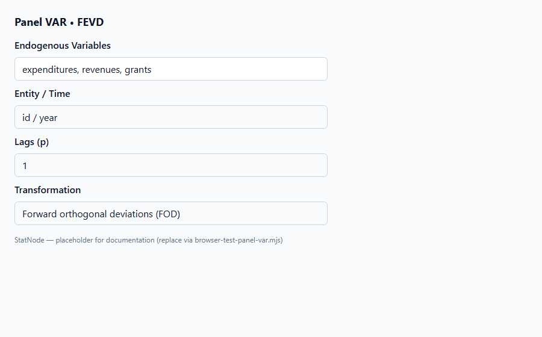
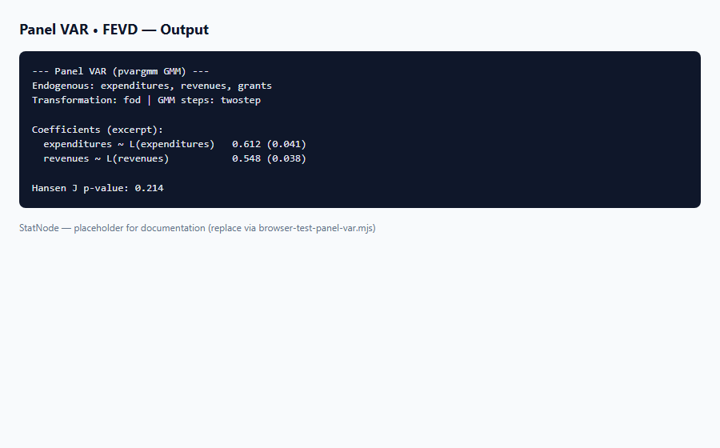

## 1. Mô hình dùng để làm gì?

Sub-node **Panel VAR • FEVD** tính **phân rã phương sai sai số dự báo (forecast error variance decomposition, FEVD)** dựa trên IRF trực giao, qua `panelvar::fevd_orthogonal()`. FEVD cho biết **tỷ lệ phần trăm** phương sai dự báo của mỗi biến tại horizon $h$ do shock từng biến khác (và chính nó) gây ra.

Bổ sung cho IRF — IRF đo **độ lớn** phản ứng theo thời gian, FEVD đo **đóng góp tương đối** của các nguồn shock vào không chắc chắn dự báo. Trong nghiên cứu tài chính công địa phương, FEVD trả lời: *tại horizon 8 năm, sai số dự báo chi tiêu chủ yếu do shock trợ cấp hay thu nhập?* (Dahlberg et al., 2005; Love & Zicchino, 2006).

Sub-node in ma trận FEVD riêng cho từng biến phụ thuộc trong hệ PVAR.

FEVD là bước cuối trong workflow post-estimation StatNode: sau khi Hansen J và stability xác nhận mô hình, OIRF mô tả **đường đi** của shock, FEVD định lượng **tầm quan trọng tương đối** của từng nguồn shock vào sai số dự báo (Lütkepohl, 2005).


## 2. Nền tảng lý thuyết

### 2.1. Phương sai sai số dự báo

Với forecast $h$ bước $\hat{Y}_{t+h|T}$, sai số $e_{t+h} = Y_{t+h} - \hat{Y}_{t+h|T}$. Trong biểu diễn MA($infty$) ổn định:

$$
mathrm{Var}(e_{i,t+h}) = sum_{j=1}^{K} sum_{s=0}^{h-1} left( psi_{s,ij}^{orth} 
ight)^2,
$$

với $psi_{s,ij}^{orth}$ hệ số IRF trực giao từ shock $j$ tới biến $i$ tại lag $s$.

### 2.2. Định nghĩa FEVD

Đóng góp của shock $j$ vào phương sai dự báo biến $i$ tại horizon $h$:

$$
mathrm{FEVD}_{i,j}(h) = rac{sum_{s=0}^{h-1} left( psi_{s,ij}^{orth} 
ight)^2}{mathrm{Var}(e_{i,t+h})} \times 100%.
$$

Ma trận FEVD: hàng là biến được giải thích, cột là nguồn shock; mỗi hàng tổng ≈ 100% (Lütkepohl, 2005).

### 2.3. Orthogonal vs generalized FEVD

`fevd_orthogonal()` dùng cùng phân rã Cholesky với `oirf()` — nhất quán về thứ tự biến. **Generalized FEVD** (Pesaran & Shin, 1998) không phụ thuộc thứ tự; chưa có trong `panelvar` v1 StatNode.

### 2.4. Horizon

$h$ nhỏ: thường shock “own” chiếm tỷ lệ cao. $h$ lớn: shock chéo có thể tăng nếu tương tác động mạnh — đọc bảng FEVD tại nhiều horizon (8, 12, 20).

### 2.5. Liên hệ với OIRF

FEVD orthogonal xây dựng từ cùng $Psi_h^{orth}$ như `oirf()` — hai sub-node nhất quán khi dùng chung `n_ahead` và cùng đối tượng `pvargmm`. Báo cáo nên trình bày IRF (hình) và FEVD (bảng %) song song.

### 2.6. Generalized FEVD (ngoài v1)

Pesaran & Shin (1998) generalized FEVD không phụ thuộc ordering — hữu ích khi thứ tự Cholesky không rõ. `panelvar` R chỉ có `fevd_orthogonal()`; generalized deferred sang phiên bản sau (xem `Panel VAR.md`).


## 3. Điều kiện sử dụng

1. **Cùng điều kiện như OIRF:** PVAR fit, Hansen J, stability đạt.

2. **Tham số `n_ahead`** khớp hoặc lớn hơn horizon IRF để so sánh nhất quán.

3. **Thứ tự Cholesky** giống OIRF — FEVD orthogonal phụ thuộc ordering.

4. **Hàng tổng 100%:** làm tròn số có thể lệch nhẹ 99.9–100.1%.

5. **Không có CI bootstrap** trong v1 — diễn giải định tính và so sánh relative magnitude.

6. **Biến scale:** FEVD là tỷ lệ phần trăm — ít nhạy scale hơn IRF tuyệt đối.

7. **Chạy sau OIRF:** FEVD dùng cùng orthogonalisation — thứ tự sub-node OIRF rồi FEVD giúp đọc kết quả nhất quán.

8. **Nhiều horizon:** Chạy lại sub-node với `n_ahead = 12` hoặc `20` nếu báo cáo cần decomposition dài hạn.


## 4. Quy trình workflow

1. Panel VAR → Hansen J → Stability.
2. (Khuyến nghị) Chạy **OIRF** trước để hiểu hình dạng động.
3. Chạy **FEVD** với cùng `n_ahead`.
4. Đọc bảng theo từng biến: own vs cross contributions.
5. Báo cáo bảng FEVD tại $h=4,8,12$ nếu cần chi tiết.
6. Chạy lại với horizon 12 nếu IRF cho thấy persistence cao (max eigenvalue $> 0.85$).
7. Đặt bảng FEVD cạnh bảng IRF trong báo cáo — đọc giả theo cặp shock–response.


## 5. Thực hành StatNode





**Cấu hình:** **Forecast Horizon** = `8`.

```r
library(panelvar)
fevd_res <- fevd_orthogonal(pvar, n.ahead = 8)
for (nm in names(fevd_res)) {
  cat("=== ", nm, " ===\n", sep = "")
  print(fevd_res[[nm]])
}
```

Ví dụ output:

```r
--- Panel VAR Forecast Error Variance Decomposition ---

=== expenditures ===
           own_shock  grants  revenues
h=1         72.3      18.5     9.2
h=4         58.1      28.4    13.5
h=8         45.2      38.9    15.9

=== revenues ===
...
```

Trên dữ liệu Dahlberg, đóng góp shock `grants` vào FEVD của `expenditures` thường tăng theo horizon — nhất quán flypaper effect.

**Bảng đọc nhanh FEVD (%):**

| Horizon | Own shock cao | Cross shock cao |
|---------|---------------|-----------------|
| $h=1$ | Bình thường | Hiếm |
| $h=4$–$8$ | Giảm dần | grants → expenditures tăng |
| $h>12$ | Ổn định | Cấu trúc dài hạn |

Chạy sub-node với **Forecast Horizon** = `8` đồng bộ với OIRF để so sánh trực tiếp.


## 6. Diễn giải kết quả

1. **Own shock:** Tỷ lệ cao tại $h=1$ là bình thường — biến khó dự báo chủ yếu bởi shock riêng.

2. **Cross shock:** Shock `grants` chiếm >30% tại $h=8$ cho `expenditures` → trợ cấp là nguồn không chắc chắn dự báo quan trọng.

3. **Theo horizon:** So sánh $h=1$ vs $h=8$ — shock chéo tăng khi hệ điều chỉnh dần.

4. **Nhất quán IRF:** IRF dương lớn từ grants → expenditures nên đi kèm FEVD grants cao.

5. **Ordering caveat:** Đổi thứ tự Cholesky có thể thay FEVD — ghi rõ ordering và thử robustness ngoài app.

6. **Báo cáo:** Bảng FEVD %, horizon, ordering, và nguồn Abrigo & Love (2016) / Love & Zicchino (2006).

**Ví dụ đoạn văn báo cáo:** "FEVD orthogonal tại horizon 8 cho thấy shock trợ cấp giải thích 38.9% phương sai dự báo chi tiêu địa phương, trong khi shock thu nhập đóng góp 15.9%; shock riêng của chi tiêu còn 45.2%."

**Lỗi thường gặp:** (a) FEVD hàng không cộng 100% do làm tròn — bình thường; (b) so sánh FEVD giữa các ordering khác nhau mà không ghi chú; (c) diễn giải % cao như nhân quả thuần túy.

**Nguyên tắc tổng hợp:** Đọc FEVD theo từng biến phụ thuộc (mỗi block output một biến). Theo dõi cột **own shock** giảm và cột **grants** / **revenues** tăng theo $h$ — pattern điển hình trên Dahlberg. Trình bày bảng % với 1 chữ số thập phân.

**So sánh IRF–FEVD:** IRF shock grants → expenditures dương kéo dài đi kèm hàng FEVD expenditures có % grants tăng từ ~18% ($h=1$) lên ~39% ($h=8$) trong ví dụ minh họa — hai sub-node bổ sung nhau, không thay thế.

**Hạn chế v1:** Generalized FEVD (Pesaran & Shin, 1998) và bootstrap chưa có; ordering sensitivity cần robustness check ngoài StatNode.

**Checklist báo cáo FEVD:**

- [ ] Nêu horizon và ordering Cholesky
- [ ] Bảng % cho mỗi biến phụ thuộc ($K$ bảng)
- [ ] So sánh own vs cross shock tại $h=1$ và $h=8$
- [ ] Nhất quán với IRF cùng horizon
- [ ] Caveat: orthogonal FEVD, không phải generalized

**Ví dụ đọc bảng Dahlberg ($h=8$):** Own shock của `expenditures` còn 45.2%; shock `grants` giải thích 38.9% — gần bằng nhau, cho thấy trợ cấp là nguồn không chắc chắn dự báo trung hạn quan trọng như shock riêng của chi tiêu. Shock `revenues` đóng góp 15.9%, nhỏ hơn grants nhưng không thể bỏ qua khi đánh giá vòng ngân sách địa phương.

## 7. Tài liệu tham khảo

- Holtz-Eakin, D., Newey, W., & Rosen, H. S. (1988). Estimating Vector Autoregressions with Panel Data. *Econometrica*, 56(6), 1371–1395.
- Arellano, M., & Bond, S. (1991). Some Tests of Specification for Panel Data. *Review of Economic Studies*, 58(2), 277–297.
- Blundell, R., & Bond, S. (1998). Initial Conditions and Moment Restrictions in Dynamic Panel Data Models. *Journal of Econometrics*, 87(1), 115–143.
- Love, I., & Zicchino, L. (2006). Financial Development and Dynamic Investment Behavior. *Quarterly Review of Economics and Finance*, 46(2), 190–210.
- Abrigo, M. R. M., & Love, I. (2016). *panelvar*: Panel Vector Autoregression. R package vignette. CRAN.
- Hansen, L. P. (1982). Large Sample Properties of Generalized Method of Moments Estimators. *Econometrica*, 50(4), 1029–1054.
- Sargan, J. D. (1958). The Estimation of Economic Relationships Using Instrumental Variables. *Econometrica*, 26(3), 393–415.
- Lütkepohl, H. (2005). *New Introduction to Multiple Time Series Analysis*. Springer.
- Sims, C. A. (1980). Macroeconomics and Reality. *Econometrica*, 48(1), 1–48.

---

Ghi chú: Tài liệu nhằm hướng dẫn học thuật cho người dùng StatNode. Output mẫu minh họa định dạng; kết quả thực tế phụ thuộc dữ liệu, số lag và cấu hình GMM.

