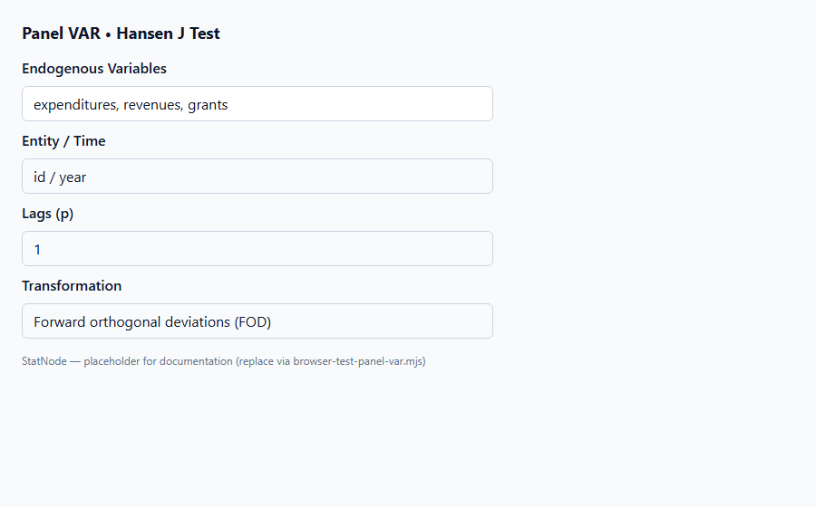
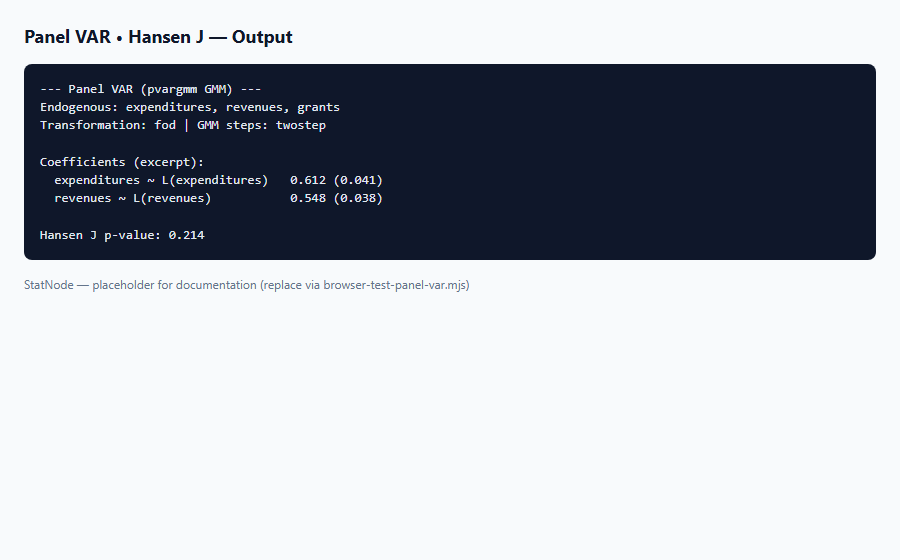

## 1. Mô hình dùng để làm gì?

Sub-node **Panel VAR • Hansen J Test** thực hiện **kiểm định J của Hansen** (còn gọi **Sargan–Hansen test**) trên mô hình PVAR GMM đã ước lượng, nhằm trả lời câu hỏi: *các công cụ lag được dùng có hợp lệ — tức các moment điều kiện có được thỏa mãn trên mẫu không?*

Trong ước lượng GMM panel, số moment (công cụ) thường **lớn hơn** số tham số cần ước lượng — mô hình **overidentified**. Hansen (1982) đề xuất thống kê kiểm định giả thuyết rằng trung bình mẫu của các moment điều kiện bằng không, tương đương kiểm tra xem công cụ có tương quan với phần dư sau khi đã dùng làm IV hay không. Đây là bước **bắt buộc** trong workflow PVAR trước khi diễn giải hệ số và IRF (Arellano & Bond, 1991; Roodman, 2009).

Sub-node gọi `panelvar::hansen_j_test()` trên đối tượng `pvargmm` từ node cha và in thống kê J cùng p-value.

Trong pipeline municipal finance (Dahlberg et al., 2005), kiểm định overidentification đặc biệt quan trọng vì hệ ba phương trình với nhiều lag instrument — proliferation dễ làm J reject giả. Sub-node giúp phân biệt misspecification thật và artifact do quá nhiều công cụ.


## 2. Nền tảng lý thuyết

### 2.1. Moment conditions và overidentification

GMM dựa trên vector moment $g_i(\hat{\theta})$ cho mỗi cá thể $i$. Điều kiện dân số:

$$
E[g_i(\theta_0)] = 0.
$$

Gọi $q$ là số moment (công cụ) và $p$ là số tham số. Nếu $q > p$, hệ **overidentified** và có thể kiểm tra xem tất cả $q$ moment có đồng thời bằng không.

### 2.2. Thống kê Hansen J

Với ước lượng hai bước $\hat{\theta}$ và ma trận covariance moment ước lượng $\hat{S}$, thống kê J (Hansen, 1982):

$$
J = N \cdot \bar{g}(\hat{\theta})' \hat{W} \bar{g}(\hat{\theta}) \xrightarrow{d} \chi^2_{q-p},
$$

dưới $H_0$: tất cả moment điều kiện hợp lệ. Ở đây $\bar{g}(\hat{\theta}) = N^{-1}\sum_i g_i(\hat{\theta})$ và $\hat{W}$ là ma trận trọng số tối ưu GMM.

### 2.3. Liên hệ Sargan và difference-in-Hansen

Sargan (1958) đề xuất kiểm định tương tự trong IV 2SLS. Trong GMM panel động, **difference-in-Hansen** (Roodman, 2009) so sánh mô hình exactly-identified với overidentified để kiểm tra tập con công cụ; `hansen_j_test()` trong `panelvar` áp dụng cho toàn bộ hệ PVAR sau `pvargmm()`.

### 2.4. Instrument proliferation

Khi $T$ hoặc $p$ lớn, số công cụ tăng nhanh — J test có xu hướng **reject $H_0$** ngay cả khi công cụ về mặt lý thuyết hợp lệ (Roodman, 2009). Giải pháp: `collapse = TRUE`, giảm `max_instr_dependent_vars`, hoặc giới hạn lag công cụ.

### 2.5. GMM hai bước và ma trận trọng số

Quy trình **two-step GMM** (Arellano & Bond, 1991): bước 1 ước lượng $\hat{\theta}_1$ với $W_N = S_N^{-1}(\hat{\theta}_0)$; bước 2 tái ước lượng với $W_N = S_N^{-1}(\hat{\theta}_1)$. Thống kê J tính ở bước cuối — dùng cùng $\hat{W}$ optimal để đánh giá moment sample. **Iterative (m-step)** lặp cho đến hội tụ; Abrigo & Love (2016) khuyến nghị two-step cho PVAR mặc định.

### 2.6. Moment Arellano–Bond trong PVAR đa phương trình

Với $K$ biến nội sinh, mỗi phương trình có bộ moment riêng; `pvargmm()` **stack** moment toàn hệ. Số overidentifying restrictions phụ thuộc $K$, $p$, $T$ và giới hạn `max_instr_*`. Trên Dahlberg ($K=3$, $p=1$), df thường từ 10–20 — đủ cho J test có power hợp lý.


## 3. Điều kiện sử dụng

1. **Phải có node cha Panel VAR đã chạy thành công** và cổng Model được kết nối đúng; đối tượng phải thuộc class `pvargmm`.

2. **Mô hình overidentified.** Nếu số moment bằng số tham số (exactly identified), J test không có ý nghĩa — cần tăng số công cụ hoặc giảm ràng buộc `min_instr`.

3. **Two-step GMM khuyến nghị.** J test nhất quán nhất sau `steps = "twostep"` hoặc `"mstep"` (Abrigo & Love, 2016).

4. **Không thay thế kiểm định serial correlation.** Arellano–Bond AR(1)/AR(2) test cho phần dư sai phân nằm ngoài phạm vi sub-node này trong v1.

5. **Mức ý nghĩa:** p-value $< 0.05$ → nghi ngờ công cụ; p-value $geq 0.10$ thường được chấp nhận trong thực nghiệm panel nếu không có proliferation.

6. **Kết hợp lý thuyết kinh tế:** J test đạt không chứng minh nhân quả; chỉ cho phép diễn giải hệ số GMM có điều kiện.

7. **Cỡ mẫu $N$ lớn:** J test có power cao khi $N > 100$; với $N$ nhỏ, p-value cao có thể do power yếu chứ không chắc công cụ đúng.

8. **Windmeijer correction:** GMM hai bước có thể downward-bias SE; Hansen J vẫn dùng được nhưng kết hợp báo cáo robust SE nếu package hỗ trợ trong tương lai.


## 4. Quy trình workflow

1. Hoàn thành ước lượng **Panel VAR** trên node cha; ghi nhận số công cụ và transformation.
2. Kéo sub-node **Panel VAR • Hansen J Test** vào canvas; nối output Model của Panel VAR vào input Panel VAR Model.
3. Chạy sub-node (không cần tham số bổ sung).
4. Đọc thống kê J và p-value.
5. Nếu reject $H_0$: quay lại node cha — thử `collapse`, giảm `max_instr`, đổi FOD↔FD, hoặc tắt system GMM.
6. Nếu không reject: tiếp tục **Stability** → **OIRF** → **FEVD**.
7. Báo cáo J statistic, bậc tự do và p-value trong bảng kết quả chính.
8. Lưu screenshot output và trích dẫn trong bài viết học thuật hoặc báo cáo seminar.
9. Nếu J reject sau khi collapse: ghi nhận đặc tả cuối vẫn không đạt — tránh overfitting bằng cách giảm công cụ quá mức.


## 5. Thực hành StatNode

Sub-node kết nối sau node Panel VAR trên cùng canvas workflow:





**Các bước:** chạy node Panel VAR trước → kéo sub-node Hansen J → nối Model → Run.

Code R tương đương:

```r
library(panelvar)
# pvar: đối tượng pvargmm từ pvargmm()
hj <- hansen_j_test(pvar)
print(hj)
```

Ví dụ output mẫu:

```r
--- Panel VAR Hansen J Overidentification Test ---
Hansen J test of overidentifying restrictions

       Statistic  df  p-value
J.test   12.453  15    0.654

Interpretation: H0 = instruments are valid (overidentifying restrictions hold).
Reject at conventional levels if the p-value is below 0.05.
```

Với dữ liệu Dahlberg (expenditures, revenues, grants), p-value cao ($> 0.10$) thường cho thấy công cụ lag Arellano–Bond phù hợp sau FOD transformation.

**Bảng đọc nhanh output:**

| Thành phần | Ý nghĩa | p-value cao | p-value thấp |
|------------|---------|-------------|--------------|
| J statistic | Khoảng cách moment sample tới 0 | — | Moment không nhất quán |
| df | $q - p$ overidentifying restrictions | — | — |
| p-value | $H_0$: công cụ hợp lệ | Tiếp tục IRF/FEVD | Giảm công cụ / đổi GMM spec |

**Khắc phục khi J reject (theo Roodman, 2009):**

1. Bật **Collapse Instrument Matrix** trên node cha.
2. Giảm **Max Instruments (Endogenous)** từ 99 xuống 20–40.
3. Thử **first differences** thay FOD hoặc ngược lại.
4. Tắt **System GMM** nếu moment mức gây reject.
5. Tăng **Lags (p)** nếu nghi ngờ serial correlation trong phần dư.

**Ví dụ workflow canvas (Dahlberg):** Panel VAR (`expenditures`, `revenues`, `grants`, lag=1, FOD) → Hansen J → Stability → OIRF → FEVD. Hansen J chạy ngay sau fit vì chi phí tính toán thấp so với bootstrap IRF (chưa có trong v1).


## 6. Diễn giải kết quả

1. **p-value $geq 0.05$:** Không bác bỏ $H_0$ — không có bằng chứng thống kê cho thấy công cụ không hợp lệ; có thể tiếp tục phân tích động (IRF/FEVD) nếu stability đạt.

2. **p-value $< 0.05$:** Bác bỏ $H_0$ — moment sample không đồng nhất với giả thuyết công cụ hợp lệ. Kiểm tra **instrument proliferation** trước; thử `collapse = TRUE` hoặc giảm `max_instr_dependent_vars` từ 99 xuống 15–30.

3. **J statistic và df:** df $= q - p$ là số overidentifying restrictions. J lớn tương đối df cho thấy moment “xa” zero.

4. **So sánh difference vs system GMM:** System GMM thêm moment mức — nếu J reject chỉ khi bật system, cân nhắc giữ difference GMM (Blundell–Bond có thể vi phạm nếu ban đầu không đúng).

5. **Không nhầm với AR test:** Phần dư serially correlated có thể làm J reject; xem xét tăng lag $p$ trên node cha.

6. **Báo cáo:** Luôn nêu J, df, p-value ngay sau bảng hệ số GMM — theo chuẩn Arellano–Bond và Roodman (2009).

**Ví dụ đoạn văn báo cáo:** "Ước lượng PVAR GMM hai bước trên 285 đô thị Thụy Điển ($T=24$) với ba biến nội sinh và lag 1, kiểm định Hansen J cho thống kê 12.45 (df = 15, p = 0.65), không bác bỏ giả thuyết công cụ lag hợp lệ. Kết quả hỗ trợ tiếp tục phân tích IRF và FEVD."

**Lỗi thường gặp:** (a) chạy Hansen J trước khi node cha fit xong; (b) kết luận nhân quả chỉ vì J pass; (c) bỏ qua J reject và vẫn trình bày IRF; (d) không báo cáo số công cụ và loại GMM kèm J statistic.

**Nguyên tắc tổng hợp:** Kết hợp J test với lý thuyết công cụ (lag $geq 2$ cho FD-GMM) và kiểm tra proliferation. Một mô hình “đạt” gồm: (i) J không reject ở mức 5%; (ii) số công cụ hợp lý ($<$ $N$ hoặc sau collapse); (iii) hệ số có dấu phù hợp lý thuyết; (iv) stability pass. Chỉ khi đủ (i)–(iv) mới chuyển sang IRF/FEVD.

**Liên hệ Stata `pvar`:** Abrigo & Love (2015) Stata package in `pvar` postestimation `pvarstable`, `pvarirf` — workflow StatNode mirror R `panelvar` với Hansen J → stability → oirf → fevd_orthogonal theo cùng thứ tự khuyến nghị trong vignette.

**Checklist báo cáo Hansen J:**

- [ ] J statistic, df, p-value in ngay sau bảng GMM
- [ ] Số công cụ và loại GMM (difference/system) đã nêu
- [ ] Nếu reject: mô tả biện pháp (collapse, giảm max_instr)
- [ ] Không diễn giải nhân quả chỉ từ J pass

## 7. Tài liệu tham khảo

- Holtz-Eakin, D., Newey, W., & Rosen, H. S. (1988). Estimating Vector Autoregressions with Panel Data. *Econometrica*, 56(6), 1371–1395.
- Arellano, M., & Bond, S. (1991). Some Tests of Specification for Panel Data. *Review of Economic Studies*, 58(2), 277–297.
- Blundell, R., & Bond, S. (1998). Initial Conditions and Moment Restrictions in Dynamic Panel Data Models. *Journal of Econometrics*, 87(1), 115–143.
- Love, I., & Zicchino, L. (2006). Financial Development and Dynamic Investment Behavior. *Quarterly Review of Economics and Finance*, 46(2), 190–210.
- Abrigo, M. R. M., & Love, I. (2016). *panelvar*: Panel Vector Autoregression. R package vignette. CRAN.
- Hansen, L. P. (1982). Large Sample Properties of Generalized Method of Moments Estimators. *Econometrica*, 50(4), 1029–1054.
- Sargan, J. D. (1958). The Estimation of Economic Relationships Using Instrumental Variables. *Econometrica*, 26(3), 393–415.
- Lütkepohl, H. (2005). *New Introduction to Multiple Time Series Analysis*. Springer.
- Sims, C. A. (1980). Macroeconomics and Reality. *Econometrica*, 48(1), 1–48.

---

Ghi chú: Tài liệu nhằm hướng dẫn học thuật cho người dùng StatNode. Output mẫu minh họa định dạng; kết quả thực tế phụ thuộc dữ liệu, số lag và cấu hình GMM.

