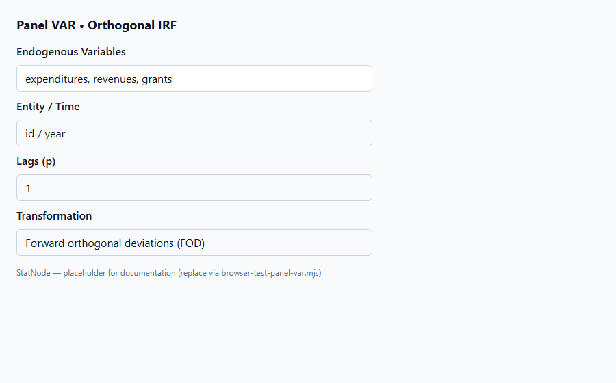
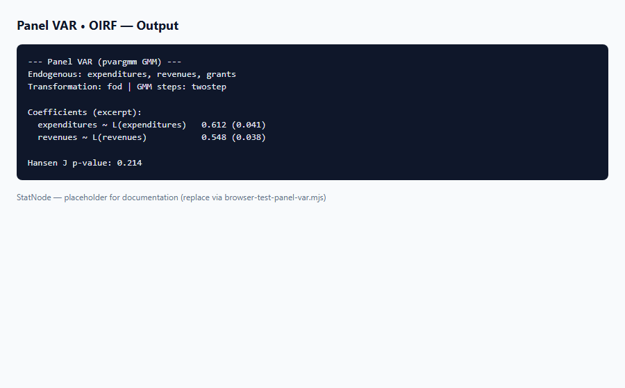

## 1. Mô hình dùng để làm gì?

Sub-node **Panel VAR • Orthogonal IRF** tính **hàm đáp ứng xung (impulse response function, IRF)** trực giao từ mô hình PVAR đã ước lượng, qua `panelvar::oirf()`. IRF mô tả phản ứng của từng biến trong hệ theo thời gian khi một biến nhận **shock một đơn vị** (sau khi trực giao hóa các shock đồng thời).

Trong kinh tế lượng ứng dụng, IRF trả lời câu hỏi động: *nếu trợ cấp (`grants`) tăng đột ngột, chi tiêu và thu nhập địa phương điều chỉnh thế nào trong $H$ kỳ tới?* Love & Zicchino (2006) dùng IRF PVAR để phân tích tương tác giữa phát triển tài chính và đầu tư; Dahlberg et al. (2005) và Abrigo & Love (2016) minh họa trên dữ liệu municipal finance Thụy Điển.

Khác với VAR time-series đơn lẻ (Sims, 1980), PVAR IRF phản ánh động **trung bình panel** sau khi loại $mu_i$, dưới giả định mô hình GMM đã đặc tả đúng.

Node cho phép điều chỉnh **Forecast Horizon** (1–40 kỳ); mặc định 8 phù hợp dữ liệu năm của Dahlberg ($T=24$).


## 2. Nền tảng lý thuyết

### 2.1. MA($infty$) representation

Nếu VAR($p$) ổn định, có biểu diễn:

$$
Y_t = sum_{s=0}^{infty} Psi_s arepsilon_{t-s},
$$

với $Psi_s$ ma trận hệ số MA, $arepsilon_t$ vector shock đồng thời. **IRF** tại horizon $h$ cho shock tác động biến $j$:

$$
rac{partial Y_{i,t+h}}{partial arepsilon_{j,t}} = psi_{h,ij},
$$

với $psi_{h,ij}$ phần tử của $Psi_h$.

### 2.2. Trực giao hóa (Cholesky)

Shock đồng thời có ma trận hiệp phương sai $Sigma_arepsilon$. **Orthogonal IRF** dùng phân rã Cholesky $Sigma_arepsilon = P P'$:

$$
\tilde{arepsilon}_t = P^{-1} arepsilon_t, qquad \text{IRF}^{orth}_h = Psi_h P.
$$

Thứ tự biến trong Cholesky ảnh hưởng kết quả — biến đặt trước “nhận shock trước” trong cùng kỳ. Abrigo & Love (2016) khuyến nghị sắp xếp theo lý thuyết kinh tế (ví dụ: grants → revenues → expenditures).

### 2.3. Horizon và hội tụ

Với hệ ổn định, IRF hội tụ về 0 khi $h \to infty$. Horizon $H$ trên StatNode (mặc định 8) nên đủ dài để thấy decay nhưng không quá lớn gây nhiễu ước lượng.

### 2.4. Bootstrap IRF (ngoài v1)

Phân phối sampling của IRF thường cần **bootstrap** (Kilian, 1998; Abrigo & Love, 2016). StatNode v1 chỉ cung cấp IRF điểm (point estimate); khoảng tin cậy bootstrap chưa có — xem `Panel VAR.md` tại repo.

### 2.5. Flypaper effect trên dữ liệu Dahlberg

Dahlberg et al. (2005) nghiên cứu tương tác giữa `expenditures`, `revenues` và `grants` của đô thị Thụy Điển. IRF shock `grants` → `expenditures` dương và kéo dài hỗ trợ giả thuyết **flypaper effect** (trợ cấp “dính” vào chi tiêu công). Love & Zicchino (2006) dùng cùng cấu trúc PVAR để minh họa package.

### 2.6. Shock identification và ordering

Thứ tự Cholesky mặc định theo thứ tự biến trong `dependent_vars` trên node cha. Đặt `grants` trước `expenditures` nếu giả thuyết trợ cấp thanh toán trước khi điều chỉnh chi tiêu trong năm ngân sách; thử ordering đảo ngược trong robustness check ngoài app.


## 3. Điều kiện sử dụng

1. **PVAR đã ước lượng; Hansen J và Stability nên đạt** trước khi diễn giải IRF.

2. **Hệ ổn định** — nếu stability fail, IRF có thể phân kỳ.

3. **Chọn horizon `n_ahead`** (1–40): mặc định 8; tăng lên 12–20 cho dữ liệu năm nếu tính bền cao.

4. **Thứ tự biến Cholesky:** ghi rõ trong báo cáo; thử đổi thứ tự kiểm tra robustness (ngoài UI v1).

5. **Đơn vị shock:** IRF phụ thuộc scale biến — so sánh cross-study cần chuẩn hóa hoặc dùng cùng đơn vị log.

6. **Không nhầm nhân quả:** IRF mô tả phản ứng động có điều kiện trong VAR, không phải causal effect đã nhận dạng.

7. **Log vs level:** Dahlberg dùng log biến — IRF là phản ứng log-point; diễn giải % gần đúng với shock nhỏ.

8. **Replication Love & Zicchino (2006):** Đặt $p=1$, FOD, three-step có thể khác SE nhưng IRF hình dạng tương tự nếu stability đạt.


## 4. Quy trình workflow

1. Panel VAR → Hansen J → Stability (cả hai pass).
2. Kéo **Orthogonal IRF**; nối Model; đặt **Forecast Horizon**.
3. Run; đọc ma trận IRF theo từng cặp shock–response.
4. (Tùy chọn) Vẽ đồ thị từ số liệu output — hump-shaped, sign, persistence.
5. Tiếp **FEVD** để bổ sung đóng góp phương sai.
6. Báo cáo: hình IRF, thứ tự Cholesky, horizon, nguồn dữ liệu.
7. Copy output text vào Excel hoặc R để vẽ đồ thị IRF đa panel nếu cần publication-quality figures.
8. Đối chiếu dấu IRF với hệ số lag trong bảng `summary(pvar)` — phải nhất quán về hướng tác động.


## 5. Thực hành StatNode





**Cấu hình mẫu (Dahlberg):**

- **Forecast Horizon:** `8`
- Biến nội sinh (từ node cha): `expenditures`, `revenues`, `grants`

```r
library(panelvar)
oirf_res <- oirf(pvar, n.ahead = 8)
print(oirf_res)
```

Ví dụ output (rút gọn):

```r
--- Panel VAR Orthogonal Impulse Response Function ---
Horizon  Response        Shock (orthogonal)
0        expenditures    grants: 0.000
1        expenditures    grants: 0.042
2        expenditures    grants: 0.038
...
```

Shock dương lên `grants` làm `expenditures` tăng dần trong vài kỳ — phù hợp giả thuyết trợ cấp kích thích chi tiêu địa phương (flypaper effect, Dahlberg et al., 2005).

**Bảng đọc nhanh IRF:**

| Pattern | Diễn giải |
|---------|-----------|
| Hump-shaped | Phản ứng trễ rồi suy |
| Monotonic decay | Shock tác động ngay, suy dần |
| Đổi dấu | Phản ứng overshoot / điều chỉnh |

**Thiết lập Settings trên StatNode:**

- **Forecast Horizon:** `8` (mặc định); tăng `12`–`16` nếu eigenvalue lớn nhất $> 0.85$.
- Đảm bảo cổng **Panel VAR Model** đã nối từ node cha đã chạy thành công.


## 6. Diễn giải kết quả

1. **Dấu IRF:** Dương/âm cho biết hướng phản ứng; significant về mặt kinh tế cần bootstrap CI (v1: mô tả định tính).

2. **Đỉnh và decay:** IRF đạt đỉnh tại $h^*$ rồi suy giảm — báo cáo $h^*$ và giá trị đỉnh.

3. **Cross-equation:** Xem shock `revenues` lên `expenditures` vs ngược lại — bất đối xứng là bình thường trong VAR.

4. **Thứ tự Cholesky:** Ghi chú “ordering: grants, revenues, expenditures” khi trình bày.

5. **So sánh literature:** Love & Zicchino (2006) Figure IRF — đối chiếu hình dạng qualitatively.

6. **Kết hợp FEVD:** IRF cho magnitude động; FEVD cho tỷ trọng shock tại mỗi horizon.

7. **Báo cáo:** Hình IRF đa biến, horizon, transformation GMM, và caveat không có bootstrap CI trong v1.

**Ví dụ đoạn văn báo cáo:** "Orthogonal IRF (horizon 8, ordering: grants, revenues, expenditures) cho thấy shock một đơn vị trợ cấp làm chi tiêu địa phương tăng đỉnh ở kỳ 2 (0.04 log-point) rồi suy dần về 0 — nhất quán flypaper effect trong Dahlberg et al. (2005)."

**Lỗi thường gặp:** (a) diễn giải IRF khi stability fail; (b) không nêu ordering Cholesky; (c) nhầm orthogonal IRF với generalized IRF (Pesaran & Shin, 1998).

**Nguyên tắc tổng hợp:** Trình bày IRF theo từng shock orthogonal — mỗi shock một cột hoặc một panel hình. Ghi rõ biến shock và biến response. Với dữ liệu log, shock “một đơn vị” là 1 log-point ≈ 100% thay đổi tại $x$ nhỏ. Kết hợp IRF với FEVD để vừa có timing vừa có tỷ trọng phương sai.

**Hạn chế v1:** Không có bootstrap CI (Kilian, 1998) — báo cáo nên nêu caveat và trích dẫn point IRF là ước lượng điểm GMM, không kèm khoảng tin cậy 95%.

**Checklist báo cáo IRF:**

- [ ] Hansen J và stability đã pass
- [ ] Ghi ordering: grants, revenues, expenditures (hoặc thứ tự đã chọn)
- [ ] Horizon và đơn vị (log) nêu rõ
- [ ] Hình IRF hoặc bảng số liệu từ output
- [ ] Caveat bootstrap CI chưa có trong v1

## 7. Tài liệu tham khảo

- Holtz-Eakin, D., Newey, W., & Rosen, H. S. (1988). Estimating Vector Autoregressions with Panel Data. *Econometrica*, 56(6), 1371–1395.
- Arellano, M., & Bond, S. (1991). Some Tests of Specification for Panel Data. *Review of Economic Studies*, 58(2), 277–297.
- Blundell, R., & Bond, S. (1998). Initial Conditions and Moment Restrictions in Dynamic Panel Data Models. *Journal of Econometrics*, 87(1), 115–143.
- Love, I., & Zicchino, L. (2006). Financial Development and Dynamic Investment Behavior. *Quarterly Review of Economics and Finance*, 46(2), 190–210.
- Abrigo, M. R. M., & Love, I. (2016). *panelvar*: Panel Vector Autoregression. R package vignette. CRAN.
- Hansen, L. P. (1982). Large Sample Properties of Generalized Method of Moments Estimators. *Econometrica*, 50(4), 1029–1054.
- Sargan, J. D. (1958). The Estimation of Economic Relationships Using Instrumental Variables. *Econometrica*, 26(3), 393–415.
- Lütkepohl, H. (2005). *New Introduction to Multiple Time Series Analysis*. Springer.
- Sims, C. A. (1980). Macroeconomics and Reality. *Econometrica*, 48(1), 1–48.

---

Ghi chú: Tài liệu nhằm hướng dẫn học thuật cho người dùng StatNode. Output mẫu minh họa định dạng; kết quả thực tế phụ thuộc dữ liệu, số lag và cấu hình GMM.

