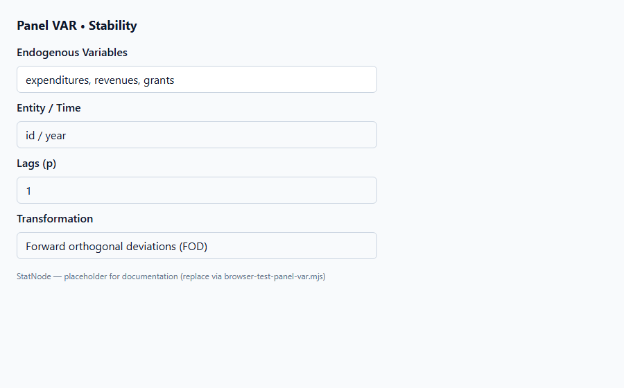
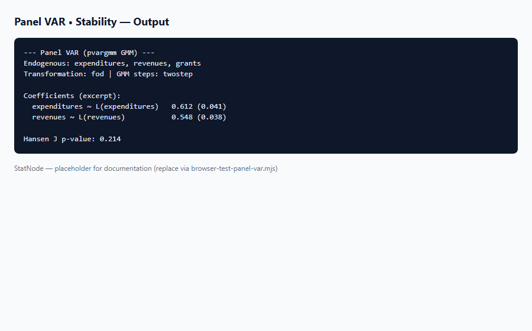

## 1. Mô hình dùng để làm gì?

Sub-node **Panel VAR • Stability** kiểm tra **tính ổn định động** (dynamic stability) của mô hình PVAR đã ước lượng bằng cách tính **giá trị riêng** (eigenvalues) của ma trận companion tương ứng với hệ VAR($p$). Mục tiêu: xác nhận hệ tự hồi quy không có mode phát tán — điều kiện cần để impulse response hội tụ và dự báo không bùng nổ.

Trong phân tích VAR chuỗi thời gian, Lütkepohl (2005) nhấn mạnh kiểm tra stability trước IRF và FEVD. Với PVAR trên panel đã loại hiệu ứng cố định, logic tương tự áp dụng cho ma trận hệ số ước lượng GMM: nếu companion matrix có root ngoài đường tròn đơn vị, phản ứng động được tính từ `oirf()` và `fevd_orthogonal()` có thể không có ý nghĩa kinh tế.

Sub-node gọi `panelvar::stability()` và in bảng modulus của từng eigenvalue.

Đây là bước tiền đề cho mọi phân tích impulse response trên StatNode: node **Orthogonal IRF** và **FEVD** giả định hệ đã loại hiệu ứng cố định và có companion matrix ổn định (Love & Zicchino, 2006).


## 2. Nền tảng lý thuyết

### 2.1. Companion form của VAR($p$)

Viết VAR($p$) cho vectơ $Y_t$ kích thước $K$:

$$
Y_t = A_1 Y_{t-1} + A_2 Y_{t-2} + cdots + A_p Y_{t-p} + u_t.
$$

Định nghĩa vectơ stacked $\tilde{Y}_t = (Y_t', Y_{t-1}', ldots, Y_{t-p+1}')'$ và ma trận companion:

$$
mathcal{C} = \begin{pmatrix}
A_1 & A_2 & cdots & A_p \
I_K & 0 & cdots & 0 \
0 & I_K & cdots & 0 \
\vdots & \vdots & ddots & \vdots \
0 & 0 & cdots & I_K & 0
end{pmatrix}_{Kp \times Kp}.
$$

Hệ **ổn định** (covariance stationary) khi mọi eigenvalue $lambda_j$ thỏa:

$$
|lambda_j| < 1, qquad j = 1,ldots,Kp.
$$

### 2.2. Ý nghĩa kinh tế

Root gần 1 cho thấy **tính bền cao** (high persistence) — shock tác động lâu. Root $|lambda| geq 1$ cho thấy quá trình không dừng hoặc explosive trong khuôn khổ VAR — IRF có thể không hội tụ về zero.

### 2.3. PVAR và transformation

PVAR GMM ước lượng trên không gian FOD/FD; hệ số companion được xây dựng từ ước lượng $\hat{A}_ell$ sau transformation. `stability()` trong `panelvar` áp dụng trực tiếp lên đối tượng `pvargmm` — người dùng không cần tự ghép ma trận.

### 2.4. Liên hệ unit root

Nếu một hoặc nhiều biến có unit root và không sai phân, VAR trên mức có thể không ổn định (Binder et al., 2005). Stability reject gợi ý kiểm tra unit root panel hoặc ước lượng trên sai phân (không có sẵn trong node PVAR v1).

### 2.5. IRF và điều kiện stability

IRF dài hạn $Psi_h$ tăng theo $h$ nếu hệ không ổn định — đồ thị IRF “bùng nổ” là dấu hiệu trực quan. Lütkepohl (2005) khuyến nghị kiểm tra eigenvalue trước mọi phân tích động; `panelvar` tự động hóa bước này qua `stability()`.

### 2.6. So sánh với VAR chuỗi thời gian

Trên VAR đơn lẻ, stability kiểm tra cùng điều kiện $|lambda_j| < 1$. PVAR GMM ước lượng hệ số có sai số mẫu — eigenvalue gần 1 có thể dao động giữa các đặc tả lag; so sánh stability khi chọn $p=1$ vs $p=2$ trên cùng dữ liệu Dahlberg.


## 3. Điều kiện sử dụng

1. **Node cha Panel VAR đã fit thành công** — cần hệ số VAR hợp lệ.

2. **Lag $p geq 1$.** Với $p=0$ không có companion matrix động — không áp dụng stability VAR.

3. **Chạy sau hoặc song song Hansen J** — stability độc lập với công cụ nhưng cả hai đều là tiền đề cho IRF.

4. **Không thay thế kiểm tra unit root** — stability trên hệ số VAR không chứng minh biến I(0).

5. **WebR:** `stability()` nhẹ, chạy nhanh sau GMM.

6. **Biến đã scale:** modulus eigenvalue không đổi nếu scale đồng nhất tất cả biến; so sánh đặc tả nên dùng cùng đơn vị dữ liệu.

7. **Lag $p$ cao:** Companion matrix kích thước $Kp$ — số eigenvalue tăng; kiểm tra từng modulus, không chỉ max.

8. **Song song Hansen J:** Stability độc lập với J nhưng nên chạy cả hai trước IRF — chi phí thấp.


## 4. Quy trình workflow

1. Ước lượng Panel VAR (node cha).
2. (Khuyến nghị) Chạy **Hansen J** — xác nhận công cụ.
3. Chạy **Stability** — kiểm tra $|lambda_j| < 1$ cho mọi $j$.
4. Nếu unstable: thử giảm $p$, loại biến unit root, hoặc rà soát đặc tả.
5. Nếu stable: chạy **Orthogonal IRF** và **FEVD**.
6. Báo cáo bảng modulus eigenvalues hoặc tóm tắt “all roots inside unit circle”.
7. Chụp `panel-var-stability-output.png` cho phụ lục báo cáo.
8. Nếu unstable: thử $p=1$ thay $p=2$ hoặc loại biến có unit root trước khi fit lại.


## 5. Thực hành StatNode





**Các bước:** Panel VAR → nối Model → sub-node Stability → Run.

```r
library(panelvar)
stab <- stability(pvar)
print(stab)
```

Ví dụ output:

```r
--- Panel VAR Stability Test ---
Companion matrix eigenvalues (modulus):

    Eigenvalue  Modulus  Stable
1       0.812    0.812    Yes
2       0.654    0.654    Yes
3       0.421    0.421    Yes
...

Interpretation: All companion-matrix roots should lie inside the unit circle for a stable PVAR.
```

Với hệ Dahlberg ($K=3$, $p=1$), có $3$ eigenvalues; tất cả modulus $< 1$ là điều kiện tiếp tục IRF.

**Bảng đọc nhanh:**

| Modulus | Ý nghĩa | Hành động |
|---------|---------|-----------|
| $< 0.8$ | Shock suy nhanh | IRF ngắn hạn |
| $0.8$–$0.99$ | Bền cao | Báo cáo persistence |
| $geq 1$ | Không ổn định | Dừng IRF/FEVD; đổi spec |

**Lệnh R bổ sung — trích modulus lớn nhất:**

```r
stab <- stability(pvar)
max_mod <- max(Mod(stab$eigenvalues))  # nếu object chứa eigenvalues
cat("Max modulus:", max_mod, "
")
```


## 6. Diễn giải kết quả

1. **Tất cả modulus $< 1$:** Hệ ổn định — IRF và FEVD có ý nghĩa trong khuôn khổ VAR; shock ảnh hưởng có hạn.

2. **Một hoặc nhiều modulus $geq 1$:** Hệ không ổn định — **không** diễn giải IRF/FEVD cho đến khi đặc tả được sửa.

3. **Root gần 1 (ví dụ 0.95–0.99):** Tính bền cao — IRF decay chậm; nêu trong báo cáo khi so sánh với nghiên cứu Love & Zicchino (2006).

4. **So sánh đặc tả:** Stability là tiêu chí bổ sung cho AIC/BIC khi chọn lag $p$.

5. **Đồ thị:** Vẽ eigenvalues trên mặt phẳng phức (unit circle) nếu báo cáo chi tiết — sub-node in bảng modulus.

6. **Báo cáo học thuật:** Nêu rõ “companion eigenvalues all lie inside the unit circle” hoặc liệt kê modulus lớn nhất.

**Ví dụ đoạn văn báo cáo:** "Kiểm tra stability của PVAR GMM cho thấy cả ba eigenvalue của ma trận companion có modulus nằm trong đường tròn đơn vị (max = 0.81), xác nhận hệ ổn định và đủ điều kiện cho phân tích IRF/FEVD."

**Lỗi thường gặp:** (a) bỏ qua stability khi IRF “đẹp”; (b) nhầm stability với stationarity của từng biến; (c) không thử lag thấp hơn khi unstable.

**Nguyên tắc tổng hợp:** Stability là điều kiện **cần** chứ không đủ cho nhân quả. Báo cáo nên nêu rõ số eigenvalue, modulus lớn nhất và kết luận binary (stable / unstable). Nếu max modulus $in [0.9, 1)$, cảnh báo persistence cao khi diễn giải IRF dài hạn.

**Ứng dụng Dahlberg:** Với `expenditures`, `revenues`, `grants` ($K=3$, $p=1$), companion có 3 eigenvalues — kiểm tra cả ba trước khi trình bày flypaper effect qua IRF shock grants.

**Checklist báo cáo stability:**

- [ ] Liệt kê modulus từng eigenvalue hoặc max modulus
- [ ] Kết luận stable / unstable rõ ràng
- [ ] Nếu max $in [0.9,1)$: cảnh báo persistence
- [ ] Chỉ chạy IRF/FEVD khi stable

## 7. Tài liệu tham khảo

- Holtz-Eakin, D., Newey, W., & Rosen, H. S. (1988). Estimating Vector Autoregressions with Panel Data. *Econometrica*, 56(6), 1371–1395.
- Arellano, M., & Bond, S. (1991). Some Tests of Specification for Panel Data. *Review of Economic Studies*, 58(2), 277–297.
- Blundell, R., & Bond, S. (1998). Initial Conditions and Moment Restrictions in Dynamic Panel Data Models. *Journal of Econometrics*, 87(1), 115–143.
- Love, I., & Zicchino, L. (2006). Financial Development and Dynamic Investment Behavior. *Quarterly Review of Economics and Finance*, 46(2), 190–210.
- Abrigo, M. R. M., & Love, I. (2016). *panelvar*: Panel Vector Autoregression. R package vignette. CRAN.
- Hansen, L. P. (1982). Large Sample Properties of Generalized Method of Moments Estimators. *Econometrica*, 50(4), 1029–1054.
- Sargan, J. D. (1958). The Estimation of Economic Relationships Using Instrumental Variables. *Econometrica*, 26(3), 393–415.
- Lütkepohl, H. (2005). *New Introduction to Multiple Time Series Analysis*. Springer.
- Sims, C. A. (1980). Macroeconomics and Reality. *Econometrica*, 48(1), 1–48.

---

Ghi chú: Tài liệu nhằm hướng dẫn học thuật cho người dùng StatNode. Output mẫu minh họa định dạng; kết quả thực tế phụ thuộc dữ liệu, số lag và cấu hình GMM.

