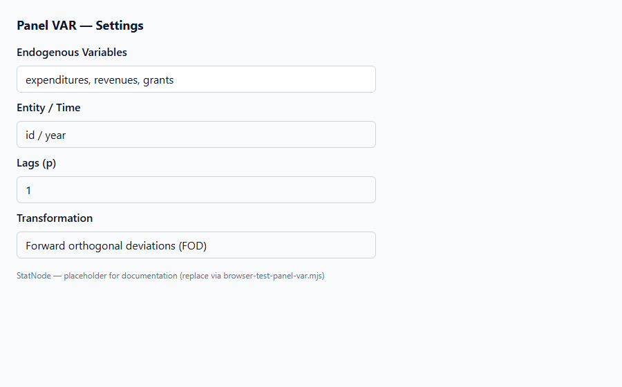
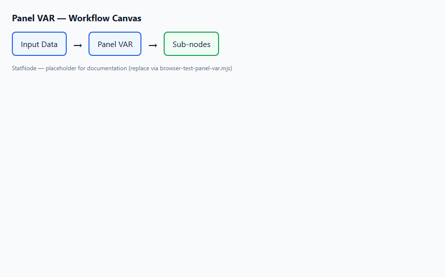
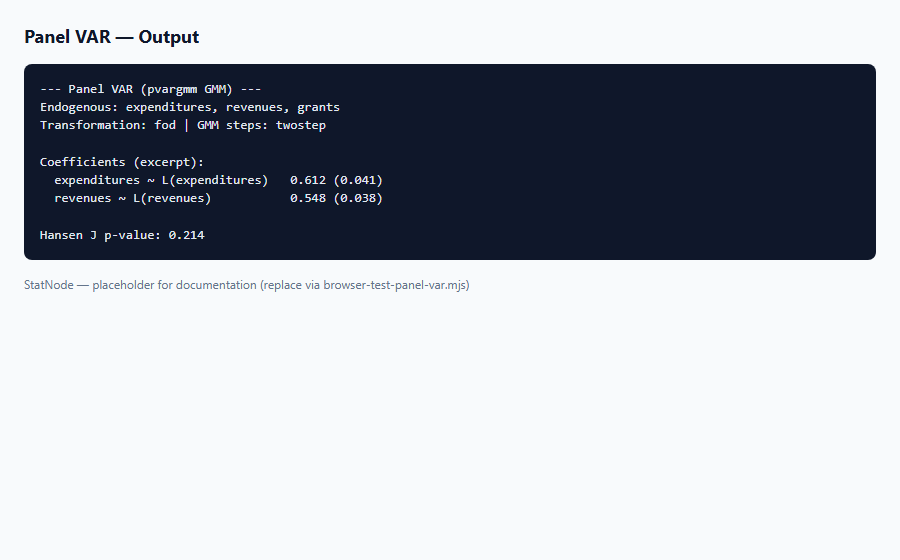

## 1. Mô hình dùng để làm gì?

Node **Panel VAR** trên StatNode ước lượng **mô hình vector tự hồi quy bảng** (Panel Vector Autoregression, PVAR) với hiệu ứng cố định cá thể, sử dụng phương pháp **GMM** qua hàm `panelvar::pvargmm()` (Abrigo & Love, 2016). Khác với VAR chuỗi thời gian đơn lẻ (Lütkepohl, 2005) — nơi một vectơ biến $y_t$ được mô tả bởi các lag của chính nó — PVAR mở rộng khung này sang dữ liệu bảng $(y_{it})$ với $i = 1,ldots,N$ đơn vị chéo và $t = 1,ldots,T$ kỳ thời gian, đồng thời loại bỏ hiệu ứng không quan sát $mu_i$ bằng biến đổi first-difference (FD) hoặc forward orthogonal deviations (FOD).

Nguồn gốc lý thuyết của PVAR GMM bắt nguồn từ Holtz-Eakin, Newey & Rosen (1988), những người đề xuất ước lượng VAR trên panel bằng moment conditions và biến đổi loại hiệu ứng cố định. Arellano & Bond (1991) phát triển GMM một bước/hai bước cho mô hình động panel với công cụ lag nội sinh; Blundell & Bond (1998) bổ sung **system GMM** — kết hợp moment trên phương trình sai phân và phương trình mức — để cải thiện hiệu quả ước lượng khi biến có tính bền (persistent). Package `panelvar` tích hợp toàn bộ pipeline này cho hệ nhiều phương trình.

Trong thực nghiệm kinh tế công và tài chính địa phương, PVAR được dùng để:

- **Phân tích tương tác động** giữa các biến nội sinh đồng thời (ví dụ chi tiêu, thu nhập và trợ cấp của chính quyền địa phương).
- **Đo lường phản ứng nhân quả có điều kiện** qua impulse response và phân rã phương sai sai số dự báo (sub-node hậu ước lượng).
- **Kiểm tra tính hợp lệ của công cụ GMM** và **ổn định động** của hệ sau khi loại hiệu ứng cố định.

Node Panel VAR là điểm khởi đầu của workflow trên StatNode: sau `pvargmm()`, đối tượng `pvargmm` được truyền sang các sub-node **Hansen J Test**, **Stability**, **Orthogonal IRF** và **FEVD**. Toàn bộ pipeline chạy trong trình duyệt qua WebR.


## 2. Nền tảng lý thuyết

### 2.1. Đặc tả PVAR với hiệu ứng cố định

Xét vectơ biến nội sinh $Y_{it} = (y_{1,it},ldots,y_{K,it})'$ và mô hình VAR($p$) trên panel:

$$
Y_{it} = sum_{ell=1}^{p} Phi_ell Y_{i,t-ell} + Gamma' Z_{it} + mu_i + e_{it}, qquad e_{it} sim (0, Sigma_e),
$$

với $mu_i$ là vector hiệu ứng cố định cá thể, $Z_{it}$ gồm biến định trước (predetermined) và ngoại sinh nghiêm ngặt (strictly exogenous). Holtz-Eakin et al. (1988) đề xuất loại $mu_i$ bằng **first-difference**:

$$
Delta Y_{it} = sum_{ell=1}^{p} Phi_ell Delta Y_{i,t-ell} + Gamma' Delta Z_{it} + Delta e_{it}.
$$

Package `panelvar` còn hỗ trợ **forward orthogonal deviations (FOD)** — biến đổi của Arellano & Bover (1995) / Blundell & Bond (1998) — giảm mất mát quan sát so với FD thuần khi $T$ nhỏ.

### 2.2. Moment conditions GMM (Arellano–Bond)

Với biến nội sinh và lag nội sinh làm regressor, OLS thiên lệch do tương quan giữa $Delta Y_{i,t-ell}$ và $Delta e_{it}$. Arellano & Bond (1991) dùng **công cụ lag** của chính biến ở các kỳ xa hơn:

$$
Eleft[ Y_{i,t-s} \cdot Delta e_{it} 
ight] = 0, qquad s geq 2,
$$

tạo ra hệ moment $E[g_i(\theta)] = 0$ cho mỗi cá thể $i$. GMM ước lượng $\hat{\theta}$ minimising:

$$
Q_N(\theta) = left(rac{1}{N}sum_{i=1}^{N} g_i(\theta)
ight)' W_N left(rac{1}{N}sum_{i=1}^{N} g_i(\theta)
ight),
$$

với ma trận trọng số $W_N$ (one-step, two-step hoặc iterative m-step).

### 2.3. System GMM (Blundell–Bond)

Khi các biến có tính bền cao, FD-GMM yếu vì lag gần tương quan mạnh với $Delta e_{it}$. Blundell & Bond (1998) thêm moment trên phương trình **mức** (level):

$$
Eleft[ (Delta Y_{i,t-1} - mu_{Delta Y}) \cdot (eta_{it} + e_{it}) 
ight] = 0,
$$

với $eta_{it}$ là hiệu ứng cố định trong phương trình mức, giả định ban đầu $Delta Y_{i,t}$ không tương quan với $mu_i$. Trên StatNode, bật **System GMM (Blundell-Bond)** tương ứng `system_instruments = TRUE` trong `pvargmm()`.

### 2.4. Companion matrix và ổn định

Gộp các hệ số VAR($p$) thành ma trận companion $mathcal{C}$ kích thước $(Kp \times Kp)$. Hệ **ổn định** (stationary) khi mọi giá trị riêng $lambda_j$ của $mathcal{C}$ nằm **trong đường tròn đơn vị**: $|lambda_j| < 1$. Sub-node **Stability** gọi `stability()` để kiểm tra điều kiện này sau ước lượng.

### 2.5. Ma trận công cụ và collapse

Số công cụ GMM tăng nhanh theo $T$, $p$ và $K$, gây **instrument proliferation** (Roodman, 2009). `pvargmm()` cho phép giới hạn `max_instr_*` / `min_instr_*` và **collapse** ma trận công cụ — gộp các cột tương ứng để giảm chiều mà vẫn giữ moment cốt lõi.


## 3. Điều kiện sử dụng

1. **Ít nhất hai biến nội sinh.** PVAR là mô hình hệ; một biến duy nhất không tạo thành VAR đa biến. Thực nghiệm khuyến nghị $K geq 2$.

2. **Panel dài (large $T$).** Asymptotic của GMM panel VAR dựa trên $N \to infty$ với $T$ cố định hoặc $T$ tăng vừa phải. Love & Zicchino (2006) dùng $T approx 19$–30; Dahlberg et al. (2005) có $T = 24$. $T < 10$ mỗi cá thể làm suy yếu số công cụ hữu dụng.

3. **Không trùng lặp (entity, time).** Mỗi cặp $(i,t)$ phải duy nhất; dữ liệu long format với cột định danh cá thể và thời gian.

4. **Tính dừng hoặc sai phân dừng.** PVAR GMM trên FD/FOD giả định biến không có unit root hoặc đã được xử lý phù hợp (Binder et al., 2005). Kiểm tra unit root panel trước khi ước lượng.

5. **Overidentification.** Số moment phải lớn hơn số tham số — nếu không, chỉ có exactly-identified GMM và không thể chạy Hansen J. Điều chỉnh `max_instr_*` nếu gặp lỗi under/over-identification.

6. **Giới hạn WebR.** Panel lớn ($N > 500$, $T > 30$, $K > 4$) có thể chạy chậm; thử subsample hoặc giảm lag / collapse instruments khi thử nghiệm.

7. **Diễn giải nhân quả.** IRF và FEVD mô tả phản ứng động **có điều kiện** trong khuôn khổ VAR; không thay thế thiết kế nhân quả ngoài mô hình (IV, RDD) nếu nội sinh nghiêm trọng.


## 4. Quy trình workflow

Quy trình phân tích PVAR điển hình trên StatNode:

1. **Chuẩn bị dữ liệu:** CSV long format — `id`, `year`, các biến nội sinh; kiểm tra balanced panel và missing values.
2. **Khám phá sơ bộ:** mô tả thống kê, biểu đồ theo thời gian; kiểm tra tương quan chéo giữa biến trong hệ.
3. **Chọn lag $p$:** bắt đầu từ $p=1$ (Love & Zicchino, 2006; Abrigo & Love, 2016); so sánh AIC/BIC nếu chạy nhiều đặc tả.
4. **Kéo node Panel VAR** vào canvas; kết nối Input Data; cấu hình biến nội sinh, entity, time, transformation (FOD mặc định), GMM steps.
5. **Chạy ước lượng** `pvargmm()`; đọc bảng hệ số và ma trận phương sai moment.
6. **Gắn sub-node Hansen J** — kiểm tra tính hợp lệ công cụ (overidentification).
7. **Gắn sub-node Stability** — xác nhận mọi root nằm trong unit circle.
8. **Gắn sub-node Orthogonal IRF** — phản ứng xung động trực giao giữa các shock.
9. **Gắn sub-node FEVD** — đóng góp phần trăm của từng shock vào sai số dự báo.
10. **Báo cáo:** trình bày đặc tả, Hansen J, stability, IRF/FEVD và diễn giải kinh tế.

**Sơ đồ workflow (tóm tắt):**

```
Input Data → Panel VAR (pvargmm)
                ├→ Hansen J Test
                ├→ Stability
                ├→ Orthogonal IRF
                └→ FEVD
```


## 5. Thực hành StatNode

Phần này minh họa PVAR trên dữ liệu **Dahlberg** — chi tiêu, thu nhập và trợ cấp của các đô thị Thụy Điển (Dahlberg, Johansson & Lindström, 2005; Love & Zicchino, 2006). File mẫu `dahlberg-sample.csv` gồm biến `expenditures`, `revenues`, `grants` theo `id` và `year`.

Giao diện gồm bảng cấu hình, canvas workflow và panel output:







**Các bước cụ thể:**

1. Nạp dataset `dahlberg-sample.csv` (hoặc bảng panel tương đương).
2. Kéo node **Panel VAR** (category: Panel Data → Statistic) vào canvas; kết nối cổng Data.
3. Trong Settings:
   - **Endogenous Variables:** `expenditures`, `revenues`, `grants`
   - **Entity Variable:** `id`
   - **Time Variable:** `year`
   - **Lags (p):** `1`
   - **Fixed-Effects Transformation:** `fod` (Forward orthogonal deviations)
   - **GMM Steps:** `twostep`
   - **System GMM:** tắt ban đầu (bật nếu biến bền và Hansen J đạt)
4. Chạy node (Run). Output hiển thị hệ số VAR, lỗi chuẩn GMM và thông tin moment.

Lệnh R tương đương StatNode thực thi:

```r
library(panelvar)
data <- read.csv("dahlberg-sample.csv")
pvar <- pvargmm(
  dependent_vars = c("expenditures", "revenues", "grants"),
  lags = 1,
  transformation = "fod",
  data = data,
  panel_identifier = c("id", "year"),
  steps = c("twostep"),
  system_instruments = FALSE,
  max_instr_dependent_vars = 99,
  min_instr_dependent_vars = 2L,
  progressbar = FALSE
)
summary(pvar)
```

Ví dụ output mẫu (minh họa định dạng):

```r
--- Panel VAR (pvargmm GMM) ---
Endogenous: expenditures, revenues, grants
Transformation: fod | GMM steps: twostep

Panel Vector Autoregression Model (GMM)
---------------------------------------
Lag order: 1
Number of instruments: 42
Number of overidentifying restrictions: 15

Coefficients:
                    Estimate  Std. Error  z-value  Pr(>|z|)
expenditures.l1     0.4521    0.0812    5.567    0.0000 ***
revenues.l1         0.1234    0.0621    1.987    0.0469 *
grants.l1           0.0345    0.0289    1.194    0.2324
...
```

Sau khi ước lượng, kéo các sub-node từ menu post-estimation (màu xanh lá) và nối cổng Model của node Panel VAR vào cổng Panel VAR Model của sub-node tương ứng.


## 6. Diễn giải kết quả

Khi đọc bảng ước lượng PVAR GMM, tuân thủ các nguyên tắc sau:

1. **Hệ số lag nội sinh:** $\hat{Phi}_ell$ đo độ bền và tương tác chéo — ví dụ $\hat{phi}_{12}$ cho thấy lag của `revenues` ảnh hưởng `expenditures` hiện tại. Ý nghĩa thống kê dựa trên z-statistic GMM (không phải OLS SE).

2. **Dấu và độ lớn:** Trên dữ liệu Dahlberg, lag chi tiêu thường dương và significant — phù hợp quán tính chi tiêu địa phương (Dahlberg et al., 2005). So sánh hệ số giữa các phương trình để đánh giá vòng phản hồi thu–chi–trợ cấp.

3. **Transformation:** Hệ số ước lượng trên FOD/FD là trong không gian đã loại $mu_i$; không so sánh trực tiếp với OLS pooled hoặc FE static.

4. **Hansen J (sub-node):** p-value lớn ($> 0.05$) → không bác bỏ tính hợp lệ công cụ; p-value nhỏ → xem xét giảm số công cụ (`collapse`, giảm `max_instr`) hoặc đổi transformation/steps.

5. **Stability:** Nếu có root $|lambda| geq 1$, IRF và FEVD có thể không hội tụ — cần giảm lag hoặc xem xét đặc tả khác trước khi diễn giải động.

6. **System vs difference GMM:** System GMM thường có SE nhỏ hơn nhưng phụ thuộc giả định ban đầu Blundell–Bond; báo cáo rõ lựa chọn.

7. **Báo cáo học thuật:** Nêu rõ $N$, $T$, biến nội sinh, $p$, transformation, loại GMM (difference/system), kết quả Hansen J, stability, và hình IRF/FEVD kèm horizon.

## 7. Tài liệu tham khảo

- Holtz-Eakin, D., Newey, W., & Rosen, H. S. (1988). Estimating Vector Autoregressions with Panel Data. *Econometrica*, 56(6), 1371–1395.
- Arellano, M., & Bond, S. (1991). Some Tests of Specification for Panel Data: Monte Carlo Evidence and an Application to Employment Equations. *Review of Economic Studies*, 58(2), 277–297.
- Blundell, R., & Bond, S. (1998). Initial Conditions and Moment Restrictions in Dynamic Panel Data Models. *Journal of Econometrics*, 87(1), 115–143.
- Love, I., & Zicchino, L. (2006). Financial Development and Dynamic Investment Behavior: Evidence from Panel VAR. *Quarterly Review of Economics and Finance*, 46(2), 190–210.
- Abrigo, M. R. M., & Love, I. (2015). Estimation of Panel Vector Autoregression in Stata: A Package of Programs. *Stata Journal*, 16(3), 778–804.
- Abrigo, M. R. M., & Love, I. (2016). *panelvar*: Panel Vector Autoregression. R package. CRAN.
- Binder, M., Hsiao, C., & Pesaran, M. H. (2005). Estimation and Inference in Short Panel Vector Autoregressions with Unit Roots and Cointegration. *Econometric Theory*, 21(4), 795–837.
- Roodman, D. (2009). How to Do xtabond2: An Introduction to Difference and System GMM in Stata. *Stata Journal*, 9(1), 86–136.
- Dahlberg, M., Johansson, E., & Lindström, T. (2005). Economic Approaches to the Study of Municipal Expenditures. *Swedish Economic Policy Review*, 12(1), 137–158.
- Baltagi, B. H. (2021). *Econometric Analysis of Panel Data* (6th ed.). Springer.
- Lütkepohl, H. (2005). *New Introduction to Multiple Time Series Analysis*. Springer.

---

Ghi chú: Tài liệu nhằm hướng dẫn học thuật cho người dùng StatNode. Output mẫu minh họa định dạng; kết quả thực tế phụ thuộc dữ liệu, số lag và cấu hình GMM.

