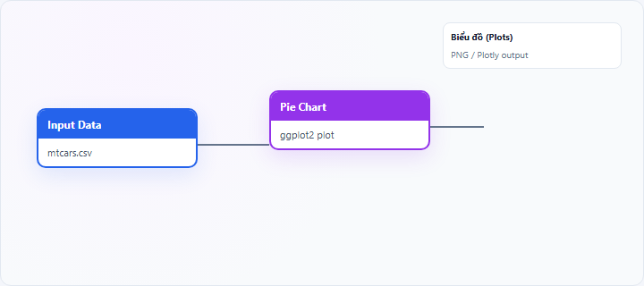
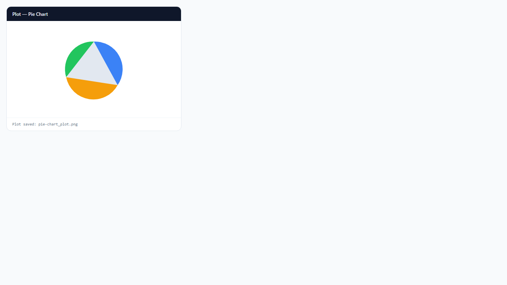

## 1. Biểu đồ tròn (Pie Chart) là gì?

**Pie chart** (biểu đồ tròn) chia hình tròn thành các **lát (slice)**; góc mỗi lát tỷ lệ với **tỷ trọng** của category trong tổng thể. Phù hợp câu chuyện **phần–tổng thể** (composition, market share, cơ cấu).

Node **Pie Chart** trên StatNode dùng **ggplot2** (`geom_bar` + `coord_polar`). Nếu **Value Variable** trống, kích thước lát theo **số dòng** mỗi nhóm; nếu có, theo **tổng giá trị** trong nhóm.

## 2. Biểu đồ tròn (Pie Chart) dùng để làm gì?

Pie chart trả lời:

- **Cơ cấu** phân bố category trong tổng?
- Nhóm nào chiếm **phần lớn** thị phần/tỷ trọng?

**Khi nên dùng:** ít nhóm (2–6), mục tiêu truyền đạt **tỷ lệ phần trăm** trực quan.

**Khi không nên dùng:** nhiều nhóm nhỏ (khó đọc nhãn); so sánh chênh lệch nhỏ giữa các lát (dùng **bar chart**); chuỗi thời gian.

**So sánh:** **donut chart** cùng ý nghĩa nhưng có lỗ giữa cho nhãn; bar chart chính xác hơn khi so sánh sát.

## 3. Thực hành trên phần mềm StatNode

Workflow cơ bản: kéo node **Input Data** (hoặc nguồn dữ liệu khác) → nối cổng **Data** vào node **Pie Chart** → chạy workflow → xem biểu đồ tại panel **Biểu đồ** (Plots).

**Dữ liệu minh họa:** `iris`: `Species` làm category.

**Cấu hình node:**

- **Category Variable**: `Species`
- **Value Variable**: để trống (đếm) hoặc chọn biến số cần tổng hợp
- **Chart Title**: `Cơ cấu loài Iris`

**Kết quả:**

## 4. Diễn giải kết quả

- **Lát lớn nhất:** category chiếm ưu thế — nêu % ước lượng (đọc từ diện tích tương đối).
- **Nhiều lát nhỏ:** gộp thành `Khác` khi trình bày.
- **Count vs Value:** count = tần suất mẫu; value = tổng kinh tế (doanh thu, dân số…) — diễn giải khác nhau.
- **Không có trục số:** pie kém chính xác hơn bar khi so sánh 48% vs 52%.

**Sai lầm:** dùng pie cho xu hướng thời gian; quá 7–8 lát.

## 5. Tài liệu tham khảo

1. Wilke, C. O. (2019). *Fundamentals of Data Visualization* — Ch. 9 Pie charts. https://clauswilke.com/dataviz/
2. Few, S. (2007). Save the Pies for Dessert. *Perceptual Edge*.
3. Wickham, H. (2016). *ggplot2* (2nd ed.). Springer.
4. R Documentation — `coord_polar()`: https://ggplot2.tidyverse.org/reference/coord_polar.html

---

Ghi chú: Nhiều chuyên gia trực quan hóa khuyên ưu tiên bar chart thay pie khi cần so sánh chính xác; pie phù hợp bài thuyết trình phần–tổng.