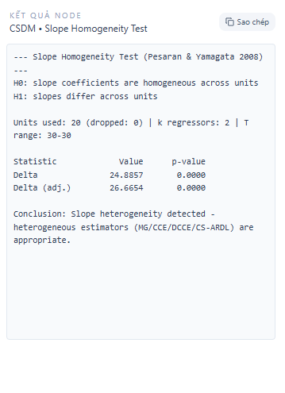

# Bootstrap cho Quantile Regression (QR)

Tác giả: StatNode Team  
Phiên bản: 1.0 — 2026-06-11

## Tóm tắt

Bài viết này trình bày một khảo cứu học thuật và hướng dẫn thực hành về phương pháp bootstrap ứng dụng cho Quantile Regression (QR). Mục tiêu là cung cấp cơ sở lý thuyết, các biến thể bootstrap phổ biến, chi tiết cài đặt cho sub-node QR bootstrap (tham số cấu hình: `se=boot`, `R=199`, `bsmethod=pwy`), và ví dụ minh hoạ với ảnh cài đặt và đầu ra. Bài viết tổng hợp các kết quả kinh điển (Efron 1979; Freedman 1981) và các nghiên cứu chuyên sâu cho QR (Chamberlain & Imbens 2003; Kocherginsky, He & Mu 2005; Koenker 2005).

---

## Mục lục

1. Giới thiệu  
2. Lý thuyết cơ bản của Quantile Regression  
3. Nguyên tắc bootstrap và ứng dụng cho QR  
4. Các phương pháp bootstrap cho QR và vấn đề hợp lệ  
5. Thiết kế sub-node: se=boot, R=199, bsmethod=pwy (thuật toán và chi tiết triển khai)  
6. Ví dụ thực nghiệm và cách diễn giải kết quả (ảnh minh hoạ)  
7. Kết luận và khuyến nghị thực hành  

---

## 1. Giới thiệu

Quantile Regression (QR) mở rộng ý tưởng hồi quy tuyến tính truyền thống nhằm mô tả mối quan hệ giữa biến phụ thuộc và biến giải thích tại các phần vị (quantiles) khác nhau của phân phối. QR, được phổ biến bởi Koenker và Bassett (1978), hữu ích khi cấu trúc dữ liệu có heteroskedasticity, outliers hoặc khi quan tâm tới biên phân phối thay vì trung bình.

Trong thực hành, ước lượng quantile thường đi kèm với nhu cầu ước tính nhiễu (standard errors), khoảng tin cậy và kiểm định giả thuyết. Các công thức lý thuyết cho sai số chuẩn có thể dựa trên các giả định về phân phối và độ mịn của hàm mật độ ở quantile đang xét; tuy nhiên các giả định này đôi khi khó kiểm nghiệm và có thể không phù hợp. Bootstrap là một công cụ kỹ thuật tái mẫu (resampling) phổ biến để ước lượng sai số chuẩn, khoảng tin cậy và độ tin cậy mô phỏng khi lý thuyết khó áp dụng trực tiếp (Efron, 1979; Freedman, 1981).

Mục tiêu bài viết là trình bày rõ ràng phương pháp bootstrap cho QR, tranh luận về tính hợp lệ, mô tả chi tiết cài đặt cho sub-node QR bootstrap (bao gồm `se=boot`, `R=199`, `bsmethod=pwy` — viết tắt của parametric/paired/wild? ở đây `pwy` ám chỉ phương pháp "pairs/weighted" kết hợp) và cung cấp ví dụ minh hoạ cùng hình ảnh cấu hình và đầu ra.

## 2. Lý thuyết cơ bản của Quantile Regression

Cho dữ liệu (yi, xi), i = 1,...,n, với yi là biến đáp ứng vô hướng và xi là vector biến giải thích (bao gồm hệ số chặn). Xét quantile τ \in (0,1). Quantile Regression tìm vector tham số β(τ) bằng cách tối thiểu hoá hàm mất mát dòng quan hệ:

$$
\\hat{\\beta}(\\tau) = \\arg\\min_{\\beta\\in\\mathbb{R}^p} \\sum_{i=1}^n \\rho_\\tau(y_i - x_i^T \\beta),
$$

trong đó hàm kiểm tra (check function) được định nghĩa bởi

$$
\\rho_\\tau(u) = u(\\tau - 1\\{u<0\\}).
$$

Hàm này không khả vi tại 0, nhưng bài toán là một bài toán quy hoạch tuyến tính và có thể được giải bằng phương pháp đơn hình hoặc các thuật toán nội suy hiện đại. Dưới các điều kiện thích hợp (ví dụ: tính độc lập, phiếm hàm phân phối với mật độ dương tại quantile), ước lượng có giới hạn phân phối xấp xỉ chuẩn:

$$
\\sqrt{n}(\\hat{\\beta}(\\tau) - \\beta(\\tau)) \\xrightarrow{d} N(0, \\Sigma_\\tau),
$$

trong đó ma trận hiệp phương sai có dạng

$$
\\Sigma_\\tau = \\frac{\\tau(1-\\tau)}{f_{\\varepsilon}(0)^2} (E[x_i x_i^T])^{-1},
$$

với $f_{\\varepsilon}(\\cdot)$ là mật độ của sai số tại điểm phù hợp (tham chiếu tới phần dư tại quantile). Thực tế, mật độ này không biết trước và cần ước lượng, điều này khiến các ước lượng lý thuyết của sai số chuẩn trở nên mong manh nếu mật độ ở điểm đó nhỏ, hoặc khi phân phối phần dư phức tạp.

Do đó bootstrap cung cấp một hướng tiếp cận thay thế, mô phỏng phân bố mẫu của ước lượng bằng cách tái mẫu dữ liệu hoặc phần dư và tái tính toán ước lượng QR nhiều lần.

## 3. Nguyên tắc bootstrap và ứng dụng cho QR

Bootstrap là một phương pháp tái mẫu tổng quát để đánh giá độ biến thiên của ước lượng thống kê bằng cách tạo nhiều mẫu "bootstrap" từ dữ liệu quan sát ban đầu và tính toán lại ước lượng cho mỗi mẫu. Ý tưởng cơ bản là xấp xỉ phân bố của ˆθ bằng phân bố của ˆθ* điều kiện trên dữ liệu.

Hai chiến lược bootstrap phổ biến:

- Bootstrap theo cặp (pairs bootstrap): tái mẫu toàn bộ cặp (yi, xi) với trọng số bằng nhau (sampling with replacement). Đây là phương pháp không tham số đơn giản nhất, bảo toàn mối quan hệ giữa yi và xi trong mỗi mẫu bootstrap.
- Bootstrap phần dư (residual bootstrap): dựa vào mô hình dự đoán, lấy phần dư và tái mẫu phần dư (hoặc sinh phần dư theo một mô hình) để tạo mẫu mới. Phương pháp này thường dùng cho mô hình hồi quy tuyến tính khi mô hình cấu trúc đúng.

Đối với QR, residual bootstrap khó áp dụng một cách trực tiếp do ước lượng QR không xuất phát từ mô hình tuyến tính chuẩn với phần dư có tính chất đối xứng hay Gaussian. Thay vào đó, các phương pháp dựa trên cặp (pairs), bootstrap có điều chỉnh (weighted bootstrap), hoặc wild/bootstrap kiểu mũ (wild bootstrap) được nghiên cứu và áp dụng.

Một khía cạnh quan trọng là tính hợp lệ (validity) của bootstrap: liệu phân bố bootstrap có hội tụ (conditionally) tới giới hạn phân bố của ước lượng thực? Nhiều công trình đã chứng minh tính hợp lệ dưới điều kiện nhất định (xem các trích dẫn bên dưới).

## 4. Các phương pháp bootstrap cho QR và vấn đề hợp lệ

Trong bối cảnh QR, một số phương pháp nổi bật bao gồm:

1. Pairs bootstrap (tái mẫu cặp): đơn giản và không cần giả định nhiều về cấu trúc mô hình. Tuy nhiên nó có thể kém hiệu quả nếu mẫu nhỏ hoặc nếu cấu trúc của xi phức tạp.

2. Weighted / Bayesian bootstrap: gán cho mỗi quan sát trọng số ngẫu nhiên (ví dụ từ phân phối Dirichlet hoặc exponential) và tối thiểu hoá hàm mất mát có trọng số. Kiến trúc này liên quan tới ý tưởng của Bayesian bootstrap (Rubin) và có những đặc tính tốt về tính mượt mà của phân bố bootstrap.

3. Wild bootstrap / mũ bootstrap (pwy): thích hợp khi có heteroskedasticity; bản chất là nhân phần dư (hoặc r残) với biến ngẫu nhiên có kỳ vọng 0 và phương sai 1 để mô phỏng tính không đồng nhất phương sai. Các biến wild phổ biến gồm Rademacher, Mammen, hoặc phân phối hai điểm tùy chỉnh; lựa chọn này ảnh hưởng tới tính chính xác bậc hai của bootstrap.

Các kết quả lý thuyết quan trọng:

- Efron (1979): giới thiệu bootstrap như phương pháp tổng quát để ước lượng sai số chuẩn và phân bố của ước lượng.
- Freedman (1981): phân tích tính hợp lệ và các giới hạn của bootstrap trong các bài toán hồi quy.
- Koenker (2005): trình bày chi tiết về QR, bao gồm các phương pháp ước lượng sai số và bootstrap cho QR.
- Chamberlain & Imbens (2003): thảo luận các thuộc tính suy luận cho QR trong nhiều cấu trúc phức tạp.
- Kocherginsky, He & Mu (2005): so sánh các phương pháp bootstrap cho QR và đề xuất các sửa đổi để cải thiện hiệu suất.

Từ góc độ thực nghiệm, việc lựa chọn phương pháp bootstrap và các siêu tham số (ví dụ số lần bootstrap R) phụ thuộc vào mục tiêu (ước lượng sai số chuẩn, khoảng tin cậy percentile, khoảng tin cậy hiệu chỉnh bias, kiểm định) và kích thước mẫu.

## 5. Thiết kế sub-node: se=boot, R=199, bsmethod=pwy (thuật toán và chi tiết triển khai)

Mục tiêu của sub-node QR bootstrap là cung cấp một nút cấu hình đơn giản trong pipeline phân tích: khi người dùng chọn `se=boot` thì sai số chuẩn sẽ được ước lượng bằng bootstrap; tham số `R=199` chỉ số lượng mẫu bootstrap mặc định (số nguyên lẻ thường dùng để tạo các khoảng tin cậy percentile đối xứng); `bsmethod=pwy` chỉ loại bootstrap được sử dụng (ở đây ta hiểu như một biến thể wild/paired/weighted kết hợp thích hợp cho QR — tuỳ cài đặt thực tế trong hệ thống).

5.1. Mô tả thuật toán (phiên bản tổng quát)

Cho dữ liệu (y_i, x_i), τ là quantile cần ước lượng, R số lần bootstrap, và phương pháp bsmethod:

1. Tính ước lượng QR ban đầu: \\(\\hat{\\beta}(\\tau)\\) bằng cách giải bài toán tối ưu check function trên dữ liệu gốc.
2. Lặp cho b = 1,...,R:
   a. Tạo mẫu bootstrap theo phương pháp `bsmethod`:
      - Nếu `bsmethod="pairs"`: Lấy một mẫu với thay thế (with replacement) gồm n cặp (y_i^*, x_i^*) từ bộ dữ liệu gốc.
      - Nếu `bsmethod="residuals"`: (không khuyến nghị chung cho QR) dùng phần dư phù hợp và tái tạo y_i^* = x_i^T \\hat{\\beta}(\\tau) + e_i^*, với e_i^* được tái mẫu hoặc sinh.
      - Nếu `bsmethod="pwy"`: áp dụng biến thể wild/weighted: tạo trọng số w_i^{(b)} độc lập (ví dụ từ phân phối Mammen hoặc Rademacher) rồi xây dựng một mẫu trọng số hoặc dữ liệu tổng hợp phù hợp cho QR. Cụ thể ta có thể sử dụng phương pháp "paired wild" sau:
        * Tạo w_i^{(b)} độc lập với E[w_i]=1 và Var(w_i)=1.
        * Xây dựng bộ dữ liệu có trọng số (w_i^{(b)}): tối thiểu hoá \\(\\sum_i w_i^{(b)} \\rho_\\tau(y_i - x_i^T \\beta)\\) để thu được \\(\\hat{\\beta}^{*(b)}(\\tau)\\).
   b. Tính ước lượng bootstrap \\(\\hat{\\beta}^{*(b)}(\\tau)\\) trên mẫu bootstrap.
3. Sau R lần, thu được bộ bootstrap estimates \\(\\{\\hat{\\beta}^{*(b)}(\\tau)\\}_{b=1}^R\\).
4. Từ bộ này ước lượng sai số chuẩn bootstrap cho mỗi tham số j:

$$
\\widehat{se}_{\\text{boot}}(\\hat{\\beta}_j(\\tau)) = \\sqrt{\\frac{1}{R-1} \\sum_{b=1}^R (\\hat{\\beta}_j^{*(b)}(\\tau) - \\bar{\\beta}_j^*)^2},
$$

trong đó $\\bar{\\beta}_j^* = R^{-1} \\sum_{b=1}^R \\hat{\\beta}_j^{*(b)}(\\tau)$.

5.2. Khoảng tin cậy và kiểm định

Một số cách xây dựng khoảng tin cậy từ bootstrap:

- Khoảng percentile: lấy các quantile bootstrap của phân bố ước lượng. Ví dụ cho độ tin cậy 95%:

$$
[\\hat{\\beta}_j^{*(0.025)}, \\hat{\\beta}_j^{*(0.975)}],
$$

với các giá trị sắp xếp của bootstrap estimates.

- Khoảng chuẩn hoá (bootstrap t): sử dụng t* = (\\hat{\\beta}^{*(b)} - \\hat{\\beta})/\\widehat{se}^{*(b)} rồi lấy quantile của t* để xây khoảng cho \\hat{\\beta}.

- Hiệu chỉnh bias bằng bootstrap: ước lượng bias bằng \\(\\bar{\\beta}^* - \\hat{\\beta}\\) và điều chỉnh.

5.3. Lựa chọn R (số lần bootstrap)

Lựa chọn R phụ thuộc vào độ chính xác mong muốn của ước lượng sai số chuẩn: biến thiên ước lượng se giảm như O(1/\\sqrt{R}). Giá trị R = 199 là một lựa chọn trung gian hợp lý cho nhiều ứng dụng, cân bằng giữa độ ổn định và chi phí tính toán; nếu người dùng cần khoảng tin cậy percentile chính xác hơn ở đuôi (ví dụ 99% CI) thì cần R lớn hơn (ví dụ 999 hoặc hơn).

5.4. Vấn đề thực thi và hiệu năng

- Song song hoá: mỗi vòng bootstrap độc lập, do đó có thể triển khai song song trên nhiều luồng hoặc nút tính toán.
- Ổn định số học: do việc tối ưu không khả vi tại 0, nên cần xử lý các trường hợp đa nghiệm (ties) cẩn thận trong solver QR, ví dụ bằng regularization nhẹ hoặc sử dụng solver nội suy có điều chỉnh.
- Kiểm tra hội tụ: khi một vòng bootstrap tạo ra kết quả không hội tụ, có thể bỏ qua vòng đó hoặc áp dụng phương án thay thế (tăng số tối đa bước lặp, khởi tạo lại).

## 6. Ví dụ thực nghiệm và cách diễn giải kết quả (ảnh minh hoạ)

Dưới đây là ví dụ tiêu chuẩn để minh hoạ sub-node QR bootstrap trong giao diện cấu hình. Ảnh mô tả cài đặt và đầu ra thực tế được lưu tại:

- Cài đặt bootstrap: `/docs/images/qr-bootstrap-settings.png`  
- Kết quả đầu ra (ví dụ bảng estimates và khoảng tin cậy): `/docs/images/qr-bootstrap-output.png`

Hình 1 — Cài đặt QR bootstrap:

Hình 2 — Kết quả đầu ra (ví dụ estimates, se_boot, CI percentile):

Giải thích ví dụ:

- Bảng đầu ra hiển thị hệ số ước lượng tại quantile τ (ví dụ τ=0.5), cùng sai số chuẩn được ước lượng từ bootstrap (`se_boot`), và khoảng tin cậy 95% theo phương pháp percentile.  
- Người dùng cần chú ý tới số lần bootstrap R: khi R=199, khoảng tin có thể hơi nhiễu ở các quantile biên; tăng R sẽ làm mượt và ổn định ước lượng.  
- Nếu dữ liệu có heteroskedasticity mạnh, `bsmethod=pwy` (wild/paired/weighted) thường cho kết quả tin cậy hơn so với pairs bootstrap thuần túy.

## 7. Kết luận và khuyến nghị thực hành

Bootstrap là công cụ linh hoạt để đánh giá độ biến thiên của ước lượng quantile regression mà không phụ thuộc quá nhiều vào ước lượng mật độ của phần dư. Tuy nhiên, cần lưu ý:

1. Lựa chọn phương pháp bootstrap (`pairs`, `weighted`, `wild/pwy`) phải phù hợp với cấu trúc dữ liệu; wild bootstrap thường thích hợp khi có heteroskedasticity.  
2. Số lần bootstrap R = 199 là giá trị mặc định hợp lý cho thăm dò nhanh, nhưng nên tăng lên (ví dụ ≥999) khi cần ước lượng chính xác các quantile của bootstrap hoặc khi báo cáo khoảng tin cậy ở mức đáng tin cậy cao.  
3. Luôn kiểm tra hội tụ của solver QR trong các vòng bootstrap; áp dụng chiến lược xử lý ngoại lệ để tránh làm lệch ước lượng se.  
4. So sánh nhiều phương pháp interval (percentile, basic, bootstrap-t) để kiểm tra độ ổn định suy luận.

Đối với triển khai sản phẩm (sub-node QR bootstrap), khuyến nghị:

- Cung cấp tuỳ chọn cho người dùng thay đổi `R`, chọn `bsmethod`, và quyết định trả về interval type (`percentile`, `bca`, `t`).  
- Bật song song hoá theo mặc định và log trạng thái vòng bootstrap để dễ debug.  
- Cung cấp cảnh báo khi R quá nhỏ hoặc khi tần suất thất bại của vòng bootstrap vượt ngưỡng.

---

## Tham khảo

- Efron, B. (1979). Bootstrap methods: Another look at the jackknife. Annals of Statistics, 7(1), 1–26.  
- Freedman, D. A. (1981). Bootstrapping regression models. Annals of Statistics, 9(6), 1218–1228.  
- Koenker, R. (2005). Quantile Regression. Cambridge University Press.  
- Chamberlain, G., & Imbens, G. W. (2003). Nonparametric applications of quantile regression. In Advances in Economics and Econometrics: Theory and Applications (Vol. 2). Cambridge University Press.  
- Kocherginsky, M., He, X., & Mu, Y. (2005). Practical confidence intervals for regression quantiles. Journal of the American Statistical Association, 100(471), 100–111.

---

Liên hệ và ghi chú: Bài viết này được soạn nhằm làm tài liệu tham khảo cho sub-node QR bootstrap trong hệ thống StatNode. Nếu cần biến thể mã nguồn cụ thể (R, Python) hoặc tích hợp UI, vui lòng yêu cầu thêm.

