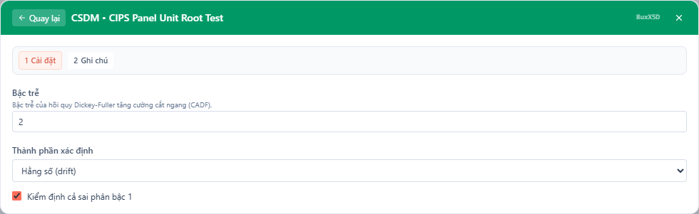
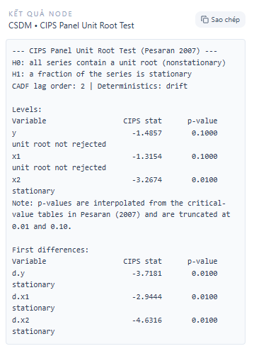

# Tóm tắt

Bài viết này trình bày một hướng dẫn học thuật và tổng quan về kiểm định thứ tự (rank test) trong bối cảnh hồi quy lượng tử (quantile regression), tập trung vào chỉ dẫn thực hiện bằng hàm `anova.rq` với tham số `test = "rank"` trong gói `quantreg` của R. Mục tiêu là cung cấp nền tảng lý thuyết, diễn giải công thức toán học, hướng dẫn thao tác với dữ liệu thực nghiệm, cùng ví dụ minh họa kèm hình ảnh cấu hình và kết quả. Các tham chiếu chính bao gồm các công trình nền tảng của Gutenbrunner, Jurečková, Koenker & Portnoy (1993), các tổng quan của Koenker (2005) và tuyển tập "Handbook of Quantile Regression" (2017).

# Mục lục

1. Giới thiệu
2. Cơ sở lý thuyết: kiểm định thứ tự trong hồi quy lượng tử
3. Định nghĩa kiểm định anova.rq (test = "rank") và công thức
4. Thực hiện trong R: chỉ dẫn chi tiết
5. Ví dụ minh họa: cấu hình và đầu ra
6. Diễn giải kết quả, hạn chế và khuyến nghị thực nghiệm
7. Kết luận và tài liệu tham khảo

# 1. Giới thiệu

Hồi quy lượng tử (quantile regression) là một công cụ thống kê quan trọng để mô tả mối quan hệ giữa biến phụ thuộc và biến giải thích theo các phần vị (quantiles) khác nhau của phân phối điều kiện. Khác với hồi quy tuyến tính thông thường tập trung vào trung bình điều kiện, hồi quy lượng tử khai thác thông tin về các điểm phân vị như trung vị, các phần vị trên hoặc dưới để khảo sát tính không đối xứng, heteroskedasticity, hoặc hiệu ứng khác nhau của biến giải thích trên các vùng khác nhau của phân phối.

Khi so sánh mô hình hoặc kiểm tra ảnh hưởng của tập biến giải thích, ta cần các kiểm định thống kê phù hợp với mục tiêu của hồi quy lượng tử. Một trong các kiểm định đó là "rank test" — kiểm định dựa trên xếp hạng (rank) của phần dư hoặc các thống kê tương đương — được triển khai trong `anova.rq` với `test = "rank"`. Kiểm định này hữu ích khi ta muốn kiểm tra các giả thuyết tuyến tính (ví dụ: một tập hệ số bằng 0) đồng thời không phụ thuộc nhiều vào giả định phân phối chuẩn của nhiễu.

Mục tiêu của bài viết là tổng hợp lý thuyết và chỉ dẫn thực hành để nhà nghiên cứu có thể hiểu sâu bản chất, áp dụng chính xác hàm `anova.rq(..., test = "rank")`, và diễn giải kết quả trong các nghiên cứu thực nghiệm.

# 2. Cơ sở lý thuyết: kiểm định thứ tự trong hồi quy lượng tử

2.1. Ý tưởng chung

Kiểm định thứ tự (rank test) dựa trên các xếp hạng hoặc các hàm của các xếp hạng nhằm xây dựng thống kê không tham số hoặc bán tham số. Trong khung hồi quy lượng tử, ta quan tâm đến việc kiểm định giả thuyết về các tham số \(\beta(\tau)\) của mô hình lượng tử tại cấp phần vị \(\tau\):

$$
Q_{Y|X}(\tau \mid X) = X^\top \beta(\tau),
$$

với \(Q_{Y|X}(\tau \mid X)\) là hàm lượng tử thứ \(\tau\) của \(Y\) điều kiện vào \(X\).

Giả sử ta muốn kiểm \(H_0: R\beta(\tau) = r\) (ví dụ: một số thành phần bằng 0) đối với nhiều \(\tau\) hoặc tập \(\tau\). Kiểm định thứ tự thường được dẫn xuất từ hàm mục tiêu lượng tử:

$$
\rho_\tau(u) = u(\tau - \mathbf{1}\{u < 0\}),
$$

và các vectơ xếp hạng liên quan đến phần dư \(u_i = y_i - x_i^\top\hat\beta(\tau)\).

2.2. Tính bất biến và tính phi tham số

Ưu điểm của các kiểm định rank là mức độ ít phụ thuộc vào giả định phân phối cụ thể của nhiễu; nhiều kiểm định rank là phi tham số hoặc bán tham số và có tính bất biến dưới nhiều biến đổi. Trong hồi quy lượng tử, các kiểm định này dựa trên trật tự phần dư và do đó chịu ít ảnh hưởng bởi outliers ở phần đuôi so với kiểm định chuẩn.

2.3. Công trình nền tảng

Lịch sử kiểm định rank trong bối cảnh lượng tử liên quan đến các kết quả lý thuyết về tính liên tục, phân phối cực và các ước lượng dốc (influence functions). Nhiều kết quả cổ điển đến từ công trình của Gutenbrunner và Jurečková, sau đó Koenker & Portnoy (1993) cung cấp phân tích chi tiết về phương pháp kiểm định nonparametric/based-on-ranks trong khung lượng tử. Koenker (2005) và tuyển tập "Handbook of Quantile Regression" (2017) cung cấp tổng quan và các chỉ dẫn thực nghiệm hiện đại.

# 3. Định nghĩa kiểm định anova.rq (test = "rank") và công thức

3.1. Dạng tổng quát của kiểm định

Cho hai mô hình hồi quy lượng tử lồng nhau: mô hình đầy đủ \(M_F\) và mô hình rút gọn \(M_R\) (ví dụ rút gọn bằng cách ép một số tham số về 0). Hàm `anova.rq` cho phép so sánh hai mô hình này bằng các kiểm định khác nhau; khi `test = "rank"` được chọn, kiểm định dựa trên các xếp hạng phần dư và các thống kê thứ tự.

Một dạng tổng quát của thống kê kiểm định rank có thể được viết như:

$$
T_{rank} = \frac{1}{\hat\sigma^2}\left(\hat{S}_F - \hat{S}_R\right),
$$

trong đó \(\hat{S}_F\) và \(\hat{S}_R\) là các hàm mục tiêu lượng tử (sum of check function) của mô hình đầy đủ và rút gọn, đã hiệu chỉnh theo độ lệch và trọng số phù hợp; \(\hat\sigma\) là ước lượng độ lệch phù hợp để chuẩn hóa.

3.2. Chi tiết kỹ thuật (phác thảo)

Chi tiết triển khai nội bộ của `test = "rank"` trong `anova.rq` được xây dựng dựa trên lý thuyết hạn chuẩn (asymptotic) cho các ước lượng lượng tử và thống kê xếp hạng. Về mặt toán học, ta sử dụng kết quả:

$$
\sqrt{n}(\hat\beta(\tau) - \beta(\tau)) \xrightarrow{d} N(0, \Sigma(\tau)),
$$

với ma trận phương sai \(\Sigma(\tau)\) có thể được ước lượng bằng các phương pháp bootstrap hoặc ước lượng sandwich dựa trên mật độ của nhiễu tại phần vị \(\tau\).

Tuy nhiên, kiểm định rank không trực tiếp dựa trên giả thiết chuẩn toàn vẹn; thay vào đó nó khai thác các đại lượng chuẩn hóa bởi các xếp hạng phần dư, và phân phối giới hạn của thống kê dưới \(H_0\) thường được suy ra bằng phương pháp gần đúng hoặc bootstrap tương ứng.

3.3. Giả thuyết và quyết định

Với \(H_0: R\beta(\tau) = r\), ta tính thống kê \(T_{rank}\) và đối chiếu với phân phối tham chiếu (asymptotic chi-square hoặc phân phối thu được bằng bootstrap) để ra quyết định. Như với mọi kiểm định đa mức, cần chú ý đến việc điều chỉnh kiểm định khi thử nghiệm ở nhiều giá trị \(\tau\) (vấn đề nhiều kiểm định).

# 4. Thực hiện trong R: chỉ dẫn chi tiết

4.1. Gói cần thiết

Để thực hiện kiểm định rank bằng `anova.rq`, ta cần gói `quantreg`. Cài đặt:

```r
install.packages("quantreg")
library(quantreg)
```

4.2. Cấu trúc lệnh cơ bản

Quy trình cơ bản gồm các bước:

1. Ước lượng mô hình đầy đủ: `fitF <- rq(y ~ x1 + x2 + ..., tau = tau, data = data)`
2. Ướ lượng mô hình rút gọn: `fitR <- rq(y ~ x1 + ..., tau = tau, data = data)` (loại bỏ biến cần kiểm định)
3. So sánh bằng: `anova(fitR, fitF, test = "rank")`

Lưu ý: `anova.rq` cho phép nhiều lựa chọn `test`, trong đó `"rank"` là một phương án dựa trên xếp hạng; một số phương án khác bao gồm `"Wald"`, `"Koenker"`, `"Rao"`, v.v.

4.3. Các tham số quan trọng

- `tau`: phần vị (hoặc vector phần vị) mà ta quan tâm. Có thể chạy kiểm định cho một tau cụ thể (ví dụ 0.5) hoặc cho nhiều tau.
- `anova(...)` có thể nhận thêm các đối số để điều khiển phương pháp ước lượng ma trận phương sai, bootstrap, hay các tuỳ chọn nội bộ khác.

4.4. Ví dụ mã mẫu

```r
library(quantreg)

# Dữ liệu ví dụ
data <- mydata

# Mô hình đầy đủ
fitF <- rq(y ~ x1 + x2 + x3, tau = 0.5, data = data)

# Mô hình rút gọn (ví dụ loại bỏ x3)
fitR <- rq(y ~ x1 + x2, tau = 0.5, data = data)

# So sánh bằng kiểm định rank
anova(fitR, fitF, test = "rank")
```

4.5. Kiểm định nhiều tau

Khi quan tâm đến một dải phần vị (ví dụ \(\tau = 0.1, 0.25, 0.5, 0.75, 0.9\)), ta có thể ước lượng nhiều mô hình đồng thời và kiểm định tổng quát. `anova.rq` hỗ trợ đối chiếu các mô hình chứa các ước lượng giao thoa giữa các tau khác nhau; lưu ý điều chỉnh nhiều kiểm định nếu cần.

# 5. Ví dụ minh họa: cấu hình và đầu ra

5.1. Thiết lập ví dụ

Giả sử dữ liệu khảo sát gồm biến phụ thuộc \(Y\) và ba biến giải thích \(X_1, X_2, X_3\). Mục tiêu là kiểm tra giả thuyết rằng \(X_3\) không có ý nghĩa ở phần vị trung vị (\(\tau = 0.5\)). Ta ước lượng mô hình đầy đủ \(Y \sim X_1 + X_2 + X_3\) và mô hình rút gọn \(Y \sim X_1 + X_2\).

5.2. Hình cấu hình (các tuỳ chọn chạy)

Hình dưới đây minh họa cửa sổ cấu hình thiết lập kiểm định trong giao diện (hoặc tài liệu hướng dẫn) mà người dùng có thể sử dụng để chạy `anova.rq` với `test = "rank"`.



Phần thiết lập chính thường gồm:
- Chọn biến phụ thuộc và biến giải thích
- Lựa chọn phần vị (\(\tau\))
- Lựa chọn mô hình đầy đủ và mô hình rút gọn
- Chọn phương pháp kiểm định: `"rank"`
- Các tuỳ chọn bootstrap (nếu muốn ước lượng phân phối tham chiếu)

5.3. Ví dụ kết quả

Sau khi chạy `anova(fitR, fitF, test = "rank")`, ta nhận được bảng kết quả tóm tắt. Hình minh họa dưới đây là ví dụ đầu ra tiêu biểu từ một lượt chạy:



Một đầu ra tiêu chuẩn sẽ chứa:
- Giá trị thống kê kiểm định \(T_{rank}\)
- bậc tự do tương ứng (nếu áp dụng)
- p-value (xác định ý nghĩa thống kê)
- Thông tin phụ như số mẫu, tau, và tuỳ chọn bootstrap nếu sử dụng

# 6. Diễn giải kết quả, hạn chế và khuyến nghị thực nghiệm

6.1. Diễn giải p-value và ý nghĩa thống kê

Nếu p-value nhỏ hơn mức α đã chọn (ví dụ 0.05), ta bác bỏ \(H_0\) và kết luận rằng biến \(X_3\) có ảnh hưởng tới phần vị \(\tau\) được xét. Ngược lại, nếu p-value lớn hơn α, không đủ bằng chứng để bác bỏ \(H_0\).

Quan trọng: như với mọi kiểm định, "không bác bỏ \(H_0\)" không đồng nghĩa \(H_0\) đúng; chỉ ra rằng dữ liệu không cho thấy bằng chứng đủ mạnh tại mức α đó.

6.2. Kiểm tra giả định và độ tin cậy

- Tính độc lập và tính cố định của mẫu: Các kết quả bất biến khi mẫu không độc lập (ví dụ dữ liệu chuỗi thời gian có auto-correlation) có thể không còn chính xác; cần đối xử bằng kỹ thuật phù hợp (clustered SE, bootstrap block).
- Số lượng mẫu: kiểm định rank có cơ sở bất đối xứng tốt trong cỡ mẫu lớn; với cỡ mẫu nhỏ, phân phối xấp xỉ có thể kém chính xác; bootstrap có thể cải thiện độ tin cậy.
- Nhiều tau: khi kiểm định cùng một lúc trên nhiều tau, cần chỉnh p-value (ví dụ Bonferroni, BH) hoặc sử dụng các phương pháp đa biến đặc thù.

6.3. Hạn chế của kiểm định rank

- Kiểm định rank thường mất đi một phần thông tin về cường độ hiệu ứng (so sánh với kiểm định Wald dựa trên ước lượng tham số và phương sai).
- Với outliers mạnh ở biến giải thích, kết quả có thể bị ảnh hưởng; cần kiểm tra đồ thị và phân phối.
- Kiểm định rank cung cấp kiểm tra về sự khác biệt về thứ tự/phân vị nhưng không đưa ra ước lượng kích thước hiệu ứng trực tiếp — người dùng vẫn nên báo cáo ước lượng \(\hat\beta(\tau)\) kèm theo khoảng tín cậy.

6.4. Khuyến nghị thực nghiệm

- Luôn ước lượng cả mô hình đầy đủ và rút gọn, báo cáo ước lượng tham số quan trọng (point estimates) cùng với kiểm định.
- Khi cỡ mẫu nhỏ hoặc dữ liệu phụ thuộc, dùng bootstrap (block bootstrap nếu cần).
- Kiểm tra độ nhạy theo tau: chạy kiểm định cho nhiều tau để đánh giá tính ổn định của kết luận trên phân vị.
- Báo cáo rõ ràng phương pháp chuẩn hoá (ví dụ, loại ma trận phương sai, số lần bootstrap) để đảm bảo khả năng lặp lại.

# 7. Kết luận và tài liệu tham khảo

7.1. Kết luận ngắn gọn

Kiểm định thứ tự (rank test) triển khai trong `anova.rq` với `test = "rank"` là một công cụ thực tế và hữu ích để so sánh mô hình trong khung hồi quy lượng tử, đặc biệt khi ta mong muốn kiểm tra giả thuyết tuyến tính mà không dựa nặng vào giả định phân phối chuẩn của nhiễu. Việc sử dụng cần kết hợp với đánh giá ước lượng tham số, bootstrap khi cần, và kiểm tra tính phù hợp dữ liệu.

7.2. Tài liệu tham khảo

- Gutenbrunner, C., Jurečková, J., Koenker, R., & Portnoy, S. (1993). "Rank tests in linear models: A review and extension to quantile regression." (các kết quả lý thuyết nền tảng về kiểm định dựa trên xếp hạng trong khung lượng tử).
- Koenker, R. (2005). "Quantile Regression." Cambridge University Press. (tổng quan toàn diện về hồi quy lượng tử).
- "Handbook of Quantile Regression" (2017). (tuyển tập các chương chuyên sâu về phương pháp, tính toán và ứng dụng).

7.3. Ghi chú thực hành

Tệp này trình bày hướng dẫn mang tính học thuật kết hợp thực hành để người nghiên cứu có thể áp dụng `anova.rq(..., test = "rank")` một cách chính xác. Để sao chép kết quả trên dữ liệu thực, vui lòng đảm bảo đường dẫn hình ảnh tồn tại trong thư mục `/public/docs/images/` và kiểm tra kỹ các tham số bootstrap nếu sử dụng.

---

Nếu bạn muốn, tôi có thể:

- Thêm đoạn mã R chi tiết hơn với dữ liệu mẫu giả lập và chỉ dẫn cách visualize kết quả.
- Chạy kiểm định trên một dataset mẫu trong repo (nếu bạn cho phép chạy mã).

