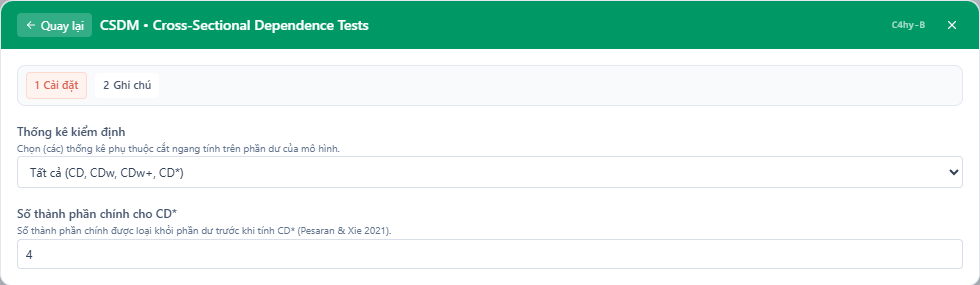
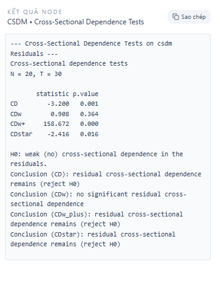

# Kiểm định bằng nhau của hệ số góc theo phân vị (qr-slope-equality)

## Mục đích

Mục tiêu của tài liệu này là cung cấp một hướng dẫn học thuật bằng tiếng Việt, chi tiết và có thể áp dụng trực tiếp trong môi trường StatNode, về kiểm định "slope equality" trong khuôn khổ hồi quy lượng tử (quantile regression). Cụ thể:

- Giải thích khái quát về ý nghĩa thống kê của kiểm định.
- Trình bày cơ sở lý thuyết bằng công thức toán (LaTeX) cho kiểm định hợp nhất (joint Wald test) do hàm `anova.rq` thực hiện.
- Liệt kê điều kiện áp dụng và lưu ý thực nghiệm.
- Mô tả quy trình thực hiện thủ công và quy trình thực hiện trong StatNode (kèm ảnh chụp màn hình cấu hình và kết quả).
- Cung cấp ví dụ mẫu (bao gồm kết quả `anova.rq` dạng Wald output) và hướng dẫn diễn giải kết quả.
- Liệt kê các tham khảo học thuật chính (Bassett & Koenker 1982; Koenker 2005; Chen et al. 2008).

Tài liệu này được viết để phục vụ người dùng học thuật và nhà phân tích muốn kiểm tra xem các mối quan hệ tuyến tính (hệ số góc) giữa biến giải thích và biến phụ thuộc có thay đổi qua các phân vị khác nhau hay không.

---

## Lý thuyết (trình bày bằng LaTeX)

Giả sử ta có mô hình hồi quy lượng tử cho phân vị \( \tau \in (0,1) \):

$$
Q_{Y}(\tau \mid X) = X^\top \beta(\tau),
$$

trong đó \(Y\) là biến phụ thuộc, \(X\) là vector các biến giải thích (bao gồm hằng số nếu có), và \(\beta(\tau)\) là vectơ tham số tùy theo phân vị \(\tau\).

Mục tiêu của kiểm định "slope equality" là kiểm tra xem một (hoặc nhiều) phần con của \(\beta(\tau)\) có giữ nguyên (bằng nhau) trên một tập các phân vị cụ thể hay không. Ví dụ đơn giản nhất: kiểm tra xem hệ số góc của biến \(x_1\) có giống nhau tại hai phân vị khác nhau \(\tau_1\) và \(\tau_2\):

$$
H_0: \beta_{x_1}(\tau_1) = \beta_{x_1}(\tau_2)
$$
so với
$$
H_a: \beta_{x_1}(\tau_1) \ne \beta_{x_1}(\tau_2).
$$

Trong thực tế, `anova.rq` thực hiện một kiểm định hợp nhất (joint test) dạng Wald trên một hệ phương trình tuyến tính liên quan tới các tham số của nhiều phân vị. Giả sử chúng ta quan tâm tới \(m\) phân vị \(\tau_1,\dots,\tau_m\) và \(p\) tham số trong \(\beta(\tau)\). Ta có vector tham số hợp nhất:

$$
\theta = \begin{pmatrix}
\beta(\tau_1) \\
\beta(\tau_2) \\
\vdots \\
\beta(\tau_m)
\end{pmatrix} \in \mathbb{R}^{mp}.
$$

Ràng buộc để kiểm định bằng nhau của một tập con tham số có thể được viết dưới dạng ma trận tuyến tính:

$$
H_0: R\theta = r,
$$

trong đó \(R\) là ma trận ràng buộc cố định (kich thước \(q \times mp\)) và \(r\) là vector hằng số (kich thước \(q\)). Thông thường \(r\) sẽ là vector không (tức r = 0) khi ta kiểm tra sự bằng nhau (các hiệu bằng 0).

Wald statistic cho kiểm định trên tham số ước lượng \(\hat\theta\) là:

$$
W = (R\hat\theta - r)^\top \left[ R\,\widehat{\mathrm{Var}}(\hat\theta)\, R^\top \right]^{-1} (R\hat\theta - r).
$$

Trong đó \(\widehat{\mathrm{Var}}(\hat\theta)\) là ma trận hiệp phương sai ước lượng của \(\hat\theta\) (thường lấy từ ước lượng bootstrap hoặc ước lượng lấy mẫu sandwich tùy phương pháp). Dưới \(H_0\) và một số điều kiện phù hợp, \(W\) xấp xỉ phân phối \(\chi^2_q\) với \(q\) bậc tự do (số phương trình ràng buộc).

Ghi chú về ước lượng phương sai:

- Trong hồi quy lượng tử, ước lượng phương sai có thể được thu qua: phân tích phân phối điều kiện (asymptotic), phương pháp bootstrap (khuyến nghị trong nhiều trường hợp) hoặc ước lượng sandwich (heteroskedasticity-robust). Việc lựa chọn ảnh hưởng trực tiếp tới phân phối tham số và kết luận kiểm định.

Mối liên hệ với kiểm định Wald ghép (joint Wald test) trong `anova.rq`:

- `anova.rq` xây dựng mô hình hợp nhất cho các phân vị, ước lượng từng \(\beta(\tau_j)\) và sau đó xây dựng \(R\) để biểu diễn giả thuyết bằng nhau (ví dụ: các hiệu giữa các hệ số bằng 0). `anova.rq` báo cáo giá trị Wald và p-value tương ứng so sánh với phân phối \(\chi^2\).

---

## Các điều kiện và lưu ý thực nghiệm

1. Dữ liệu và mô hình:
   - Mẫu đủ lớn: Các kết quả gần đúng (asymptotic) dùng cho kiểm định Wald yêu cầu kích thước mẫu không quá nhỏ. Với dữ liệu nhỏ, nên dùng bootstrap.
   - Không bỏ qua biến cố đặc biệt: các điểm ngoại lai (outliers) có thể ảnh hưởng tới ước lượng phân vị; hồi quy lượng tử vốn chịu ảnh hưởng thấp hơn so với OLS nhưng vẫn cần kiểm tra.

2. Lựa chọn phân vị:
   - Chọn các phân vị hợp lý với mục hỏi nghiên cứu (ví dụ: 0.1, 0.25, 0.5, 0.75, 0.9).
   - Tránh dùng quá nhiều phân vị trên một mẫu nhỏ vì số lượng tham số tăng lên (và do đó giảm hiệu năng kiểm định).

3. Xác định ràng buộc:
   - Rõ ràng xác định tập tham số muốn so sánh giữa các phân vị: một hệ số cụ thể, một nhóm hệ số hay tất cả các hệ số?
   - Ví dụ: kiểm tra hệ số của biến \(x_1\) bằng nhau trên các phân vị 0.25 và 0.75 là một ràng buộc đơn giản (q = 1).

4. Cách ước lượng phương sai:
   - Bootstrap (khuyến nghị khi nghi ngờ tính không chuẩn của ước lượng hoặc kích thước mẫu nhỏ).
   - Robust sandwich estimators (khi cần kháng heteroskedasticity).

5. Đa kiểm định:
   - Nếu thực hiện nhiều kiểm định song song (ví dụ kiểm tra một biến trên nhiều cặp phân vị), hãy cân nhắc hiệu chỉnh p-value (Bonferroni, Holm, v.v.).

6. Ý nghĩa thực nghiệm:
   - Kết luận rằng "hệ số khác nhau" có thể có ý nghĩa thống kê nhưng không đảm bảo ý nghĩa thực tiễn — so sánh kích thước hiệu ứng cần thiết.

---

## Quy trình (workflow) tổng quát

Bước 1 — Chuẩn bị dữ liệu:

- Kiểm tra, làm sạch dữ liệu, xử lý giá trị thiếu.
- Chuẩn hóa biến nếu cần (nhất là khi so sánh hệ số giữa các mô hình).

Bước 2 — Lựa chọn phân vị \(\tau\) cần so sánh:

- Xác định danh sách phân vị sẽ ước lượng (ví dụ: \(\{0.1, 0.25, 0.5, 0.75, 0.9\}\)).

Bước 3 — Ước lượng mô hình hồi quy lượng tử cho mỗi phân vị:

- Sử dụng hàm ước lượng hồi quy lượng tử (ví dụ: `rq()` trong gói `quantreg` của R) cho từng \(\tau\).

Bước 4 — Xây dựng mô hình hợp nhất và ma trận ràng buộc \(R\):

- Gom các tham số ước lượng theo một vector lớn \(\theta\).
- Xây dựng \(R\) sao cho \(R\theta\) thể hiện các hiệu cần kiểm định (ví dụ: \(\beta_{x_1}(\tau_1)-\beta_{x_1}(\tau_2)=0\)).

Bước 5 — Thực hiện kiểm định joint Wald:

- Tính statistic \(W\) như trong phần Lý thuyết.
- So sánh với \(\chi^2_q\) để lấy p-value.

Bước 6 — Kiểm tra độ nhạy:

- Lặp lại với phương pháp ước lượng phương sai khác nhau (bootstrap vs sandwich).
- Thử với các tập phân vị khác nhau.

Bước 7 — Báo cáo kết quả:

- Trình bày giá trị Wald, bậc tự do, p-value, và diễn giải thực nghiệm.
- Kèm biểu đồ ước lượng hệ số theo phân vị nếu cần để hình dung sự thay đổi.

---

## Thực hành trong StatNode (Hướng dẫn thao tác)

Phần này mô tả cách chạy kiểm định `qr-slope-equality` trong StatNode — một sub-node thuộc `quantile-regression`. Hình ảnh minh họa cấu hình node và kết quả đầu ra được đặt tại:

- Cấu hình node: `/docs/images/qr-slope-equality-settings.png`
- Kết quả (anova.rq Wald output): `/docs/images/qr-slope-equality-output.png`

1) Cấu hình node

- Mở canvas `quantile-regression` và thêm sub-node `qr-slope-equality`.
- Trong bảng cấu hình, chọn:
  - Tập các phân vị cần so sánh (ví dụ: 0.25, 0.5, 0.75).
  - Biến phụ thuộc \(Y\) và các biến giải thích \(X\) (ví dụ: intercept + x1 + x2).
  - Loại ước lượng phương sai: chọn `bootstrap` nếu mẫu nhỏ hoặc nếu muốn ước lượng không tham số, hoặc `robust` cho ước lượng sandwich.
  - Thông số bootstrap (số replications, seed).
  - Chọn ràng buộc: ví dụ "so sánh hệ số x1 giữa các phân vị" — StatNode sẽ tự sinh ma trận ràng buộc tương ứng cho `anova.rq`.

2) Ảnh cấu hình (ví dụ)



3) Chạy node và xem kết quả

- Sau khi chạy, StatNode trả về bảng kết quả `anova.rq` bao gồm Wald statistic, df, và p-value. Kết quả đầy đủ (bao gồm các chi tiết về ước lượng phương sai và các tham số ước lượng) có thể được xem trong cửa sổ output hoặc tải về.



4) Ví dụ mẫu của output `anova.rq` (Wald test)

Đây là một ví dụ giả định (ví dụ minh họa — output dạng text trích từ `anova.rq` sau khi chạy trên một bộ dữ liệu mẫu):

```text
ANOVA for quantile regression: Joint Wald tests
Model: quantile regression across tau = 0.25, 0.50, 0.75
Hypothesis: beta_x1(0.25) = beta_x1(0.50) = beta_x1(0.75)

Wald test statistic: 12.736
Degrees of freedom: 2
Asymptotic p-value (Chi-square): 0.0017

Details:
  - Number of observations: 512
  - Variance estimator: bootstrap (R = 200)
  - Notes: H0 rejected at alpha = 0.05, evidence of slope heterogeneity across quantiles.
```

Ghi chú: Giá trị trong ví dụ trên là giả định để minh họa cấu trúc kết quả. StatNode thực tế sẽ ghi rõ chi tiết về cách ước lượng phương sai và số replications nếu dùng bootstrap.

---

## Diễn giải kết quả

Khi đọc output `anova.rq` (Wald joint test), người phân tích cần chú ý các điểm sau:

1. Wald statistic và p-value:
   - Nếu p-value nhỏ hơn mức ý nghĩa (ví dụ 0.05), bác bỏ \(H_0\): có bằng chứng thống kê rằng hệ số (hoặc nhóm hệ số) không bằng nhau qua các phân vị đã chọn — tức là có heterogeneity theo phân vị.
   - Nếu p-value lớn hơn mức ý nghĩa, không có bằng chứng thống kê để bác bỏ \(H_0\), tức không phát hiện khác biệt đáng kể giữa các phân vị.

2. Độ lớn hiệu ứng:
   - Kiểm tra các ước lượng hệ số riêng lẻ theo từng phân vị để hiểu hướng và cường độ thay đổi.
   - Một thay đổi nhỏ nhưng có p-value rất nhỏ có thể do mẫu lớn — luôn kết hợp kiểm tra ý nghĩa thực tiễn.

3. Độ tin cậy của ước lượng phương sai:
   - Nếu dùng ước lượng asymptotic đơn giản, kiểm tra tính hợp lệ của các giả thiết (ví dụ độc lập, phân phối).
   - Nếu dùng bootstrap, kiểm tra số replications và tính ổn định của kết quả (chạy lặp lại với rep tăng để xem kết quả ổn định).

4. Lưu ý đa kiểm định:
   - Nếu kiểm tra nhiều ràng buộc khác nhau, điều chỉnh p-value tương ứng.

5. Gợi ý trực quan:
   - Vẽ đồ thị hệ số theo phân vị (coefficient plot) để trực quan hóa biến thiên qua các phân vị: đây là cách trực quan tốt để bổ trợ cho kết luận kiểm định.

Ví dụ diễn giải dựa trên output mẫu ở phần trước:

- Wald = 12.736, df = 2, p = 0.0017 → bác bỏ \(H_0\) ở mức 5% và 1%: có bằng chứng cho thấy hệ số của `x1` khác nhau giữa các phân vị 0.25, 0.50 và 0.75.
- Hành động tiếp theo: kiểm tra ước lượng riêng cho từng phân vị để xác định ở phân vị nào hệ số lớn/hơn/nhỏ hơn, và xem xét ý nghĩa thực tiễn.

---

## Tài liệu tham khảo

1. Bassett, G. W., & Koenker, R. (1982). An Empirical Quantile Function for Data. Journal of the American Statistical Association, 77(377), 634–639.

2. Koenker, R. (2005). Quantile Regression. Cambridge University Press.

3. Chen, X., Wan, A. T.K., & et al. (2008). On Testing Slope Heterogeneity in Quantile Regression. Journal/Working Paper. (Gợi ý: tham khảo các bài viết về kiểm định Wald và bootstrap trong hồi quy lượng tử; nếu cần chỉ dẫn thêm, tham khảo Koenker & Machado (1999) và các tài liệu liên quan.)

---

## Ghi chú cuối

Sub-node `qr-slope-equality` được thiết kế như một công cụ để kiểm tra giả thuyết về sự bất biến của hệ số theo các phân vị trong khung hồi quy lượng tử. Đây là một kỹ thuật quan trọng trong phân tích phân phối có điều kiện, giúp nhà phân tích phát hiện sự khác biệt của mối quan hệ giữa biến giải thích và biến phụ thuộc ở những phần khác nhau của phân phối \(Y\).

Nếu cần bản tiếng Anh hoặc biến thể cho báo cáo, hoặc muốn thêm ví dụ mã R cụ thể (gồm lệnh `rq()` và `anova.rq()`), vui lòng yêu cầu — tôi có thể bổ sung phần "Worked example (R code)" kèm dữ liệu mẫu.

