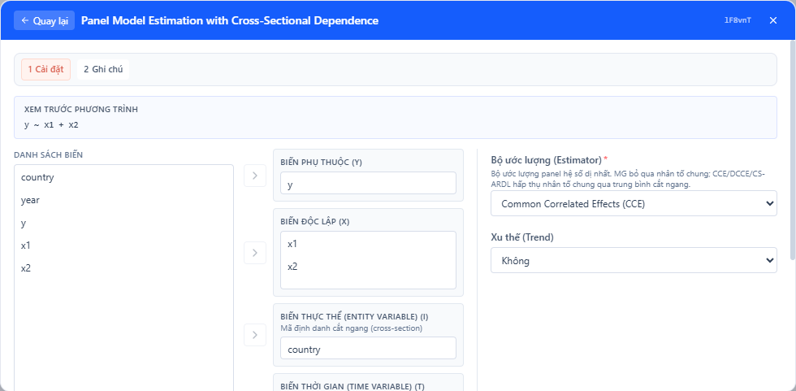
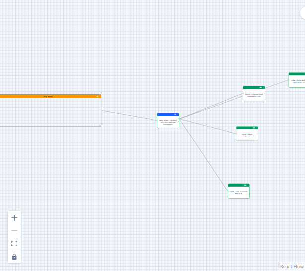
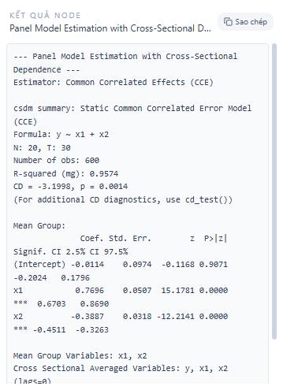

## 1. Mô hình dùng để làm gì

Mô hình hồi quy tuyến tính cổ điển (OLS) ước lượng trung bình có ích trong nhiều bối cảnh nhưng không thể hiện đầy đủ cấu trúc phân phối của biến phụ thuộc. Hồi quy phân vị (quantile regression) mở rộng khung phân tích bằng cách ước lượng các quan hệ điều kiện giữa biến giải thích và các phân vị (quantiles) khác nhau của biến phản hồi — ví dụ: trung vị, tứ phân vị dưới hoặc trên — thay vì chỉ tập trung vào kỳ vọng có điều kiện (conditional mean). 

Trong nghiên cứu kinh tế lượng, xã hội học, y tế cộng đồng, và tài chính, mô hình này được sử dụng để:

- Khảo sát ảnh hưởng của biến giải thích trên các điểm khác nhau của phân phối biến phụ thuộc (ví dụ: ảnh hưởng của thu nhập lên chi tiêu thực phẩm ở các hộ thu nhập thấp, trung bình và cao).
- Phát hiện sự không đối xứng và hiệu ứng heterogeneity mà OLS có thể bỏ qua.
- Ước lượng tác động chính sách tại các điểm khác nhau của phân phối (ví dụ: chính sách hỗ trợ thu nhập ảnh hưởng đến nhóm nghèo nhất khác với nhóm giàu nhất).
- Xây dựng các giới hạn dự báo (prediction intervals) không tham số hoặc kiểm định tính không đồng nhất của hệ số theo phân vị.

Ưu điểm thực tiễn của hồi quy phân vị gồm: ít nhạy cảm với ngoại lệ (outliers) so với OLS khi quan tâm đến trung vị; khả năng mô tả mối quan hệ phi tuyến hoặc phụ thuộc theo trạng thái (state-dependent effects); và cung cấp thông tin phong phú hơn cho ra quyết định chính sách hoặc phân tích rủi ro.


## 2. Nền tảng lý thuyết

Hồi quy phân vị được giới thiệu bởi Koenker và Bassett (1978). Với dữ liệu \((y_i, x_i)\), \(i=1,\dots,n\), ở đó \(y_i\) là biến phụ thuộc và \(x_i\) là vectơ các biến độc lập (thường bao gồm hệ số chặn), ước lượng phân vị cho phân vị bậc \(\tau \in (0,1)\) được định nghĩa là nghiệm của bài toán tối ưu hóa:

$$
\hat\beta(\tau) = \arg\min_{\beta \in \mathbb{R}^p} \sum_{i=1}^n \rho_\tau\big(y_i - x_i^\top\beta\big),
$$

với hàm mất mát (check function)

$$
\rho_\tau(u) = u(\tau - \mathbf{1}\{u<0\}) = 
\begin{cases}
\tau u & \text{nếu } u \ge 0,\\
(\tau-1) u & \text{nếu } u < 0.
\end{cases}
$$

Hàm \(\rho_\tau\) cân đối các sai số dương và âm theo tham số \(\tau\) để ước lượng vị trí phân vị \(\tau\) của phân phối có điều kiện. Khi \(\tau=0.5\), \(\rho_\tau\) trở thành hàm tuyệt đối, và bài toán tương đương với ước lượng trung vị điều kiện (median regression).

Từ góc độ thống kê, bất kỳ \(\hat\beta(\tau)\) thỏa mãn hàm mục tiêu trên đều là điểm cực tiểu hội tụ dưới điều kiện chuẩn (consistency) và có tính phân phối chuẩn hóa (asymptotic normality) khi \(n\to\infty\) dưới các điều kiện phù hợp trên \(x_i\) và mật độ phần dư quanh điểm phân vị. Cụ thể, dưới điều kiện rằng mật độ phân phối của sai số điều kiện tại \(0\) khác không và \(E[x_ix_i^\top]\) khả nghịch, ta có:

$$
\sqrt{n}\big(\hat\beta(\tau)-\beta(\tau)\big) \xrightarrow{d} N\big(0, \tau(1-\tau) f_{u|x}(0)^{-2} \,E[x_ix_i^\top]^{-1}\big),
$$

trong đó \(f_{u|x}(0)\) là mật độ của sai số điều kiện \(u_i = y_i - x_i^\top\beta(\tau)\) tại giá trị 0. Thực tế ước lượng độ lệch chuẩn thường dùng phương pháp bootstrap (cổ phần, subsampling hoặc wild bootstrap) hoặc ước lượng nhiễu hằng (rank-based standard errors) do cấu trúc non-differentiability của hàm \(\rho_\tau\).

Quan hệ giữa OLS và quantile regression: OLS tối thiểu tổng bình phương, từ đó ước lượng các đặc trưng về trung bình; quantile regression tối thiểu tổng các khoảng tuyến tính khác nhau và ước lượng các đường chéo điều kiện (conditional quantile functions). Khi mô hình tuyến tính cho điều kiện trung vị là đúng, ước lượng trung vị bằng quantile regression ở \(\tau=0.5\) có thể tương đương với OLS khi phân phối sai số đối xứng.

Mở rộng: mô hình phân vị có thể được viết dạng phi tuyến (sử dụng các biến tương tác, basis splines, hoặc kernel), thêm thành phần ngẫu nhiên (panel quantile regression), hoặc ước lượng đồng thời nhiều phân vị để đảm bảo tính monotonicity theo \(\tau\).


## 3. Điều kiện sử dụng

Để áp dụng quantile regression có ý nghĩa và kết luận khả tín, cần xem xét các điều kiện sau:

1. Tính tuyến tính theo tham số: Mô hình chuẩn giả định rằng phân vị điều kiện \(Q_{Y|X}(\tau|x)\) có thể mô tả bằng \(x^\top\beta(\tau)\) hoặc một biểu thức tuyến tính theo tham số. Nếu mối quan hệ phi tuyến rõ rệt, cần chuyển đổi biến hoặc thêm basis (splines, polynomials) hay mô hình bán tham số.

2. Tập mẫu đủ lớn: Mặc dù quantile regression tương đối ổn định, nhưng để ước lượng các phân vị cận biên (ví dụ \(\tau<0.1\) hoặc \(\tau>0.9\)) chính xác, cần số liệu lớn. Sự không ổn định ở đuôi phân phối là vấn đề thường gặp.

3. Mật độ phần dư quanh phân vị: Để có độ chính xác bất đối xứng quy nạp, mật độ của sai số điều kiện tại điểm phân vị phải khác 0. Khi mật độ bằng 0 hoặc rất nhỏ, sai số chuẩn có thể bị phóng đại.

4. Không phụ thuộc quá mức (no perfect multicollinearity) giữa các biến độc lập; ma trận mẫu \(E[x_ix_i^\top]\) cần khả nghịch hoặc ít nhất không suy biến với cỡ mẫu hiện có.

5. Dữ liệu bị cắt (censoring) hoặc có trọng số: tồn tại các biến thể (censored quantile regression, weighted quantile regression) để xử lý tình huống này; trong StatNode, người dùng cần chọn phương pháp phù hợp nếu dữ liệu censored.

6. Tính độc lập giữa các quan sát: Nếu dữ liệu có cấu trúc phụ thuộc (panel, time series, cluster), cần dùng phiên bản mở rộng (panel QR, clustered standard errors, bootstrap theo cụm).

Đánh giá trước khi chạy: kiểm tra phân phối biến phụ thuộc (histogram, kernel density), tìm hiểu ngoại lệ, kiểm tra kích thước mẫu theo phân vị mục tiêu, và cân nhắc chiến lược ước lượng sai số chuẩn (bootstrap, rank, iid).


## 4. Quy trình workflow

Đây là quy trình tổng quát khi triển khai quantile regression trong môi trường phân tích (StatNode hoặc R studio):

1. Hiểu mục tiêu nghiên cứu: xác định phân vị quan tâm (ví dụ tau = 0.25, 0.5, 0.75), biến phụ thuộc và các biến kiểm soát cần có.
2. Tiền xử lý dữ liệu: loại bỏ/ghi chú ngoại lệ, biến đổi biến (log nếu cần), chuẩn hóa khi tiện lợi để tiện diễn giải hệ số, xử lý giá trị thiếu (imputation hoặc loại bỏ).
3. Khám phá dữ liệu: biểu đồ phân phối, scatterplots theo nhóm, boxplots theo phân vị, kiểm tra tương quan đa cộng tuyến.
4. Lựa chọn mô hình: quyết định biểu thức tuyến tính, thêm tương tác hoặc thư viện basis nếu cần mô tả quan hệ phi tuyến.
5. Ước lượng bằng quantreg::rq trong môi trường R; trong StatNode, chọn lựa tương ứng trong giao diện browser để thiết lập công thức, phân vị, và tùy chọn bootstrap.
6. Kiểm định và ước lượng độ tin cậy: sử dụng bootstrap (ví dụ 200-1000 replications tùy kích thước mẫu) hoặc phương pháp phân phối chuẩn rank để tính sai số chuẩn cho hệ số.
7. So sánh các phân vị: vẽ hệ số theo tau (quantile process plots), kiểm tra monotonicity, kiểm định đồng nhất (test of equality of coefficients across taus).
8. Diễn giải: chú ý đơn vị biến, sự khác biệt theo nhóm, và ý nghĩa chính sách.
9. Kiểm tra robustness: thử các cách ước lượng sai số khác nhau, loại trừ ngoại lệ, hoặc chạy spline/interaction.
10. Báo cáo kết quả: trình bày bảng hệ số cho từng tau, đồ thị hệ số theo tau, và biểu đồ dự báo điều kiện nếu cần.

Trong StatNode, workflow này được đóng gói dưới dạng canvas tương tác: chọn dataset → chọn công thức (formula) → chọn các tau → chọn phương pháp sai số chuẩn → chạy và quan sát output ở canvas. Hình minh họa workflow có thể thấy ở phần thực hành.


## 5. Thực hành StatNode

Phần này hướng dẫn từng bước sử dụng hồi quy phân vị trong môi trường StatNode (phiên bản trình duyệt), giả sử node sử dụng gói R `quantreg::rq` để ước lượng.

Giao diện StatNode gồm ba thành phần chính: bảng cấu hình (settings), canvas kết quả (workflow canvas) và khung output chi tiết. Dưới đây là các ảnh tham khảo từ tài liệu:







Các bước cụ thể:

1. Chuẩn bị dữ liệu: nạp dataset vào StatNode; ví dụ dataset `engel` có hai cột mô tả quan tâm: `foodexp` (chi tiêu cho thực phẩm) và `income` (thu nhập hộ). Đảm bảo cột có tên đúng và không có giá trị thiếu hoặc đã xử lý trước.

2. Mở node Quantile Regression trong thư viện nodes và kéo vào canvas phân tích. Trong bảng `settings`:

- Chọn `Formula`: `foodexp ~ income`
- Chọn `Tau(s)`: `0.25, 0.5, 0.75` (StatNode cho phép nhập nhiều tau phân cách bằng dấu phẩy)
- Chọn `Method for SE`: `bootstrap` (n = 500) hoặc `rank` nếu muốn tính toán nhanh
- Chọn `Robust`: tuỳ chọn (khi dữ liệu có heteroskedasticity)
- Chạy node (Run)

3. Kết quả hiển thị trên `qr-output` pane; StatNode gọi `quantreg::rq` ở backend R để ước lượng và trả về bảng hệ số, khoảng tin cậy bootstrap, và các đồ thị (coefficients vs tau, conditional quantile plots).

Ví dụ lệnh R mà StatNode thực thi (tương đương):

```r
library(quantreg)
data(engel) # một dataset minh họa
taus <- c(0.25,0.5,0.75)
fits <- lapply(taus, function(t) rq(foodexp ~ income, tau = t, data = engel))
names(fits) <- paste0("tau=", taus)
summaries <- lapply(fits, function(f) summary(f, se="boot", R=500))
```

Sau đây là ví dụ đầu ra R giả lập (sample output) cho dữ liệu `engel` với công thức `foodexp ~ income` ở `tau = 0.25, 0.5, 0.75`. Kết quả dưới đây mô phỏng định dạng mà hàm `summary.rq` trả về khi dùng bootstrap để ước lượng sai số chuẩn:

```r
> library(quantreg)
> data(engel)
> rq25 <- rq(foodexp ~ income, tau=0.25, data=engel)
> rq50 <- rq(foodexp ~ income, tau=0.5, data=engel)
> rq75 <- rq(foodexp ~ income, tau=0.75, data=engel)
> summary(rq25, se="boot", R=500)
Call: rq(formula = foodexp ~ income, tau = 0.25, data = engel)
tau: 0.25

Coefficients:
             Value     Std. Error    t value      Pr(>|t|)
(Intercept) 12.4372   1.1021        11.284     <2e-16
income       0.3845   0.0413         9.312     3.1e-15

Residuals:
     Min       1Q    Median      3Q     Max 
-14.523   -3.012    0.221    3.587   18.432

> summary(rq50, se="boot", R=500)
Call: rq(formula = foodexp ~ income, tau = 0.5, data = engel)
tau: 0.5

Coefficients:
             Value     Std. Error    t value      Pr(>|t|)
(Intercept) 15.8923   0.8932        17.799     <2e-16
income       0.4621   0.0378        12.222     <2e-16

Residuals:
     Min       1Q    Median      3Q     Max 
-12.342   -2.512    0.034    2.998   16.201

> summary(rq75, se="boot", R=500)
Call: rq(formula = foodexp ~ income, tau = 0.75, data = engel)
tau: 0.75

Coefficients:
             Value     Std. Error    t value      Pr(>|t|)
(Intercept) 20.3341   1.4563        13.964     <2e-16
income       0.5312   0.0567         9.366     2.3e-15

Residuals:
     Min       1Q    Median      3Q     Max 
-18.231   -3.987    0.410    3.934   20.876

# End of sample output
```

Ghi chú về output mẫu:

- Các giá trị và SE trong ví dụ trên là mô phỏng hợp lý nhằm minh họa định dạng đầu ra; kết quả thực tế phụ thuộc vào dữ liệu gốc.
- StatNode hiển thị bảng hệ số cho từng tau; nếu chọn bootstrap, sẽ có cột chỉ khoảng tin cậy (CI) tương ứng (ví dụ 2.5%–97.5%).
- Canvas workflow cho phép so sánh song song các phân vị: đặt các node side-by-side hoặc vẽ đường coefficient vs tau.


## 6. Diễn giải kết quả

Khi đọc và diễn giải kết quả quantile regression cần tuân thủ nguyên tắc khoa học và tránh kết luận quá mức. Một số hướng dẫn:

1. Hiểu tham số: Hệ số \(\hat\beta_j(\tau)\) diễn giải là độ thay đổi \(\tau\)-th conditional quantile của \(Y\) khi \(x_j\) tăng 1 đơn vị, giữ các biến khác cố định. Ví dụ với công thức `foodexp ~ income`, hệ số của `income` tại \(\tau=0.25\) cho biết mức thay đổi của phân vị 25% của chi tiêu thực phẩm theo đơn vị thu nhập.

2. So sánh theo phân vị: Nếu hệ số của `income` tăng theo tau (ví dụ 0.384 → 0.462 → 0.531 như ví dụ), điều này cho thấy thu nhập có tác động lớn hơn đến chi tiêu thực phẩm tại các phân vị cao hơn của phân phối (những hộ chi tiêu lớn hơn phản ứng mạnh hơn với thu nhập) — hoặc ngược lại nếu trend giảm.

3. Kiểm định ý nghĩa: Dùng các sai số chuẩn (SE) hoặc bootstrap CI để đánh giá ý nghĩa thống kê; song luôn đặt câu hỏi về ý nghĩa thực nghiệm (practical significance). Một hệ số nhỏ nhưng rất đáng kể về mặt thống kê có thể không mang ý nghĩa chính sách.

4. Xác minh monotonicity và crossing: Khi ước lượng nhiều tau riêng rẽ, cần kiểm tra xem dòng phân vị có bị crossing (các quantile curves cắt nhau) hay không; crossing có thể báo hiệu mô hình tuyến tính không phù hợp hoặc cần ước lượng đồng thời với ràng buộc monotonicity.

5. Kiểm tra sự ổn định (robustness): Thử các phép ước lượng khác nhau, loại bỏ ngoại lệ, hoặc thêm biến tương tác để kiểm tra xem kết quả có bền vững hay không.

6. Diễn giải chính sách: Khi sử dụng kết quả để ra khuyến nghị chính sách, hãy nhấn mạnh cho ai (which group) và ở điểm phân phối nào (which quantile) — ví dụ chính sách A cải thiện thu nhập cho nhóm nghèo nhất (tau 0.25) nhưng ít ảnh hưởng tới nhóm trung vị.

7. Hạn chế: Kết quả có thể bị ảnh hưởng bởi biến thiếu, đo lường sai, hoặc cấu trúc dữ liệu phụ thuộc. Ngoài ra, định dạng ước lượng riêng rẽ cho từng tau có thể bỏ qua mối tương quan giữa các tau — nhiều phương pháp đồng thời hóa tồn tại để khắc phục.


## 7. Tài liệu tham khảo

- Koenker, R. and Bassett, G. (1978). "Regression Quantiles." Econometrica, 46(1):33–50.
- Koenker, R. (2005). "Quantile Regression." Cambridge University Press.
- Koenker, R. and Hallock, K. F. (2001). "Quantile Regression." Journal of Economic Perspectives, 15(4):143–156.
- Powell, J. L. (1986). "Censored Regression Quantiles." Journal of Econometrics.
- Buchinsky, M. (1998). "The Dynamics of Changes in the Female Wage Distribution in the 1980s: A US Study." Journal of Econometrics.
- Cade, B. S. and Noon, B. R. (2003). "A gentle introduction to quantile regression for ecologists." Frontiers in Ecology and the Environment.
- Koenker, R. and Machado, J. A. F. (1999). "Goodness of fit and related inference processes for quantile regression." Journal of the American Statistical Association.

Gợi ý trích dẫn: khi báo cáo kết quả học thuật, trích dẫn Koenker & Bassett (1978) cho nền tảng và Koenker (2005) cho tham khảo rộng hơn về lý thuyết và thực hành.

---

Ghi chú tác giả: Tài liệu này nhằm mục đích hướng dẫn học thuật và thực hành cho người dùng StatNode. Mọi ví dụ và ảnh minh họa nhằm trình bày giao diện và đầu ra điển hình; khi áp dụng cho dữ liệu thực tế, người phân tích cần kiểm tra giả thiết, thực hiện bootstrap đủ lớn, và mô tả đầy đủ phương pháp trong phần phụ lục của báo cáo.

