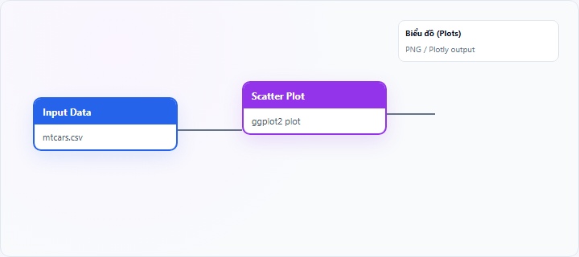
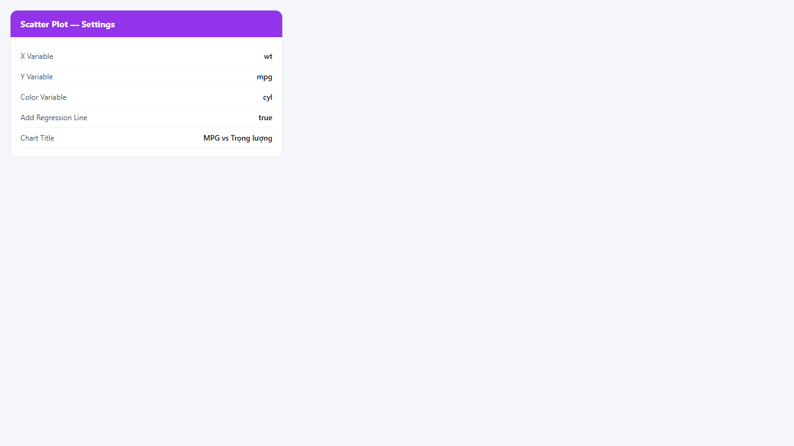
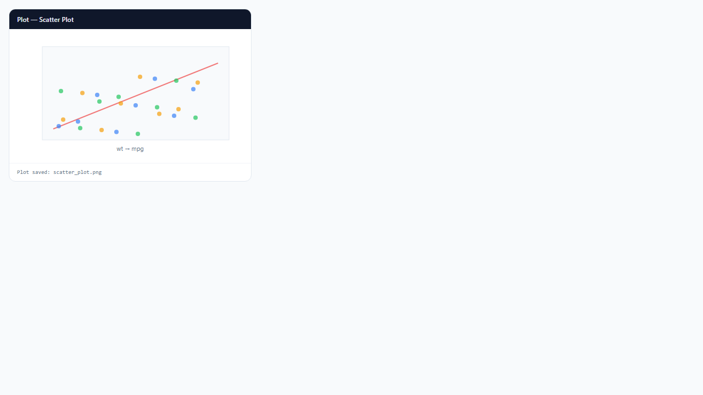

## 1. Biểu đồ phân tán (Scatter Plot) là gì?

**Scatter plot** (biểu đồ phân tán) vẽ từng quan sát dưới dạng **điểm** trên mặt phẳng hai chiều: trục X và trục Y tương ứng hai biến số. Mật độ và hướng của đám điểm phản ánh **mối liên hệ** giữa hai biến; có thể tô màu theo biến phân loại thứ ba hoặc chồng **đường hồi quy tuyến tính** (`geom_smooth(method = "lm")`).

Node **Scatter Plot** trên StatNode dùng **ggplot2** và tùy chọn **Plotly** cho phiên bản tương tác.

## 2. Biểu đồ phân tán (Scatter Plot) dùng để làm gì?

Scatter plot giúp:

- Nhận diện **quan hệ dương/âm** và **độ mạnh** liên kết trực quan
- Phát hiện **phi tuyến**, **heteroskedasticity** (dạng quạt), **outlier**
- So sánh **nhiều nhóm** khi dùng **Color Variable**

**Khi nên dùng:** hai biến số, đặc biệt trước hồi quy tuyến tính hoặc correlation.

**Khi không nên dùng:** một biến phân loại + một biến số so sánh nhóm (ưu tiên box/violin); chuỗi thời gian một biến (ưu tiên line chart).

**So sánh:** scatter cho từng cặp (X, Y); **corr-heatmap** tổng hợp tương quan của nhiều biến cùng lúc.

## 3. Thực hành trên phần mềm StatNode

Workflow cơ bản: kéo node **Input Data** (hoặc nguồn dữ liệu khác) → nối cổng **Data** vào node **Scatter Plot** → chạy workflow → xem biểu đồ tại panel **Biểu đồ** (Plots).

**Dữ liệu minh họa:** `mtcars`: `wt` (trọng lượng) và `mpg` (tiêu thụ nhiên liệu).

**Cấu hình node:**

- **X Variable**: `wt`
- **Y Variable**: `mpg`
- **Color Variable (optional)**: `cyl` (số xi-lanh) để tách nhóm
- **Add Regression Line**: bật để thêm đường LM và khoảng tin cậy
- **Chart Title**: `MPG vs Trọng lượng`

**Kết quả:**

## 4. Diễn giải kết quả

- **Đám điểm dốc xuống:** quan hệ âm — khi X tăng, Y giảm (ví dụ trọng lượng ↑, MPG ↓).
- **Đám điểm sát đường hồi quy:** liên hệ tuyến tính tương đối mạnh.
- **Đường cong hoặc điểm lệch xa:** phi tuyến hoặc outlier — xem xét transform, đa thức, hoặc robust regression.
- **Dạng quạt (phân tán tăng theo X):** heteroskedasticity — dùng SE robust (HC) trong hồi quy.
- **Nhiều màu tách rõ:** hiệu ứng nhóm — có thể cần biến giả (dummy) hoặc mô hình tương tác.

**Sai lầm:** suy diễn nhân quả chỉ từ scatter; bỏ qua outlier chi phối đường hồi quy.

## 5. Tài liệu tham khảo

1. Wickham, H. (2016). *ggplot2* (2nd ed.). Springer.
2. Wooldridge, J. M. (2019). *Introductory Econometrics* (7th ed.). Cengage.
3. Cleveland, W. S. (1993). *Visualizing Data*. Hobart Press.
4. R Documentation — `geom_point()`: https://ggplot2.tidyverse.org/reference/geom_point.html

---

Ghi chú: Đường hồi quy trên scatter là OLS đơn giản; không thay thế kiểm định giả thiết đầy đủ của mô hình hồi quy.