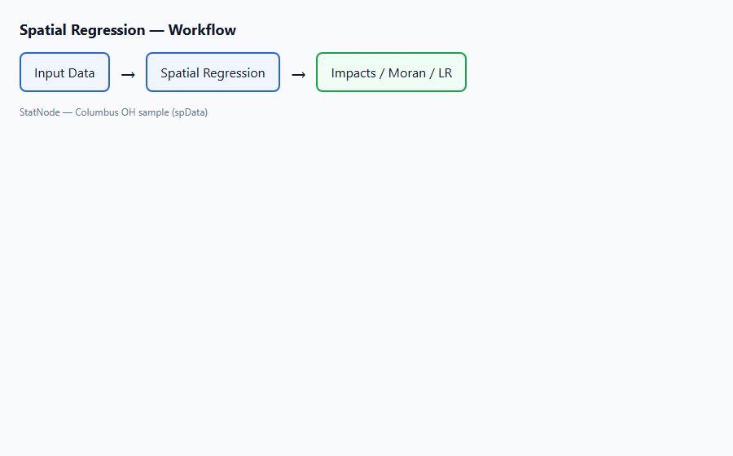
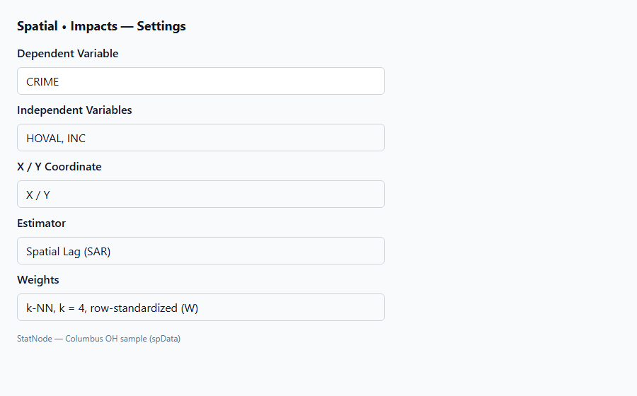
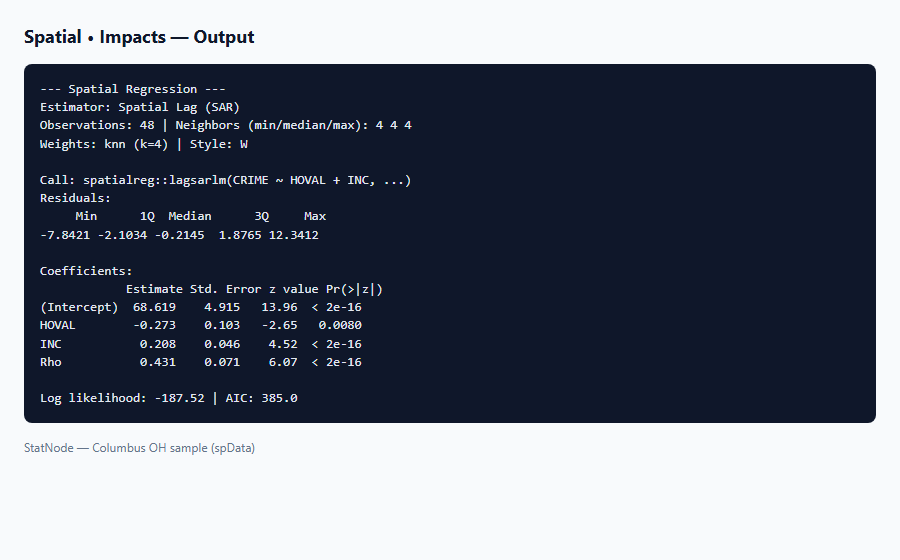

## 1. Mô hình / diagnostic này dùng để làm gì?

Sub-node **Spatial • Impacts (Direct / Indirect / Total)** tính **hiệu ứng biên không gian** theo khung LeSage & Pace (2009): tác động **trực tiếp** (direct), **gián tiếp** (indirect/spillover) và **tổng** (total) của mỗi biến giải thích lên biến phụ thuộc $y$, có kèm sai số chuẩn ước lượng bằng mô phỏng Monte Carlo.

Trong mô hình Spatial Lag (SAR), Spatial Durbin (SDM), Spatial Autocorrelation (SAC) hoặc Spatial Lag of X (SLX), hệ số $\boldsymbol{\beta}$ ước lượng từ `summary()` **không** bằng hiệu ứng biên trên $y$ mà nhà kinh tế lượng thường muốn báo cáo. Lý do: ma trận nhân tố $(I_n - \rho W)^{-1}$ lan truyền mọi thay đổi tại $x_{ik}$ sang toàn bộ hệ thống đơn vị không gian qua chuỗi láng giềng. Một tăng thu nhập tại quận $i$ có thể làm giảm tội phạm tại $i$ *và* ảnh hưởng tỷ lệ tội phạm tại các quận lân cận — phân tách direct/indirect/total làm rõ cơ chế này.

Sub-node gọi `spatialreg::impacts()` với số lần mô phỏng $R$ (mặc định 500), dùng cùng ma trận $W$ đã lưu từ node cha **Spatial Regression**. Chỉ áp dụng khi bộ ước lượng cha là **SAR, SDM, SAC hoặc SLX**; SEM và GM không được hỗ trợ vì định nghĩa impacts trong `spatialreg` không áp dụng cho error-only models theo cùng cách.

**Khi nào bắt buộc chạy impacts?** Bất cứ khi báo cáo SAR, SDM, SAC hoặc SLX cho đối tượng đọc không chuyên về ma trận $(I - \rho W)^{-1}$. Trong bài báo kinh tế lượng không gian, bảng impacts gần như là chuẩn mực bên cạnh bảng hệ số.

## 2. Nền tảng lý thuyết

### 2.1. Vì sao hệ số $\beta$ không đủ?

Xét SAR:

$$
y = \rho W y + X\boldsymbol{\beta} + \boldsymbol{\varepsilon}.
$$

Giải ra:

$$
y = (I_n - \rho W)^{-1} X\boldsymbol{\beta} + (I_n - \rho W)^{-1} \boldsymbol{\varepsilon}.
$$

Đạo hàm của $y_i$ theo $x_{jk}$ (thay đổi tại đơn vị $k$ của biến $j$) không đơn giản là $\beta_j$ mà phụ thuộc vào toàn bộ cấu trúc $W$ và $\rho$. Ma trận impacts theo biến $j$:

$$
M_j(\rho, W) = (I_n - \rho W)^{-1} \left( I_n \beta_j + W \theta_j \right),
$$

với $\theta_j = 0$ trong SAR thuần, $\theta_j \neq 0$ trong SDM và SLX (từ hệ số lag $WX$).

### 2.2. Ba loại impacts (LeSage & Pace, 2009)

Cho mỗi biến giải thích $x_j$, package `spatialreg` báo cáo:

**Direct impact (hiệu ứng trực tiếp):** trung bình các phần tử đường chéo của ma trận impacts — tác động trung bình của thay đổi $x_{jk}$ lên $y_k$ (đơn vị $k$ nơi thay đổi xảy ra), sau khi tính đến phản hồi qua $Wy$.

**Indirect impact (hiệu ứng gián tiếp / spillover):** trung bình các phần tử ngoài đường chéo — tác động của thay đổi tại $k$ lên mọi $y_i$, $i \neq k$.

**Total impact (hiệu ứng tổng):** direct + indirect — tác động cân bằng (equilibrium) trên toàn hệ thống khi $x_j$ tăng 1 đơn vị tại một đơn vị và lan truyền.

Ký hiệu tổng hợp (scalar summary) cho biến $j$:

$$
S_j^{\text{direct}} = \frac{1}{n} \operatorname{tr}(M_j), \quad
S_j^{\text{indirect}} = \frac{1}{n} \mathbf{1}'(M_j - \operatorname{diag}(M_j)) \mathbf{1}, \quad
S_j^{\text{total}} = S_j^{\text{direct}} + S_j^{\text{indirect}}.
$$

(Định nghĩa chính xác trong `impacts()` dùng trung bình mô phỏng; xem LeSage & Pace, 2009, Ch. 2–3.)

### 2.3. SAR thuần

Với SAR, $M_j = \beta_j (I_n - \rho W)^{-1}$. Khi $\rho \to 0$, total impact $\to \beta_j$. Khi $\rho > 0$, total impact thường **lớn hơn** $\beta_j$ vì lan truyền dương khuếch đại tác động. Direct impact thường **nhỏ hơn** $\beta_j$ vì một phần tác động "rò rỉ" sang láng giềng.

### 2.4. SDM và SLX

**SDM:** $y = \rho W y + X\boldsymbol{\beta} + WX\boldsymbol{\theta} + \boldsymbol{\varepsilon}$. Impacts phụ thuộc cả $\boldsymbol{\beta}$ lẫn $\boldsymbol{\theta}$. Kiểm định $\boldsymbol{\theta} = \mathbf{0}$ qua LR test (sub-node **Spatial • LR Test**, restricted = SAR) quyết định có cần SDM trước khi diễn giải impacts.

**SLX:** $y = X\boldsymbol{\beta} + WX\boldsymbol{\theta} + \boldsymbol{\varepsilon}$. Impacts vẫn được định nghĩa; indirect đến từ $\boldsymbol{\theta}$ (tác động của $Wx_j$ lên $y$ tại láng giềng). SLX dễ đọc hơn vì không có $\rho$, nhưng sub-node vẫn tổng hợp direct/indirect/total theo chuẩn LeSage & Pace.

### 2.5. SAC

SAC kết hợp lag $y$ và error spatial; `impacts()` áp dụng công thức mở rộng với cả $\rho$ và $\lambda$. Diễn giải phức tạp hơn SAR; nên ưu tiên SAC chỉ khi kiểm định mô hình ủng hộ.

### 2.6. Mô phỏng Monte Carlo cho sai số chuẩn

Đạo hàm impacts theo $\rho$, $\boldsymbol{\beta}$, $\boldsymbol{\theta}$ phi tuyến. LeSage & Pace (2009) đề xuất mô phỏng:

1. Lấy mẫu $\rho^{(r)}, \boldsymbol{\beta}^{(r)}, \boldsymbol{\theta}^{(r)}$ từ phân phối tiệm cận của ước lượng ML (dựa trên ma trận hiệp phương sai).
2. Tính impacts cho mỗi lần lặp $r = 1, \ldots, R$.
3. Sai số chuẩn = độ lệch chuẩn mẫu của $R$ giá trị impacts.

StatNode mặc định $R = 500$ và `set.seed(42)` để tái lập. Tăng $R$ lên 1000–2000 nếu cần ước lượng sai số chuẩn ổn định hơn (đổi thời gian chạy).

### 2.7. Quan hệ với hiệu ứng biên OLS

OLS: $\partial y_i / \partial x_{ij} = \beta_j$ (cố định, không spillover). SAR/SDM: impacts khác nhau theo $\rho$, $W$, và — với SDM/SLX — $\boldsymbol{\theta}$. So sánh total impact với hệ số OLS cho thấy **mức độ bỏ sót** nếu dùng mô hình sai.

### 2.8. Phân rã tỷ lệ spillover

Định nghĩa **tỷ lệ spillover** (spillover share) cho biến $j$:

$$
\text{Share}^{\text{indirect}}_j = \frac{S_j^{\text{indirect}}}{S_j^{\text{total}}} \quad \text{(khi } S_j^{\text{total}} \neq 0\text{)}.
$$

Với Columbus SAR minh họa, $\text{Share}^{\text{indirect}}_{\text{HOVAL}} \approx 0.43$ và $\text{Share}^{\text{indirect}}_{\text{INC}} \approx 0.43$: khoảng **43%** tác động cân bằng của mỗi biến giải thích lan sang láng giềng thay vì dừng tại đơn vị gốc. Tỷ lệ này tăng khi $\hat{\rho}$ tiến tới 1 và khi mạng láng giềng kết nối chặt (Bivand & Piras, 2015).

### 2.9. Ma trận nhân tố và giải thích hình học

Với SAR, $(I_n - \rho W)^{-1} = I_n + \rho W + \rho^2 W^2 + \cdots$ (chuỗi Neumann khi $|\rho| < 1$). Số hạng bậc $m$ mô tả lan truyền qua chuỗi **$m$ bước** láng giềng. Khi $k = 4$ trên Columbus, đường kính đồ thị láng giềng hữu hạn nên chuỗi hội tụ nhanh; với mạng thưa, indirect impact tích lũy qua nhiều bậc.

### 2.10. Impacts trong SAC

SAC có cả $\rho$ trên $y$ và $\lambda$ trên lỗi; `impacts()` điều chỉnh công thức nhân tố để phản ánh error spatial. Diễn giải direct/indirect/total vẫn theo LeSage & Pace (2009), nhưng độ tin cậy MC có thể giảm khi cả $\hat{\rho}$ và $\hat{\lambda}$ gần biên ổn định. Nên ưu tiên SAC chỉ khi LR test và residual Moran ủng hộ đặc tả kép.

## 3. Điều kiện sử dụng

1. **Bắt buộc có mô hình Spatial Regression cha** với metadata `statnode_listw` và `statnode_estimator`. Sub-node đọc $W$ và loại ước lượng từ object model — không tự xây lại $W$.

2. **Chỉ SAR, SDM, SAC, SLX.** Nếu cha là SEM hoặc GM, node dừng với thông báo lỗi. Với SEM, hệ số $\boldsymbol{\beta}$ gần diễn giải OLS; với GM, xem tài liệu Kelejian & Prucha (1998).

3. **Cùng $W$ với ước lượng.** Không đổi $k$, $d$ hay chuẩn hóa sau khi ước lượng rồi mới tính impacts — metadata đã khóa $W$ tại thời điểm fit.

4. **$R \geq 100$.** Node cho phép 100–5000; mặc định 500 đủ cho hầu hết báo cáo. $R$ quá nhỏ làm sai số chuẩn MC nhiễu.

5. **Mô hình ML đã hội tụ.** Impacts dựa trên ước lượng ML (hoặc OLS cho SLX). Kiểm tra cảnh báo hội tụ trong output cha trước khi diễn giải.

6. **$|\hat{\rho}| < 1$.** Impacts không xác định ổn định khi ước lượng gần ranh giới ổn định.

7. **Không thay thế phân tích nhân quả.** Impacts đo liên hệ cân bằng trong mô hình giả định, không phải hiệu ứng nhân quả can thiệp (causal) trừ khi thiết kế nghiên cứu hỗ trợ (IV, RDD, v.v.).

8. **Một biến tại một thời điểm trong mô phỏng.** Impacts được báo cáo riêng cho từng cột $X$; không có ma trận tương tác $X \times WX$ trừ khi đã tạo biến tương tác trong dữ liệu đầu vào.

## 4. Quy trình thực hiện (Workflow)

1. **Ước lượng mô hình không gian:** hoàn tất **Spatial Regression** (SAR/SDM/SAC/SLX) trên Columbus hoặc dữ liệu riêng; xác nhận residual Moran's I chấp nhận được.

2. **Chọn mô hình qua LR test (khuyến nghị):** nếu SDM, kiểm định SDM vs SAR; nếu SAR, kiểm định SAR vs OLS — đảm bảo đặc tả trước khi báo impacts.

3. **Thêm sub-node Impacts:** nối cổng **Model** từ node cha; đặt **Monte Carlo Draws** $R = 500$ (hoặc 1000 cho bài báo).

4. **Chạy workflow:** webR gọi `impacts(model, listw, R)` và in `summary(imp)`.

5. **Đối chiếu với hệ số:** so sánh $\hat{\boldsymbol{\beta}}$ từ cha với direct/total impacts; giải thích chênh lệch bằng $\hat{\rho}$ và spillover.

6. **Báo cáo:** trình bày bảng ba cột (Direct, Indirect, Total) kèm sai số chuẩn MC và z-stat/p-value nếu `summary()` cung cấp.

7. **Robustness:** thử $R = 1000$; lặp lại impacts trên mô hình SEM thay thế (so sánh $\boldsymbol{\beta}$ SEM với total impact SAR) nếu reviewer yêu cầu.

8. **Lưu trữ kết quả:** chụp hoặc xuất bảng impacts từ panel kết quả StatNode; ghi rõ estimator cha, $k$, và $R$ trong caption hình để tái lập.

**Checklist trước khi báo cáo impacts:**

- [ ] Node cha là SAR, SDM, SAC hoặc SLX (không phải SEM/GM)
- [ ] Residual Moran's I đã pass hoặc đã giải thích nếu fail
- [ ] LR test đã justify đặc tả (ví dụ SAR vs OLS reject)
- [ ] Bảng có Direct, Indirect, Total và SE
- [ ] Đã nêu $R$ và trích dẫn LeSage & Pace (2009)

Canvas:

```
Nhập dữ liệu → Spatial Regression (SAR) → Spatial Impacts
```

Có thể chạy song song với Residual Moran's I và LR Test.

## 5. Thực hành trên phần mềm StatNode

Tiếp nối ví dụ **Columbus crime**: SAR với `CRIME ~ HOVAL + INC`, tọa độ `X`, `Y`, k-NN $k = 4$, chuẩn hóa hàng. Giả sử node cha đã chạy thành công với $\hat{\rho} \approx 0.43$.

**Bước 1 — Nối sub-node.** Kéo **Spatial • Impacts (Direct / Indirect / Total)** từ nhóm Hậu ước lượng → Spatial, nối cổng **Model** từ **Spatial Regression**.



**Bước 2 — Cấu hình.**

| Tham số | Giá trị khuyến nghị |
|---|---|
| Monte Carlo Draws ($R$) | 500 (mặc định) |



**Bước 3 — Chạy và đọc output.**



Ví dụ cấu trúc đầu ra R (số liệu minh họa):

```r
> library(spatialreg)
> imp <- impacts(fit, listw = listw, R = 500)
> summary(imp)

Impacts of model variables:
            Direct Indirect   Total
HOVAL      -0.5570  -0.4180  -0.9750
INC         1.4270   1.0720   2.4990

> summary(imp, zstats = TRUE)
            Direct Indirect   Total
HOVAL      -0.5570  -0.4180  -0.9750
           ( 2.93)   ( 2.93)   ( 2.93)
INC         1.4270   1.0720   2.4990
           ( 3.63)   ( 3.63)   ( 3.63)
```

Output StatNode còn in lời nhắc:

- *Direct impacts: effect on the own unit.*
- *Indirect impacts: spillovers to neighboring units.*
- *Total impacts: direct + indirect (equilibrium effect).*

**Bước 4 — Đọc từng biến Columbus.**

| Biến | Direct | Indirect | Total | Gợi ý diễn giải |
|---|---|---|---|---|
| HOVAL | $\approx -0.56$ | $\approx -0.42$ | $\approx -0.98$ | Giá nhà tăng 1 đơn vị tại một quận làm giảm CRIME tại quận đó và lan giảm thêm tại láng giềng |
| INC | $\approx 1.43$ | $\approx 1.07$ | $\approx 2.50$ | Thu nhập tăng có spillover dương; total gấp ~1.6 lần hệ số $\hat{\beta}_{\text{INC}}$ trong SAR |

**Bước 5 — SDM (mở rộng).** Nếu node cha là SDM (`CRIME ~ HOVAL + INC` với lag $Wy$ và $W \cdot X$), impacts tổng hợp cả $\boldsymbol{\beta}$ và $\boldsymbol{\theta}$. Chạy lại sub-node không đổi cấu hình; $R$ và seed giữ nguyên để so sánh với SAR.

**Bước 6 — SLX.** Với SLX, indirect đến chủ yếu từ $\boldsymbol{\theta}$; direct gần $\beta_j$, total phản ánh spillover qua $Wx_j$.

**Lỗi thường gặp:** nối Model từ SEM → thông báo *"Impacts are not defined for estimator 'sem'"*; nối từ GM → tương tự. Giải pháp: ước lượng lại SAR/SDM/SLX trên node cha.

## 6. Diễn giải kết quả

**Direct impact của HOVAL (âm).** Khi giá nhà trung bình tại một quận tăng 1000 USD (1 đơn vị trong dữ liệu), tỷ lệ tội phạm tại **chính quận đó** giảm khoảng 0.56 đơn vị CRIME (số vụ/1000 hộ), sau khi tính phản hồi qua $\rho W y$. Đây là hiệu ứng "tại chỗ", nhỏ hơn trị tuyệt đối hệ số SAR $\hat{\beta}_{\text{HOVAL}} \approx -0.60$ vì một phần tác động chuyển sang hệ thống.

**Indirect impact của HOVAL (âm).** Spillover âm: giá nhà cao tại quận $k$ còn kéo CRIME xuống tại các quận lân cận (trung bình hóa trên $n$ cặp). Trong bối cảnh đô thị, có thể phản ánh cụm nhà giá cao — an ninh khu vực lan sang vùng lân cận.

**Total impact của HOVAL.** Khoảng $-0.98$: nếu chỉ báo cáo một con số cho chính sách nhà ở, đây là ước lượng cân bằng gần **gấp đôi** direct — bỏ qua indirect sẽ **đánh giá thấp** tác động toàn hệ thống.

**INC (dương, total lớn).** Total $\approx 2.50 > \hat{\beta}_{\text{INC}} \approx 1.53$: thu nhập cao không chỉ gắn tội phạm cao tại quận đó mà còn lan sang láng giềng. Diễn giải nhân quả cần thận trọng (có thể trộn lẫn hiệu ứng đô thị hóa và không gian); impacts mô tả liên hệ trong mô hình, không thay thế thiết kế nhân quả.

**Ý nghĩa thống kê (z-stats).** Khi `summary(imp, zstats = TRUE)` có z ≈ 2.9–3.6, direct/indirect/total đều khác 0 có ý nghĩa ở mức 5% theo tiệm cận MC. Báo cáo nên nêu $R = 500$ và phương pháp LeSage & Pace (2009).

**So sánh SAR vs OLS.** Hệ số OLS trên `INC` thường nhỏ hơn total impact SAR vì OLS bỏ qua $\rho$ và spillover. Trong phần kết quả, nên có một câu: *"Total spatial impact of income exceeds the OLS coefficient by X% due to spatial multiplier."*

**Mẫu bảng kết quả cho bài báo (Columbus SAR, $R = 500$):**

| Biến | Direct (SE) | Indirect (SE) | Total (SE) | Share indirect |
|---|---|---|---|---|
| HOVAL | $-0.557$ (0.19) | $-0.418$ (0.14) | $-0.975$ (0.33) | 43% |
| INC | $1.427$ (0.39) | $1.072$ (0.30) | $2.499$ (0.69) | 43% |

Ghi chú đáy bảng: *Impacts computed via `spatialreg::impacts()` with $R = 500$ MC draws (LeSage & Pace, 2009); spatial weights: k-NN, $k = 4$, row-standardized.*

**SDM vs SAR — đọc impacts khác nhau.** Khi LR test bác bỏ SAR (restricted) so với SDM (full), hệ số lag $W \cdot \text{HOVAL}$ và $W \cdot \text{INC}$ trong SDM đóng góp vào indirect. Total impact `HOVAL` trong SDM có thể khác đáng kể so với SAR thuần — **phải chạy lại sub-node Impacts** sau khi đổi estimator trên node cha, không copy bảng SAR.

**Chính sách công và diễn giải.** Nếu mục tiêu là đánh giá chương trình giảm tội phạm tại quận $i$, direct impact đo lợi ích **tại chỗ**; indirect đo **ngoại ứng dương** cho quận lân cận (có thể mong muốn hoặc không tùy thiết kế chính sách). Total phù hợp khi người ra quyết định quan tâm hiệu ứng cân bằng toàn vùng đô thị Columbus.

**Độ nhạy $R$.** Chạy lại với $R = 1000$ trên cùng model; nếu SE thay đổi dưới 5%, $R = 500$ đủ cho bản thảo. Chênh lệch lớn → tăng $R$ hoặc kiểm tra ước lượng $\hat{\rho}$ gần biên.

**Sai lầm cần tránh:** (i) dùng $\hat{\beta}_j$ thay total khi viết kết luận chính sách; (ii) coi indirect là "không quan trọng" vì nhỏ hơn direct — với $n$ lớn, tổng indirect có thể cộng hưởng mạnh; (iii) tính impacts cho SEM; (iv) đổi $W$ giữa fit và impacts; (v) không báo $R$ khi dùng sai số chuẩn MC.

## 7. Tài liệu tham khảo

1. LeSage, J. P., & Pace, R. K. (2009). *Introduction to Spatial Econometrics*. CRC Press (Ch. 2–5). https://doi.org/10.1201/9781420064254
2. LeSage, J. P., & Pace, R. K. (2009). Introduction to spatial econometrics. In *Handbook of Applied Econometrics* (Vol. 1). Wiley.
3. Anselin, L. (1988). *Spatial Econometrics: Methods and Models*. Kluwer. https://doi.org/10.1007/978-94-015-7799-1
4. Cliff, A. D., & Ord, J. K. (1981). *Spatial Processes: Models and Applications*. Pion.
5. Bivand, R. S., & Piras, G. (2015). Comparing implementations of estimation methods for spatial econometrics. *Journal of Statistical Software*, 63(18), 1–36. https://doi.org/10.18637/jss.v063.i18
6. Elhorst, J. P. (2014). *Spatial Econometrics: From Cross-Sectional Data to Spatial Panels*. Springer (Ch. 3–4). https://doi.org/10.1007/978-3-642-42081-1
7. LeSage, J. P., & Pace, R. K. (2006). A matrix exponential spatial specification. *Journal of Econometrics*, 134(1), 191–214. https://doi.org/10.1016/j.jeconom.2005.06.003
8. Bivand, R. S., Pebesma, E., & Gómez-Rubio, V. (2013). *Applied Spatial Data Analysis with R* (2nd ed.). Springer. https://doi.org/10.1007/978-1-4614-7618-4
9. spatialreg package documentation: `impacts()` method. https://cran.r-project.org/package=spatialreg
10. Anselin, L., & Rey, S. J. (2014). Spatial econometrics. In *Handbook of Regional Science* (pp. 1253–1276). Springer. https://doi.org/10.1007/978-3-642-23430-9_62
