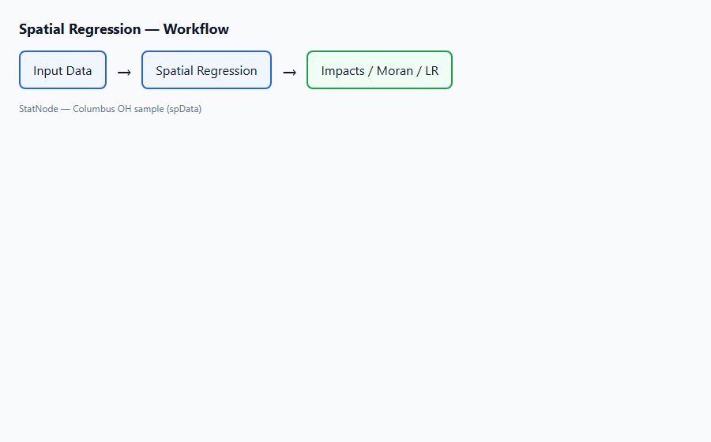
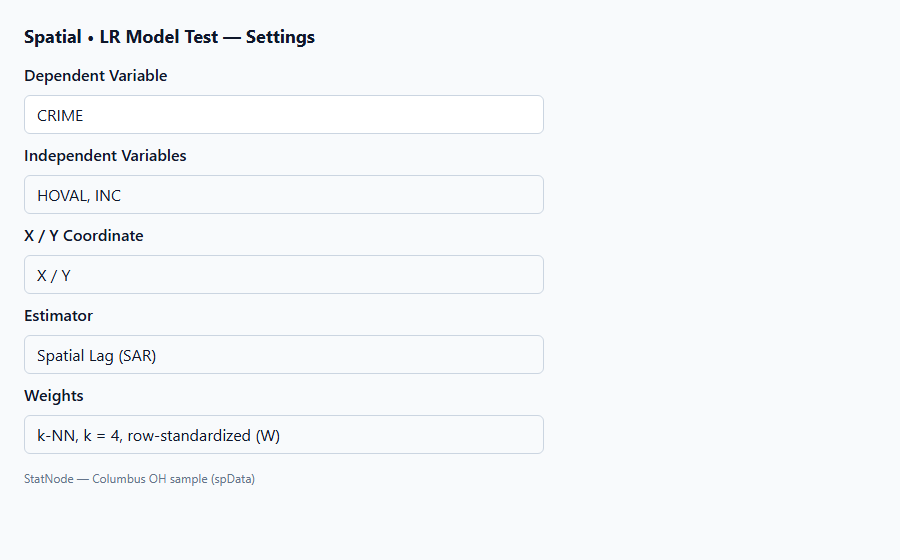
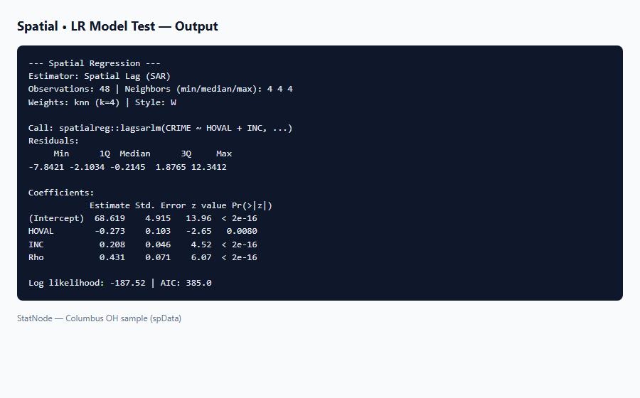

## 1. Mô hình / diagnostic này dùng để làm gì?

Sub-node **Spatial • Likelihood Ratio Model Test** thực hiện **kiểm định hợp lệ (specification test)** so sánh mô hình không gian đã ước lượng (mô hình **đầy đủ**, full) với một mô hình **lồng ghép hạn chế** (restricted/nested) đơn giản hơn, dựa trên thống kê **likelihood ratio (LR)**. Câu hỏi điển hình:

- OLS đủ hay **bắt buộc** có thuật ngữ không gian ($\rho = 0$)?
- SAR đủ hay cần **Spatial Durbin** (lag $WX$)?
- SEM có cải thiện fit so với **SLX** trong cùng họ mô hình?

Sub-node tái ước lượng mô hình hạn chế trên **cùng dữ liệu**, **cùng công thức**, **cùng ma trận $W$** đã lưu từ node cha **Spatial Regression**, rồi tính:

$$
LR = 2\big(\ell_{\text{full}} - \ell_{\text{rest}}\big) \sim \chi^2(\Delta k) \quad \text{dưới } H_0,
$$

với $\Delta k$ là chênh lệch số tham số tự do. Kết quả gồm log-likelihood hai mô hình, $LR$, bậc tự do, p-value và kết luận (reject restricted tại 5% hay không).

Triển khai theo Bivand & Piras (2015) và `spatialreg::anova()` (hoặc công thức thủ công khi restricted = OLS). **Không áp dụng** khi node cha dùng **GM (stsls/gstsls)** vì không có log-likelihood ML thống nhất.

## 2. Nền tảng lý thuyết

### 2.1. Nguyên tắc kiểm định mô hình lồng ghép

Mô hình **restricted** là trường hợp đặc biệt của mô hình **full** khi một hoặc nhiều tham số bị ràng buộc về giá trị null (thường 0). Ví dụ:

| Full (cha) | Restricted (H0) | Ràng buộc |
|---|---|---|
| SAR | OLS | $\rho = 0$ |
| SDM | SAR | $\boldsymbol{\theta} = \mathbf{0}$ (không lag $X$) |
| SAC | SAR | $\lambda = 0$ |
| SAC | SEM | $\rho = 0$ |
| SEM | OLS | $\lambda = 0$ |
| SLX | OLS | $\boldsymbol{\theta} = \mathbf{0}$ |

Dưới $H_0$, $LR$ tiệm cận $\chi^2(\Delta k)$ với $\Delta k$ bằng số ràng buộc độc lập.

### 2.2. Công thức LR

Gọi $\ell_{\text{full}}$ và $\ell_{\text{rest}}$ log-likelihood tại ước lượng ML (cùng mẫu, cùng $W$):

$$
LR = 2(\ell_{\text{full}} - \ell_{\text{rest}}).
$$

P-value:

$$
p = P(\chi^2_{\Delta k} > LR).
$$

Reject $H_0$ ở mức $\alpha$: mô hình hạn chế **bị bác bỏ** — tham số không gian bị ràng buộc về 0 **có đóng góp** có ý nghĩa vào fit (theo tiêu chí LR).

### 2.3. LR khi restricted = OLS

OLS không phải mô hình spatial ML; `spatialreg` so sánh bằng cách tính $\ell_{\text{OLS}}$ từ `lm()` và $\ell_{\text{full}}$ từ object spatial, với điều chỉnh số tham số:

- Mỗi tham số spatial ($\rho$, $\lambda$) thêm 1 df.
- SAC full so OLS: $\Delta k$ gồm $\rho$, $\lambda$, và các hệ số $\boldsymbol{\beta}$ chung.

StatNode in bảng thủ công khi restricted = OLS (xem template R trong node).

### 2.4. LR giữa hai mô hình spatial ML

Khi cả full và restricted đều ML (`anova(fit_rest, fit_full)`), bảng `anova` của R in:

- Residual deviance difference (= $LR$),
- df difference ($\Delta k$),
- Pr(>Chisq).

Ví dụ SDM (full) vs SAR (restricted): $\Delta k = p$ (số biến giải thích) vì SDM thêm $p$ hệ số lag $WX$.

### 2.5. Quan hệ với AIC/BIC

AIC = $-2\ell + 2k$; BIC = $-2\ell + k\ln n$. LR test là kiểm định **giả thuyết** với p-value; AIC là **tiêu chí dự báo** không có ngưỡng p. Mô hình có AIC thấp hơn thường đồng thuận với LR reject, nhưng không luôn — nên báo cáo cả hai (Bivand & Piras, 2015).

### 2.6. Định lý tương đương SDM–SEM (LeSage & Pace, 2009)

Nếu SDM với $\boldsymbol{\theta} = -\rho\boldsymbol{\beta}$, SDM tương đương SEM. LR SDM vs SAR kiểm tra một phần giả thuyết lag $X$; LR SDM vs SEM kiểm tra dạng ràng buộc phi tuyến. Trên StatNode, dropdown restricted gồm OLS, SAR, SEM, SLX — chọn cặp phù hợp lý thuyết.

### 2.7. Giới hạn LR

1. **Chỉ nested models.** So SAC với OLS được; so hai mô hình không lồng nhau cần Vuong test hoặc AIC (không có trong sub-node).
2. **Cùng $W$.** LR không hợp lệ nếu hai mô hình dùng $W$ khác — node đảm bảo cùng `listw`.
3. **ML estimators only.** GM loại trừ.
4. **Regularity conditions.** Ràng buộc $\rho=0$ hoặc $\lambda=0$ nằm **biên** tham số — phân phối tiệm cận có thể là hỗn hợp (như kiểm định $\sigma=0$ trong Tobit); với Columbus và mẫu vừa, $\chi^2$ vẫn là xấp xỉ chuẩn được dùng rộng rãi (Anselin, 1988; Bivand & Piras, 2015).
5. **Multiple testing.** Thử nhiều cặp restricted/full mà không điều chỉnh → tăng xác suất false positive.

### 2.8. Bảng các cặp lồng ghép hợp lệ trên StatNode

| Full (node cha) | Restricted (dropdown) | $\Delta k$ điển hình | Câu hỏi |
|---|---|---|---|
| SAR | OLS | 1 ($\rho$) | Có cần spatial lag? |
| SEM | OLS | 1 ($\lambda$) | Có cần spatial error? |
| SDM | SAR | $p$ (lag $X$) | Có cần lag biến giải thích? |
| SDM | OLS | $1 + 2p$* | Spatial lag + lag $X$ vs OLS |
| SLX | OLS | $p$ ($\boldsymbol{\theta}$) | Spillover qua $WX$? |
| SAC | SAR | 1 ($\lambda$) | Thêm error spatial? |
| SAC | SEM | 1 ($\rho$) | Thêm lag $y$? |

*Số df chính xác do `anova()` hoặc nhánh manual OLS; node in giá trị thực tế.

**Không hợp lệ / không có trong dropdown:** SAR (full) vs SEM (restricted) — hai họ khác nhau, không lồng ghép.

## 3. Điều kiện sử dụng

1. **Node cha Spatial Regression** với estimator ML: SAR, SEM, SAC, SDM, SLX. Metadata `statnode_data`, `statnode_listw`, `statnode_formula`, `statnode_estimator` bắt buộc.

2. **Restricted phải đơn giản hơn full.** Dropdown không cho chọn restricted trùng estimator cha; nếu trùng, node dừng.

3. **Restricted phải lồng ghép thực sự.** Ví dụ SAR restricted so SDM full hợp lệ; OLS restricted so SEM full hợp lệ. SAR restricted so SEM full **không** lồng ghép (hai họ khác nhau) — không có trong dropdown.

4. **Không dùng với GM.** Thông báo lỗi rõ ràng; dùng Wald hoặc so sánh AIC thủ công nếu cần.

5. **Cùng mẫu sau `complete.cases`.** Dữ liệu đọc lại từ metadata cha.

6. **Diễn giải kết hợp residual Moran.** LR reject không đảm bảo residual không còn autocorrelation — kiểm tra sub-node Residual Moran's I.

7. **Một kiểm định có chủ đích.** Chọn restricted theo câu hỏi nghiên cứu, không quét mọi tổ hợp.

8. **SLX vs OLS:** SLX là OLS mở rộng trên $[X \; WX]$; LR kiểm tra $\boldsymbol{\theta}=\mathbf{0}$.

## 4. Quy trình thực hiện (Workflow)

**Chiến lược Columbus kinh điển (Anselin, 1988):**

1. Fit **SAR** (`CRIME ~ HOVAL + INC`, $k=4$).
2. **LR Test**, restricted = **OLS** → cần spatial lag không?
3. Nếu giữ SAR: **Residual Moran**; nếu fail → thử **SEM**.
4. Fit **SDM**; **LR Test**, restricted = **SAR** → lag $X$ có cần?
5. So **AIC** SAR, SEM, SDM; chọn mô hình parcimonious.
6. Báo cáo **Impacts** trên mô hình được chọn.

**Sơ đồ quyết định:**

```
OLS ──LR──→ SAR? ──LR──→ SDM?
              │              │
              └──LR──→ SEM?  └── impacts
```

**Thứ tự trên canvas:**

```
Nhập dữ liệu → Spatial Regression → Spatial LR Test
                 (SAR / SDM / …)     (restricted = OLS / SAR / …)
```

Chạy song song Residual Moran và Impacts sau khi chọn mô hình.

## 5. Thực hành trên phần mềm StatNode

**Kịch bản A — SAR vs OLS (Columbus).** Node cha: SAR, `CRIME ~ HOVAL + INC`, k-NN $k=4$.

**Bước 1 — Nối sub-node** từ cổng Model.



**Bước 2 — Cấu hình.**

| Tham số | Giá trị kịch bản A |
|---|---|
| Restricted (Nested) Model | OLS (no spatial terms) |



**Bước 3 — Output.**



Ví dụ đầu ra (manual OLS branch, minh họa):

```
--- Likelihood Ratio Test (manual, OLS vs spatial ML) ---
Full model: sar | Restricted: OLS

Log-likelihood (full):     -187.5200
Log-likelihood (rest.):    -201.3400
LR statistic:                27.6400
df:                               1
p-value:                    0.000000

Conclusion: restricted model rejected — spatial specification adds significant fit
```

$\Delta k = 1$ vì SAR thêm $\rho$. p-value $\approx 0$ → **bác bỏ OLS**; cần thuật ngữ spatial lag.

**Kịch bản B — SDM vs SAR.** Node cha đổi sang **Spatial Durbin (SDM)**; LR Test, restricted = **Spatial Lag (SAR)**.

Ví dụ `anova()` output:

```r
> fit_sdm <- lagsarlm(CRIME ~ HOVAL + INC, data=df, listw=listw,
+                     type="mixed", Durbin=TRUE)
> fit_sar <- lagsarlm(CRIME ~ HOVAL + INC, data=df, listw=listw)
> anova(fit_sar, fit_sdm)

Model    logLik  AIC    BIC
fit_sar  -187.5  383.0  390.2
fit_sdm  -184.1  378.2  392.6
LR test: LR = 6.8, df = 2, p-value = 0.033
```

$\Delta k = 2$ (lag `HOVAL`, lag `INC`). Reject → lag $WX$ **có đóng góp**; SDM được ưu tiên hơn SAR thuần nếu lý thuyết không ép parcimonious.

**Kịch bản C — SEM vs OLS.** Cha = SEM; restricted = OLS. Kiểm tra $\lambda \neq 0$.

**Kịch bản D — SLX vs OLS.** Cha = SLX; restricted = OLS. Kiểm tra spillover qua $WX$ mà không cần $\rho$.

**Lỗi thường gặp:**

- Cha = GM → *"Likelihood ratio tests require ML-based spatial models"*.
- Restricted = cùng estimator cha → *"Restricted model must differ from the parent estimator"*.
- Cha = SEM, restricted = SAR → không lồng ghép đúng hướng trong dropdown — đặt SEM làm **full** và OLS/SAR làm restricted tùy câu hỏi.

## 6. Diễn giải kết quả

**SAR vs OLS (Columbus).** $LR \approx 27.6$, df = 1, p $\approx 0$: bằng chứng mạnh **tự tương quan trên $y$** không thể bỏ qua. Trong phần mở đầu kết quả: *"We reject the null that OLS is adequate (LR = 27.6, p < 0.001) and estimate a spatial lag model."* Log-likelihood SAR ($-187.5$) cao hơn OLS ($-201.3$) — cải thiện fit rõ.

**Không reject (p $\geq 0.05$).** Ví dụ SDM vs SAR với p = 0.12: không đủ bằng chứng cho lag $X$ tại 5% — có thể giữ SAR parcimonious, nhưng xem AIC (SDM có thể vẫn thấp hơn nhẹ). Báo cáo trung thực: *"LR test does not reject SAR at 5%, though SDM yields lower AIC."*

**Chọn giữa SEM và SAR.** LR không so trực tiếp hai mô hình không lồng nhau. Quy trình: (i) LR mỗi loại vs OLS; (ii) residual Moran; (iii) AIC; (iv) lý thuyết (error spillover vs reaction function trên $y$). Columbus thường được trích dẫn cho cả hai.

**df và số tham số.** Mỗi spatial parameter ($\rho$, $\lambda$) và mỗi cột $WX$ trong SDM tăng $\Delta k$. Ghi đúng df trong bảng kết quả để reader đối chiếu $\chi^2$.

**Kết hợp với impacts.** Nếu SDM vs SAR reject, impacts SDM (sub-node riêng) phản ánh cả $\boldsymbol{\beta}$ và $\boldsymbol{\theta}$ — nhất quán với LR.

**Regularity caveat.** Khi p-value sát 0.05 và $\hat{\rho}$ gần 0, nhắc đến vấn đề parameter-on-boundary trong phần hạn chế — không làm suy yếu kết luận nếu $LR$ rất lớn và Moran($y$) mạnh.

**Bảng so sánh mô hình Columbus (minh họa, cùng $k = 4$):**

| Mô hình | Log-likelihood | AIC | LR vs OLS (df) | Ghi chú |
|---|---|---|---|---|
| OLS | $\approx -201.3$ | $\approx 410$ | — | Baseline |
| SAR | $\approx -187.5$ | $\approx 383$ | $LR \approx 27.6$ (1) | $\hat{\rho} \approx 0.43$ |
| SEM | $\approx -188.0$ | $\approx 384$ | $LR \approx 26.6$ (1) | $\hat{\lambda} \approx 0.50$ |
| SDM | $\approx -184.1$ | $\approx 378$ | — | LR vs SAR: $p \approx 0.03$ |

Số liệu là xấp xỉ từ tài liệu kinh điển và có thể lệch nhẹ theo phiên bản `spatialreg`; dùng output StatNode làm nguồn chính khi viết báo cáo.

**Mẫu đoạn Phương pháp:** *"Nested model selection relies on likelihood ratio tests implemented in `spatialreg` (Bivand & Piras, 2015). We first test whether OLS is rejected in favor of the spatial lag model (SAR). Conditional on that result, we test whether Spatial Durbin terms ($WX$) significantly improve fit over SAR."*

**Thứ tự ưu tiên khi mâu thuẫn LR và AIC.** Nếu LR không reject SDM vs SAR (p = 0.08) nhưng AIC SDM thấp hơn 4–5 điểm, báo cáo mô hình parcimonious (SAR) trong bảng chính và SDM trong robustness — LeSage & Pace (2009) khuyến nghị SDM khi nghi ngờ misspecification SEM.

**Columbus SEM vs OLS.** Tương tự SAR, SEM thường reject OLS mạnh ($LR > 20$, df = 1). Không có dropdown SEM vs SAR; chọn giữa hai mô hình bằng lý thuyết (phản ứng $y$ vs tương quan lỗi), residual Moran, và AIC.

**Sai lầm cần tránh:** (i) LR giữa mô hình khác $W$; (ii) dùng LR với GM; (iii) so SAR vs SEM trực tiếp qua dropdown; (iv) chỉ dựa LR mà không xem residual Moran; (v) multiple testing không điều chỉnh; (vi) nhầm reject restricted với "mô hình full sai" — chỉ có nghĩa tham số bị ràng buộc có đóng góp.

## 7. Tài liệu tham khảo

1. Bivand, R. S., & Piras, G. (2015). Comparing implementations of estimation methods for spatial econometrics. *Journal of Statistical Software*, 63(18), 1–36. https://doi.org/10.18637/jss.v063.i18
2. Anselin, L. (1988). *Spatial Econometrics: Methods and Models*. Kluwer (Ch. 4, 9). https://doi.org/10.1007/978-94-015-7799-1
3. LeSage, J. P., & Pace, R. K. (2009). *Introduction to Spatial Econometrics*. CRC Press (Ch. 2, 6). https://doi.org/10.1201/9781420064254
4. Cliff, A. D., & Ord, J. K. (1981). *Spatial Processes: Models and Applications*. Pion.
5. Ord, J. K. (1975). Estimation methods for models of spatial interaction. *Journal of the American Statistical Association*, 70(349), 120–126. https://doi.org/10.2307/2285388
6. Wilks, S. S. (1938). The large-sample distribution of the likelihood ratio for testing composite hypotheses. *The Annals of Mathematical Statistics*, 9(1), 60–62. https://doi.org/10.1214/aoms/1177732360
7. Vuong, Q. H. (1989). Likelihood ratio tests for model selection and non-nested hypotheses. *Econometrica*, 57(2), 307–333. https://doi.org/10.2307/1912557
8. Anselin, L., Bera, A. K., Florax, R., & Yoon, M. J. (1996). Simple diagnostic tests for spatial dependence. *Regional Science and Urban Economics*, 26(1), 77–104. https://doi.org/10.1016/0166-0462(95)02111-6
9. Elhorst, J. P. (2014). *Spatial Econometrics: From Cross-Sectional Data to Spatial Panels*. Springer (Ch. 2). https://doi.org/10.1007/978-3-642-42081-1
10. Bivand, R. S., Pebesma, E., & Gómez-Rubio, V. (2013). *Applied Spatial Data Analysis with R* (2nd ed.). Springer. https://doi.org/10.1007/978-1-4614-7618-4
11. spatialreg package: `anova()` methods for `sarlm` objects. https://cran.r-project.org/package=spatialreg
