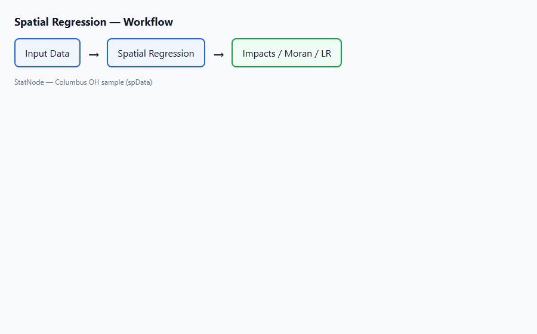
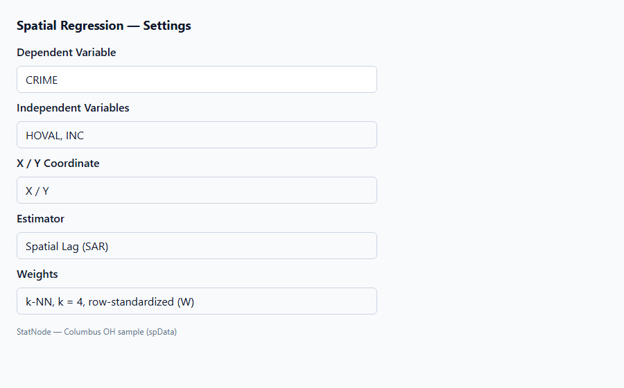
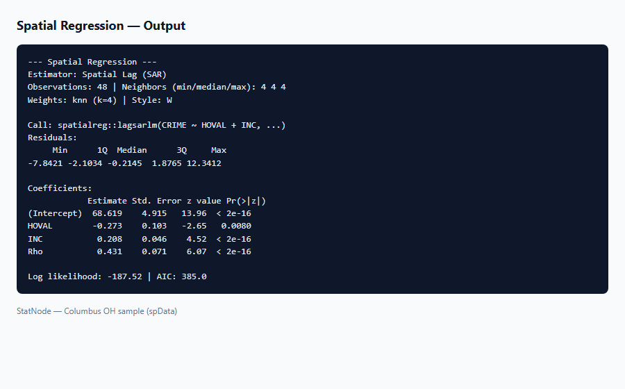

## 1. Mô hình này dùng để làm gì?

Node **Spatial Regression (Hồi quy không gian)** ước lượng các mô hình hồi quy cắt ngang có cấu trúc phụ thuộc không gian (spatial dependence) giữa các đơn vị quan sát địa lý. Node được triển khai trên package `spatialreg` và `spdep` của R (Bivand & Piras, 2015), chạy trong trình duyệt qua webR trên StatNode.

Khác với OLS thuần — giả định các quan sát độc lập — dữ liệu không gian thường vi phạm giả định này: tỷ lệ tội phạm ở một khu vực có thể tương quan với tỷ lệ ở khu lân cận; giá nhà, nông nghiệp, ô nhiễm, bệnh truyền nhiễm đều thể hiện *lan truyền* (spillover) hoặc *tương quan lỗi* (error correlation) theo vị trí. Node hỗ trợ sáu bộ ước lượng:

| Bộ ước lượng | Tên đầy đủ | Ý tưởng cốt lõi |
|---|---|---|
| **SAR** | Spatial Autoregressive (Spatial Lag) | Biến phụ thuộc $y$ phụ thuộc vào giá trị $y$ của láng giềng |
| **SEM** | Spatial Error Model | Phần dư có tự tương quan không gian, không có lag $y$ |
| **SAC** | Spatial Autocorrelation | Kết hợp cả lag $y$ và lỗi không gian |
| **SDM** | Spatial Durbin Model | Lag $y$ và lag các biến giải thích $X$ |
| **SLX** | Spatial Lag of X | Chỉ lag các biến giải thích, không lag $y$ |
| **GM** | Spatial GM (2SLS/GMM) | Ước lượng nhạy cảm với nội sinh không gian (Kelejian & Prucha) |

Ma trận trọng số không gian $W$ được xây dựng tự động từ tọa độ mỗi đơn vị: **k láng giềng gần nhất** (k-NN) hoặc **dải khoảng cách** (distance band). Đây là bước bắt buộc trong phân tích không gian: $W$ mã hóa cấu trúc "ai là láng giềng của ai" và quyết định cách lan truyền được mô hình hóa.

Node xuất cổng **Model** để nối ba sub-node hậu ước lượng: **Spatial Impacts**, **Residual Moran's I**, **Likelihood Ratio Model Test**. Workflow điển hình: kiểm tra Moran's I trên biến phụ thuộc → ước lượng SAR/SEM/SDM → kiểm định residual Moran → tính impacts → so sánh mô hình lồng ghép bằng LR test.

## 2. Nền tảng lý thuyết

### 2.1. Ma trận trọng số không gian $W$

Cho $n$ đơn vị không gian được đánh số $i = 1, \ldots, n$. Ma trận $W = (w_{ij})$ là ma trận $n \times n$ với $w_{ij} > 0$ nếu $j$ là láng giềng của $i$, ngược lại $w_{ij} = 0$. Đường chéo $w_{ii} = 0$ (không tự kết nối). Trên StatNode, láng giềng được xác định bởi:

- **k-NN:** mỗi đơn vị $i$ kết nối với $k$ đơn vị gần nhất theo khoảng cách Euclid trên tọa độ $(x_i, y_i)$.
- **Distance band:** $j$ là láng giềng của $i$ nếu $d_{ij} \leq d$ với ngưỡng $d$ do người dùng chọn.

**Chuẩn hóa hàng** (row-standardization, ký hiệu $W$) biến mỗi hàng thành tổng bằng 1:

$$
\tilde{w}_{ij} = \frac{w_{ij}}{\sum_{j=1}^{n} w_{ij}}.
$$

Ma trận chuẩn hóa hàng đảm bảo $W\mathbf{1} = \mathbf{1}$, nên $Wy$ là trung bình có trọng số của $y$ tại các láng giềng — diễn giải trực quan hơn so với ma trận nhị phân $B$ (không chuẩn hóa). Cliff & Ord (1973, 1981) và Anselin (1988) khuyến nghị chuẩn hóa hàng làm mặc định cho hầu hết mô hình lag.

Toán tử lag không gian định nghĩa:

$$
W y_i = \sum_{j=1}^{n} \tilde{w}_{ij} y_j,
$$

tức giá trị trung bình (có trọng số) của biến phụ thuộc tại các đơn vị lân cận của $i$.

### 2.2. Mô hình Spatial Lag (SAR)

Mô hình SAR (Cliff & Ord, 1973; Ord, 1975) — còn gọi là spatial autoregressive model:

$$
y = \rho W y + X\boldsymbol{\beta} + \boldsymbol{\varepsilon}, \qquad \boldsymbol{\varepsilon} \sim N(\mathbf{0}, \sigma^2 I_n),
$$

với $|\rho| < 1$ để đảm bảo nghịch đảo $(I_n - \rho W)^{-1}$ tồn tại. Tham số $\rho$ đo cường độ phụ thuộc không gian trên biến phụ thuộc: $\rho > 0$ nghĩa là tỷ lệ tội phạm cao tại một khu vực kéo theo tỷ lệ cao hơn ở láng giềng (hiệu ứng lan truyền dương).

Dạng tương đương giải nghiệm:

$$
y = (I_n - \rho W)^{-1} X\boldsymbol{\beta} + (I_n - \rho W)^{-1} \boldsymbol{\varepsilon}.
$$

Ma trận $(I_n - \rho W)^{-1}$ là **nhân tố lan truyền** (multiplier matrix): một thay đổi tại $x_j$ của đơn vị $i$ ảnh hưởng không chỉ $y_i$ mà còn lan sang mọi đơn vị khác qua chuỗi láng giềng. Do đó, hệ số $\boldsymbol{\beta}$ trong SAR **không** bằng hiệu ứng biên trên $y$ — cần sub-node **Spatial Impacts** (LeSage & Pace, 2009).

Ước lượng: hợp lý cực đại (ML) hoặc quasi-ML trên `spatialreg::lagsarlm()`.

### 2.3. Mô hình Spatial Error (SEM)

SEM (Anselin, 1988) mô hình hóa tự tương quan trong phần dư:

$$
y = X\boldsymbol{\beta} + \mathbf{u}, \qquad \mathbf{u} = \lambda W \mathbf{u} + \boldsymbol{\varepsilon}, \qquad \boldsymbol{\varepsilon} \sim N(\mathbf{0}, \sigma^2 I_n).
$$

Tương đương:

$$
y = X\boldsymbol{\beta} + (I_n - \lambda W)^{-1} \boldsymbol{\varepsilon}.
$$

Tham số $\lambda$ đo mức tương quan lỗi giữa các láng giềng. SEM phù hợp khi nghi ngờ biến bỏ sót có cấu trúc không gian hoặc đo lường sai có tương quan theo vị trí, trong khi $y$ không trực tiếp phụ thuộc vào $Wy$. Hệ số $\boldsymbol{\beta}$ trong SEM có diễn giải gần OLS hơn SAR vì không có phản hồi qua $Wy$.

Ước lượng: `spatialreg::errorsarlm()`.

### 2.4. Mô hình SAC (kết hợp lag và error)

SAC (Anselin & Bera, 1998) kết hợp cả hai cơ chế:

$$
y = \rho W y + X\boldsymbol{\beta} + \mathbf{u}, \qquad \mathbf{u} = \lambda W \mathbf{u} + \boldsymbol{\varepsilon}.
$$

Mô hình linh hoạt nhất nhưng khó nhận dạng (identification): khi cả $\rho$ và $\lambda$ đều khác 0, ranh giới giữa "lan truyền trên $y$" và "tương quan lỗi" mờ đi. Nên dùng SAC khi kiểm định LR cho thấy cả SAR và SEM đều bị bác bỏ so với OLS, hoặc khi lý thuyết ủng hộ cả hai cơ chế. Ước lượng: `spatialreg::sacsarlm()`.

### 2.5. Mô hình Spatial Durbin (SDM)

SDM (LeSage & Pace, 2009) mở rộng SAR bằng cách thêm lag của $X$:

$$
y = \rho W y + X\boldsymbol{\beta} + WX\boldsymbol{\theta} + \boldsymbol{\varepsilon}.
$$

Nếu $\boldsymbol{\theta} = -\rho\boldsymbol{\beta}$, SDM suy biến thành SEM (LeSage & Pace, 2009, định lý tương đương). SDM là mô hình **không bị thiên lệch** (unbiased) khi đúng cơ chế thực tế là SEM nhưng ta ước lượng SAR — "robust" hơn SAR thuần trong nhiều ứng dụng thực nghiệm. SDM cũng cho phép kiểm định giả thuyết $\boldsymbol{\theta} = \mathbf{0}$ (có cần lag $X$ không?) qua LR test so với SAR.

Trên StatNode, SDM được ước lượng bằng `lagsarlm(..., type = "mixed", Durbin = TRUE)`.

### 2.6. Mô hình Spatial Lag of X (SLX)

SLX (Anselin, 2003; Elhorst, 2014) là mô hình tuyến tính:

$$
y = X\boldsymbol{\beta} + WX\boldsymbol{\theta} + \boldsymbol{\varepsilon}, \qquad \boldsymbol{\varepsilon} \sim N(\mathbf{0}, \sigma^2 I_n).
$$

Không có tham số $\rho$ trên $Wy$; lan truyền chỉ qua biến giải thích. SLX dễ diễn giải hơn SAR, ước lượng bằng OLS mở rộng (`spatialreg::lmSLX()`), và cho phép tách hiệu ứng **cục bộ** ($\boldsymbol{\beta}$) và **lan truyền** ($\boldsymbol{\theta}$) trực tiếp từ hệ số. Nhược điểm: bỏ qua phản hồi gián tiếp qua $Wy$ nếu cơ chế thực tế là SAR.

### 2.7. Bộ ước lượng GM (Kelejian–Prucha)

Khi $\rho$ hoặc biến giải thích có thể **nội sinh** (endogenous) do phản hồi đồng thời hoặc $Wy$ tương quan với phần dư, ML có thể chệch. Kelejian & Prucha (1998, 1999) đề xuất:

- **Spatial 2SLS (stsls):** dùng $WX$ làm công cụ cho $Wy$ và các biến nội sinh.
- **Generalized Spatial 2SLS (gstsls):** mở rộng với ma trận công cụ phong phú hơn.

GM không dựa trên hợp lý cực đại nên **không** hỗ trợ LR test trên StatNode; residual Moran's I vẫn áp dụng được.

### 2.8. So sánh nhanh các mô hình

| Mô hình | Tham số không gian | Lag $y$ | Lag $X$ | Error spatial | Ước lượng StatNode |
|---|---|---|---|---|---|
| OLS | — | ✗ | ✗ | ✗ | (tham chiếu) |
| SAR | $\rho$ | ✓ | ✗ | ✗ | ML |
| SEM | $\lambda$ | ✗ | ✗ | ✓ | ML |
| SAC | $\rho, \lambda$ | ✓ | ✗ | ✓ | ML |
| SDM | $\rho$ | ✓ | ✓ | ✗ | ML |
| SLX | — | ✗ | ✓ | ✗ | OLS |
| GM | — | ✓* | ✗ | ✗ | 2SLS/GMM |

*GM mô hình hóa phụ thuộc không gian qua công cụ hóa $Wy$, không ước lượng $\rho$ trực tiếp theo cùng cách ML.

## 3. Điều kiện sử dụng

1. **Dữ liệu cắt ngang có định danh không gian.** Mỗi quan sát gắn với một vị trí (tọa độ $X, Y$ hoặc centroid). Node hiện tại không hỗ trợ panel không gian hoặc mạng (network) không dựa trên tọa độ.

2. **Số quan sát đủ lớn.** Sau loại NA, cần ít nhất 5 quan sát (giới hạn kỹ thuật); thực tế nên có $n \geq 30$ để ML ổn định và kiểm định Moran có ý nghĩa.

3. **Ma trận $W$ không có đơn vị cô lập.** Mọi đơn vị phải có ít nhất một láng giềng. Nếu k-NN hoặc dải khoảng cách tạo hàng toàn 0, node dừng và báo chỉ số hàng cô lập — tăng $k$, mở rộng $d$, hoặc kiểm tra tọa độ.

4. **$k < n$.** Với k-NN, số láng giềng phải nhỏ hơn số quan sát.

5. **Giả định dừng (stationarity) cho SAR/SEM/SAC/SDM.** Cần $|\rho| < 1$ và $|\lambda| < 1$ (điều kiện ổn định). Ước lượng ML thường ràng buộc miền tham số; kiểm tra giá trị $\hat{\rho}$, $\hat{\lambda}$ trong output.

6. **Lựa chọn $W$ là quyết định mô hình.** Kết quả nhạy cảm với định nghĩa láng giềng (Anselin, 1988). Nên thử nhiều $k$ hoặc $d$ và báo cáo độ bền (sensitivity analysis).

7. **Phân phối chuẩn phần dư (ML).** Các mô hình ML giả định $\varepsilon \sim N(\mathbf{0}, \sigma^2 I)$ sau khi đã mô hình hóa cấu trúc không gian. Residual Moran's I kiểm tra phần còn lại.

8. **Không đa cộng tuyến hoàn hảo** giữa $X$ và $WX$ trong SDM/SLX; ma trận $[X \; WX]$ phải đủ hạng.

9. **Tọa độ cùng hệ quy chiếu.** $X$ và $Y$ phải cùng đơn vị (ví dụ mét hoặc kinh độ/vĩ độ đã chiếu). Trộn hệ tọa độ gây $W$ sai.

10. **GM khi nghi ngờ nội sinh.** Nếu $Wy$ hoặc biến chính sách có thể nội sinh, ưu tiên stsls/gstsls thay vì SAR ML.

## 4. Quy trình thực hiện (Workflow)

Quy trình phân tích không gian tiêu chuẩn trên StatNode gồm tám bước:

1. **Khám phá dữ liệu:** mô tả thống kê $y$ và $X$; vẽ bản đồ hoặc scatter tọa độ để phát hiện outlier và cụm không gian.

2. **Kiểm tra tự tương quan không gian (tiền kiểm định):** tính Global Moran's I trên $y$ (node **Moran's I** hoặc ESDA ngoài StatNode) để xác nhận có bằng chứng phụ thuộc không gian trước khi ước lượng mô hình.

3. **Chuẩn bị dữ liệu:** mỗi hàng một đơn vị không gian; cột tọa độ $X, Y$; không thiếu trên biến dùng trong hồi quy. Tải CSV qua **Nhập dữ liệu**.

4. **Xây dựng $W$ và ước lượng mô hình cơ sở:** chạy **Spatial Regression** với SAR hoặc SEM làm điểm xuất phát; ghi lại $k$ hoặc $d$, chuẩn hóa hàng.

5. **Chẩn đoán phần dư:** nối **Spatial • Residual Moran's I** — nếu vẫn còn tự tương quan, thử SEM (nếu đang dùng SAR), SDM, SAC, hoặc đổi $W$.

6. **So sánh mô hình lồng ghép:** dùng **Spatial • LR Test** (OLS vs SAR, SAR vs SDM, v.v.) để chọn đặc tả hợp lý.

7. **Tính impacts (SAR/SDM/SAC/SLX):** nối **Spatial • Impacts** với $R \geq 500$ lần mô phỏng Monte Carlo.

8. **Diễn giải và robustness:** báo cáo hệ số, $\hat{\rho}$/$\hat{\lambda}$, impacts trực tiếp/gián tiếp/tổng; thử đổi $k$ hoặc mô hình thay thế.

Sơ đồ workflow đầy đủ trên canvas:

```
Nhập dữ liệu → Spatial Regression → ┬→ Spatial Impacts
                                    ├→ Residual Moran's I
                                    └→ LR Model Test
```

## 5. Thực hành trên phần mềm StatNode

Minh họa với bộ dữ liệu **Columbus crime** (Anselin, 1988; `spData::columbus`): tỷ lệ tội phạm `CRIME` (số vụ trên 1000 hộ), giá nhà trung bình `HOVAL` (nghìn USD), thu nhập bình quân `INC` (nghìn USD), tọa độ `X`, `Y` (hệ chiếu Columbus). Mô hình kinh điển:

$$
\text{CRIME} = \rho W \cdot \text{CRIME} + \beta_0 + \beta_1 \text{HOVAL} + \beta_2 \text{INC} + \varepsilon \quad \text{(SAR)}.
$$

Tệp mẫu: `scripts/spatial-smoke/columbus-sample.csv` (tập con 49 quận). Trọng số: **k-NN với $k = 4$**, chuẩn hóa hàng.

**Bước 1 — Dựng workflow.** Thêm **Nhập dữ liệu** và **Spatial Regression** (nhóm Ước lượng → Spatial), nối cổng Data. Gắn các sub-node vào cổng Model sau khi ước lượng:



**Bước 2 — Cấu hình node chính.**

| Tham số | Giá trị Columbus |
|---|---|
| Biến phụ thuộc (Y) | `CRIME` |
| Biến độc lập (X) | `HOVAL`, `INC` |
| Tọa độ X | `X` |
| Tọa độ Y | `Y` |
| Bộ ước lượng | Spatial Lag (SAR) — thử SEM, SDM sau |
| Phương pháp trọng số | k-Nearest Neighbors |
| Số láng giềng (k) | 4 |
| Chuẩn hóa hàng | Row-standardized (W) |



**Bước 3 — Chạy và đọc output.** Nhấn **Chạy tất cả**. webR cài `spatialreg`, `spdep`, `spData`, xây $W$ từ tọa độ và in `summary()`:



Ví dụ cấu trúc đầu ra R (số liệu minh họa, có thể thay đổi nhẹ theo phiên bản package):

```r
> library(spatialreg); library(spdep)
> df <- read.csv("columbus-sample.csv")
> coords <- as.matrix(df[, c("X", "Y")])
> nb <- knearneigh(coords, k = 4)
> listw <- nb2listw(knn2nb(nb), style = "W")
> fit <- lagsarlm(CRIME ~ HOVAL + INC, data = df, listw = listw)
> summary(fit)

Spatial lag model (lagsarlm)
Observations: 49
Coefficients:
            Estimate Std. Error z value Pr(>|z|)
(Intercept)  68.6190    4.7355  14.490  < 2e-16 ***
HOVAL        -0.5967    0.1899  -3.142  0.00168 **
INC           1.5289    0.3933   3.887  0.00010 ***
Rho           0.4314    0.0815   5.293  1.2e-07 ***

Log likelihood: -187.52
AIC: 383.0, SCM: 387.0
```

Dòng đầu output StatNode còn in: số quan sát, min/median/max số láng giềng, phương pháp $W$.

**Bước 4 — Thử SEM và SDM.** Đổi **Estimator** sang Spatial Error (SEM) hoặc Spatial Durbin (SDM), giữ nguyên $k = 4$, so sánh AIC và LR test.

**Bước 5 — Sub-node hậu ước lượng.** Sau SAR/SDM, chạy lần lượt Residual Moran's I, Impacts ($R = 500$), LR Test (restricted = OLS hoặc SAR). Chi tiết từng sub-node xem các bài hướng dẫn tương ứng.

**Bước 6 — Distance band (tùy chọn).** Đổi **Spatial Weights Method** sang Distance Band, đặt **Distance Threshold** $d$ phù hợp đơn vị tọa độ (ví dụ $d = 5$ đơn vị bản đồ). Đảm bảo không có đơn vị cô lập.

**Bước 7 — GM khi cần.** Chọn **Spatial GM (2SLS/GMM)** với `stsls` hoặc `gstsls` nếu nghi ngờ nội sinh; lưu ý không dùng LR test với GM.

## 6. Diễn giải kết quả

**Tham số $\hat{\rho}$ (SAR).** $\hat{\rho} = 0.43$ (ví dụ trên) có ý nghĩa thống kê và dương: tỷ lệ tội phạm có lan truyền không gian — khi láng giềng có CRIME cao hơn 1 đơn vị (theo $Wy$ chuẩn hóa), CRIME tại đơn vị $i$ tăng khoảng 0.43 đơn vị, giữ $X$ cố định. Đây **không** phải hệ số OLS; so sánh trực tiếp với OLS dễ gây hiểu nhầm.

**Hệ số $\boldsymbol{\beta}$.** $\hat{\beta}_{\text{HOVAL}} < 0$: giá nhà cao hơn gắn với tỷ lệ tội phạm thấp hơn *sau khi đã kiểm soát lan truyền $\rho$ và thu nhập*. $\hat{\beta}_{\text{INC}} > 0$: thu nhập cao hơn liên quan tội phạm cao hơn — cần thận trọng về nhân quả (có thể phản ánh cấu trúc đô thị). Trong SAR, đây là hiệu ứng **cục bộ tức thời** (immediate local effect), chưa gồm lan truyền qua $(I - \rho W)^{-1}$.

**AIC và log-likelihood.** So sánh SAR, SEM, SDM trên cùng $W$: mô hình có AIC thấp hơn được ưu tiên nếu LR test ủng hộ. Ví dụ nếu SEM có AIC thấp hơn SAR và residual Moran không còn ý nghĩa, SEM có thể phù hợp hơn.

**Residual Moran's I.** Sau SAR, nếu p-value của residual Moran vẫn $< 0.05$, đặc tả lag chưa đủ — cân nhắc SEM, SDM hoặc SAC. Nếu p-value lớn, phần dư không còn tự tương quan toàn cục (global), mô hình đạt chẩn đoán cơ bản.

**Impacts (sub-node).** Đối với HOVAL và INC trong SAR, báo cáo **direct**, **indirect**, **total** impacts (LeSage & Pace, 2009). Total impact của INC thường lớn hơn hệ số $\hat{\beta}_{\text{INC}}$ vì bao gồm lan truyền sang láng giềng.

**LR Test.** So OLS vs SAR: reject $H_0$ nghĩa là cần thuật ngữ không gian ($\rho \neq 0$). So SAR vs SDM: reject nghĩa là lag $WX$ có đóng góp ($\boldsymbol{\theta} \neq \mathbf{0}$).

**Sai lầm cần tránh:** (i) diễn giải $\boldsymbol{\beta}$ SAR như hiệu ứng biên OLS; (ii) dùng $W$ khác nhau khi so sánh AIC/LR; (iii) bỏ qua đơn vị cô lập; (iv) nhầm tọa độ kinh độ/vĩ độ thô với khoảng cách mét; (v) dùng LR test với mô hình GM; (vi) kết luận nhân quả chỉ từ hồi quy không gian cắt ngang.

## 7. Tài liệu tham khảo

1. Anselin, L. (1988). *Spatial Econometrics: Methods and Models*. Kluwer Academic. https://doi.org/10.1007/978-94-015-7799-1
2. Cliff, A. D., & Ord, J. K. (1973). *Spatial Autocorrelation*. Pion.
3. Cliff, A. D., & Ord, J. K. (1981). *Spatial Processes: Models and Applications*. Pion.
4. Ord, J. K. (1975). Estimation methods for models of spatial interaction. *Journal of the American Statistical Association*, 70(349), 120–126. https://doi.org/10.2307/2285388
5. LeSage, J. P., & Pace, R. K. (2009). *Introduction to Spatial Econometrics*. CRC Press. https://doi.org/10.1201/9781420064254
6. Bivand, R. S., & Piras, G. (2015). Comparing implementations of estimation methods for spatial econometrics. *Journal of Statistical Software*, 63(18), 1–36. https://doi.org/10.18637/jss.v063.i18
7. Kelejian, H. H., & Prucha, I. R. (1998). A generalized spatial two-stage least squares procedure for estimating a spatial autoregressive model with autoregressive disturbances. *Journal of Real Estate Finance and Economics*, 17(1), 99–121. https://doi.org/10.1023/A:1007707431419
8. Kelejian, H. H., & Prucha, I. R. (1999). A generalized moments estimator for the autoregressive parameter in a spatial model. *International Economic Review*, 40(2), 509–533. https://doi.org/10.1111/1468-2354.00027
9. Anselin, L., & Bera, A. K. (1998). Spatial dependence in linear regression models with an introduction to spatial econometrics. In A. Ullah & D. E. A. Giles (Eds.), *Handbook of Applied Economic Statistics* (pp. 237–289). Marcel Dekker.
10. Elhorst, J. P. (2014). *Spatial Econometrics: From Cross-Sectional Data to Spatial Panels*. Springer. https://doi.org/10.1007/978-3-642-42081-1
11. Bivand, R. S., Pebesma, E., & Gómez-Rubio, V. (2013). *Applied Spatial Data Analysis with R* (2nd ed.). Springer. https://doi.org/10.1007/978-1-4614-7618-4
12. Luc Anselin (1988). Columbus crime data. Trong `spData::columbus`. https://cran.r-project.org/package=spData
