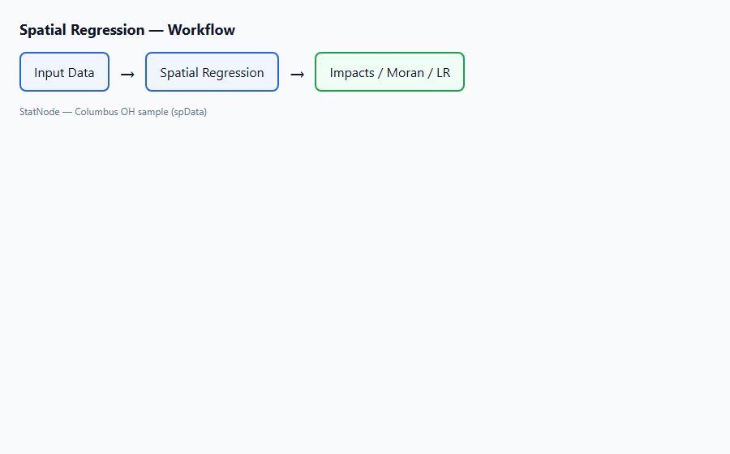
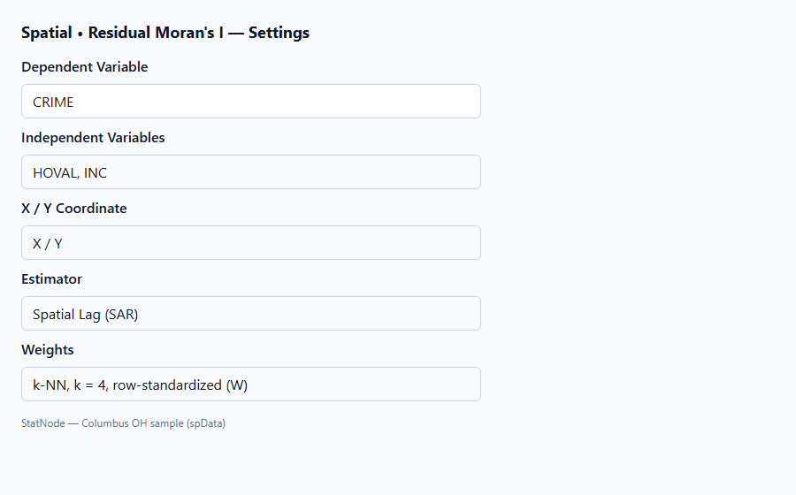
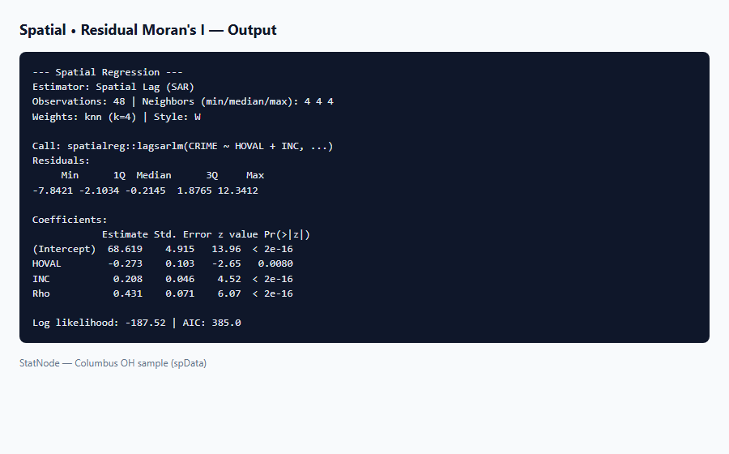

## 1. Mô hình / diagnostic này dùng để làm gì?

Sub-node **Spatial • Residual Moran's I** thực hiện **kiểm định Moran toàn cục (Global Moran's I)** trên **phần dư** của mô hình hồi quy không gian đã ước lượng bởi node cha **Spatial Regression**. Mục tiêu: phát hiện liệu phần dư còn **tự tương quan không gian** sau khi đã mô hình hóa cấu trúc lag hoặc error — dấu hiệu đặc tả mô hình chưa đủ hoặc ma trận $W$ chưa phù hợp.

Moran's I trên biến phụ thuộc thô $y$ (tiền kiểm định) trả lời: *có bằng chứng phụ thuộc không gian trong dữ liệu không?* Moran's I trên **residuals** trả lời câu hỏi khác, quan trọng hơn sau khi fit: *mô hình đã "hấp thụ" hết cấu trúc không gian chưa?* Đây là chẩn đoán cốt lõi trong workflow Anselin (1988): LM tests trước khi chọn SAR/SEM, residual Moran sau khi ước lượng.

Giả thuyết kiểm định:

$$
H_0: \text{không có tự tương quan không gian trong phần dư} \quad \text{vs.} \quad H_1: \text{có tự tương quan (một hoặc hai phía)}.
$$

Sub-node dùng `spdep::moran.test()` với cùng `listw` đã lưu từ node cha, in $I$, kỳ vọng $E[I]$, phương sai, z-score, p-value và kết luận sơ bộ (reject $H_0$ tại 5% hay không). Áp dụng cho **mọi** bộ ước lượng ML và GM từ Spatial Regression (SAR, SEM, SAC, SDM, SLX, stsls, gstsls).

## 2. Nền tảng lý thuyết

### 2.1. Chỉ số Global Moran's I

Cho vector giá trị $z$ (ở đây là phần dư $\hat{\boldsymbol{\varepsilon}}$ hoặc $\hat{\mathbf{u}}$) và ma trận trọng số chuẩn hóa hàng $W$, Moran's I (Cliff & Ord, 1981; Anselin, 1988):

$$
I = \frac{n}{S_0} \cdot \frac{\sum_{i=1}^{n} \sum_{j=1}^{n} w_{ij} (z_i - \bar{z})(z_j - \bar{z})}{\sum_{i=1}^{n} (z_i - \bar{z})^2},
$$

với $S_0 = \sum_i \sum_j w_{ij}$ và $\bar{z}$ là trung bình mẫu. Với $W$ chuẩn hóa hàng, $S_0 = n$.

**Diễn giải:** $I > E[I]$ (kỳ vọng dưới $H_0$) gợi ý **tự tương quan dương** (các đơn vị tương tự về phần dư có xu hướng nằm cạnh nhau). $I < E[I]$ gợi ý **tự tương quan âm** (pattern checkerboard). $|I - E[I]|$ lớn và p-value nhỏ → bác bỏ $H_0$.

### 2.2. Kỳ vọng và phương sai dưới $H_0$

Dưới giả thuyết ngẫu nhiên hóa (randomization) hoặc giả thuyết chuẩn (normality), Cliff & Ord (1981) cho:

$$
E[I] = -\frac{1}{n-1},
$$

và $\operatorname{Var}[I]$ phụ thuộc các moment bậc cao của $W$ (được `moran.test()` tính tự động). Với $n$ lớn, z-score:

$$
z = \frac{I - E[I]}{\sqrt{\operatorname{Var}[I]}}
$$

tiệm cận chuẩn để suy ra p-value hai phía, một phía lớn (positive autocorrelation), hoặc một phía nhỏ (negative).

### 2.3. Residual Moran vs. Moran trên $y$

| Đối tượng | Câu hỏi | Giai đoạn |
|---|---|---|
| Moran($y$) | $y$ có cluster không gian? | Tiền mô hình hóa |
| Moran($\hat{\varepsilon}$) | Mô hình còn bỏ sót cấu trúc không gian? | Hậu ước lượng |

Sau SAR với $\hat{\rho}$ đáng kể, Moran($y$) thường dương; điều quan trọng là Moran($\hat{\varepsilon}$) **không còn ý nghĩa**. Nếu vẫn ý nghĩa:

- SAR có thể thiếu — thử SEM (error trong phần dư) hoặc SDM (thiếu lag $X$).
- $W$ sai (quá ít láng giềng, sai đơn vị khoảng cách).
- Cần mô hình bậc cao hơn (SAC) hoặc biến bỏ sót có pattern không gian.

### 2.4. Liên hệ với LM tests (Anselin, 1988)

Trước khi chọn SAR hay SEM, tài liệu cổ điển khuyến nghị **Lagrange Multiplier** tests (LM lag, LM error, robust variants) trên phần dư OLS. Residual Moran's I trên mô hình đã fit là bước **bổ sung** sau ước lượng, không thay thế LM tests tiền xử lý. Trên StatNode, nếu chưa có node LM riêng, quy trình thực tế: OLS/SAR sơ bộ → residual Moran → điều chỉnh đặc tả.

### 2.5. SEM và residual Moran

SEM mô hình hóa trực tiếp $\mathbf{u} = \lambda W \mathbf{u} + \boldsymbol{\varepsilon}$. Residual Moran trên output SEM kiểm tra phần dư **sau khi đã tách $\lambda$** — lý thuyết kỳ vọng gần 0 nếu SEM đúng. Nếu SEM fit tốt mà Moran($\hat{\varepsilon}$) vẫn lớn, có thể cần SAC hoặc đổi $W$.

### 2.6. SLX và GM

SLX không có $\rho$ trên $y$; residual Moran dương sau SLX gợi ý cần SAR/SDM. GM (2SLS) vẫn tạo phần dư; Moran trên residuals GM kiểm tra đặc tả công cụ — nếu fail, xem xét bộ công cụ mở rộng (gstsls) hoặc mô hình khác.

### 2.7. Giới hạn Global Moran

Moran's I là thống kê **toàn cục** (một con số cho cả bản đồ). Nó có thể bỏ sót **tự tương quan cục bộ** (local clusters) — cần Local Moran's I (LISA) hoặc bản đồ phần dư ngoài StatNode. Moran cũng nhạy với **nonstationarity** (xu hướng toàn cục trên bản đồ) và **ma trận $W$ cố định** — nên thử robustness với $k$ khác.

### 2.8. Giả thuyết randomisation vs. normality

`spdep::moran.test()` mặc định dùng phương sai Moran dưới giả thuyết **hoán vị ngẫu nhiên** (randomisation): các giá trị $z_i$ cố định, vị trí được hoán vị ngẫu nhiên trên mạng $W$. Giả thuyết **normality** (phần dư chuẩn) cho phân phối tiệm cận khác khi $n$ nhỏ. Với Columbus $n = 49$, hai cách thường cho p-value gần nhau; báo cáo nên ghi "Moran's I test under randomisation" như output R.

### 2.9. Bảng đối chiếu chẩn đoán không gian

| Giai đoạn | Thống kê | Ý nghĩa khi reject $H_0$ |
|---|---|---|
| Tiền mô hình | Moran($y$) | Cần mô hình không gian (SAR/SEM/…) |
| Tiền mô hình | LM lag / LM error (Anselin, 1996) | Gợi ý SAR vs SEM |
| Hậu mô hình | Moran($\hat{\varepsilon}$) — **sub-node này** | Đặc tả đã chọn vẫn thiếu |
| Hậu mô hình | LR test (sub-node khác) | Tham số spatial bị ràng buộc cần thiết |

Residual Moran bổ sung LR: LR so sánh **fit** (log-likelihood); Moran kiểm tra **cấu trúc còn sót** trong phần dư. Có thể LR reject OLS nhưng residual Moran vẫn fail sau SAR — tín hiệu cần SEM hoặc SDM.

### 2.10. Moran trên Columbus crime — kỳ vọng định tính

Trong sách kinh điển Anselin (1988), biến `CRIME` thể hiện clustering không gian rõ (Moran($y$) dương, p-value nhỏ). Sau SAR với $\hat{\rho} \approx 0.43$, residual Moran thường **không còn ý nghĩa** — đúng với vai trò SAR hấp thụ phụ thuộc trên $y$. Nếu dùng SEM với $\hat{\lambda}$ đáng kể, residual Moran tương tự có thể pass; so sánh hai mô hình bằng AIC và LR vs OLS, không chỉ một con số Moran.

## 3. Điều kiện sử dụng

1. **Mô hình Spatial Regression cha hợp lệ** với `statnode_listw` và độ dài residuals khớp $n$.

2. **Cùng $W$ với ước lượng.** Sub-node không tái tạo láng giềng; dùng `listw` đã gắn vào object model.

3. **Phần dư có phương sai hữu hạn.** Quan sát cực đoan hoặc fit không hội tụ có thể làm Moran không ổn định.

4. **Chọn giả thuyết đối (alternative).** Mặc định **two.sided**; dùng **greater** nếu lý thuyết chỉ dự đoán spillover dương (tội phạm, dịch bệnh); **less** cho pattern âm hiếm.

5. **$n$ đủ lớn.** Với $n < 30$, phân phối tiệm cận của Moran yếu; diễn giải p-value thận trọng.

6. **Không có đơn vị cô lập trong $W$.** Node cha đã kiểm tra khi xây $W$; nếu đổi dữ liệu sau fit, chạy lại cha.

7. **Một kiểm định trong bộ chẩn đoán.** Kết hợp với AIC, LR test, và đồ thị phần dư — không chỉ dựa vào một p-value.

8. **zero.policy = TRUE.** `moran.test` trên StatNode cho phép hàng có trọng số 0 (theo mặc định spdep khi listw được tạo không có cô lập).

## 4. Quy trình thực hiện (Workflow)

1. **Tiền kiểm định (tùy chọn):** Moran trên `CRIME` thô để xác nhận cluster không gian trước khi mô hình hóa.

2. **Ước lượng Spatial Regression:** ví dụ SAR Columbus `CRIME ~ HOVAL + INC`, $k = 4$.

3. **Residual Moran's I:** nối sub-node, chạy với alternative two.sided (mặc định).

4. **Quyết định:**
   - p-value $\geq 0.05$: đặc tả chấp nhận được ở mức global Moran; tiếp tục impacts và LR test.
   - p-value $< 0.05$: thử SEM, SDM, SAC; hoặc tăng $k$, đổi distance band; kiểm tra biến bỏ sót.

5. **Lặp:** fit mô hình mới → residual Moran lại cho đến khi chấp nhận được hoặc hết lựa chọn lý thuyết.

6. **Báo cáo:** nêu $I$, $E[I]$, z, p-value, loại mô hình và $W$ (k=4, row-standardized).

7. **Lặp với mô hình thay thế:** nếu fail, document trong phụ lục: SAR fail → SEM pass (hoặc ngược lại) để minh chứng quy trình chẩn đoán đầy đủ.

**Checklist chẩn đoán residual:**

- [ ] Đã fit mô hình ML trên node cha (không chỉ OLS)
- [ ] `listw` từ metadata, không tái tạo $W$ thủ công
- [ ] Alternative hypothesis phù hợp lý thuyết (two.sided / greater)
- [ ] Kết quả đọc cùng bảng AIC và LR test
- [ ] Đã thử ít nhất một đặc tả thay thế nếu p < 0.05

**Ví dụ Columbus — đọc song song ba sub-node:**

Sau SAR ($k=4$): (1) Residual Moran pass → phần dư ổn; (2) LR vs OLS reject → cần spatial; (3) Impacts cho HOVAL/INC. Ba kết quả **nhất quán** củng cố kết luận giữ SAR. Nếu (1) fail trong khi (2) reject, ưu tiên điều chỉnh đặc tả (SEM/SDM) trước khi báo impacts.

```
Nhập dữ liệu → Spatial Regression → Residual Moran's I
                      ↓ (nếu fail)
                 đổi SEM / SDM / W
```

## 5. Thực hành trên phần mềm StatNode

Ví dụ **Columbus SAR**: sau khi fit `CRIME ~ HOVAL + INC` với k-NN $k=4$, kiểm tra phần dư.

**Bước 1 — Nối sub-node.** Từ cổng **Model** của Spatial Regression, nối **Spatial • Residual Moran's I**.



**Bước 2 — Cấu hình.**

| Tham số | Giá trị Columbus |
|---|---|
| Alternative Hypothesis | Two-sided (mặc định) |

Tùy chọn **Greater** nếu chỉ quan tâm spillover dương trong phần dư; **Less** cho autocorrelation âm.



**Bước 3 — Chạy output.**



Ví dụ đầu ra R (minh họa):

```r
> library(spdep)
> res <- residuals(fit)
> moran.test(res, listw, alternative = "two.sided")

        Moran I test under randomisation

Moran I statistic standard deviate = 0.7421, p-value = 0.458
alternative hypothesis: two.sided
sample estimates:
Moran I       Expectation    Variance
0.01234      -0.02083       0.00198
```

Output StatNode in thêm:

```
H0: no spatial autocorrelation in residuals
Conclusion: no significant residual spatial autocorrelation
```

(khi p-value $\geq 0.05$).

**Bước 4 — So sánh SAR vs SEM.** Chạy node cha với SEM, giữ $k=4$, chạy lại Residual Moran. So sánh $I$ và p-value; mô hình có p-value lớn hơn và AIC thấp hơn được ưu tiên nếu lý thuyết không ép SAR.

**Bước 5 — Trường hợp reject $H_0$.** Giả sử p-value = 0.02 sau SAR:

1. Đổi estimator sang SEM → residual Moran lại.
2. Thử SDM nếu LM/LR gợi ý thiếu lag $X$.
3. Tăng $k$ từ 4 lên 6 hoặc 8 (độ nhạy $W$).
4. Scatter plot phần dư theo tọa độ (node biểu đồ) để xem cluster cục bộ.

**Bước 6 — Alternative một phía.** Với tội phạm, chọn **Greater**: $H_1$ là residual positive spatial autocorrelation. p-value một phía có thể nhỏ hơn two-sided khi $I > E[I]$.

**Bước 7 — Lưu ý cổng Model.** Sub-node chỉ đọc object model từ Spatial Regression; không cần nối lại Data. Chạy **Chạy tất cả** sau khi đổi estimator trên node cha để residuals và `listw` đồng bộ.

## 6. Diễn giải kết quả

**Trường hợp chấp nhận $H_0$ (p $\geq 0.05$, ví dụ Columbus SAR).** Moran I ≈ 0.01 gần $E[I] \approx -0.02$; z ≈ 0.74. Phần dư không còn bằng chứng thống kê mạnh về tự tương quan toàn cục. Kết hợp với $\hat{\rho}$ có ý nghĩa trong SAR, có thể kết luận: **thuật ngữ lag $Wy$ đã nắm bắt phần lớn phụ thuộc không gian** trong mẫu này. Đây là điều kiện tốt trước khi báo cáo impacts và so sánh LR.

**Trường hợp bác bỏ $H_0$ (p < 0.05).** Ví dụ $I = 0.15$, z = 2.8, p = 0.005: vẫn còn pattern không gian trong phần dư — mô hình **chưa đủ**. Không nên dừng ở SAR chỉ vì AIC thấp; cần đặc tả phong phú hơn. Thông điệp trong bài báo: *"Residual Global Moran's I rejects the null (p = 0.005), motivating our SEM/SDM specification."*

**So sánh SAR và SEM trên Columbus.** Trong tài liệu kinh điển (Anselin, 1988), Columbus crime thường được mô tả tốt bởi cả SAR và SEM; residual Moran sau SEM đôi khi tương đương hoặc tốt hơn SAR. Báo cáo nên trình bày cả hai nếu không có lý thuyết áp đảo.

**z-score âm (negative autocorrelation).** Hiếm trong dữ liệu kinh tế địa lý; có thể do $W$ quá dày, competition effect, hoặc mẫu nhỏ. Kiểm tra lại tọa độ và $k$.

**Không nhầm với Moran trên $y$.** Moran($y$) dương mạnh chỉ cho thấy cần mô hình không gian; Moran($\hat{\varepsilon}$) mới đánh giá **chất lượng fit**.

**Giới hạn:** Global Moran pass không chứng minh mô hình đúng — chỉ không còn autocorrelation toàn cục trong phần dư. Vẫn có thể sai functional form, heteroskedasticity, hoặc local misspecification.

**Bảng quyết định sau residual Moran (Columbus workflow):**

| Residual Moran | LR (SAR vs OLS) | Gợi ý bước tiếp |
|---|---|---|
| Pass (p ≥ 0.05) | Reject OLS | Giữ SAR; chạy Impacts |
| Fail (p < 0.05) | Reject OLS | Thử SEM hoặc SDM; đổi $k$ |
| Pass | — | Báo cáo Moran I, z, p trong phụ lục |
| Fail sau SEM | Reject OLS | Thử SAC hoặc thêm biến không gian |

**Viết trong phần Phương pháp (mẫu):** *"We assess residual spatial autocorrelation using the Global Moran's I statistic on spatial regression residuals (`spdep::moran.test`), with the same row-standardized k-NN weights ($k = 4$) used in estimation. The null hypothesis is the absence of spatial autocorrelation among residuals."*

**Độ nhạy $k$ trên Columbus.** Thử $k = 6$ và $k = 8$ trên node cha (re-fit), rồi residual Moran lại. Nếu kết luận đổi từ pass sang fail chỉ vì đổi $k$, báo cáo robustness: kết quả phụ thuộc định nghĩa láng giềng (Anselin, 1988).

**Liên hệ với heteroskedasticity.** Moran trên residuals không phát hiện phương sai lỗi thay đổi theo không gian; nếu nghi ngờ, xem xét spatial heteroskedasticity models ngoài phạm vi node hiện tại.

**Sai lầm cần tránh:** (i) bỏ qua residual Moran khi báo SAR; (ii) đổi $W$ khi test residuals mà không re-fit; (iii) diễn giải Moran($y$) như Moran($\hat{\varepsilon}$); (iv) chỉ dùng one-sided khi không có lý thuyết hướng; (v) kết luận nhân quả từ việc pass Moran.

## 7. Tài liệu tham khảo

1. Anselin, L. (1988). *Spatial Econometrics: Methods and Models*. Kluwer (Ch. 2, 4). https://doi.org/10.1007/978-94-015-7799-1
2. Cliff, A. D., & Ord, J. K. (1973). *Spatial Autocorrelation*. Pion.
3. Cliff, A. D., & Ord, J. K. (1981). *Spatial Processes: Models and Applications*. Pion (Ch. 2).
4. Moran, P. A. P. (1950). Notes on continuous stochastic phenomena. *Biometrika*, 37(1/2), 17–23. https://doi.org/10.2307/2332142
5. LeSage, J. P., & Pace, R. K. (2009). *Introduction to Spatial Econometrics*. CRC Press (Ch. 6). https://doi.org/10.1201/9781420064254
6. Bivand, R. S., & Piras, G. (2015). Comparing implementations of estimation methods for spatial econometrics. *Journal of Statistical Software*, 63(18), 1–36. https://doi.org/10.18637/jss.v063.i18
7. Bivand, R. S., Pebesma, E., & Gómez-Rubio, V. (2013). *Applied Spatial Data Analysis with R* (2nd ed.). Springer (Ch. 9). https://doi.org/10.1007/978-1-4614-7618-4
8. Anselin, L., Bera, A. K., Florax, R., & Yoon, M. J. (1996). Simple diagnostic tests for spatial dependence. *Regional Science and Urban Economics*, 26(1), 77–104. https://doi.org/10.1016/0166-0462(95)02111-6
9. Ord, J. K., & Getis, A. (1995). Local spatial autocorrelation statistics: distributional issues and an application. *Geographical Analysis*, 27(4), 286–306. https://doi.org/10.1111/j.1538-4632.1995.tb00912.x
10. spdep package: `moran.test()` documentation. https://cran.r-project.org/package=spdep
