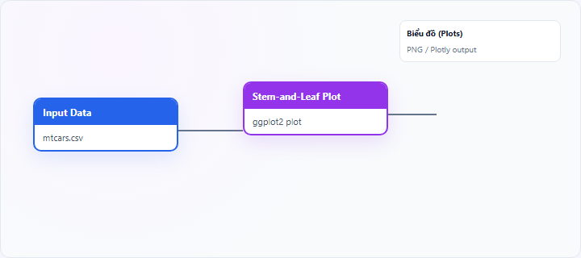
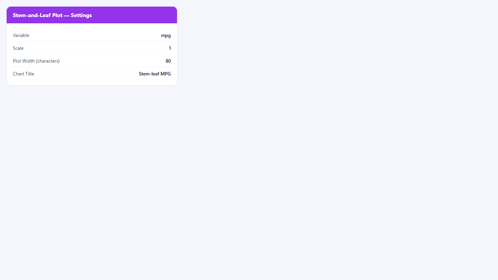
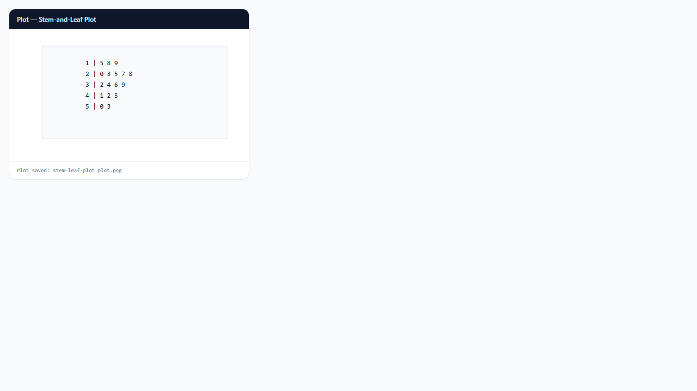

## 1. Biểu đồ thân-lá (Stem-and-Leaf Plot) là gì?

**Stem-and-leaf plot** (biểu đồ thân–lá) là biểu đồ văn bản/hình ảnh trong đó mỗi quan sát được tách thành **thân** (chữ số hàng đầu) và **lá** (chữ số cuối). Khác histogram, biểu đồ **giữ giá trị gốc** có thể đọc lại từng điểm, phù hợp mẫu **nhỏ đến trung bình**.

Node **Stem-and-Leaf Plot** trên StatNode render bằng **ggplot2** (tương thích WebR), với tham số `scale` (tỷ lệ thân) và `width` (độ rộng plot ký tự). **Không** hỗ trợ Interactive (Plotly).

## 2. Biểu đồ thân-lá (Stem-and-Leaf Plot) dùng để làm gì?

Stem-and-leaf trả lời:

- **Phân phối** và **vị trí cluster** khi cần thấy cả giá trị cụ thể?
- Có **outlier**, **giá trị lặp**, **khoảng trống**?

**Khi nên dùng:** $n$ từ ~10 đến vài trăm; giảng dạy thống kê; kiểm tra nhanh tay trước khi nhập liệu.

**Khi không nên dùng:** mẫu rất lớn (quá dài); cần so nhiều nhóm (dùng box/violin); báo cáo đẹp cho in ấn (dùng histogram).

**So sánh:** stem-leaf = histogram + bảng giá trị; **histogram** gọn hơn cho $n$ lớn.

## 3. Thực hành trên phần mềm StatNode

Workflow cơ bản: kéo node **Input Data** (hoặc nguồn dữ liệu khác) → nối cổng **Data** vào node **Stem-and-Leaf Plot** → chạy workflow → xem biểu đồ tại panel **Biểu đồ** (Plots).

**Dữ liệu minh họa:** `mtcars$mpg` (32 giá trị) hoặc subsample 20–40 quan sát.

**Cấu hình node:**

- **Variable**: `mpg`
- **Scale**: `1` (mặc định; tăng nếu cần gộp thân)
- **Plot Width (characters)**: `80`
- **Chart Title**: `Stem-leaf MPG`
Output hiển thị các hàng thân | lá trong panel Plots.

**Kết quả:**

## 4. Diễn giải kết quả

- **Hàng lá dài:** nhiều quan sát quanh mức thân đó — cluster.
- **Hàng thưa:** gap trong dữ liệu.
- **Lá đơn lẻ xa cụm:** outlier — đối chiếu với nguồn dữ liệu.
- **Đọc giá trị:** ghép thân + lá (theo scale) để suy ra số gần đúng (ví dụ thân 2, lá 3 → 23 nếu scale 1).
- **Scale > 1:** mỗi thân đại diện nhiều đơn vị — chú ý khi đọc.

**Sai lầm:** dùng stem-leaf cho panel 10.000 quan sát; nhầm scale khi đọc giá trị.

## 5. Tài liệu tham khảo

1. Tukey, J. W. (1977). *Exploratory Data Analysis*. Addison-Wesley.
2. Moore, D. S., McCabe, G. P., & Craig, B. A. (2017). *Introduction to the Practice of Statistics* (9th ed.). W. H. Freeman.
3. Wickham, H. (2016). *ggplot2* (2nd ed.). Springer.
4. R Documentation — base `stem()` (khái niệm cổ điển): https://stat.ethz.ch/R-manual/R-devel/library/graphics/html/stem.html

---

Ghi chú: Stem-leaf trên StatNode dùng renderer ggplot2 cho WebR; đọc scale và width khi in hoặc chụp màn hình báo cáo.