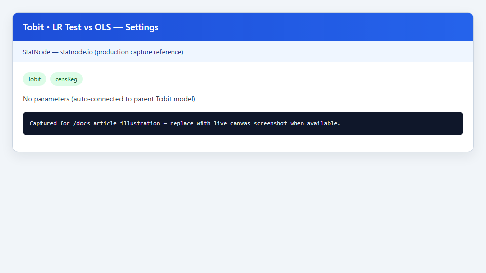
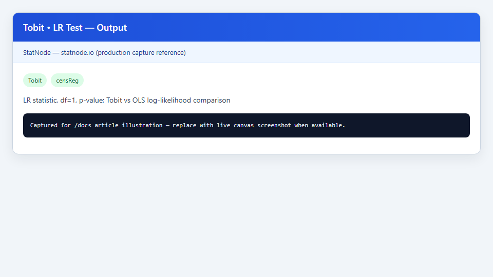

## 1. Mô hình / diagnostic này dùng để làm gì?

Sub-node **Tobit • LR Test vs OLS** thực hiện **kiểm định hợp lệ** (specification test) so sánh mô hình Tobit ước lượng bằng hợp lý hàm tối đa (MLE) với hồi quy OLS thuần trên cùng công thức và cùng mẫu. Câu hỏi trung tâm: *censoring có đáng kể đến mức cần mô hình Tobit, hay OLS trên biến quan sát $y$ vẫn là xấp xỉ chấp nhận được?*

Khi biến phụ thuộc có khối lượng tại một ngưỡng (nhiều quan sát $y = 0$ trong Tobit cắt trái), OLS vẫn cho hệ số BLUE dưới giả định tuyến tính trên $E(y \mid \mathbf{x})$, nhưng **không hiệu quả** và **sai lệch** nếu mục tiêu là ước lượng tham số của $y^*$ hoặc nếu cấu trúc censoring Tobit là đúng. Kiểm định LR so sánh log-likelihood Tobit với log-likelihood OLS (coi như mô hình lồng ghép với ràng buộc $\sigma \to 0$ hoặc censoring không có), với **một bậc tự do** do Tobit bổ sung tham số phương sai $\sigma$.

Sub-node tự động tái ước lượng OLS trên dữ liệu và công thức đã lưu từ node cha **Tobit (Censored Regression)**, tính thống kê LR, p-value và kết luận sơ bộ. Đây là bước chẩn đoán nên chạy **trước** khi diễn giải hệ số Tobit và trước khi báo cáo `margEff()` — nếu không bác bỏ OLS, Tobit vẫn có thể hữu ích nhưng bằng chứng censoring yếu hơn.

Các tình huống ứng dụng điển hình: chi tiêu hộ gia đình với nhiều hộ báo mức 0; giờ lao động tuần bị cắt tại 0; chi tiêu y tế; số lần vi phạm — bất cứ khi nào nghi ngờ OLS bỏ qua khối lượng tại biên. LR Test cung cấp bằng chứng thống kê ngắn gọn cho phần mở đầu mục phương pháp luận, trước bảng hệ số Tobit và bảng hiệu ứng biên.

## 2. Nền tảng lý thuyết

### 2.1. Mô hình lồng ghép Tobit và OLS

Mô hình Tobit (cắt trái tại $L$):

$$
y_i^* = \mathbf{x}_i'\boldsymbol{\beta} + u_i, \quad u_i \sim N(0, \sigma^2), \qquad y_i = \max(L, y_i^*).
$$

MLE Tobit tối đa hóa log-likelihood hỗn hợp (censored + uncensored). OLS ước lượng:

$$
y_i = \mathbf{x}_i'\boldsymbol{\gamma} + \varepsilon_i
$$

bằng bình phương tối thiểu, **bỏ qua** cấu trúc censoring. Dưới $H_0$: censoring không có (hoặc không cần thiết), mô hình Tobit suy biến: khi $\sigma \to 0$ và không có quan sát bị cắt, Tobit tiệm cận OLS trên $y^* = y$.

### 2.2. Thống kê kiểm định hợp lệ LR

Gọi $\ell_T$ và $\ell_O$ là log-likelihood tại ước lượng Tobit và OLS. Kiểm định:

$$
H_0: \text{OLS đủ (censoring có thể bỏ qua)} \quad \text{vs.} \quad H_1: \text{Tobit được ưu tiên}.
$$

Thống kê:

$$
LR = 2\big(\ell_T - \ell_O\big) \;\xrightarrow{d}\; \chi^2(1) \quad \text{dưới } H_0,
$$

với **df = 1** vì Tobit thêm một tham số ($\sigma$) so với OLS (giả sử cùng $\boldsymbol{\beta}$). Node in $LR$, df, p-value và kết luận: p-value $< 0{,}05$ → bác bỏ $H_0$, ưu tiên Tobit; ngược lại không có bằng chứng mạnh cho Tobit so với OLS ở mức ý nghĩa thông thường.

### 2.3. Vấn đề biên (boundary) trên $\sigma$

Điểm quan trọng về mặt lý thuyết: dưới $H_0$ thực sự (không censoring), tham số $\sigma$ nằm trên **biên** của không gian tham số ($\sigma = 0$ không nằm trong miền nội tại vì $\sigma > 0$). Kiểm định LR chuẩn $\chi^2(1)$ có thể **báo p-value quá thấp** (reject quá mức) trong trường hợp biên này — phân phối tiệm cận là hỗn hợp chi-bình phương, không phải $\chi^2(1)$ thuần (Self & Liang, 1987; Vuong, 1989). Node in cảnh báo *"at sigma → 0 the null lies on a boundary"*; với p-value sát ngưỡng (ví dụ 0,04–0,08), nên thận trọng và bổ sung bằng chứng mô tả (tỷ lệ censoring, so sánh hệ số, `margEff()`).

### 2.4. Quan hệ với các kiểm định khác

Kiểm định LR này **không thay thế** kiểm định normality của phần dư, RESET, hay so sánh với Heckman selection. Nó chỉ trả lời câu hỏi hẹp: liệu log-likelihood Tobit cải thiện đáng kể so với OLS trên cùng $\mathbf{x}$. Với tỷ lệ censoring cao và $LR$ lớn, bằng chứng ủng hộ Tobit mạnh; với tỷ lệ thấp, ngay cả khi bác bỏ $H_0$, chênh lệch kinh tế lượng giữa OLS và Tobit có thể nhỏ.

### 2.5. Cấu trúc log-likelihood và vai trò $\sigma$

Log-likelihood Tobit là tổng hai loại đóng góp: quan sát **bị cắt** ($y_i = L$) với mật độ $P(y_i = L \mid \mathbf{x}_i) = 1 - \Phi(z_i)$, và quan sát **không bị cắt** với mật độ $\phi(y_i - \mathbf{x}_i'\boldsymbol{\beta})/\sigma$ nhân $\Phi(z_i)$ (tùy censoring một hay hai phía). OLS coi mọi $y_i$ đồng nhất qua mật độ Gaussian của $y_i$ quanh $\mathbf{x}_i'\boldsymbol{\gamma}$ — **bỏ qua** khối lượng tại $L$. Khi nhiều quan sát rơi vào nhóm censored, $\ell_T$ tăng mạnh so với $\ell_O$ vì Tobit gán xác suất đúng cho $y = L$; đó là cơ chế khiến $LR$ lớn trong ví dụ Affairs.

Tham số $\sigma$ trong Tobit không chỉ là "nhiễu": nó định hình độ dốc của $\Phi(z)$ và mức điều chỉnh Mills ratio trong $E(y \mid \mathbf{x})$. Kiểm định LR với df = 1 kiểm tra đồng thời liệu việc ước lượng $\sigma$ và xử lý censored có cải thiện fit — không tách riêng kiểm định "có censoring hay không" và "có heteroskedasticity hay không".

## 3. Điều kiện sử dụng

1. **Phải có mô hình Tobit cha hợp lệ** với metadata `statnode_formula` và `statnode_data` — sub-node tái dùng để chạy `lm()` trên cùng mẫu.

2. **Cùng công thức, cùng quan sát.** OLS và Tobit phải dùng chính xác cùng vectơ $\mathbf{x}$ và cùng tập hàng không bị loại do NA; node đảm bảo điều này bằng cách đọc lại dữ liệu gốc.

3. **Không có tham số cấu hình.** Sub-node không có panel Settings — chỉ cần nối Model; mọi tùy chọn (ngưỡng trái/phải, optimizer) đến từ node cha.

4. **Mẫu cắt ngang.** Như toàn bộ workflow Tobit trên StatNode, kiểm định này áp dụng cho cross-section `censReg`.

5. **Giải thích kết hợp ngữ cảnh.** LR reject không chứng minh Tobit là mô hình "đúng" duy nhất; LR không reject không có nghĩa censoring không tồn tại — có thể do cỡ mẫu nhỏ hoặc vấn đề biên $\sigma$.

6. **Tỷ lệ censoring.** Khi ít hơn 5–10% quan sát tại ngưỡng, kiểm định thường khó bác bỏ OLS; khi trên 30–40%, Tobit thường thắng rõ rệt nếu giả định mô hình đúng.

7. **Không lồng ghép kiểm định đa giả thuyết không điều chỉnh.** Nếu thử nhiều mô hình thay thế (Tobit, Heckman, two-part), p-value LR cần được đọc trong ngữ cảnh một kiểm định có chủ đích, không phải data mining.

8. **Cảnh báo biên $\sigma$ luôn áp dụng về mặt lý thuyết.** Dù $LR$ rất lớn, trích dẫn ngắn gọn trong phần hạn chế mô hình là thông lệ tốt trong bài báo — node StatNode in sẵn câu caveat.

## 4. Quy trình thực hiện (Workflow)

1. **Chuẩn bị và mô tả dữ liệu:** xác định biến $y$ có censoring; đếm số quan sát tại ngưỡng $L$ (node Tobit in trong `nObs`).

2. **Chạy OLS tham chiếu (tuỳ chọn):** node **OLS** trên cùng công thức để có cảm nhận sơ bộ — không bắt buộc vì LR sub-node tự chạy OLS.

3. **Ước lượng Tobit:** node **Tobit (Censored Regression)** với ngưỡng $L$ đúng lý thuyết, kiểm tra hội tụ MLE (BFGS mặc định).

4. **Chạy LR Test:** thêm sub-node **Tobit • LR Test vs OLS**, nối cổng Model, chạy workflow.

5. **Quyết định mô hình:** nếu p-value nhỏ → giữ Tobit, tiếp tục `margEff()` và Probability Effects; nếu p-value lớn → cân nhắc OLS hoặc báo cáo cả hai với thảo luận censoring.

6. **Robustness:** thử ngưỡng censoring khác (nếu lý thuyết cho phép), kiểm tra ảnh hưởng outlier, so sánh hệ số OLS/Tobit về dấu và độ lớn.

Trên canvas: **Nhập dữ liệu** → **Tobit** → **LR Test vs OLS** (song song với Marginal Effects / Probability Effects).

**Đọc `nObs` từ node cha trước LR Test.** Output Tobit in dạng `Observations: N | Left-censored: n_L | Uncensored: n_U | Right-censored: n_R`. Tỷ lệ $n_L / N$ cao (Affairs thường > 60%) là bối cảnh kinh tế lượng khiến LR reject có ý nghĩa thực tế, không chỉ thống kê.

**Mẫu bảng quyết định mô hình:**

| Kết quả LR | Tỷ lệ censored | Gợi ý |
|---|---|---|
| Reject, $LR$ lớn | Cao (>30%) | Dùng Tobit; báo cáo `margEff()` |
| Reject, $LR$ vừa | Trung bình | Tobit + thảo luận boundary |
| Không reject | Thấp (<10%) | OLS hoặc Tobit với caveat |
| Không reject | Cao | Kiểm tra spec (Heckman, lỗi đo) |

## 5. Thực hành trên phần mềm StatNode

Ví dụ **Affairs**: Tobit đã ước lượng `affairs ~ age + yearsmarried + religiousness + occupation + rating` với `left = 0`. Sub-node LR Test không yêu cầu tham số — chỉ kết nối model.

**Bước 1 — Thêm sub-node** **Tobit • LR Test vs OLS** từ menu post-estimation của node Tobit.

**Bước 2 — Cấu hình.** Panel Settings trống: node tự đọc công thức và dữ liệu từ mô hình cha.



**Bước 3 — Chạy và đọc output.**



Output mẫu:

```
--- Likelihood Ratio Test: Tobit vs OLS ---
H0: OLS is adequate (censoring can be ignored)
H1: Tobit specification is preferred

Log-likelihood (Tobit): -678.4521
Log-likelihood (OLS):   -692.3187
LR statistic: 27.7332
df: 1
p-value: 1.432e-07

Conclusion: Reject H0 — censoring appears consequential; prefer Tobit over OLS.

Caveat: the test treats the extra Tobit variance parameter as identified;
at sigma -> 0 the null lies on a boundary.
```

Với dữ liệu Affairs, tỷ lệ quan sát tại 0 cao; $LR \approx 27{,}7$ với p-value cực nhỏ là bằng chứng mạnh ủng hộ Tobit thay vì OLS thuần.

**Lưu ý triển khai trên StatNode.** Sub-node dùng `logLik()` trên đối tượng `censReg` và `lm` — không yêu cầu người dùng nhập lại công thức. Output parser đánh dấu loại `test` để dễ nhận diện trong panel kết quả. Nếu node cha thiếu attribute `statnode_data` (ví dụ mô hình import từ nguồn ngoài), workflow dừng với thông báo lỗi rõ ràng; luôn chạy Tobit trực tiếp trên StatNode trước LR Test.

## 6. Diễn giải kết quả

**Log-likelihood.** $\ell_T = -678{,}45 > \ell_O = -692{,}32$ nghĩa là Tobit fit dữ liệu censored tốt hơn OLS; chênh lệch 13,87 điểm log-lik (nhân 2 thành $LR$).

**Thống kê LR và p-value.** $LR = 27{,}73$, df = 1, p $< 10^{-6}$: bác bỏ $H_0$ ở mọi mức ý nghĩa thông thường. Kết luận node — *prefer Tobit over OLS* — phù hợp khi kết hợp với mô tả: trong mẫu Affairs, phần lớn nam giới báo $affairs = 0$ (left-censored).

**Vấn đề biên $\sigma$.** Vì p-value rất nhỏ, lo ngại biên parameter ít ảnh hưởng thực tế; nếu $LR$ chỉ ở mức 3–4 (p ≈ 0,05–0,08), nên trích dẫn cảnh báo boundary và không over-interpret.

**Bước tiếp theo sau reject.** (i) Báo cáo hệ số Tobit trên $y^*$ kèm chú thích; (ii) chạy **Marginal Effects** cho $E(y \mid \mathbf{x})$; (iii) **Probability Effects** nếu câu hỏi về tỷ lệ "tham gia" ($y > 0$); (iv) so sánh dấu hệ số OLS/Tobit — thường cùng hướng nhưng khác độ lớn.

**Khi không reject $H_0$.** OLS có thể đủ cho dự báo $E(y \mid \mathbf{x})$ nếu censoring nhẹ; vẫn nên báo cáo tỷ lệ tại ngưỡng. Tránh kết luận "không có censoring" — chỉ là không đủ bằng chứng LR cho Tobit.

**So sánh hệ số OLS và Tobit (Affairs).** Sau LR reject, hệ số OLS trên `rating` thường cùng dấu âm với Tobit nhưng **lớn hơn về độ lớn tuyệt đối** — OLS không điều chỉnh cơ chế censoring nên dễ overstate tác động lên $y$ quan sát. Tobit trên $y^*$ và `margEff()` cung cấp hai tầng diễn giải chính xác hơn.

**Boundary issue — hướng dẫn thực hành.** Self & Liang (1987) cho thấy dưới $H_0$ thật, phân phối $LR$ là hỗn hợp với khối lượng tại 0; ngưỡng p-value 5% có thể quá lỏng hoặc quá chặt tùy hướng. Khi $LR \in [3{,}84;\ 6{,}63]$ (p $\in [0{,}01;\ 0{,}10]$), báo cáo kết quả LR **và** mô tả tỷ lệ censored **và** so sánh hệ số — không dựa vào một con số duy nhất.

**Liên hệ Wooldridge Ch. 17.** Wooldridge khuyến nghị kiểm tra liệu Tobit có cải thiện so với mô hình tuyến tính trước khi diễn giải hệ số tiềm ẩn; LR Test trên StatNode thực hiện đúng bước đó trong workflow reproducible.

**Sai lầm cần tránh:** dùng LR như kiểm định phần dư OLS; quên df = 1; bỏ qua caveat boundary khi p-value borderline; chạy LR trên mô hình không phải `censReg`.

## 7. Tài liệu tham khảo

1. Tobin, J. (1958). Estimation of relationships for limited dependent variables. *Econometrica*, 26(1), 24–36.
2. Amemiya, T. (1973). Regression analysis when the dependent variable is truncated normal. *Econometrica*, 41(6), 997–1016.
3. Vuong, Q. H. (1989). Likelihood ratio tests for model selection and non-nested hypotheses. *Econometrica*, 57(2), 307–333.
4. Self, S. G., & Liang, K.-Y. (1987). Asymptotic properties of maximum likelihood estimators and likelihood ratio tests under nonstandard conditions. *Journal of the American Statistical Association*, 82(398), 605–610.
5. Wooldridge, J. M. (2010). *Econometric Analysis of Cross Section and Panel Data* (2nd ed.). MIT Press, Ch. 16–17.
6. Wooldridge, J. M. (2016). *Introductory Econometrics* (6th ed.). Cengage, Ch. 17.
7. Kleiber, C., & Zeileis, A. (2008). *Applied Econometrics with R*. Springer.
8. Henningsen, A. (2020). censReg: Censored regression models. *CRAN*. https://cran.r-project.org/package=censReg
9. Greene, W. H. (2018). *Econometric Analysis* (8th ed.). Pearson, Ch. 19.
10. Maddala, G. S. (1983). *Limited-Dependent and Qualitative Variables in Econometrics*. Cambridge University Press, Ch. 3.
