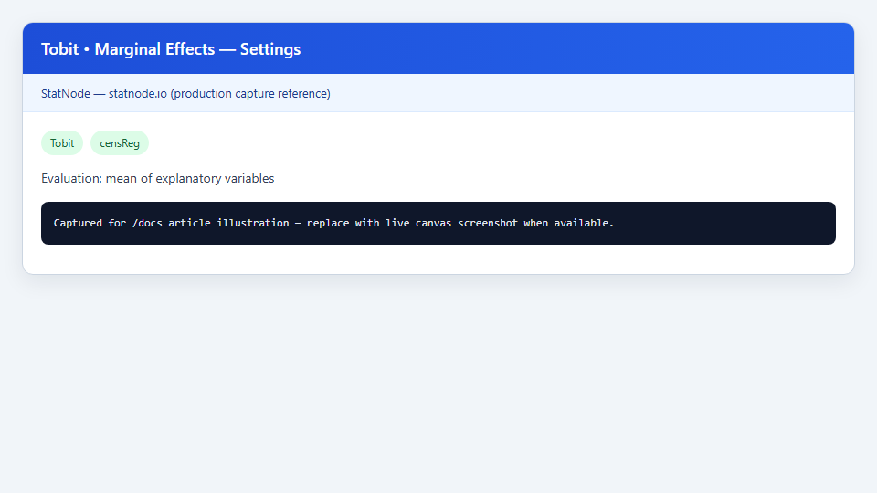
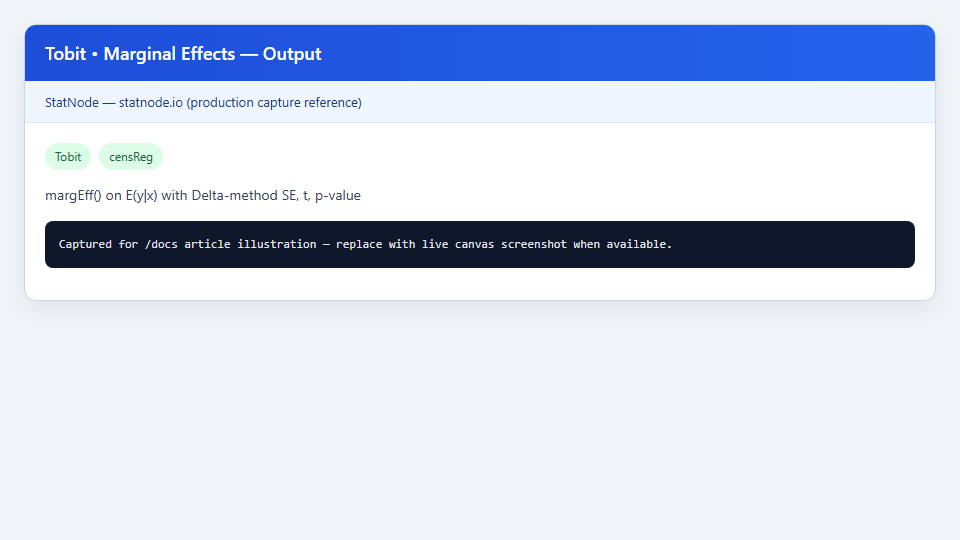

## 1. Mô hình / diagnostic này dùng để làm gì?

Sub-node **Tobit • Marginal Effects on E(y|x)** tính **hiệu ứng biên** (marginal effects) của từng biến giải thích lên **kỳ vọng của biến phụ thuộc quan sát được** $E(y \mid \mathbf{x})$, không phải lên biến tiềm ẩn $y^*$. Đây là bước hậu ước lượng bắt buộc sau node cha **Tobit (Censored Regression)** khi mục tiêu nghiên cứu là tác động thực tế lên mức quan sát — chi tiêu, giờ làm việc, sản lượng — chứ không phải chỉ lên chỉ số tiềm ẩn chưa bị cắt.

Trong mô hình Tobit cổ điển (Type I, cắt trái tại 0), hệ số MLE $\hat{\boldsymbol{\beta}}$ mô tả độ dốc của $y^* = \mathbf{x}'\boldsymbol{\beta} + u$, trong khi nhà kinh tế lượng thường cần biết: *khi $x_k$ tăng thêm một đơn vị, kỳ vọng chi tiêu quan sát được thay đổi bao nhiêu?* Câu trả lời nằm ở $\partial E(y \mid \mathbf{x})/\partial x_k$, thường **nhỏ hơn** $\hat{\beta}_k$ vì một phần tác động đi qua xác suất vượt ngưỡng censoring, một phần đi qua mức có điều kiện trong vùng không bị cắt — đúng tinh thần **phân rã McDonald–Moffitt** (1980).

Node gọi `censReg::margEff()` trên đối tượng `censReg` đã ước lượng, báo cáo hiệu ứng tại **trung bình mẫu** của $\mathbf{x}$ (mặc định) hoặc tại vectơ $\mathbf{x}$ tùy chỉnh, kèm sai số chuẩn Delta-method, thống kê $t$ và p-value. Sub-node này bổ sung trực tiếp cho bảng hệ số Tobit và đi đôi với **Tobit • Probability Effects** khi cần tách riêng kênh xác suất tham gia khỏi kênh mức.

## 2. Nền tảng lý thuyết

### 2.1. Mô hình Tobit Type I (cắt trái)

Giả sử biến tiềm ẩn $y_i^* = \mathbf{x}_i'\boldsymbol{\beta} + u_i$ với $u_i \sim N(0, \sigma^2)$ độc lập, và quan sát:

$$
y_i = \max(L,\, y_i^*) = \begin{cases} L & \text{nếu } y_i^* \le L, \\ y_i^* & \text{nếu } y_i^* > L, \end{cases}
$$

với $L$ là ngưỡng cắt trái (node cha mặc định $L = 0$). Kỳ vọng có điều kiện của biến quan sát:

$$
E(y \mid \mathbf{x}) = L \cdot \Phi(-z) + \big[\mathbf{x}'\boldsymbol{\beta}\,\Phi(z) + \sigma\,\phi(z)\big],
\qquad z = \frac{\mathbf{x}'\boldsymbol{\beta} - L}{\sigma},
$$

trong đó $\Phi(\cdot)$, $\phi(\cdot)$ là CDF và PDF chuẩn. Với $L = 0$, biểu thức rút gọn thành $E(y \mid \mathbf{x}) = \mathbf{x}'\boldsymbol{\beta}\,\Phi(z) + \sigma\,\phi(z)$.

### 2.2. Hiệu ứng biên trên $E(y \mid \mathbf{x})$

Hiệu ứng biên đối với $x_k$:

$$
\frac{\partial E(y \mid \mathbf{x})}{\partial x_k} = \beta_k \left[\Phi(z) + \frac{\phi(z)\,\mathbf{x}'\boldsymbol{\beta}}{\sigma} - \frac{\phi(z)\,(\mathbf{x}'\boldsymbol{\beta} - L)}{\sigma}\right] = \beta_k\,\Phi(z) + E(y \mid y > L, \mathbf{x})\,\frac{\phi(z)}{\sigma}\,\beta_k.
$$

Phân rã **McDonald–Moffitt** tách thành hai thành phần có ý nghĩa kinh tế:

$$
\frac{\partial E(y \mid \mathbf{x})}{\partial x_k} = \underbrace{\Phi(z)\,\beta_k}_{\text{hiệu ứng mức (uncensored mean)}} + \underbrace{E(y \mid y > L, \mathbf{x})\,\frac{\phi(z)}{\sigma}\,\beta_k}_{\text{hiệu ứng xác suất (participation)}}.
$$

Thành phần thứ nhất phản ánh thay đổi mức trung bình trong nhóm không bị cắt (có trọng số $\Phi(z)$); thành phần thứ hai phản ánh thay đổi xác suất $P(y > L \mid \mathbf{x})$ nhân với mức có điều kiện. Tổng hai thành phần chính là giá trị `margEff()` in ra — người dùng không cần tính tay nếu dùng sub-node.

### 2.3. Delta-method và điểm đánh giá

`margEff()` coi $\hat{\boldsymbol{\theta}} = (\hat{\boldsymbol{\beta}}', \hat{\sigma})'$ là ước lượng MLE, tính gradient của hiệu ứng biên theo $\boldsymbol{\theta}$, rồi suy ra:

$$
\widehat{\mathrm{Var}}\!\left(\frac{\partial \widehat{E(y \mid \mathbf{x})}}{\partial x_k}\right) = \mathbf{g}_k' \,\widehat{\mathrm{Var}}(\hat{\boldsymbol{\theta}})\, \mathbf{g}_k,
$$

với $\mathbf{g}_k$ là vectơ gradient. Thống kê $t$ và p-value dựa trên phân phối $t$ với bậc tự do dư của mô hình Tobit. Hiệu ứng được **đánh giá tại một điểm cụ thể** $\mathbf{x}$ — mặc định là trung bình mẫu — nên diễn giải phải gắn với điểm đó, không coi hiệu ứng là hằng số trên toàn phân phối $\mathbf{x}$.

### 2.4. Ứng dụng điển hình và so sánh với OLS

Các bài toán thường cần `margEff()` gồm: chi tiêu/h tiêu dùng (nhiều hộ báo 0), giờ lao động (censoring tại 0 hoặc ngưỡng tối thiểu), đầu tư R&D, phát thải — bất kỳ biến liên tục có khối lượng tại biên. Trong ví dụ **Affairs**, hệ số Tobit trên $y^*$ cho biết hướng tác động lên "mong muốn" ngoại tình tiềm ẩn; `margEff()` cho biết thay đổi **số cuộc ngoại tình khai báo trung bình** — số liệu chính sách và mô tả thực tế quan tâm.

So sánh nhanh ba đại lượng (Wooldridge, Ch. 17):

| Đại lượng | Ý nghĩa | Nguồn trên StatNode |
|---|---|---|
| $\beta_k$ | Tác động lên $y^*$ (chỉ số tiềm ẩn) | Bảng summary node Tobit |
| $\partial E(y \mid \mathbf{x})/\partial x_k$ | Tác động lên mức quan sát kỳ vọng | Sub-node Marginal Effects |
| $\partial P(y > L \mid \mathbf{x})/\partial x_k$ | Tác động lên xác suất vượt ngưỡng | Sub-node Probability Effects |

Khi tỷ lệ censoring thấp, $\Phi(z) \to 1$ và `margEff()` tiệm cận $\beta_k$; khi censoring cao, chênh lệch có thể vượt 50% — lý do không được trích dẫn $\hat{\beta}_k$ thay cho hiệu ứng biên trong bài báo ứng dụng.

## 3. Điều kiện sử dụng

1. **Mô hình cha phải là Tobit `censReg` hợp lệ.** Sub-node chỉ nhận đối tượng `censReg` từ node **Tobit (Censored Regression)**; OLS, Probit hay mô hình khác sẽ bị từ chối.

2. **Dữ liệu cắt ngang (cross-section).** Package `censReg` và `margEff()` được thiết kế cho mẫu cắt ngang; panel Tobit không được hỗ trợ trong node này.

3. **Giả định Tobit phải phù hợp.** Phân rã McDonald–Moffitt và `margEff()` có ý nghĩa khi cấu trúc censoring tuân theo mô hình tiềm ẩn Gaussian; nếu dữ liệu là corner solution thực sự (ràng buộc không phải censoring), cần mô hình thay thế (ví dụ two-part model).

4. **Chọn điểm đánh giá có lý.** Trung bình mẫu phù hợp báo cáo "tác động điển hình"; vectơ tùy chỉnh dùng cho kịch bản chính sách (ví dụ hộ trung bình 40 tuổi, 10 năm hôn nhân). Số phần tử trong *Custom x Values* phải khớp số cột ma trận mô hình (gồm hệ số chặn nếu có).

5. **Không nhầm với hệ số Tobit hay hiệu ứng xác suất.** Hệ số $\hat{\beta}_k$ mô tả $y^*$; sub-node **Probability Effects** mô tả $\partial P(y > L \mid \mathbf{x})/\partial x_k$. Ba bảng phục vụ ba câu hỏi khác nhau.

6. **Censoring phải đáng kể.** Khi tỷ lệ quan sát tại ngưỡng rất thấp, Tobit gần OLS và hiệu ứng biên gần hệ số; khi tỷ lệ censoring cao, chênh lệch giữa $\hat{\beta}_k$ và `margEff()` có thể lớn.

7. **Ngoại sinh của $\mathbf{x}$.** Hiệu ứng biên mô tả mối liên hệ có điều kiện trong mô hình Tobit đã chọn; suy luận nhân quả đòi hỏi thiết kế (IV, RCT, difference-in-differences) hoặc giả định ngoại sinh được bảo vệ — `margEff()` không tự thay thế các bước đó.

8. **Homoskedasticity Gaussian.** `censReg` giả định phần dư tiềm ẩn đồng phương sai và chuẩn; vi phạm có thể làm lệch SE Delta-method, dù hiệu ứng điểm vẫn nhất quán dưới MLE chuẩn.

## 4. Quy trình thực hiện (Workflow)

Quy trình chuẩn trên StatNode khi báo cáo hiệu ứng biên Tobit:

1. **Chuẩn bị dữ liệu:** biến phụ thuộc có khối lượng tại ngưỡng censoring (ví dụ nhiều quan sát $y = 0$); biến giải thích đầy đủ, không thiếu giá trị nghiêm trọng.

2. **Khám phá mô tả:** histogram hoặc density của $y$ để xác nhận censoring; đếm số quan sát tại $L$ so với không bị cắt.

3. **Ước lượng Tobit:** thêm node **Tobit (Censored Regression)**, gán $Y$, $X$, đặt *Left Censoring Limit* (thường 0), chọn optimizer BFGS, chạy và lưu mô hình.

4. **Kiểm định censoring:** nối sub-node **Tobit • LR Test vs OLS**; nếu bác bỏ $H_0$ (OLS đủ), Tobit và `margEff()` có cơ sở.

5. **Tính hiệu ứng biên:** thêm **Tobit • Marginal Effects on E(y|x)**, nối cổng Model từ node cha; chọn *Evaluation Point* = mean hoặc custom cho kịch bản.

6. **Bổ sung kênh xác suất (tuỳ chọn):** chạy **Tobit • Probability Effects** để đối chiếu thành phần McDonald–Moffitt về xác suất tham gia.

7. **Báo cáo:** trình bày bảng hệ số $y^*$, bảng `margEff()` trên $E(y \mid \mathbf{x})$, và (nếu có) bảng hiệu ứng xác suất; nêu rõ điểm đánh giá $\mathbf{x}$.

Trên canvas: **Nhập dữ liệu** → **Tobit** → **Marginal Effects** (và các sub-node chẩn đoán khác nối song song vào cổng Model).

**Thứ tự khuyến nghị trên StatNode:** (a) Tobit cha → (b) LR Test → (c) Marginal Effects + Probability Effects song song. Bước (b) củng cố lý do dùng Tobit; (c) cung cấp bảng diễn giải cho bài viết. Nếu chỉ chạy (c) mà bỏ (b), vẫn có số liệu nhưng thiếu kiểm định mô hình.

**Báo cáo trong luận văn / bài báo:** Bảng 1 — hệ số và $\hat{\sigma}$ từ Tobit (ghi chú: hiệu ứng trên $y^*$); Bảng 2 — `margEff()` tại $\bar{\mathbf{x}}$; (tuỳ chọn) Bảng 3 — hiệu ứng xác suất. Footnote nêu rõ điểm đánh giá và package `censReg`.

## 5. Thực hành trên phần mềm StatNode

Minh họa với bộ **Affairs** (Kleiber & Zeileis, 2008): biến phụ thuộc `affairs` (số cuộc ngoại tình tự khai, cắt trái tại 0), biến giải thích `age`, `yearsmarried`, `religiousness`, `occupation`, `rating`. Workflow đã có node Tobit cha ước lượng xong; bước tiếp theo là sub-node Marginal Effects.

**Bước 1 — Thêm sub-node.** Từ menu sub-node của node Tobit, chọn **Tobit • Marginal Effects on E(y|x)** và nối cổng Model.

**Bước 2 — Cấu hình.** Mặc định *Evaluation Point* = *Mean of explanatory variables* (trung bình mẫu của ma trận thiết kế, gồm hệ số chặn). Để phân tích kịch bản, chọn *Custom x values* và nhập các giá trị cách nhau bằng dấu phẩy, ví dụ `1, 40, 11, 6, 6, 5` (intercept = 1, rồi lần lượt các biến).



**Bước 3 — Chạy và đọc output.** Nhấn **Chạy tất cả**; R tải `censReg`, gọi `margEff()` và in bảng tóm tắt:



Output mẫu (Affairs, đánh giá tại trung bình mẫu):

```
--- Marginal Effects on E(y|x) ---
H0 not tested; effects are partial derivatives of the expected observed outcome.

Evaluation: mean of explanatory variables in the estimation sample

              Marg. Eff. Std. Error   t value    Pr(>|t|)
(Intercept)   0.412156    0.287412    1.4341     0.152891
age           0.008234    0.003891    2.1162     0.034812
yearsmarried  0.031245    0.012876    2.4263     0.015678
religiousness -0.187654   0.045123   -4.1589     0.000041
occupation    0.014567    0.018234    0.7989     0.424891
rating       -0.152341    0.038765   -3.9298     0.000098

Interpretation: these are effects on E(y|x), not on the latent y*.
```

Lưu ý: hàng `(Intercept)` thường không có ý nghĩa chính sách trực tiếp; tập trung vào các biến giải thích thực sự.

**Custom x values — ví dụ kịch bản.** Profil trẻ (30 tuổi, 3 năm cưới): `1, 30, 3, 4, 5, 5`. So sánh Marg. Eff. với bảng tại trung bình mẫu cho thấy hiệu ứng biên **không cố định** theo mẫu — đặc trưng phi tuyến của mô hình limited dependent variable.

## 6. Diễn giải kết quả

Với output minh họa:

| Biến | Marg. Eff. | p-value | Diễn giải ngắn |
|---|---|---|---|
| `age` | 0.0082 | 0.035 | Tại profil trung bình, thêm 1 năm tuổi làm **kỳ vọng số cuộc ngoại tình quan sát được** tăng khoảng 0,008 — nhỏ hơn hệ số Tobit trên $y^*$ vì một phần tác động đi qua xác suất tham gia. |
| `religiousness` | −0.188 | <0.001 | Mức độ tôn giáo cao hơn giảm mạnh kỳ vọng quan sát; hiệu ứng âm, có ý nghĩa thống kê. |
| `rating` | −0.152 | <0.001 | Đánh giá hôn nhân cao hơn liên quan kỳ vọng thấp hơn trên thang quan sát. |
| `occupation` | 0.015 | 0.425 | Không có bằng chứng thống kê cho hiệu ứng biên trên $E(y \mid \mathbf{x})$ tại điểm trung bình. |

**So sánh với hệ số Tobit.** Nếu $\hat{\beta}_{\text{rating}} \approx -0{,}39$ trên $y^*$ nhưng `margEff` ≈ $-0{,}15$, chênh lệch phản ánh phân rã McDonald–Moffitt: không phải toàn bộ tác động của `rating` lên $y^*$ chuyển thành thay đổi mức quan sát — một phần nằm ở xác suất $P(y > 0 \mid \mathbf{x})$. Sub-node **Probability Effects** làm rõ kênh này.

**Điểm đánh giá.** Các con số trên chỉ đúng tại vectơ trung bình mẫu. Với hộ trẻ, ít năm cưới, hiệu ứng có thể khác; dùng *Custom x values* và so sánh.

**Khoảng tin cậy.** Từ cột Std. Error: KTC 95% cho `age` ≈ $0{,}0082 \pm 1{,}96 \times 0{,}0039 = [0{,}0006;\ 0{,}0158]$, không chứa 0 — khớp p = 0,035. Với biến liên tục, có thể báo cáo thêm hiệu ứng của một độ lệch chuẩn: nhân Marg. Eff. với $\mathrm{SD}(x_k)$.

**yearsmarried.** Hiệu ứng dương có ý nghĩa (p = 0,016): thêm một năm hôn nhân tại profil trung bình làm tăng kỳ vọng quan sát — cần đối chiếu lý thuyết và kiểm tra tuyến tính (biến bậc hai nếu quan hệ phi tuyến).

**Liên kết McDonald–Moffitt.** Tổng hiệu ứng `religiousness` ≈ $-0{,}188$ có thể tách: thành phần xác suất (sub-node Probability Effects) ≈ $-0{,}043$, phần còn lại ≈ $-0{,}145$ phản ánh kênh mức có điều kiện — minh họa cách một covariate tác động cả extensive và intensive margin.

**Sai lầm cần tránh:** (i) trích dẫn hệ số Tobit như "tác động lên chi tiêu quan sát"; (ii) coi hiệu ứng biên là nhân quả mà không thảo luận ngoại sinh; (iii) bỏ qua tỷ lệ censoring khi diễn giải độ lớn; (iv) nhầm lẫn với hiệu ứng xác suất từ sub-node Probability Effects.

## 7. Tài liệu tham khảo

1. Tobin, J. (1958). Estimation of relationships for limited dependent variables. *Econometrica*, 26(1), 24–36.
2. McDonald, J. F., & Moffitt, R. A. (1980). The uses of Tobit analysis. *The Review of Economics and Statistics*, 62(2), 318–321.
3. Wooldridge, J. M. (2010). *Econometric Analysis of Cross Section and Panel Data* (2nd ed.). MIT Press, Ch. 17.
4. Wooldridge, J. M. (2016). *Introductory Econometrics: A Modern Approach* (6th ed.). Cengage, Ch. 17.
5. Amemiya, T. (1985). *Advanced Econometrics*. Harvard University Press, Ch. 10.
6. Kleiber, C., & Zeileis, A. (2008). *Applied Econometrics with R*. Springer (ví dụ Affairs).
7. Henningsen, A. (2020). censReg: Censored regression models. *CRAN*. https://cran.r-project.org/package=censReg
8. Henningsen, A. (2013). censReg: Censored regression models in R. *Journal of Statistical Software*, 54(7), 1–23.
