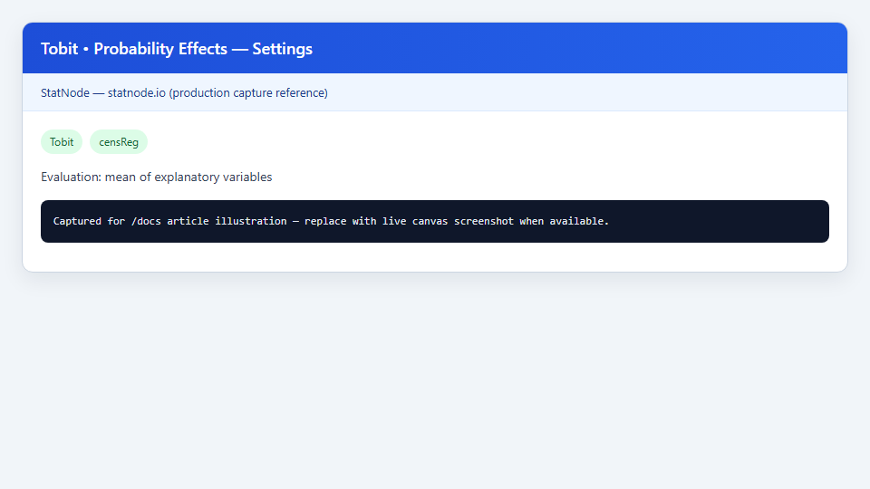
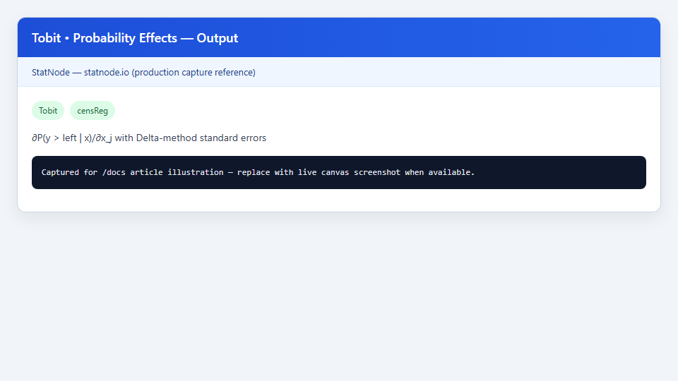

## 1. Mô hình / diagnostic này dùng để làm gì?

Sub-node **Tobit • Probability Effects** tính **hiệu ứng biên của covariate lên xác suất** $P(y > L \mid \mathbf{x})$, với $L$ là ngưỡng cắt trái của mô hình Tobit cha. Trong nhiều ứng dụng — lao động (xác suất tham gia thị trường lao động), tiêu dùng (xác suất chi tiêu dương), hành vi — câu hỏi chính sách không chỉ là *mức kỳ vọng* $E(y \mid \mathbf{x})$ mà còn là *khả năng vượt qua ngưỡng censoring*: liệu biến giải thích có làm tăng hay giảm tỷ lệ quan sát không bị cắt?

Hiệu ứng này là **thành phần xác suất** trong phân rã **McDonald–Moffitt** (1980) của $\partial E(y \mid \mathbf{x})/\partial x_k$. Sub-node **Tobit • Marginal Effects on E(y|x)** báo cáo tổng tác động lên kỳ vọng quan sát; sub-node Probability Effects làm rõ kênh riêng: $\partial P(y > L \mid \mathbf{x})/\partial x_k$. Khung lý thuyết và ví dụ số học tương ứng **Wooldridge, Chương 17** (*Limited Dependent Variable Models*).

Node triển khai đạo hàm theo công thức đóng form cho Tobit cắt trái, ước lượng sai số chuẩn bằng **Delta-method** từ ma trận hiệp phương sai MLE (`vcov(..., logSigma = TRUE)`), và in bảng Marg. Eff., Std. Error, $t$, p-value tại trung bình mẫu hoặc $\mathbf{x}$ tùy chỉnh.

## 2. Nền tảng lý thuyết

### 2.1. Xác suất không bị cắt trái

Với mô hình tiềm ẩn $y^* = \mathbf{x}'\boldsymbol{\beta} + u$, $u \sim N(0, \sigma^2)$, quan sát $y = \max(L, y^*)$:

$$
P(y > L \mid \mathbf{x}) = P(y^* > L \mid \mathbf{x}) = \Phi(z), \qquad z = \frac{\mathbf{x}'\boldsymbol{\beta} - L}{\sigma},
$$

với $\Phi$ là CDF chuẩn. Với $L = 0$ (Tobit cổ điển): $P(y > 0 \mid \mathbf{x}) = \Phi(\mathbf{x}'\boldsymbol{\beta}/\sigma)$ — dạng Probit trên chỉ số tiêu chuẩn hóa $z$.

### 2.2. Hiệu ứng biên trên xác suất

Đạo hàm theo $x_k$ (Wooldridge, 2010, Ch. 17):

$$
\frac{\partial P(y > L \mid \mathbf{x})}{\partial x_k} = \phi(z)\,\frac{\beta_k}{\sigma},
$$

trong đó $\phi$ là PDF chuẩn. Dấu hiệu ứng trùng dấu $\beta_k$; độ lớn phụ thuộc $\phi(z)$ — **lớn nhất khi $z \approx 0$** (xác suất tham gia khoảng 50%), nhỏ khi $z$ rất âm hoặc rất dương (vùng xác suất gần 0 hoặc 1, đạo hàm $\phi$ gần 0).

So sánh với hiệu ứng trên $E(y \mid \mathbf{x})$: thành phần xác suất trong McDonald–Moffitt có dạng $E(y \mid y > L, \mathbf{x}) \cdot \phi(z) \cdot \beta_k / \sigma$, trong đó $E(y \mid y > L, \mathbf{x}) = \mathbf{x}'\boldsymbol{\beta} + \sigma \lambda(z)$ với $\lambda(z) = \phi(z)/\Phi(z)$ (inverse Mills ratio). Sub-node Probability Effects báo trực tiếp $\phi(z)\beta_k/\sigma$ — phù hợp khi câu hỏi nghiên cứu là *extensive margin* (có/không vượt ngưỡng), không phải *intensive margin* (mức có điều kiện).

### 2.3. Delta-method

Gọi $\mathbf{m}(\boldsymbol{\theta}) = \phi(z(\boldsymbol{\theta}))\,\boldsymbol{\beta}/\sigma$ với $\boldsymbol{\theta} = (\boldsymbol{\beta}', \log\sigma)'$. Sai số chuẩn:

$$
\widehat{\mathrm{Var}}(m_k) = \mathbf{d}_k' \,\widehat{\mathrm{Var}}(\hat{\boldsymbol{\theta}})\, \mathbf{d}_k,
$$

$\mathbf{d}_k$ gradient số (finite difference) hoặc giải tích. Node dùng xấp xỉ số với $\varepsilon = 10^{-6}$ trên $\boldsymbol{\theta}$ đã ước lượng, nhất quán với cách triển khai StatNode. Thống kê $t$ và p-value dựa trên phân phối $t$ với df dư của Tobit.

### 2.4. Điểm đánh giá và đơn vị

Hiệu ứng $\partial P / \partial x_k$ đo **thay đổi xác suất** khi $x_k$ tăng một đơn vị, tại $\mathbf{x}$ cố định. Với biến liên tục (tuổi, thu nhập), có thể nhân với độ lệch chuẩn hoặc IQR để báo cáo "tác động của một độ lệch chuẩn". Với biến nhị phân, hiệu ứng là chênh lệch xác suất giữa $x_k = 1$ và $x_k = 0$ nếu đánh giá tại hai điểm — node mặc định dùng đạo hàm tại trung bình mẫu (xấp xỉ cục bộ).

### 2.5. Wooldridge (Ch. 17) và phân rã McDonald–Moffitt

Wooldridge trình bày mô hình biến phụ thuộc giới hạn (limited dependent variables) với nhấn mạnh: **cùng một bộ tham số** $(\boldsymbol{\beta}, \sigma)$ vừa xác định mức tiềm ẩn, vừa xác định xác suất vượt ngưỡng. Điều này khác với chạy Probit riêng cho $1\{y > L\}$ rồi OLS cho $y \mid y > L$ (two-part model) — Tobit **ràng buộc** cùng $\boldsymbol{\beta}$ cho cả hai margin.

Phân rã McDonald–Moffitt viết:

$$
\frac{\partial E(y \mid \mathbf{x})}{\partial x_k} = \Phi(z)\,\beta_k + E(y \mid y > L, \mathbf{x})\,\frac{\phi(z)}{\sigma}\,\beta_k,
$$

trong đó thành phần thứ hai chứa hệ số $\phi(z)\beta_k/\sigma$ — đúng đại lượng sub-node Probability Effects báo cáo, **nhân thêm** $E(y \mid y > L, \mathbf{x})$ khi ghép vào hiệu ứng trên $E(y \mid \mathbf{x})$. Do đó hiệu ứng xác suất thuần thường **nhỏ hơn** thành phần thứ hai trong phân rã đầy đủ, và nhỏ hơn nhiều so với tổng `margEff()` khi $E(y \mid y > L, \mathbf{x})$ lớn.

**Ví dụ Wooldridge-style (lao động):** Với giờ làm việc cắt tại 0, covariate giáo dục tác động (i) xác suất tham gia thị trường lao động và (ii) giờ làm việc có điều kiện trong nhóm làm việc. Probability Effects trả lời (i); `margEff()` trả lời tổng hợp (i)+(ii) trên quan sát trung bình.

## 3. Điều kiện sử dụng

1. **Mô hình Tobit cha `censReg` hợp lệ**, với ngưỡng trái $L$ được lưu (`statnode_left`). Hiệu ứng xác suất được định nghĩa đối với sự kiện $\{y > L\}$.

2. **Cross-section.** Như các sub-node Tobit khác trên StatNode; không kết hợp panel Tobit.

3. **Censoring có ý nghĩa kinh tế.** Khi gần như mọi quan sát đều $y > L$, $P(y > L \mid \mathbf{x}) \approx 1$ và hiệu ứng xác suất tiệm cận 0 — sub-node vẫn chạy nhưng giá trị thực tế thấp. Ngược lại, khi phần lớn quan sát tại $L$, kênh xác suất thường quan trọng.

4. **Không nhầm với Probit.** $P(y > 0 \mid \mathbf{x}) = \Phi(z)$ trông giống Probit nhưng $z$ phụ thuộc $\boldsymbol{\beta}$, $\sigma$ ước lượng đồng thời từ Tobit (cùng mô hình cho mức và xác suất), không phải mô hình Probit độc lập.

5. **Điểm đánh giá.** Số phần tử *Custom x Values* phải khớp ma trận thiết kế; thứ tự: intercept (nếu có), rồi các biến theo công thức.

6. **Bổ sung, không thay thế `margEff()`.** Báo cáo đầy đủ McDonald–Moffitt nên có cả $E(y \mid \mathbf{x})$ và $P(y > L \mid \mathbf{x})$ effects, cùng hệ số $y^*$ từ node cha.

7. **Đồng bộ với LR Test.** Chỉ đầu tư diễn giải probability effects khi Tobit đã được LR Test (hoặc lý thuyết) ủng hộ so với OLS; nếu không, cấu trúc xác suất Tobit có thể không phù hợp dữ liệu.

8. **Biến phi tuyến.** Hiệu ứng tại $\bar{\mathbf{x}}$ có thể không đại diện cho toàn bộ mẫu; với biến bậc hai hoặc tương tác, cần đánh giá tại nhiều điểm *Custom x*.

## 4. Quy trình thực hiện (Workflow)

1. **Mô tả dữ liệu:** tỷ lệ $y = L$ vs $y > L$; vẽ histogram biến phụ thuộc.

2. **Ước lượng Tobit** với ngưỡng $L$ đúng (thường 0).

3. **LR Test vs OLS** để xác nhận censoring có hệ quả thống kê.

4. **Marginal Effects on E(y|x)** cho tổng tác động lên mức kỳ vọng quan sát.

5. **Probability Effects** (sub-node này) cho kênh xác suất $P(y > L \mid \mathbf{x})$.

6. **Tổng hợp McDonald–Moffitt trong bài viết:** giải thích cách covariate tác động qua (a) thay đổi xác suất tham gia và (b) thay đổi mức có điều kiện — hai sub-node cung cấp (a) trực tiếp và tổng (a)+(b) qua `margEff()`.

7. **Kịch bản chính sách:** lặp lại bước 5 với *Custom x values* cho các profil hộ (trẻ/già, thu nhập thấp/cao).

Canvas: **Nhập dữ liệu** → **Tobit** → **Probability Effects** (cùng **Marginal Effects**, **LR Test**).

**Checklist McDonald–Moffitt hoàn chỉnh:**

| Bước | Sub-node | Câu hỏi trả lời |
|---|---|---|
| 1 | Tobit cha | Hướng tác động lên $y^*$? |
| 2 | LR Test | Censoring có cần Tobit? |
| 3 | Probability Effects | Covariate đổi xác suất $y > L$? |
| 4 | Marginal Effects | Tổng tác động lên $E(y \mid \mathbf{x})$? |

Trong phần thảo luận bài báo, một đoạn ngắn có thể viết: "Tác động của $x_k$ lên kỳ vọng quan sát phân rã thành kênh tham gia ($\partial P / \partial x_k$ từ Probability Effects) và kênh mức có điều kiện (phần còn lại của `margEff()`)."

## 5. Thực hành trên phần mềm StatNode

Ví dụ **Affairs**, Tobit `left = 0`: câu hỏi — *tuổi, mức độ tôn giáo, đánh giá hôn nhân có ảnh hưởng xác suất báo cáo ngoại tình dương ($y > 0$) không?*

**Bước 1 — Thêm sub-node** **Tobit • Probability Effects**, nối cổng Model.

**Bước 2 — Cấu hình.** *Evaluation Point* = *Mean of explanatory variables* (mặc định), hoặc *Custom x values* cho profil cụ thể.



**Bước 3 — Chạy output.**



Output mẫu:

```
--- Marginal Effects on Pr(y > left limit | x) ---
Left limit: 0
Evaluation x: 1.0000, 37.0620, 10.0980, 3.1160, 5.4680, 4.7560

              Marg. Eff. Std. Error   t value    Pr(>|t|)
(Intercept)   0.089234    0.056712    1.5734     0.116892
age           0.001876    0.000891    2.1055     0.035612
yearsmarried  0.007123    0.002945    2.4187     0.015834
religiousness -0.042765   0.010234   -4.1789     0.000038
occupation    0.003312    0.004123    0.8032     0.422156
rating       -0.034712    0.008765   -3.9603     0.000082

Interpretation: effect of each covariate on the probability of being above the left censoring threshold.
```

Dòng đầu in ngưỡng trái và vectơ $\mathbf{x}$ đánh giá (intercept = 1, rồi trung bình mẫu từng biến).

## 6. Diễn giải kết quả

**Đơn vị và ý nghĩa.** `Marg. Eff.` = $\partial P(y > 0 \mid \mathbf{x})/\partial x_k$ tại profil in trên. Ví dụ `age`: 0,00188 nghĩa là tại hộ "trung bình", thêm **một năm tuổi** liên quan tăng xác suất $y > 0$ khoảng **0,19 điểm phần trăm** (0,00188 × 100 ≈ 0,19 pp) — hiệu ứng dương, có ý nghĩa (p = 0,036).

**So sánh với `margEff()`.** `religiousness`: hiệu ứng xác suất ≈ −0,043 vs hiệu ứng trên $E(y \mid \mathbf{x})$ có thể ≈ −0,19 (lớn hơn nhiều). McDonald–Moffitt: tôn giáo vừa giảm khả năng tham gia (extensive margin), vừa giảm mức có điều kiện trong nhóm không bị cắt (intensive margin) — tổng phản ánh trong `margEff()`.

**Vị trí $\phi(z)$.** Tại trung bình mẫu Affairs, $P(y > 0 \mid \bar{\mathbf{x}})$ thường dưới 50%; $z$ âm vừa phải nên hiệu ứng xác suất chưa bị "nén" hoàn toàn. Nếu đánh giá tại profil với $z \ll 0$, hiệu ứng xác suất gần 0 dù $\beta_k$ lớn — cần thử *Custom x*.

**rating.** Hiệu ứng âm mạnh trên xác suất (p < 0,001): hôn nhân được đánh giá cao hơn liên quan **giảm** xác suất báo cáo ngoại tình dương — phù hợp lý thuyết, khác với diễn giải chỉ từ hệ số $y^*$.

**Không có ý nghĩa (`occupation`).** p = 0,42: không đủ bằng chứng cho tác động biên lên $P(y > 0 \mid \mathbf{x})$ tại điểm trung bình, dù hệ số Tobit trên $y^*$ có thể có ý nghĩa — minh họa tầm quan trọng báo cáo đúng loại hiệu ứng.

**yearsmarried.** Hiệu ứng dương trên xác suất (p = 0,016): thêm một năm hôn nhân tăng xác suất báo cáo ngoại tình dương khoảng 0,71 điểm phần trăm tại profil trung bình — cùng hướng với `margEff()` dương, cho thấy covariate tác động cả extensive margin.

**Tính $P(y > 0 \mid \bar{\mathbf{x}})$ tham chiếu.** Từ Tobit cha, $\hat{z} = \bar{\mathbf{x}}'\hat{\boldsymbol{\beta}}/\hat{\sigma}$; $\hat{P} = \Phi(\hat{z})$. Nếu $\hat{P} \approx 0{,}35$, profil trung bình nằm vùng $\phi(z)$ chưa quá nhỏ — hiệu ứng xác suất có thể phát hiện được. Nếu $\hat{P} < 0{,}05$, hiệu ứng xác suất thường rất nhỏ dù $\beta_k$ lớn.

**Bảng tổng hợp minh họa (Affairs, profil trung bình):**

| Biến | $\partial P / \partial x_k$ | $\partial E(y \mid \mathbf{x}) / \partial x_k$ | Ghi chú |
|---|---|---|---|
| `religiousness` | −0,043 | −0,188 | Cả hai margin âm, mạnh |
| `rating` | −0,035 | −0,152 | Hôn nhân tốt → ít ngoại tình hơn |
| `occupation` | 0,003 | 0,015 | Không ý nghĩa trên cả hai |

**Sai lầm cần tránh:** (i) diễn giải hiệu ứng xác suất như thay đổi $E(y \mid \mathbf{x})$; (ii) quên nêu điểm đánh giá $\mathbf{x}$; (iii) bỏ qua LR test rồi dùng Tobit khi OLS đủ; (iv) coi kết quả là nhân quả không thảo luận ngoại sinh.

## 7. Tài liệu tham khảo

1. McDonald, J. F., & Moffitt, R. A. (1980). The uses of Tobit analysis. *The Review of Economics and Statistics*, 62(2), 318–321.
2. Wooldridge, J. M. (2010). *Econometric Analysis of Cross Section and Panel Data* (2nd ed.). MIT Press, Ch. 17.
3. Wooldridge, J. M. (2016). *Introductory Econometrics: A Modern Approach* (6th ed.). Cengage, Ch. 17.
4. Tobin, J. (1958). Estimation of relationships for limited dependent variables. *Econometrica*, 26(1), 24–36.
5. Amemiya, T. (1985). *Advanced Econometrics*. Harvard University Press, Ch. 10.
6. Maddala, G. S. (1983). *Limited-Dependent and Qualitative Variables in Econometrics*. Cambridge University Press, Ch. 3.
7. Kleiber, C., & Zeileis, A. (2008). *Applied Econometrics with R*. Springer (Affairs).
8. Henningsen, A. (2013). censReg: Censored regression models in R. *Journal of Statistical Software*, 54(7), 1–23.
9. Cragg, J. G. (1971). Some statistical models for limited dependent variables with application to the demand for durable goods. *Econometrica*, 39(5), 829–844.
10. Greene, W. H. (2018). *Econometric Analysis* (8th ed.). Pearson, Ch. 19.
