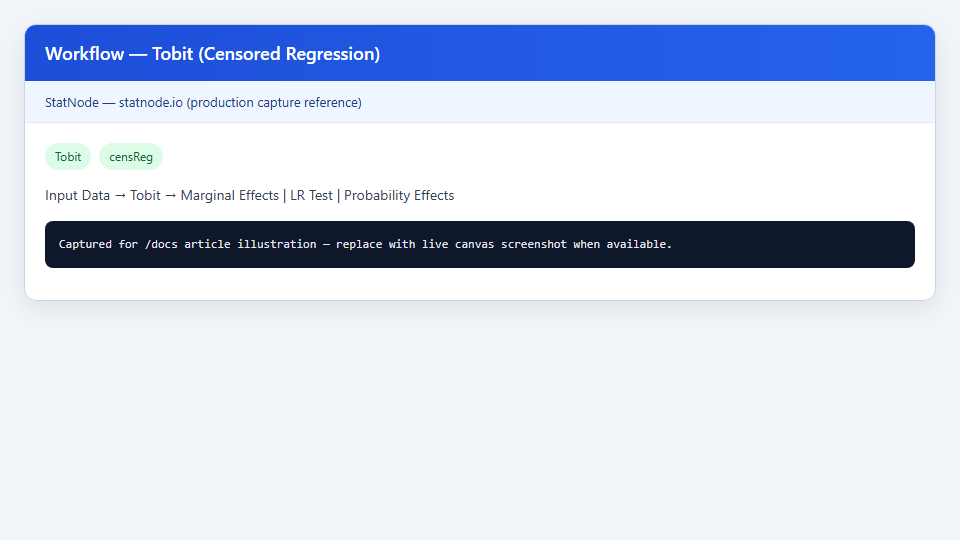
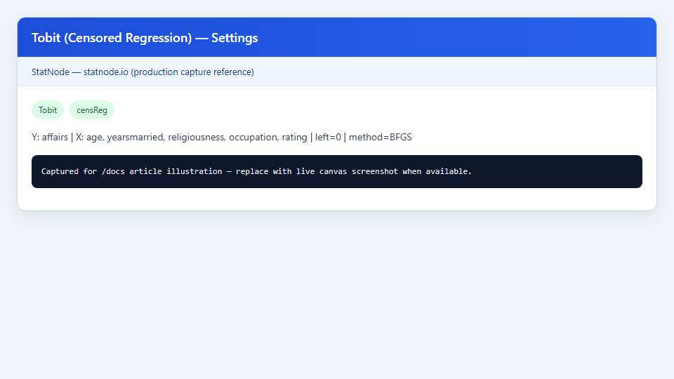
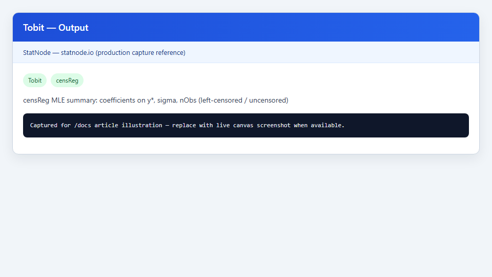

## 1. Mô hình này dùng để làm gì?

Node **Tobit (Censored Regression)** ước lượng hồi quy kiểm duyệt (censored regression) bằng hợp lý cực đại cho các biến phụ thuộc bị giới hạn tại một hoặc hai ngưỡng. Node được xây dựng trên package `censReg` của R (Henningsen, 2010) và chạy trong trình duyệt qua webR trên StatNode.

Mô hình Tobit (Tobin, 1958) giải quyết tình huống phổ biến trong kinh tế lượng: biến phụ thuộc quan sát được không phải là biến tiềm ẩn thực sự mà là phiên bản *bị cắt* (censored) của nó. Ví dụ điển hình:

- **Chi tiêu hoặc giờ lao động bằng 0:** nhiều hộ không chi tiêu cho một mặt hàng hoặc không tham gia thị trường lao động; giá trị 0 phản ánh quyết định tại ngưỡng chứ không phải mức tiêu dùng/lao động thực tế bằng đúng 0.
- **Số lần ngoại tình trong năm** (Fair, 1978; Kleiber & Zeileis, 2008): một tỷ lệ lớn quan sát báo cáo 0, trong khi các quan sát dương phản ánh cường độ thực tế trên biến tiềm ẩn.
- **Thu nhập, tài sản, thời gian chăm sóc sức khỏe** khi có khối lượng tại ngưỡng dưới hoặc trên.

Khác với OLS, Tobit nhận diện rằng các quan sát tại ngưỡng kiểm duyệt mang thông tin khác với các quan sát không bị cắt: phần dư tại ngưỡng không tuân theo phân phối chuẩn đầy đủ mà được xác định bởi xác suất *rơi vào vùng kiểm duyệt*. Do đó, chạy OLS trên toàn bộ mẫu — kể cả các quan sát bằng 0 — thường **chệch** và **mất hiệu quả** (Amemiya, 1973; Greene, 2012).

Node Tobit trên StatNode hỗ trợ kiểm duyệt trái (mặc định `left = 0`), kiểm duyệt phải tùy chọn (Tobit hai ngưỡng), và ba sub-node hậu ước lượng: **Marginal Effects**, **LR Test vs OLS**, **Probability Effects**.

## 2. Nền tảng lý thuyết

### 2.1. Biến tiềm ẩn và biến quan sát

Giả sử tồn tại biến tiềm ẩn (latent variable) $y_i^*$:

$$
y_i^* = \mathbf{x}_i' \boldsymbol{\beta} + \varepsilon_i, \qquad \varepsilon_i \sim N(0, \sigma^2),
$$

với $\mathbf{x}_i$ gồm hằng số và các biến giải thích. Biến quan sát $y_i$ liên hệ với $y_i^*$ qua quy tắc kiểm duyệt. Với **kiểm duyệt trái** tại $L$ (Tobit cổ điển, $L = 0$):

$$
y_i = \begin{cases}
L & \text{nếu } y_i^* \leq L, \\
y_i^* & \text{nếu } y_i^* > L.
\end{cases}
$$

**Tobit hai ngưỡng** thêm cận trên $U$:

$$
y_i = \begin{cases}
L & \text{nếu } y_i^* \leq L, \\
y_i^* & \text{nếu } L < y_i^* < U, \\
U & \text{nếu } y_i^* \geq U.
\end{cases}
$$

Điểm then chốt: hệ số $\boldsymbol{\beta}$ mô tả tác động lên $y^*$, **không** trực tiếp lên $E(y \mid \mathbf{x})$ — sự khác biệt này là nguồn gốc của nhiều sai lầm diễn giải (McDonald & Moffitt, 1980).

### 2.2. Hàm hợp lý và ước lượng MLE

Với kiểm duyệt trái tại $L$, xác suất một quan sát bị kiểm duyệt là $\Phi\!\left(\frac{L - \mathbf{x}_i'\boldsymbol{\beta}}{\sigma}\right)$, còn mật độ của quan sát không bị cắt là $\frac{1}{\sigma}\phi\!\left(\frac{y_i - \mathbf{x}_i'\boldsymbol{\beta}}{\sigma}\right)$. Log-hàm hợp lý:

$$
\ell(\boldsymbol{\beta}, \sigma) = \sum_{i: y_i = L} \ln \Phi\!\left(\frac{L - \mathbf{x}_i'\boldsymbol{\beta}}{\sigma}\right) + \sum_{i: y_i > L} \left[ -\ln\sigma + \ln\phi\!\left(\frac{y_i - \mathbf{x}_i'\boldsymbol{\beta}}{\sigma}\right) \right].
$$

Package `censReg` tối đa hóa $\ell$ bằng `maxLik` với các thuật toán số (BFGS, Newton-Raphson, Nelder-Mead). Sai số chuẩn của $\hat{\boldsymbol{\beta}}$ và $\hat{\sigma}$ suy ra từ ma trận thông tin Fisher ước lượng (observed information).

### 2.3. Phân rã hiệu ứng (McDonald & Moffitt, 1980)

Tổng đạo hàm của $E(y \mid \mathbf{x})$ theo $x_j$ gồm ba thành phần:

1. **Hiệu ứng biên trên $y^*$** — hệ số Tobit $\beta_j$.
2. **Hiệu ứng xác suất** — thay đổi xác suất thoát khỏi vùng kiểm duyệt.
3. **Hiệu ứng cường độ** — thay đổi mức $y^*$ trong vùng không bị cắt.

Sub-node **Marginal Effects** trên StatNode tính $\partial E(y \mid \mathbf{x}) / \partial x_j$ bằng `censReg::margEff()` với phương pháp Delta; sub-node **Probability Effects** tính hiệu ứng lên xác suất $P(y = L \mid \mathbf{x})$.

## 3. Điều kiện sử dụng

Áp dụng Tobit có ý nghĩa khi các điều kiện sau được (ít nhất) xem xét cẩn thận:

1. **Cơ chế kiểm duyệt phù hợp.** Giả định chuẩn: quyết định tại ngưỡng và biến tiềm ẩn cùng được mô hình hóa bởi một phương trình với cùng $\boldsymbol{\beta}$ (mô hình Tobit Type I). Nếu $y = 0$ do *truncation* thực sự (chỉ quan sát $y^* > 0$) hoặc do *sample selection* (Heckman), cần mô hình khác.

2. **Phân phối chuẩn của phần dư.** MLE Tobit nhạy cảm với sai lệch phân phối nặng hơn OLS; nên kiểm tra robustness hoặc cân nhắc các mô hình semi-parametric (Powell, 1984) khi phần dư lệch nhiều.

3. **Tỷ lệ kiểm duyệt đủ lớn.** Nếu gần như không có quan sát tại ngưỡng, kiểm định LR so với OLS (sub-node tương ứng) thường không bác bỏ OLS; Tobit ít lợi thế. Ngược lại, khi $> 30$–$40\%$ mẫu bị kiểm duyệt, OLS gần như chắc chắn chệch.

4. **Tính ngoại sinh của biến giải thích.** Như mọi mô hình cắt ngang, $\mathbf{x}_i$ cần ngoại sinh điều kiện; biến đồng thời hoặc biến bị bỏ sót tương quan với $\varepsilon_i$ gây chệch.

5. **Không đa cộng tuyến hoàn hảo** giữa các biến giải thích; ma trận $\sum_i \mathbf{x}_i \mathbf{x}_i'$ phải khả nghịch.

6. **Dữ liệu cắt ngang.** Node hiện tại chỉ hỗ trợ cross-section; dữ liệu panel với kiểm duyệt cần mô hình panel Tobit chuyên biệt (Wooldridge, 2010, Ch. 17).

7. **Chọn ngưỡng đúng.** `left = 0` cho chi tiêu/giờ lao động; với dữ liệu Affairs hai ngưỡng, bật kiểm duyệt phải với `right = 4` (Kleiber & Zeileis, 2008).

## 4. Quy trình thực hiện (Workflow)

Quy trình phân tích Tobit trên StatNode gồm bảy bước:

1. **Khám phá biến phụ thuộc:** histogram hoặc biểu đồ tần suất để xác nhận khối lượng tại ngưỡng kiểm duyệt (ví dụ spike tại 0).

2. **Chuẩn bị dữ liệu:** mỗi quan sát một dòng; biến phụ thuộc số; biến giải thích không thiếu hoặc đã impute có lý do. Tải CSV qua node **Nhập dữ liệu**.

3. **Chạy OLS tham chiếu (tùy chọn):** hồi quy tuyến tính thuần trên cùng công thức để so sánh — sub-node **LR Test vs OLS** tự động thực hiện bước này sau khi ước lượng Tobit.

4. **Cấu hình Tobit:** chọn biến phụ thuộc, biến giải thích, `left` (mặc định 0), bật `right` nếu cần Tobit hai ngưỡng, chọn thuật toán tối ưu (BFGS khuyến nghị).

5. **Ước lượng MLE:** chạy node; kiểm tra số quan sát kiểm duyệt/trái/phải/không bị cắt trong output và log-likelihood.

6. **Kiểm định và hiệu ứng hậu ước lượng:** nối sub-node **LR Test** (kiểm duyệt có quan trọng không?), **Marginal Effects** (tác động lên $E(y \mid \mathbf{x})$), **Probability Effects** (tác động lên $P(y = L \mid \mathbf{x})$).

7. **Diễn giải và kiểm tra độ bền:** báo cáo hệ số trên $y^*$, hiệu ứng biên trên $y$ quan sát, thử đổi thuật toán tối ưu hoặc loại biến nghi ngờ.

## 5. Thực hành trên phần mềm StatNode

Minh họa với tệp mẫu `public/samples/tobit-affairs-sample.csv` ($n = 120$): biến phụ thuộc `affairs` (số cuộc ngoại tình tự báo cáo trong năm), biến giải thích `age`, `yearsmarried`, `religiousness`, `occupation`, `rating`. Mô hình: `affairs ~ age + yearsmarried + religiousness + occupation + rating`, kiểm duyệt trái tại `left = 0`.

**Bước 1 — Dựng workflow.** Thêm node **Nhập dữ liệu** và node **Tobit (Censored Regression)** (nhóm Ước lượng → Cross-section), nối cổng dữ liệu. Có thể gắn thêm các sub-node hậu ước lượng vào cổng Model:



**Bước 2 — Cấu hình node.** Gán `affairs` vào **Biến phụ thuộc (Y)**; các biến còn lại vào **Biến độc lập (X)**. Giữ **Left Censoring Limit** = 0; tắt **Right Censoring** cho Tobit một ngưỡng. **Optimization Method**: BFGS.



**Bước 3 — Chạy và đọc output.** Nhấn **Chạy tất cả**. webR cài `censReg`, ước lượng MLE và in bảng tóm tắt:



Ví dụ đầu ra `summary()` từ `censReg` trên tệp mẫu (định dạng R):

```r
> library(censReg)
> df <- read.csv("tobit-affairs-sample.csv")
> model <- censReg(
+   affairs ~ age + yearsmarried + religiousness + occupation + rating,
+   left = 0, right = Inf, data = df, method = "BFGS"
+ )
> summary(model)

Call:
censReg(formula = affairs ~ age + yearsmarried + religiousness +
    occupation + rating, left = 0, right = Inf, data = df, method = "BFGS")

Observations:
           Total Left-censored     Uncensored Right-censored
             120            79             41              0

Coefficients:
                Estimate Std. Error t value Pr(>|t|)
(Intercept)     -4.57918    1.07157  -4.273 2.06e-05 ***
age              0.07366    0.01820   4.048 5.44e-05 ***
yearsmarried    -0.15255    0.02989  -5.104 3.52e-07 ***
religiousness   -0.20663    0.10550  -1.959 5.02e-02 .
occupation       0.31785    0.08564   3.711 2.09e-04 ***
rating           0.57464    0.12153   4.728 2.31e-06 ***
log(Sigma)       0.30604    0.12271   2.494 1.27e-02 *
Sigma            1.35804

Maximum Likelihood estimation
Number of observations: 120
Log-Likelihood: -99.30
```

Lưu ý cuối output: hệ số mô tả biến tiềm ẩn $y^*$; dùng sub-node **Marginal Effects** cho $E(y \mid \mathbf{x})$.

## 6. Diễn giải kết quả

**Hệ số trên $y^*$.** $\hat{\beta}_{\text{age}} = 0.074$ cho thấy tuổi cao hơn 1 năm liên quan với mức tiềm ẩn `affairs` tăng khoảng 0.074 đơn vị, *giữ các biến khác cố định* — nhưng đây **không** phải thay đổi kỳ vọng số cuộc ngoại tình quan sát được. Diễn giải chính sách hoặc hành vi phải dựa trên hiệu ứng biên từ sub-node **Marginal Effects**.

**Kiểm duyệt trái.** Trong mẫu, 79/120 quan sát ($65{,}8\%$) bị kiểm duyệt tại 0. Tỷ lệ cao này củng cố lý do dùng Tobit thay vì OLS; sub-node **LR Test vs OLS** kiểm định giả thuyết $H_0$: OLS đủ so với Tobit.

**Ý nghĩa thống kê.** `yearsmarried` âm và có ý nghĩa ($p < 0.001$): trên $y^*$, mỗi năm hôn nhân thêm làm giảm cường độ tiềm ẩn. `religiousness` âm ở mức ý nghĩa 10% ($p = 0.050$). `occupation` và `rating` dương và có ý nghĩa trong mẫu con này — cần đối chiếu với lý thuyết và kiểm tra độ bền trên toàn bộ dữ liệu gốc Fair (1978, $n = 601$).

**$\hat{\sigma} = 1.358$.** Độ lệch chuẩn của phần dư trên $y^*$; xuất hiện trong cả mật độ quan sát không bị cắt lẫn xác suất kiểm duyệt, nên không tách rời khỏi hệ số khi đánh giá mô hình.

**Log-Likelihood = $-99.30$.** So sánh với log-likelihood OLS qua sub-node LR Test; chênh lệch đáng kể (với $p < 0.05$) cho thấy bỏ qua kiểm duyệt làm hại fit.

**Sai lầm cần tránh:** (i) diễn giải hệ số Tobit như OLS trên $y$; (ii) loại bỏ các quan sát bằng 0 rồi chạy OLS — tương đương truncation, không phải Tobit; (iii) bỏ qua kiểm định LR khi tỷ lệ kiểm duyệt thấp; (iv) quên rằng tại biên tham số ($\sigma \to 0$) kiểm định LR có thể không tuân $\chi^2$ chuẩn.

## 7. Tài liệu tham khảo

1. Tobin, J. (1958). Estimation of relationships for limited dependent variables. *Econometrica*, 26(1), 24–36.
2. Amemiya, T. (1973). Regression analysis when the dependent variable is truncated normal. *Econometrica*, 41(6), 997–1016.
3. Amemiya, T. (1985). Advanced econometrics. Harvard University Press.
4. McDonald, J. F., & Moffitt, R. A. (1980). The uses of Tobit analysis. *The Review of Economics and Statistics*, 62(2), 318–321.
5. Greene, W. H. (2012). *Econometric Analysis* (7th ed.). Pearson (Ch. 19).
6. Wooldridge, J. M. (2010). *Econometric Analysis of Cross Section and Panel Data* (2nd ed.). MIT Press (Ch. 16–17).
7. Kleiber, C., & Zeileis, A. (2008). *Applied Econometrics with R*. Springer (Ch. 5; ví dụ Affairs).
8. Fair, R. C. (1978). A theory of extramarital affairs. *Journal of Political Economy*, 86(1), 45–61.
9. Powell, J. L. (1984). Least absolute deviations estimation for the censored regression model. *Econometrica*, 52(6), 1437–1451.
10. Henningsen, A. (2010). censReg: Censored regression models. *R package*. https://cran.r-project.org/package=censReg
11. Henningsen, A., & Suwardi, D. (2012). The influence of the financial crisis on the relation between dividend policy and the profitability of firms. *Journal of Applied Statistics*, 39(9), 1933–1947.
