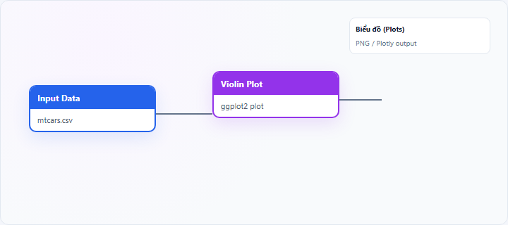

## 1. Biểu đồ violin (Violin Plot) là gì?

**Violin plot** kết hợp **đường mật độ ước lượng** (kernel density, mirrored) với **box plot nhỏ** nhúng bên trong. Chiều rộng violin tại mỗi mức giá trị phản ánh **mật độ quan sát** — rộng = nhiều dữ liệu tại mức đó.

Node **Violin Plot** trên StatNode dùng **ggplot2** `geom_violin` (và thành phần boxplot tùy template).

## 2. Biểu đồ violin (Violin Plot) dùng để làm gì?

Violin plot trả lời:

- **Hình dạng phân phối** trong từng nhóm (đơn đỉnh, đa đỉnh)?
- **Vị trí** và **độ phân tán** so với nhóm khác?

**Khi nên dùng:** so sánh phân phối giữa nhóm khi cần cả **tóm tắt** và **hình dạng**.

**Khi không nên dùng:** cỡ mẫu nhóm rất nhỏ ($n < 10$–$15$) — đường mật độ nhiễu; chỉ cần median/IQR (dùng box plot).

**So sánh:** violin ⊃ box về thông tin hình dạng; **density plot** không có box nhúng nhưng có thể overlay nhiều đường.

## 3. Thực hành trên phần mềm StatNode

Workflow cơ bản: kéo node **Input Data** (hoặc nguồn dữ liệu khác) → nối cổng **Data** vào node **Violin Plot** → chạy workflow → xem biểu đồ tại panel **Biểu đồ** (Plots).

**Dữ liệu minh họa:** `mtcars`: `mpg` theo `cyl`.

**Cấu hình node:**

- **Numeric Variable**: `mpg`
- **Group Variable (optional)**: `cyl`
- **Chart Title**: `Phân phối MPG theo xi-lanh`

**Kết quả:**

## 4. Diễn giải kết quả

- **Phần violin rộng:** giá trị phổ biến tại mức đó.
- **Hai đỉnh trên một violin:** bimodal trong nhóm — có thể tiểu nhóm ẩn.
- **Box nhúng:** median và IQR — đối chiếu với chiều rộng violin.
- **Violin mỏng/flat:** ít dữ liệu hoặc nhóm nhỏ — thận trọng khi kết luận.
- **So sánh nhóm:** lệch vị trí (location) và hình dạng (shape).

**Sai lầm:** diễn giải chi tiết đỉnh phụ với $n$ nhỏ; quên violin cần đủ quan sát để ước lượng KDE ổn định.

## 5. Tài liệu tham khảo

1. Hintze, J. L., & Nelson, R. D. (1998). Violin plots: A box plot-density trace synergism. *The American Statistician*, 52(2), 181–184.
2. Wilke, C. O. (2019). *Fundamentals of Data Visualization*. https://clauswilke.com/dataviz/
3. Wickham, H. (2016). *ggplot2* (2nd ed.). Springer.
4. R Documentation — `geom_violin()`: https://ggplot2.tidyverse.org/reference/geom_violin.html

---

Ghi chú: Với nhóm < 15 quan sát, ưu tiên box plot hoặc jittered points kèm violin để tránh over-interpret KDE.